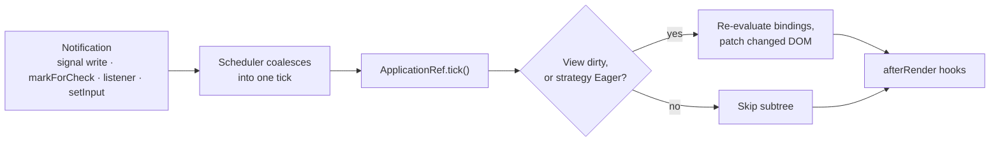

## Explanation

Change detection is the part of Angular that keeps the rendered DOM consistent with component state. Every component instance owns a *view*: its compiled template plus a record of the value last rendered for each binding. A change detection run walks the component tree from the root, re-evaluates the bindings of every view that needs checking and patches only the DOM nodes whose bound values differ from last time. Unlike React, which diffs a virtual DOM, Angular compares binding values and touches nothing else.

Two questions decide the cost of this loop: *when* a run starts (scheduling) and *which* views it checks (strategy).

**Scheduling: Zone.js versus zoneless.** Through Angular 20 the default scheduler was Zone.js, a library that monkey-patches asynchronous browser APIs (timers, promises, DOM event listeners, `XMLHttpRequest`, `fetch`) so that Angular's `NgZone` learns when any async task finishes and can run `ApplicationRef.tick()`. It is thorough but blind: a chart library's `requestAnimationFrame` loop or a polling `setInterval` triggers a full run although no bound value changed (*zone pollution*), and the remedy is `NgZone.runOutsideAngular()`. Zoneless change detection removes the patching, so Angular schedules a run only when the application notifies it: a [signal](angular-signals.md) read by a template is written, `ChangeDetectorRef.markForCheck()` is called (the `AsyncPipe` does this for you), a template or host event listener fires, `ComponentRef.setInput()` is called, or a view that one of these marked dirty is attached. Zoneless was experimental in v18, a developer preview in v20, stable in v20.2 and, since v21, `ng new` generates an application without `zone.js` at all. `provideZonelessChangeDetection()` is the explicit opt-in (needed on v20) and `provideZoneChangeDetection()` keeps the old behaviour for applications that still rely on it.

**Strategy: OnPush versus Eager.** `ChangeDetectionStrategy.OnPush` tells Angular that a component's subtree needs checking only when one of its inputs receives a new reference (compared with `Object.is`), an event bound inside that subtree is handled, the view is explicitly marked for check, or a signal its template reads changes. `Eager`, called `Default` until v22 (the old name survives as a deprecated alias), checks the component whenever the traversal reaches it. Since v22 a component that declares no strategy is OnPush; `ng update` writes `changeDetection: ChangeDetectionStrategy.Eager` into existing components so that an upgrade does not change behaviour.

**Safety nets.** In development mode Angular runs a second pass after every check and throws `ExpressionChangedAfterItHasBeenCheckedError` (NG0100) when a binding changed between the passes, the signature of code that mutates state while rendering. For zoneless applications `provideCheckNoChangesConfig()` (developer preview) can periodically look for bindings that changed without a notification, which is how you find the `setTimeout` that used to work by accident under Zone.js. `NgZone.onStable`, `onMicrotaskEmpty` and `isStable` never emit in a zoneless app, so code that waited for stability should use `afterNextRender()` or `afterEveryRender()`, and [server-side rendering](server-side-rendering.md) waits on `PendingTasks` rather than on the zone draining.

The difference is tangible in a real-time screen fed from Redis Streams through SignalR: under Zone.js every incoming message produced a tree-wide tick, which is why such screens needed `runOutsideAngular` and hand-rolled `detectChanges()` calls; with signals and OnPush each message writes one signal and only the views that read it are refreshed. The [real-time UI streaming](../frontend/realtime/real-time-ui-streaming.md) article builds on that design. For a .NET engineer, Zone.js resembles `AsyncLocal<T>` (see [async and threading](../messaging/runtime/async-threading.md)) stretched to intercept every callback; going zoneless means declaring changes instead of inferring them.



## How it differs

**[Angular Signals](angular-signals.md).** A signal records which reactive contexts read it and notifies them on write; it knows nothing about the DOM. Change detection is the scheduler that collects those notifications, decides which views are dirty and performs the render. In a zoneless application the two are halves of one pipeline: without signals (or explicit `markForCheck()` calls) nothing schedules a run; without change detection a signal write updates memory and nothing else. You do not choose between them. You choose whether your state lives in signals, which makes the scheduling precise, or in plain fields, which forces you to notify Angular yourself.

**[Virtual Scrolling](virtual-scrolling.md).** Both are rendering-performance techniques and both are needed on a large, fast-moving list, but they attack different dimensions. Change detection governs *how often* existing views are re-checked; virtual scrolling governs *how many* row views exist in the DOM at all. An OnPush blotter with 50,000 rendered rows is still slow, because every tick that reaches it must check 50,000 views and the browser must lay them out; a virtualised blotter with Eager change detection is still slow under a message storm, because every message re-checks the whole tree. Use OnPush and signals to bound the work per tick, and virtual scrolling to bound the DOM.

**[Hydration](hydration.md).** Hydration happens once, at bootstrap: Angular walks the server-rendered DOM, matches it to the views it would have created and attaches listeners without re-creating nodes. From that moment the ordinary change detection loop takes over. Confusion arises because both "render the component tree", but hydration compares DOM structure (a mismatch is an error) whereas change detection compares binding values (a difference is simply patched). A template whose output differs between server and client breaks hydration; it would never trouble change detection.

**[Server-Side Rendering](server-side-rendering.md).** On the server, Angular bootstraps the application, runs change detection until the application is stable (no pending HTTP requests or `PendingTasks`), serialises the DOM to a string and discards the application. There are no events to react to and no second tick. In the browser the same machinery runs repeatedly for the life of the page. Code that assumes repeated ticks, such as a polling loop registered in a constructor, must be guarded on the server or it keeps the render pending until the stability timeout.

| Mechanism | Question it answers | Unit of work | When it runs |
|---|---|---|---|
| Change detection | Which views must be re-checked and patched? | Component view | Every scheduled tick |
| Signals | Which value changed, and who read it? | Binding or computed value | Synchronously on write |
| Virtual scrolling | Which rows exist in the DOM at all? | Row template | On scroll |
| Hydration | Can the server DOM be adopted as-is? | Whole page or `@defer` block | Once at bootstrap, or on a hydrate trigger |
| SSR | Can the HTML be produced before the browser runs any code? | HTTP request | Once per request, on the server |

## Examples

=== "TypeScript"

    ```typescript
    // main.ts — on v21+ zoneless is the default and this provider is redundant;
    // it is required on v20 and harmless later, so it documents intent.
    import { bootstrapApplication } from '@angular/platform-browser';
    import { provideZonelessChangeDetection } from '@angular/core';
    import { App } from './app/app';

    bootstrapApplication(App, {
      providers: [provideZonelessChangeDetection()],
    });
    ```

    ```typescript
    // ticker.ts — OnPush is implicit since v22; it is spelled out so the intent
    // survives code review. Every notification Angular needs comes from a signal.
    import { ChangeDetectionStrategy, Component, computed, inject, signal } from '@angular/core';
    import { DecimalPipe } from '@angular/common';
    import { TickFeed } from './tick-feed';   // wraps a SignalR hub fed from Redis Streams

    type Tick = { symbol: string; price: number; at: number };

    @Component({
      selector: 'app-ticker',
      changeDetection: ChangeDetectionStrategy.OnPush,
      imports: [DecimalPipe],
      template: `
        <h2>{{ symbol() }}</h2>
        <p>{{ last()?.price | number:'1.2-2' }}</p>
        <p>{{ count() }} ticks</p>
        <button (click)="ticks.set([])">Reset</button>
      `,
    })
    export class Ticker {
      readonly symbol = signal('BTC-USD');
      readonly ticks = signal<Tick[]>([]);
      readonly last = computed(() => this.ticks().at(-1));
      readonly count = computed(() => this.ticks().length);

      constructor() {
        const feed = inject(TickFeed);
        // Not a template event, so Zone.js used to charge a tree-wide tick per
        // message. Zoneless: the signal write is the only scheduling trigger,
        // and only views that read `ticks` are refreshed.
        feed.on(this.symbol(), (t: Tick) => this.ticks.update(list => [...list, t]));
      }
    }
    ```

    ```typescript
    // The bug that only appears once Zone.js is gone (or once the component is OnPush).
    export class Clock {
      now = new Date();                                      // plain field
      constructor() { setInterval(() => (this.now = new Date()), 1000); }
      // Zone.js + Eager: the view updated every second "for free".
      // Zoneless, or OnPush: nothing notifies Angular, so the view never changes.
    }

    export class ClockFixed {
      readonly now = signal(new Date());                     // the write schedules the check
      constructor() { setInterval(() => this.now.set(new Date()), 1000); }
    }
    ```

=== "TypeScript (Zone.js)"

    ```typescript
    // Keeping Zone.js during a migration: opt in explicitly and keep zone.js in the
    // angular.json polyfills. eventCoalescing merges the ticks of nested listeners.
    import { provideZoneChangeDetection } from '@angular/core';

    bootstrapApplication(App, {
      providers: [provideZoneChangeDetection({ eventCoalescing: true })],
    });
    ```

    ```typescript
    // Zone pollution: a canvas animation loop must not cost a tick per frame.
    import { Component, ElementRef, NgZone, afterNextRender, inject } from '@angular/core';

    @Component({ selector: 'app-sparkline', template: '<canvas></canvas>' })
    export class Sparkline {
      private readonly zone = inject(NgZone);
      private readonly host = inject<ElementRef<HTMLElement>>(ElementRef);

      constructor() {
        afterNextRender(() => {
          const canvas = this.host.nativeElement.querySelector('canvas')!;
          this.zone.runOutsideAngular(() => {
            const frame = () => { paint(canvas); requestAnimationFrame(frame); };
            requestAnimationFrame(frame);
          });
        });
      }
    }
    // runOutsideAngular stays valid in a zoneless app (it becomes a plain call),
    // so shared library code can keep it while applications migrate.
    ```

=== "TypeScript (tests)"

    ```typescript
    // TestBed is zoneless by default. Prefer awaiting stability over detectChanges().
    import { TestBed } from '@angular/core/testing';

    it('renders the latest price', async () => {
      TestBed.configureTestingModule({
        providers: [{ provide: TickFeed, useValue: { on() {} } }],
      });
      const fixture = TestBed.createComponent(Ticker);
      fixture.componentInstance.ticks.set([{ symbol: 'BTC-USD', price: 100, at: 1 }]);
      await fixture.whenStable();
      expect(fixture.nativeElement.textContent).toContain('100.00');
    });
    // A test that changes a plain field and asserts on the DOM now throws
    // ExpressionChangedAfterItHasBeenCheckedError instead of passing by luck.
    ```

## Misconceptions

- **"OnPush components only update when an input changes."** An OnPush subtree is also checked when an event bound inside it is handled, when `markForCheck()` is called (the `AsyncPipe` does so on every emission) and when a signal read by its template changes. Inputs are one trigger of four.
- **"Zoneless means Angular no longer runs change detection."** The traversal, dirty-marking and DOM patching are unchanged; only the scheduler changed, from "after any async task" to "after an explicit notification". A zoneless app that never notifies Angular is a static page.
- **"`detectChanges()` is the normal way to refresh a view."** It is a synchronous, local check meant for detached views and tests. Writing a signal, or calling `markForCheck()` and letting the next tick run, is the normal path; sprinkling `detectChanges()` through callbacks usually means the state should have been a signal.
- **"Pushing into an array input updates the child."** OnPush compares input references with `Object.is`. `items.push(x)` leaves the reference unchanged, so the child is skipped; replace the array (`[...items, x]`) or hold it in a signal the child reads.
- **"Signals bypass change detection."** A signal write marks the consuming views dirty and schedules a tick; the DOM still changes inside that tick, after which `afterRender` hooks run. Signals make the tick precise; they do not remove it.

## Exam notes

No Microsoft, AWS or ISC2 certification examines Angular internals, so this term earns its place in architecture interviews, framework assessments and code reviews rather than on an exam objective. When it is tested, the questions are about reasoning: why a push-based feed overwhelms an Eager, Zone.js-era component tree; why OnPush demands immutable updates or signals; what a zoneless application needs from third-party libraries. The classic trap is to recite the Zone.js rule ("any asynchronous event triggers change detection") for a v21+ application, where it is false, or to present OnPush as an optimisation you opt into when, since v22, it is the default you would have to opt out of. If you use the Angular MCP server in your editor, its migration-planning tool for OnPush is a practical way to rehearse the reasoning on a real codebase; the [MCP tool orchestration](../ai/protocols/mcp-tool-orchestration.md) article explains how such tools are wired.

## Self-check

??? question "After upgrading a dashboard to Angular 21 with the zoneless default, a clock component that assigns `this.now` from `setInterval` has frozen while the rest of the page works. What happened, and what is the right fix?"
    Under Zone.js the patched `setInterval` callback ended with a tree-wide tick, so a plain field assignment was rendered by accident. Zoneless Angular only schedules a check on a notification: a signal write, `markForCheck()`, a template listener or `setInput()`. The plain assignment produces none. The right fix is to hold the value in a signal (`now = signal(new Date())` and `now.set(...)` in the callback), which also makes the component correct under OnPush. Calling `markForCheck()` in the interval works but re-creates the implicit coupling; `provideZoneChangeDetection()` restores the old behaviour and is the fallback for a staged migration, not a fix. `provideCheckNoChangesConfig({ exhaustive: true })` in development finds other components with the same latent bug.

??? question "A parent receives trades from a SignalR stream, does `this.trades.push(trade)` and passes `trades` to an OnPush child grid, which never updates. A colleague proposes wrapping the push in `setTimeout` so that change detection runs. Evaluate the proposal."
    The proposal misdiagnoses the cause. The child is OnPush, so it is checked only when its input receives a different reference, an event fires inside it, it is marked for check or a signal it reads changes. `push` mutates the same array, so the input comparison with `Object.is` sees no change; a `setTimeout` adds latency and, in a zoneless app, does nothing at all. Replace the array immutably (`this.trades = [...this.trades, trade]`) or, better, keep the list in a signal and `update` it so the child's template reads it directly and no input diffing is needed. For a high-rate feed, batch the updates per animation frame so that one tick absorbs many messages.

??? question "A charting library inside a Zone.js application runs a `requestAnimationFrame` loop and the profiler shows change detection running sixty times a second. What do you do, and does the problem disappear once the application is zoneless?"
    This is zone pollution: Zone.js patches `requestAnimationFrame`, so every frame ends with a tick even though no binding changed. Initialise the library inside `NgZone.runOutsideAngular()` so its callbacks run outside the zone, and re-enter with `NgZone.run()` only for the rare callback that must update Angular state. In a zoneless application the loop no longer triggers ticks because nothing is patched, so the symptom disappears without any wrapping. The inverse problem appears instead: a library callback that used to update the view by accident now needs an explicit signal write or `markForCheck()`.

## Further reading

- [Angular: architectural trade-offs](../frontend/angular/angular-fundamentals.md) and [RxJS versus store-based state](../frontend/angular/rxjs-state-management.md) in this library
- [Real-time UI streaming](../frontend/realtime/real-time-ui-streaming.md) for the push-feed designs that make change detection cost visible
- [Angular Signals](angular-signals.md), [Hydration](hydration.md), [Server-Side Rendering (SSR)](server-side-rendering.md), [Virtual Scrolling](virtual-scrolling.md) and [Hot Observable](hot-observable.md)
- [Angular without ZoneJS](https://angular.dev/guide/zoneless), [Skipping component subtrees](https://angular.dev/best-practices/skipping-subtrees) and [Resolving zone pollution](https://angular.dev/best-practices/zone-pollution) on angular.dev
- [NG0100: Expression changed after it was checked](https://angular.dev/errors/NG0100)
