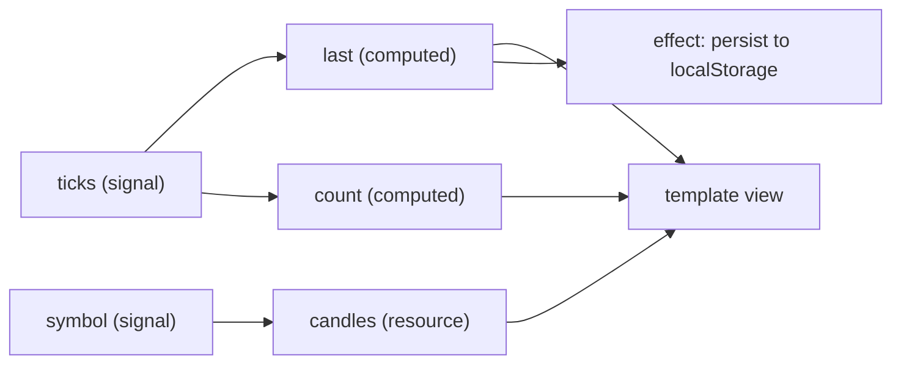

## Explanation

A signal is a container for a value that remembers who read it. Reading a signal (`count()`) inside a *reactive context* (a template, a `computed`, an `effect`) registers a dependency; writing it (`count.set(1)`, `count.update(n => n + 1)`) notifies every dependent. That bookkeeping is what lets Angular know exactly which views need a refresh, which is the information zoneless [change detection](angular-change-detection.md) runs on.

Three primitives form the core graph. `signal(initial)` creates a writable signal; `asReadonly()` exposes it without `set` and `update`, and an `equal` option (the default is `Object.is`) decides whether a write counts as a change, so a readonly signal does not freeze the object it holds and an in-place mutation notifies nobody. `computed(() => ...)` derives a read-only signal that is lazy (nothing runs until the first read), memoised (the result is cached until a dependency changes) and dynamically tracked (only the signals read during the latest evaluation count, so an untaken branch creates no dependency). `effect(() => ...)` runs a function at least once and again whenever a signal it read changes; effects execute asynchronously during change detection, need an injection context or an explicit `injector`, receive an `onCleanup` callback and are destroyed with their component or through the returned `EffectRef`. The documentation is blunt about their place: reach for `computed` first, for `linkedSignal` when a derived value must also be settable, and for `effect` only to push state into non-reactive APIs such as logging, `localStorage`, a `<canvas>` or a charting library. Using an effect to copy one signal into another invites `ExpressionChangedAfterItHasBeenChecked` errors and update loops. `untracked()` reads without creating a dependency; `afterRenderEffect()` is the variant for work that needs the committed DOM.

Core signals are synchronous and always hold a value; asynchrony is layered on top. `linkedSignal` (stable since v20) is a writable signal that is recomputed from a source whenever that source changes; its `previous` argument lets a selection survive a list reload while the selected item still exists. `resource()` (stable since v22) couples a reactive `params` computation to an async `loader`: when the params change, the in-flight load is cancelled through `abortSignal`, and the resource exposes `value`, `status` (`idle`, `loading`, `reloading`, `resolved`, `error` or `local`), `error`, `isLoading`, `hasValue`, `reload()` and a local `set()`/`update()`. `httpResource()` is the `HttpClient`-backed form, so interceptors and the server transfer cache apply, and `rxResource()` takes an observable `stream`. `chain()` (new in v22) feeds one resource's value into another's loader and propagates the upstream status. The `id` option caches a resolved value in `TransferState` so a server-rendered page [hydrates](hydration.md) without a loading flash; the guide warns against it for user-specific data. `debounced()` is still experimental. Component boundaries are signal-shaped too: `input()` and `input.required()` are read-only signal inputs, `model()` is a two-way binding that emits an implicit `...Change` output, and `viewChild()` and `contentChild()` are queries that need no lifecycle hook. Signal Forms, production-ready in v22, build form state on the same primitives.

The RxJS bridge lives in `@angular/core/rxjs-interop`. `toSignal(obs$)` subscribes immediately (so create it once per observable), unsubscribes on destroy and needs `initialValue` or `requireSync: true` to avoid an `undefined` phase; an error is rethrown when the signal is read. `toObservable(sig)` emits through an effect, so a burst of writes coalesces into the last value. That asymmetry is the heart of the contrast with [cold](cold-observable.md) and [hot](hot-observable.md) observables: an observable is a sequence of events over time, a signal is the current value of a piece of state. In a trading screen built on the Redis Streams and SignalR designs of the [real-time UI streaming](../frontend/realtime/real-time-ui-streaming.md) article, the stream stays an observable until the last operator and `toSignal` hands the latest value to the view.



## How it differs

**[Angular Change Detection](angular-change-detection.md).** Signals are the data structure; change detection is the schedule. A signal write marks the views that read it as dirty and asks for a tick; the tick is where bindings are re-evaluated and the DOM is patched. Signals replaced Zone.js as the *source of notifications*, not the rendering machinery. If you adopt signals but keep `Eager` components, you have precise notifications and imprecise checking; if you adopt OnPush but keep plain fields, you have precise checking and no notifications. Both halves are needed.

**[Cold Observable](cold-observable.md).** A cold observable is a recipe: nothing happens until `subscribe`, and each subscriber gets its own execution, which may emit zero values, many values, an error or a completion. A signal is not executed at all; it is a value with a change list. There is no subscription, no teardown, no completion and no error channel (a `resource` carries an error state precisely because it wraps asynchrony). `HttpClient.get()` is a cold observable; `httpResource()` is the signal-shaped wrapper that subscribes for you and re-subscribes when its parameters change. Choose the observable when you need operators, cancellation semantics and retry logic in the pipeline; choose the signal when the view needs the latest value.

**[Hot Observable](hot-observable.md).** A hot observable pushes events as they occur; a subscriber that arrives late never sees earlier ones unless a replay buffer is added. A signal has no history to miss: a late reader sees the current value, and a dependent that is notified three times before it runs executes once with the latest value, because signals coalesce. That makes a signal the wrong tool for an event you must handle every occurrence of (every trade must be written to the blotter) and the right tool for state (the last price). `BehaviorSubject` is the nearest observable cousin, and it is what most teams used as a stand-in before signals existed.

| | Signal | Cold observable | Hot observable |
|---|---|---|---|
| Starts | Exists from creation | On each subscribe | Independently of subscribers |
| Readers see | The current value, synchronously | Their own full execution | Emissions from subscription time on |
| Intermediate values | Coalesced | Delivered | Delivered |
| Completion and errors | None (a resource has a status) | Per subscription | Shared |
| Natural fit | View state, derived state | Requests, lazy computations | Sockets, DOM events, broadcasts |
| Angular rendering | Marks consuming views dirty | Needs `async` pipe or `toSignal` | Needs `async` pipe or `toSignal` |

## Examples

=== "TypeScript (core)"

    ```typescript
    // Derived and effectful state in a component: a lazy computed, and an effect
    // used only for a side effect into a non-reactive API.
    import { Component, computed, effect, signal } from '@angular/core';

    type Level = { price: number; size: number };

    @Component({
      selector: 'app-order-book',
      template: `
        <p>Spread: {{ spread() }}</p>
        <button (click)="bids.update(b => [{ price: 99.5, size: 2 }, ...b])">Add bid</button>
      `,
    })
    export class OrderBook {
      readonly bids = signal<Level[]>([{ price: 99, size: 1 }]);
      readonly asks = signal<Level[]>([{ price: 101, size: 1 }]);

      // Recomputed only after bids or asks change, and only when something reads it.
      readonly spread = computed(() => this.asks()[0].price - this.bids()[0].price);

      constructor() {
        // Never use an effect to copy state into another signal; derive it instead.
        effect(() => localStorage.setItem('spread', String(this.spread())));
      }
    }
    ```

=== "TypeScript (linkedSignal)"

    ```typescript
    // Writable, but reset from its source: the selection survives a reload when the
    // chosen venue still exists, and falls back to the first entry otherwise.
    import { linkedSignal, signal } from '@angular/core';

    type Venue = { id: string; name: string };

    const venues = signal<Venue[]>([{ id: 'cb', name: 'Coinbase' }, { id: 'kr', name: 'Kraken' }]);

    const selected = linkedSignal<Venue[], Venue>({
      source: venues,
      computation: (list, previous) =>
        list.find(v => v.id === previous?.value.id) ?? list[0],
    });

    selected.set(venues()[1]);                        // the user picks Kraken
    venues.set([{ id: 'kr', name: 'Kraken' }]);       // reload: Kraken survives
    venues.set([{ id: 'bn', name: 'Binance' }]);      // reload: falls back to Binance
    ```

=== "TypeScript (resources)"

    ```typescript
    // Async data as part of the graph. Changing a parameter aborts the previous load;
    // the view reads status and value as signals.
    import { Injectable, resource, signal } from '@angular/core';
    import { httpResource } from '@angular/common/http';

    type Candle = { t: number; o: number; h: number; l: number; c: number; v: number };
    type Quote = { symbol: string; bid: number; ask: number };

    @Injectable({ providedIn: 'root' })
    export class MarketData {
      readonly symbol = signal('BTC-USD');
      readonly interval = signal('1m');

      readonly candles = resource({
        params: () => ({ symbol: this.symbol(), interval: this.interval() }),
        loader: async ({ params, abortSignal }) => {
          const res = await fetch(`/api/candles/${params.symbol}?i=${params.interval}`, { signal: abortSignal });
          if (!res.ok) throw new Error(res.statusText);
          return (await res.json()) as Candle[];
        },
      });

      // The same shape through HttpClient: interceptors and the SSR transfer cache apply.
      readonly quote = httpResource<Quote>(() => `/api/quotes/${this.symbol()}`);
    }
    ```

=== "TypeScript (RxJS interop)"

    ```typescript
    // A hot SignalR stream stays an observable until the last operator, then becomes
    // a signal for the view. Create it once: toSignal subscribes immediately.
    import { Component, inject } from '@angular/core';
    import { toSignal } from '@angular/core/rxjs-interop';
    import { auditTime } from 'rxjs';
    import { TradeHub } from './trade-hub';

    @Component({ selector: 'app-last-trade', template: `{{ last()?.price ?? '…' }}` })
    export class LastTrade {
      private readonly hub = inject(TradeHub);
      readonly last = toSignal(this.hub.trades$.pipe(auditTime(100)), { initialValue: null });
    }
    ```

## Misconceptions

- **"A signal is an observable with a smaller API."** An observable models a sequence of events with subscription, teardown, completion and errors; a signal models one current value with dependency tracking. Converting between them is lossy in both directions: `toSignal` drops the sequence, `toObservable` drops intermediate values.
- **"Effects are how you react to state changes."** The guide calls `effect` the last tool to reach for. Derived state belongs in `computed` or `linkedSignal`; effects are for pushing state into APIs that cannot read signals. An effect that writes another signal is a design smell that produces update loops and `ExpressionChangedAfterItHasBeenChecked` errors.
- **"Computed values recalculate on every write."** A computed is lazy and memoised: a write to a dependency only marks it stale, and the function runs again on the next read. Ten writes followed by one read cost one evaluation.
- **"Setting a signal always notifies its readers."** The `equal` function (default `Object.is`) runs first; setting the same primitive or the same object reference is a no-op, and mutating an array in place is invisible. Replace the value, or supply an `equal` that compares contents.
- **"`toSignal` is a free cast."** It subscribes immediately and keeps the subscription until the injection context that created it is destroyed. Called from a getter or a method it either throws NG0203 (no injection context) or, given an explicit `injector`, opens a new subscription on every call; create it once in a field.

## Exam notes

Signals are framework-specific and sit outside every certification syllabus this library tracks, so they matter for architecture interviews, code reviews and framework assessments. The questions that distinguish a senior answer are about design: where state should live so that derived values stay consistent, why effects for state propagation are a trap, how asynchronous data joins a synchronous graph (`resource`, `httpResource`), and how a signal-based view consumes a hot stream without flooding it. Candidates fresh from RxJS-heavy codebases tend to re-create `BehaviorSubject` patterns with effects; the expected reasoning is that `computed` and `linkedSignal` cover almost all of those cases without side effects.

## Self-check

??? question "A component keeps a `filter` signal and a `results` signal, and an effect calls the API whenever `filter` changes and writes the response into `results`. It works, but a reviewer rejects it. Why, and what is the idiomatic shape?"
    The effect is being used for state propagation: it reads one signal and writes another, which the Angular guide warns against because it can trigger `ExpressionChangedAfterItHasBeenChecked` errors, extra change detection cycles and, if the result feeds back into the filter, a loop. It also has no cancellation: a slow response for an old filter can overwrite a newer one. The idiomatic shape is a `resource` (or `httpResource`) whose `params` reads `filter` and whose `loader` fetches the data; the previous request is aborted through `abortSignal` when the filter changes, and the view reads `results.value()`, `results.isLoading()` and `results.error()` directly. If the results must also be editable locally, `resource.set()` moves the status to `local` until the next reload.

??? question "Prices arrive through a SignalR hub as an RxJS observable several hundred times a second. The team converts it with `toSignal`, binds it in the template, and the effect that pushes data into the chart library now runs dozens of times a second and the chart stutters. What should change?"
    `toSignal` writes every emission to the signal. Writes made before the next change detection pass coalesce, so the effect runs at most once per pass, but messages that arrive in separate tasks each schedule their own pass, so the effect still runs at close to the message rate. The stream is the right place to shape the rate: keep the observable pipeline and apply `auditTime` or `sampleTime` before `toSignal`, so the signal only carries the latest value at the cadence the chart can draw, and give it an `initialValue` so the template never sees `undefined`. If every message must be recorded (a trade blotter rather than a price label), that is event handling, not state, and belongs in a subscription that appends to a list signal in batches, not in a per-message signal write.

??? question "A dropdown of trading venues is bound to a `selected` signal. When the venue list reloads from the server, the selection must be preserved if the venue still exists and otherwise fall back to the first entry. Which primitive fits, and why not an effect?"
    `linkedSignal` in its `source`/`computation` form: the source is the `venues` signal, and the computation receives the new list and the `previous` value, returning the previous venue if its id is still present and `list[0]` otherwise. It stays writable, so the dropdown can set it, and it resets automatically on reload. An effect that watches `venues` and writes `selected` would be state propagation through a side effect: it runs after rendering rather than as part of the derivation and briefly exposes a stale selection. A plain `computed` cannot be written by the dropdown at all.

## Further reading

- [Angular: architectural trade-offs](../frontend/angular/angular-fundamentals.md) and [RxJS versus store-based state](../frontend/angular/rxjs-state-management.md)
- [Real-time UI streaming](../frontend/realtime/real-time-ui-streaming.md) and [TypeScript](../frontend/typescript/typescript.md)
- [Angular Change Detection](angular-change-detection.md), [Cold Observable](cold-observable.md), [Hot Observable](hot-observable.md) and [Optimistic UI Update](optimistic-ui-update.md)
- [Signals](https://angular.dev/guide/signals), [linkedSignal](https://angular.dev/guide/signals/linked-signal), [resource](https://angular.dev/guide/signals/resource), [effect](https://angular.dev/guide/signals/effect) and [RxJS interop](https://angular.dev/ecosystem/rxjs-interop) on angular.dev
