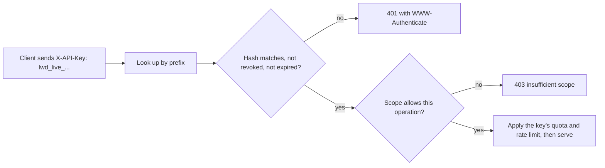

## Explanation

An API key is a random string that an API provider generates for a client and that the client sends on every request, typically in a header such as `X-API-Key`, `Ocp-Apim-Subscription-Key` or `x-api-key`. The server looks the key up, learns which application, subscription or project is calling, and applies whatever that record says: allowed APIs, rate limits, quotas, billing.

The problem has a precise name. RFC 6750 defines a bearer token as a security token "with the property that any party in possession of the token can use the token in any way that any other party in possession of it can", one that does not require the bearer to prove possession of cryptographic key material. An API key is exactly that, without the expiry, audience and scopes an OAuth access token carries. Whoever sees the key, in a proxy log, a browser's network tab, a crash dump, a screenshot or a Git commit, becomes the client. This is why AWS says not to use API keys for authentication or authorization of REST APIs but to add IAM, a Lambda authorizer or a Cognito user pool, and why Azure API Management points to OAuth 2.0 and client certificates for securing what a subscription key merely accesses. The key answers "which account is this traffic billed to", not "is this really them".

Done well, a key scheme still has a lot of engineering in it. **Generation**: at least 256 bits from a cryptographically secure random source, base64url-encoded, with an identifiable prefix. GitHub's `ghp_`, `github_pat_`, `gho_`, `ghu_`, `ghs_` and `ghr_` prefixes reveal a token's type from the string alone, which secret scanners key on; your own `lwd_live_` does the same. **Storage**: the server keeps a SHA-256 hash and a short lookup prefix, never the key, exactly as it would a password, and shows the full key once at creation. **Verification**: a constant-time comparison of hashes, so timing does not leak which prefix is close. **Scoping**: each key record names what it may do (APIs, operations, scopes, IP ranges, environments); AWS usage plans attach throttling and quota per key, and API Management scopes a subscription to a product, one API or all APIs. **Lifecycle**: keys are issued in pairs so one can be regenerated while the other serves traffic, carry an expiry, and can be revoked instantly because the server holds the hash.

Where it belongs: metering and throttling a partner integration, identifying a calling application in front of real authentication, provider APIs that offer nothing better (broker and exchange APIs often only speak keys, as discussed in [Broker and exchange API integrations](../messaging/integration/broker-exchange-api-integrations.md)), and AI provider access where a key identifies the paying project. Where it does not: as the only control on anything sensitive, in a browser or mobile app where it is extractable, in a URL where it will be logged (RFC 6750 says the query-string method should not be used unless nothing else is possible), or as a stand-in for a user's identity. OWASP's API Security Top 10 lists broken authentication second (API2:2023), and shared keys are a common cause.



In the reader's stack, keys show up as Redis `AUTH` strings and TimescaleDB passwords in Compose files (passwords are API keys with worse entropy), as the credential a Redis Streams consumer presents to a broker, and in MCP, whose specification draws the same line as this page: stdio servers take credentials from the environment, while HTTP-based MCP servers are expected to use OAuth rather than a shared key.

## How it differs

**Versus [mutual TLS](mtls.md).** A key is proof by possession of a string; mTLS is proof by possession of a private key through a signature that is only valid for one handshake. Observing an mTLS connection yields nothing reusable; observing a key yields the key. Choose mTLS inside your trust boundary and for partners who can manage certificates; keep keys for metering or for counterparties that offer nothing else, and even then put them inside TLS and treat the key as a routing hint, not an authenticator.

**Versus the [OAuth 2.0 client credentials flow](oauth-client-credentials-flow.md).** Client credentials uses a secret once, at a token endpoint, and the API sees a token that expires in about an hour, names an audience and carries scopes the API can enforce. A key is presented on every call for its whole lifetime and usually grants whatever the account can do. If the API already has an authorization server, the key is the wrong tool; if it only has a key store, you are building the parts of an authorization server by hand.

**Versus the [OAuth 2.0 authorization code flow](oauth-authorization-code-flow.md).** Authorization code involves a user, a browser, a consent screen and tokens scoped to what that user allowed. A key never represents a person, which is why "give the Angular app an API key" is wrong twice: it is extractable from the browser, and it would make every user's action look like the application's.

**Versus [workload identity](workload-identity.md).** A workload identity is attested by the platform and issued fresh, with nothing to distribute or store; a key must be generated, copied into every replica's configuration and rotated by someone. Where a platform can attest the caller (pods, VMs, CI jobs), prefer it; keys are for callers nobody can attest.

**Versus [secrets rotation](secrets-rotation.md).** Rotation is the lifecycle that keeps keys survivable: two keys per client so regeneration is a no-downtime swap, expiry dates so forgotten keys die, and hashed storage so revocation is immediate. A key without that lifecycle is a permanent credential.

| Dimension | API key | OAuth access token | mTLS certificate |
|---|---|---|---|
| Represents | An application or subscription | An application or a user, with scopes | A named workload or client |
| Proof | Possession of the string | Possession of the token (bearer) unless sender-constrained | Possession of a private key |
| Lifetime | Until rotated or revoked | Minutes to hours | Days to years, renewable |
| Scope and audience | Only if the key record says so | Built in | Name only |
| Where it may safely live | Servers and vaults | Servers; browsers only via a backend | Servers and sidecars |
| Best use | Metering, partner integrations, last resort | Delegated and service access | Service-to-service inside a trust domain |

## Examples

=== "C#"

    ```csharp
    // .NET 9 minimal API: issue keys with a recognisable prefix, store only prefix + SHA-256 hash,
    // verify in constant time, then enforce the key's scopes. 401 for a bad key, 403 for a good key
    // that lacks the scope (RFC 6750 semantics).
    using System.Buffers.Text;
    using System.Security.Cryptography;
    using System.Text;

    static (string Key, string Prefix, byte[] Hash) IssueKey()
    {
        var key = "lwd_live_" + Base64Url.EncodeToString(RandomNumberGenerator.GetBytes(32));   // 256 bits
        return (key, key[..16], SHA256.HashData(Encoding.UTF8.GetBytes(key)));   // show Key once; persist Prefix + Hash
    }

    var builder = WebApplication.CreateBuilder(args);
    builder.Services.AddSingleton<IApiKeyStore, PostgresApiKeyStore>();        // your implementation
    var app = builder.Build();

    app.MapGet("/orders", () => Results.Ok(new { orders = Array.Empty<object>() }))
       .AddEndpointFilter(async (ctx, next) =>
       {
           var presented = ctx.HttpContext.Request.Headers["X-API-Key"].ToString();
           if (presented.Length < 16) return Challenge(ctx.HttpContext);

           var store = ctx.HttpContext.RequestServices.GetRequiredService<IApiKeyStore>();
           var record = await store.FindByPrefixAsync(presented[..16]);
           var hash = SHA256.HashData(Encoding.UTF8.GetBytes(presented));
           var valid = record is { Revoked: false }
                    && record.ExpiresAt > DateTimeOffset.UtcNow
                    && CryptographicOperations.FixedTimeEquals(record.Hash, hash);
           if (!valid) return Challenge(ctx.HttpContext);
           if (!record!.Scopes.Contains("orders:read")) return Results.StatusCode(StatusCodes.Status403Forbidden);
           return await next(ctx);
       });
    app.Run();

    static IResult Challenge(HttpContext http)
    {
        http.Response.Headers.WWWAuthenticate = "ApiKey";                     // 401 must name a scheme
        return Results.Unauthorized();
    }

    public interface IApiKeyStore { Task<ApiKeyRecord?> FindByPrefixAsync(string prefix); }
    public record ApiKeyRecord(byte[] Hash, string[] Scopes, DateTimeOffset ExpiresAt, bool Revoked);
    ```

    Issue two keys per client and let them regenerate one while the other serves traffic; a rate limiter keyed on the prefix (see ASP.NET Core's `AddRateLimiter`) turns the record into a usage plan.

=== "Python"

    ```python
    # FastAPI equivalent: a dependency factory that validates the key and enforces one scope.
    import hashlib
    import hmac
    import secrets
    from datetime import datetime, timezone
    from fastapi import Depends, FastAPI, HTTPException, Security
    from fastapi.security import APIKeyHeader

    app = FastAPI()
    api_key_header = APIKeyHeader(name="X-API-Key", auto_error=False)

    def issue_key() -> tuple[str, str, str]:
        key = "lwd_live_" + secrets.token_urlsafe(32)                        # 256 bits, base64url
        return key, key[:16], hashlib.sha256(key.encode()).hexdigest()       # hand out key once; store prefix + hash

    def require_key(scope: str):
        async def dependency(presented: str | None = Security(api_key_header)):
            record = await store.find_by_prefix(presented[:16]) if presented else None   # your store
            valid = (record is not None and not record["revoked"]
                     and record["expires_at"] > datetime.now(timezone.utc)
                     and hmac.compare_digest(record["hash"], hashlib.sha256(presented.encode()).hexdigest()))
            if not valid:
                raise HTTPException(401, headers={"WWW-Authenticate": "ApiKey"})
            if scope not in record["scopes"]:
                raise HTTPException(403, "insufficient scope")
            return record
        return dependency

    @app.get("/orders")
    async def orders(key=Depends(require_key("orders:read"))):
        return {"caller": key["prefix"], "orders": []}
    ```

=== "Azure"

    In Azure API Management a *subscription* is a named container for a pair of keys (primary and secondary, regenerable independently) scoped to a product, a single API or all APIs; every instance also has a built-in all-access subscription that must never be embedded in a client. Callers send `Ocp-Apim-Subscription-Key` as a header or `subscription-key` as a query parameter (the query parameter is only checked when the header is absent, and both names are configurable per API). API Management has no built-in key expiry or automatic rotation, so time-limited access means your own workflow or a token-based scheme. The key is forwarded to the backend by default; strip it with a `set-header` policy at the end of the inbound section if the backend logs headers. For authentication, add `validate-jwt` (OAuth 2.0 or OpenID Connect) or `validate-client-certificate` on top; the subscription key then does what it is good at, which is telling the gateway which product and quota apply.

=== "AWS"

    ```bash
    # API Gateway REST API: keys identify clients for usage plans; authorization comes from elsewhere.
    aws apigateway create-api-key --name partner-acme --enabled
    aws apigateway create-usage-plan --name partner-tier \
      --throttle burstLimit=20,rateLimit=10 --quota limit=100000,period=MONTH \
      --api-stages apiId=abc123,stage=prod
    aws apigateway create-usage-plan-key --usage-plan-id u1 --key-id k1 --key-type API_KEY
    ```

    A key is an alphanumeric value of 20 to 128 characters, generated by API Gateway or imported, sent in the `x-api-key` header (or supplied by a Lambda authorizer when the API key source is `AUTHORIZER`), and checked only on methods marked as requiring it. AWS is explicit: do not use API keys for authentication or authorization, because a key valid for one API in a usage plan reaches every API in that plan; use an IAM role, a Lambda authorizer or a Cognito user pool for access control. Throttling and quotas are best effort, so pair them with AWS WAF and Budgets rather than relying on them to cap cost. For foundation-model access, MLA-C02-style questions contrast Amazon Bedrock API keys with IAM credentials: the key is for quick identification of a project, IAM is for real authorization.

## Misconceptions

- **"An API key authenticates the user."** It identifies an application, subscription or project. Both major gateways say so and point to OAuth, IAM or certificates for authentication; a user's identity needs a user flow such as authorization code.
- **"Putting the key in the query string is fine because the connection is TLS."** TLS hides it from the network, not from server logs, proxies, browser history or referrer headers. RFC 6750 discourages the query-string method for exactly this reason; use a header.
- **"Store keys encrypted so support can show them again."** Store a hash and a prefix, show the key once, and let the client regenerate. An encrypted key store is one decryption key away from a plaintext dump.
- **"Rotating a key means regenerating the key."** Regenerating a single key breaks every client still using it. Issue pairs, let clients switch, then regenerate the old one; API Management's primary and secondary keys exist for this.
- **"API keys are obsolete; everything should be OAuth."** For metering a partner, identifying a project at an AI provider or integrating with a broker that only speaks keys, they are the right tool, as long as they ride inside TLS, carry scopes and an expiry, and are not the sole control on anything sensitive.

## Exam notes

Cloud exams test keys mostly as what *not* to pick. SAA-C03 covers API creation and management with API Gateway, where usage plans and keys are the metering answer and IAM, Lambda authorizers or Cognito are the security answer; DVA-C03 asks about securing applications with bearer tokens and about API Gateway stages, so expect a question where an API key alone is the wrong control. MLA-C02 asks you to select the credential type for foundation-model access, contrasting Bedrock API keys with IAM credentials. On Azure, SC-100 covers designing API management and security, and SC-300 the lifecycle of application credentials, where a subscription key is never a substitute for OAuth 2.0 on a protected API. AI-500 explicitly lists API keys alongside OAuth 2.0 and on-behalf-of in authentication flows for multi-agent solutions; the discriminator is that keys identify a system, user flows represent a person.

Security+ frames it as hardcoded secrets in code and secrets scanning in repositories; CCSP covers API gateways as supplemental security components; CISSP folds it into credential management. The trap across all of them is the phrase "secure the API with an API key": the exam-grade answer treats the key as identification and rate limiting and adds a real authentication mechanism.

## Self-check

??? question "A partner wants to push trade fills into your .NET 9 ingestion API and can only configure a static header on their side. How do you make an API key acceptable here?"
    Issue the partner a pair of keys with an identifiable prefix, store only prefix plus SHA-256 hash on your side, and compare in constant time. Scope the key record to the ingestion endpoint only, restrict it to the partner's source IP range, give it an expiry and a quota, and log the prefix (never the key) on every request. Require TLS and reject the key in a query string. Agree a rotation schedule where the partner switches to the second key before you regenerate the first. The key now identifies and meters the partner, and the IP restriction plus scoping limit the damage if it leaks; it still is not strong authentication, so nothing beyond fills ingestion should accept it.

??? question "Your Angular 20 front end calls a third-party pricing API that only offers API keys, and a developer has put the key in environment.ts. What is wrong and what is the fix?"
    Anything compiled into the Angular bundle is public: the key can be read from the browser by any user and will appear in network traces. Move the call behind your own backend endpoint; the .NET API holds the key in a vault, applies per-user authorization and rate limiting, and calls the pricing API server-side. The browser authenticates to your backend with a cookie session or a bearer token obtained through the authorization code flow, never with the third party's key. If the third party offers OAuth or mTLS, prefer those for the backend-to-provider leg as well.

??? question "A security review finds that your API stores issued keys in plaintext so the admin UI can display them, and regenerating a key immediately breaks the client. Which two changes fix both findings?"
    Hash the keys: persist a lookup prefix plus a SHA-256 hash, show the full key only at creation, and offer regeneration instead of retrieval; the admin UI then shows prefixes and metadata only. Pair the keys: give every client a primary and a secondary, so regeneration happens on the idle one and the client switches at its own pace, as Azure API Management and most SaaS providers do. Add expiry dates while you are there, so abandoned keys die on their own.

## Further reading

- [mTLS vs. API Keys / Shared Secrets](../security/iam/mtls-vs-api-keys.md) and [Capability-based AuthZ vs. RBAC](../security/iam/capability-based-authz.md) for what a scoped credential should grant.
- [Broker and exchange API integrations](../messaging/integration/broker-exchange-api-integrations.md) for living with key-only providers, and [MCP tool orchestration](../ai/protocols/mcp-tool-orchestration.md) for credentials in tool servers.
- Terms: [Mutual TLS](mtls.md), [OAuth 2.0 client credentials flow](oauth-client-credentials-flow.md), [OAuth 2.0 authorization code flow](oauth-authorization-code-flow.md), [Workload identity](workload-identity.md), [Secrets rotation](secrets-rotation.md), [Capability-based authorization](capability-based-authorization.md).
- [RFC 6750](https://www.rfc-editor.org/rfc/rfc6750) for bearer semantics and the `WWW-Authenticate` error codes, and the [OWASP API Security Top 10 (2023)](https://api-security.owasp.org/editions/2023/en/0x11-t10).
