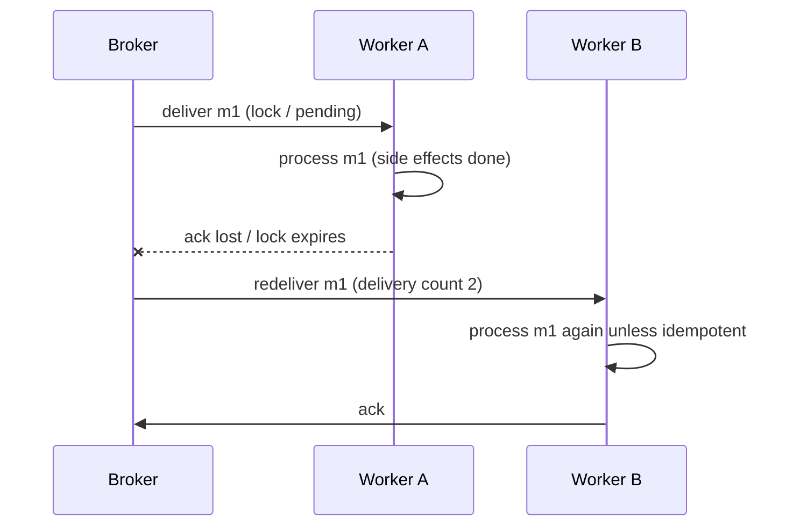

## Explanation

Delivery guarantees describe what a messaging system promises about each message when something fails: a network drops a packet, a consumer crashes mid-work, a broker node restarts. Kafka's design documentation states the three options in one line each: *at most once* means messages may be lost but are never redelivered; *at least once* means messages are never lost but may be redelivered; *exactly once* means each message is processed once and only once. At-least-once is the default of almost every durable broker and queue, and the one most systems should design around.

The mechanism is an **acknowledgement after processing**. The broker stores the message durably (the Enterprise Integration Patterns call this guaranteed delivery: store-and-forward, with the message deleted from one store only once the next has it). It hands the message to a consumer and starts a clock. The consumer does its work and *then* acknowledges. If the acknowledgement arrives, the message is settled. If it does not (because the consumer died, the network lost the ack, or the clock ran out), the broker assumes failure and delivers the message again, possibly to another consumer. Duplicates are therefore not a bug but the direct consequence of the guarantee: the broker cannot distinguish "processed but ack lost" from "never processed".



The same shape appears under different names:

- **Azure Service Bus** calls it peek-lock: the message is locked for the consumer (one minute by default, five at most, renewable); `Complete` settles it, `Abandon` or lock expiry returns it to the queue with its delivery count incremented, and `MaxDeliveryCount` eventually dead-letters it.
- **Amazon SQS** uses a visibility timeout (30 seconds by default, up to 12 hours): a received message is hidden, not deleted, until the consumer calls `DeleteMessage`; standard queues state outright that more than one copy might occasionally be delivered.
- **Redis Streams** record each delivered entry in the group's pending entries list (PEL) until `XACK`; `XPENDING` shows idle time and a delivery counter, and `XAUTOCLAIM` lets a live consumer take over entries a dead one left behind.
- **Kafka** has no per-message ack; the consumer *commits an offset*. Process first and commit after, and a crash between the two replays the uncommitted records: at-least-once. The producer side is also at-least-once by default: retries after a lost broker response would duplicate, which is why `enable.idempotence` is on by default since Kafka 3.0.
- **Event Grid, Event Hubs, Kinesis, Lambda event source mappings** all document themselves as at-least-once and tell you to make consumers idempotent.

The producer can duplicate too. A send whose acknowledgement was lost gets retried, and the broker stores two copies unless it deduplicates (Service Bus duplicate detection, SQS FIFO deduplication ids, Kafka's idempotent producer, Redis 8.6's `XADD ... IDMP`). Duplicates therefore come from three places: producer retries, consumer crash-before-ack, and rebalances or reassignment of partitions, shards and leases.

Designing for at-least-once means accepting duplicates and making them cheap. Writes become upserts keyed by a business identity or an [idempotency key](idempotency-key.md); non-idempotent effects (sending an email, charging a card) are guarded by a processed-ids record in the same transaction as the effect; the lock or visibility window is sized to real processing time and extended for long jobs; and a [dead-letter queue](dead-letter-queue.md) bounds how often a poison message is retried. In this stack that is a .NET 9 worker on a Redis Streams [consumer group](consumer-group.md) that reads, writes to TimescaleDB with `ON CONFLICT DO NOTHING` on the event id, and only then calls `XACK`, with a periodic `XAUTOCLAIM` sweep.

## How it differs

**[At-most-once delivery](at-most-once-delivery.md).** Flip the order (ack or commit before processing, or never ack at all) and the guarantee flips: no duplicates, but any crash between ack and completion loses the message. At-most-once is right for data that is cheap to lose and expensive to duplicate: telemetry samples, presence pings, live price ticks that the next tick supersedes. At-least-once is right when losing a message costs more than handling a duplicate, which is most business messages.

**[Exactly-once delivery](exactly-once-delivery.md).** Exactly-once does not change the transport (the message may still be redelivered); it adds machinery, such as Kafka transactions with `read_committed` consumers, SQS FIFO deduplication, or Service Bus transactions with send-via, so a redelivery is not applied twice *within that system's boundary*. It costs throughput, latency and lock-in, and ends at the boundary. At-least-once plus idempotent consumers gives the same observable result across boundaries for less.

**[Idempotency key](idempotency-key.md).** The key is the usual answer to at-least-once, not an alternative to it: keep the guarantee, de-duplicate at the receiver.

**[Dead-letter queue](dead-letter-queue.md).** Redelivery without a bound is an infinite loop for a message that always fails. Dead-lettering after `N` attempts is what makes at-least-once operable.

**[Consumer group](consumer-group.md).** The group is how a stream shares one at-least-once workload among several consumers: the pending list is the per-consumer record of unacknowledged entries, and claiming is how redelivery happens when a consumer dies.

| Guarantee | When the ack happens | Failure outcome | Consumer burden |
|---|---|---|---|
| At-most-once | Before processing, or never | Loss | None |
| At-least-once | After processing | Duplicate | Idempotency |
| Exactly-once (within a boundary) | Inside a transaction with the output | Neither, inside the boundary | Transactional or idempotent sink |

## Examples

**Trade ingestion.** Ticks arrive on the `ticks` Redis Stream. A `storage` consumer group writes them into a TimescaleDB hypertable with the tick id as a unique key; a redelivered tick hits `ON CONFLICT DO NOTHING` and is acknowledged again. A sweeper claims entries idle for more than a minute, so a worker that crashed mid-batch does not strand its ticks.

=== "C#"

    ```csharp
    // Redis Streams consumer group: process, persist idempotently, then XACK.
    await db.StreamCreateConsumerGroupAsync("ticks", "storage", StreamPosition.NewMessages, createStream: true);

    while (!ct.IsCancellationRequested)
    {
        var entries = await db.StreamReadGroupAsync("ticks", "storage", consumerName, StreamPosition.NewMessages, count: 100);
        if (entries.Length == 0) { await Task.Delay(50, ct); continue; }

        foreach (var e in entries)
        {
            var tick = Tick.From(e.Values);
            await conn.ExecuteAsync(
                "INSERT INTO ticks (event_id, symbol, ts, price) VALUES (@Id, @Symbol, @Ts, @Price) ON CONFLICT (event_id) DO NOTHING",
                tick);                                          // duplicate-safe write
            await db.StreamAcknowledgeAsync("ticks", "storage", e.Id);   // ack only after the write
        }
    }

    // Separate sweeper: take over entries another consumer left pending.
    var claimed = await db.StreamAutoClaimAsync("ticks", "storage", consumerName,
        minIdleTimeInMs: 60_000, startAtId: "0-0", count: 100);
    foreach (var e in claimed.ClaimedEntries) { /* process + XACK as above */ }
    ```

=== "Python"

    ```python
    # redis-py: same loop; the pending list is the at-least-once record.
    r.xgroup_create("ticks", "storage", id="$", mkstream=True)

    while True:
        for _stream, entries in r.xreadgroup("storage", consumer, {"ticks": ">"}, count=100, block=1000):
            for entry_id, fields in entries:
                cur.execute("""INSERT INTO ticks (event_id, symbol, ts, price)
                               VALUES (%s, %s, %s, %s) ON CONFLICT (event_id) DO NOTHING""",
                            (fields[b"id"], fields[b"symbol"], fields[b"ts"], fields[b"price"]))
                conn.commit()
                r.xack("ticks", "storage", entry_id)          # after the commit, never before

        # Sweep: claim entries idle for over a minute from crashed consumers.
        _next, claimed, _deleted = r.xautoclaim("ticks", "storage", consumer, min_idle_time=60_000,
                                                start_id="0-0", count=100)
        for entry_id, fields in claimed:
            ...   # process + xack
    ```

=== "Azure"

    - **Service Bus** peek-lock is at-least-once: complete after processing, abandon on transient failure, renew the lock (default 1 minute, maximum 5) for long work, and let `MaxDeliveryCount` (default 10) dead-letter poison messages. Receive-and-delete is the at-most-once alternative.
    - **Event Hubs** is at-least-once by its own description; the consumer checkpoints an offset after processing, and a failover replays from the last checkpoint, so handlers de-duplicate on sequence number or event id.
    - **Event Grid** delivers at least once per subscription, retries with exponential backoff for up to 24 hours or 30 attempts by default, and may deliver duplicates even after a late success.

=== "AWS"

    - **SQS standard** queues guarantee at-least-once and warn that an occasional extra copy is possible; the visibility timeout (default 30 seconds, maximum 12 hours) is the lock, `DeleteMessage` is the ack, and a redrive policy bounds retries.
    - **Kinesis Data Streams** documents duplicates from both producer retries (two records with different sequence numbers but the same payload) and consumer retries after worker restarts, resharding or deploys; embed a primary key in each record and de-duplicate downstream.
    - **Lambda event source mappings** process every event at least once; use partial batch responses so one failure does not replay a whole batch.

## Misconceptions

- **"At-least-once means the broker is unreliable."** It is the reliable option: nothing is lost. Duplicates are the price of refusing to lose data over an unreliable network.
- **"Duplicates only come from consumer crashes."** Producer retries after a lost acknowledgement and partition or shard reassignment during rebalances also produce them.
- **"A longer lock or visibility timeout removes duplicates."** It reduces premature redelivery, but a crash after the side effect and before the ack still duplicates, and an oversized timeout delays recovery of stuck messages.
- **"I can avoid idempotency by choosing exactly-once."** Exactly-once holds only inside one system's boundary; the moment the effect is an HTTP call, an email or a write to another store, you are back to at-least-once and need idempotent handling anyway.
- **"Redelivery is the same as retry."** Redelivery is the broker re-offering an unacknowledged message; a retry is the consumer re-attempting within one delivery. Both need a bound, and the dead-letter queue is the bound on redelivery.

## Exam notes

Cloud associate and developer exams test this through service behaviour rather than vocabulary. AZ-204 expects the difference between peek-lock and receive-and-delete, lock renewal and `MaxDeliveryCount`; AZ-305 expects at-least-once plus idempotent consumers as the default reliability design. SAA-C03, DVA-C02 and DVA-C03 test SQS standard versus FIFO semantics, the visibility timeout as the ack window, why consumers must be idempotent, and that Lambda stream and queue triggers are at-least-once; DEA-C01 and SAP-C03 add Kinesis duplicates and checkpointing. The traps: choosing a FIFO queue or exactly-once feature when the real question is about ordering or idempotency, forgetting that producer retries also duplicate, and assuming a visibility timeout or lock prevents duplicates rather than merely delaying them.

## Self-check

??? question "A worker reads a Redis Stream entry, inserts a row, and the pod is killed before XACK. What happens next, and what must the insert look like?"
    The entry stays in the group's pending list under the dead consumer. A reclaim sweep (XAUTOCLAIM or XPENDING plus XCLAIM) hands it to a live consumer, which inserts again. The insert must be idempotent, for example a unique key on the event id with `ON CONFLICT DO NOTHING`, so the second attempt is harmless and the entry is then acknowledged.

??? question "Your Service Bus handler takes three minutes on some messages and those messages are processed twice. What is the cheapest fix?"
    The default lock duration is one minute, so the lock expires mid-processing and the message is redelivered. Raise the lock duration (up to five minutes) or enable automatic lock renewal for the processor, and keep the handler idempotent for the cases where the lock is lost anyway.

??? question "Price ticks are published at-least-once and the dashboard occasionally shows a tick twice. The team wants exactly-once delivery from Redis. Is that the right ask?"
    No. Redis Streams provide at-least-once (and at-most-once with NOACK); the dashboard should de-duplicate on the entry id or render idempotently (the latest tick per symbol), which removes the symptom with no transport change. Exactly-once would not survive the hop to the browser anyway.

## Further reading

- [Delivery Semantics](../messaging/eventing/delivery-semantics.md) for the full comparison and the stack's default choice.
- [Redis Streams vs. Kafka](../messaging/eventing/redis-streams-vs-kafka.md) for how each platform implements acknowledgement.
- [Outbox Pattern vs. Dual-Write](../messaging/eventing/outbox-pattern.md) for at-least-once on the producer side.
- Terms: [At-most-once delivery](at-most-once-delivery.md), [Exactly-once delivery](exactly-once-delivery.md), [Idempotency key](idempotency-key.md), [Dead-letter queue](dead-letter-queue.md), [Consumer group](consumer-group.md).
- [Handle duplicate records (Kinesis)](https://docs.aws.amazon.com/streams/latest/dev/kinesis-record-processor-duplicates.html) and [Redis Streams introduction](https://redis.io/docs/latest/develop/data-types/streams/).
