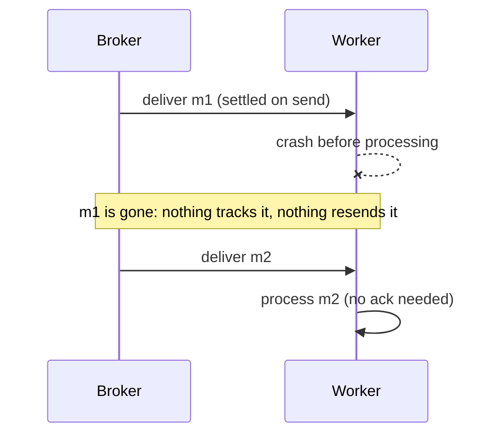

## Explanation

At-most-once is the guarantee you get when nobody waits for confirmation. The sender transmits and moves on; the broker, if there is one, considers the message settled the moment it hands it over; the consumer takes it and either succeeds or does not. Kafka's design documentation defines it as *messages may be lost but are never redelivered*. The absence of a retry loop is the whole definition: because nothing is ever re-sent, nothing can arrive twice, and because nothing is re-sent, anything that fails in flight is gone.

Protocol specifications make the trade-off explicit. MQTT's QoS 0 is literally named "at most once delivery": a single `PUBLISH`, no response from the receiver and no retry by the sender, so the specification says the message arrives either once or not at all. AMQP 1.0 describes the same thing in terms of settlement: if the sender settles a transfer before sending it, the result is an at-most-once guarantee. Every broker exposes a switch with this shape:

- **Redis Pub/Sub** is at-most-once by design: once the server pushes a message, it is never sent again, and a subscriber that is disconnected or errors loses it forever. Redis Streams exist for the cases where that is not acceptable.
- **Redis Streams** offer the same choice per read: `XREADGROUP ... NOACK` skips the pending entries list, which is equivalent to acknowledging on read. The documentation reserves it for cases where occasional loss is acceptable.
- **Azure Service Bus** receive-and-delete mode marks the message consumed as soon as it is put on the wire; if the transfer fails or the consumer crashes, the message is lost. Microsoft's own documentation calls this at-most-once processing, in contrast to peek-lock's at-least-once.
- **Kafka** has no mode flag; the order of operations decides. Read, commit the offset, then process, and a crash after the commit loses the uncommitted work. Auto-commit with asynchronous processing drifts into the same territory.
- **SQS** has no at-most-once receive mode, but deleting a message before processing it produces one. Lambda's asynchronous invocation retries a failed event twice by default; setting its maximum retry attempts to zero removes those retries, but AWS warns that its internal event queue can still hand the function the same event more than once, so even that is not a strict at-most-once guarantee.
- **Plain transports**: UDP datagrams, StatsD metrics, a WebSocket push with no application-level ack, a Server-Sent Events stream with no replay are all at-most-once by construction.



Why would anyone choose it? Because it is the cheapest, lowest-latency guarantee and because some data is worth less than the duplicate it would otherwise cause. A live price tick is superseded by the next tick within milliseconds; a heartbeat says "I am alive now"; a cursor position in a collaborative editor is replaced constantly; a metric sample is one of thousands per minute. Re-sending a stale tick is worse than dropping it, and buffering unacknowledged ticks during a consumer stall is a [backpressure](backpressure.md) problem with no good answer. At-most-once also needs no consumer-side state: no pending list, no delivery counters, no [idempotency keys](idempotency-key.md), no [dead-letter queue](dead-letter-queue.md).

The discipline is to choose it *on purpose* and only for messages whose loss is tolerable, and to keep it out of anything that represents a business fact. The common failure is accidental at-most-once: a Kafka consumer that commits before it finishes, a Service Bus receiver created in receive-and-delete for convenience, a Pub/Sub channel used to notify a payment service, a background queue in process memory that evaporates on restart. In this stack the legitimate uses are the real-time path: ticks and derived prices fanned out to Angular clients over SignalR or SSE, where the [hot observable](hot-observable.md) model already assumes late subscribers miss what came before. The durable path (orders, fills, audit events) stays on [at-least-once](at-least-once-delivery.md) Redis Streams.

## How it differs

**[At-least-once delivery](at-least-once-delivery.md).** The two guarantees are mirror images decided by one ordering: acknowledge before you process (at-most-once) or after (at-least-once). The consequences follow mechanically: before means loss on crash, after means duplicates on lost ack. Choose by asking which is more expensive for this message: a lost copy or an extra one. For the same stream you can even mix them per consumer: a Redis Stream read with `NOACK` by a dashboard and with normal acknowledgement by the persister.

**[Exactly-once delivery](exactly-once-delivery.md).** Exactly-once is at-least-once plus deduplication or transactions, so it inherits the retry machinery and its cost; at-most-once removes the machinery entirely. They share the property that the consumer never sees a duplicate, which is why the two are confused in interviews. The difference is loss: exactly-once promises each message is applied once, at-most-once promises at most one application and may apply zero.

| Property | At-most-once | At-least-once | Exactly-once (in boundary) |
|---|---|---|---|
| Acknowledgement | None, or before processing | After processing | In a transaction with the output |
| Broker state per in-flight message | None | Pending list, lock or offset | Transaction state |
| Loss possible | Yes | No | No |
| Duplicates possible | No | Yes | No (inside the boundary) |
| Latency and cost | Lowest | Medium | Highest |
| Typical payload | Telemetry, ticks, presence | Orders, commands, events | Ledger-style stream processing |

## Examples

**Live price fan-out.** A `prices` Redis Stream is read by the API gateway with `NOACK` and pushed to browsers. If the gateway restarts, clients simply receive the next tick; nobody wants the ticks from the outage replayed. The same stream is read by the `storage` group with normal acknowledgement, because the history table must be complete.

=== "C#"

    ```csharp
    // Redis Streams: NOACK = settled on read, nothing enters the pending list.
    var ticks = await db.StreamReadGroupAsync("prices", "dashboard", instanceId,
        StreamPosition.NewMessages, count: 500, noAck: true);
    await hub.Clients.All.SendAsync("ticks", ticks.Select(e => Tick.From(e.Values)), ct);   // a crash here loses them

    // Service Bus: receive-and-delete settles on the wire; a crash loses the message.
    var receiver = client.CreateReceiver("telemetry", new ServiceBusReceiverOptions
    {
        ReceiveMode = ServiceBusReceiveMode.ReceiveAndDelete,
    });
    var samples = await receiver.ReceiveMessagesAsync(maxMessages: 100, cancellationToken: ct);

    // Kafka: committing before processing turns a durable log into at-most-once.
    var record = consumer.Consume(ct);
    consumer.Commit(record);          // position saved first ...
    await ProcessAsync(record);       // ... so a crash here skips the record forever
    ```

=== "Python"

    ```python
    # redis-py: noack=True reads without tracking.
    for _stream, entries in r.xreadgroup("dashboard", instance_id, {"prices": ">"},
                                         count=500, block=1000, noack=True):
        broadcast(entries)             # lost if we crash before this returns

    # azure-servicebus: RECEIVE_AND_DELETE settles on receipt.
    from azure.servicebus import ServiceBusClient, ServiceBusReceiveMode
    with client.get_queue_receiver("telemetry",
                                   receive_mode=ServiceBusReceiveMode.RECEIVE_AND_DELETE) as receiver:
        for msg in receiver.receive_messages(max_message_count=100, max_wait_time=5):
            ingest(msg)                # no complete_message(): nothing to settle

    # confluent-kafka: commit first, process second.
    msg = consumer.poll(1.0)
    if msg is not None and not msg.error():
        consumer.commit(message=msg, asynchronous=False)
        process(msg)
    ```

=== "Azure"

    - **Service Bus**: receive-and-delete is the documented at-most-once mode; prefer it only for low-value or short-lived data, and note that AMQP presettled transfers from a low-level client are likewise fire-and-forget: no outcome is reported, so there is no diagnostic data and Microsoft excludes that mode from Azure support.
    - **Event Hubs**: checkpointing before processing a batch gives at-most-once consumption; the service itself is at-least-once.
    - **Azure SignalR Service and Web PubSub**: a push to a client has no application acknowledgement, so delivery to the browser is at-most-once unless you build replay on top (for example, re-reading the stream from the last seen id on reconnect).

=== "AWS"

    - **SQS**: there is no at-most-once mode; deleting before processing emulates it, and a `maxReceiveCount` of 1 with a dead-letter queue is a sometimes-useful middle ground (one attempt, then parked).
    - **Lambda asynchronous invocations**: setting the maximum retry attempts to zero stops retries after a function error (the event still lands in an on-failure destination if you configure one), but the asynchronous queue itself can occasionally deliver an event twice, so handlers that must never repeat an effect still need an idempotency check.
    - **Kinesis**: checkpoint before processing for at-most-once; the Kinesis documentation otherwise assumes at-least-once with duplicates from producer and consumer retries.

## Misconceptions

- **"At-most-once means usually once."** It means zero or one. Under normal conditions it is usually one, but every crash, timeout or disconnect in the wrong place is a silent loss with no trace.
- **"No duplicates means it is as good as exactly-once."** Exactly-once also guarantees no loss. At-most-once only guarantees no duplicates; it is the weaker guarantee, not an efficient version of the strong one.
- **"Pub/Sub channels are fine for notifying services."** Redis Pub/Sub is at-most-once: a subscriber that is restarting misses every message published meanwhile. Use a stream with a consumer group for anything a service must act on.
- **"Kafka is always at-least-once."** Kafka's guarantee depends on when you commit. Commit before processing (or auto-commit with work still in flight) and you have at-most-once consumption.
- **"At-most-once is a bug to be eliminated."** It is the correct choice for superseding data such as ticks, metrics and presence, where replaying stale values is worse than losing them.

## Exam notes

Exams rarely name at-most-once directly; they test whether you recognise it. AZ-204 asks what receive-and-delete does when a receiver crashes and when it is acceptable; AZ-305 and SAP-C03 present scenarios with low-value telemetry where the cheapest reliable-enough path is the answer. DVA-C02 and DVA-C03 expect you to know that SQS has no at-most-once mode and that Lambda asynchronous retries can be set between zero and two (zero removes retries, not the occasional duplicate); DEA-C01 covers checkpoint placement in Kinesis consumers. The traps are reading "no duplicates" as exactly-once, using Pub/Sub or receive-and-delete for business messages, and not noticing that a commit-before-process consumer has quietly become at-most-once.

## Self-check

??? question "A dashboard shows a gap of a few seconds after the gateway restarts, and the product owner asks for the missing ticks to be replayed. Which guarantee is the gateway using, and should you change it?"
    The gateway reads with `NOACK` (at-most-once): nothing tracks what it pushed. If a few seconds of stale ticks have no value, keep it; the next tick fills the gap. If the gap matters, have clients reconnect with their last seen stream id and read the range they missed from the stream itself rather than switching the push path to acknowledged delivery.

??? question "A Kafka consumer auto-commits every five seconds and hands records to a thread pool. After a crash some records were never processed. Why?"
    Auto-commit commits the offsets returned by poll regardless of whether the pool finished them, so the position moved past records still in flight; the restart resumed after them. That is at-most-once consumption. Commit after processing (or disable auto offset store and store offsets only when work completes) to return to at-least-once.

??? question "An order service subscribes to a Redis Pub/Sub channel to learn about payments, and orders occasionally stay unpaid after a deploy. What is wrong?"
    Pub/Sub is at-most-once: messages published while the service was restarting were never queued for it. Publish payment events to a Redis Stream and consume them with a consumer group, which persists entries and tracks what each consumer has not acknowledged.

## Further reading

- [Delivery Semantics](../messaging/eventing/delivery-semantics.md) for choosing between the three guarantees.
- [SignalR and WebSockets](../messaging/realtime/signalr-websockets.md) and [Real-Time UI Streaming](../frontend/realtime/real-time-ui-streaming.md) for the push path where at-most-once is natural.
- [Redis Streams vs. Kafka](../messaging/eventing/redis-streams-vs-kafka.md) for how each exposes the choice.
- Terms: [At-least-once delivery](at-least-once-delivery.md), [Exactly-once delivery](exactly-once-delivery.md), [Hot observable](hot-observable.md), [Backpressure](backpressure.md).
- [Message transfers, locks, and settlement](https://learn.microsoft.com/en-us/azure/service-bus-messaging/message-transfers-locks-settlement) for the receive-and-delete details.
