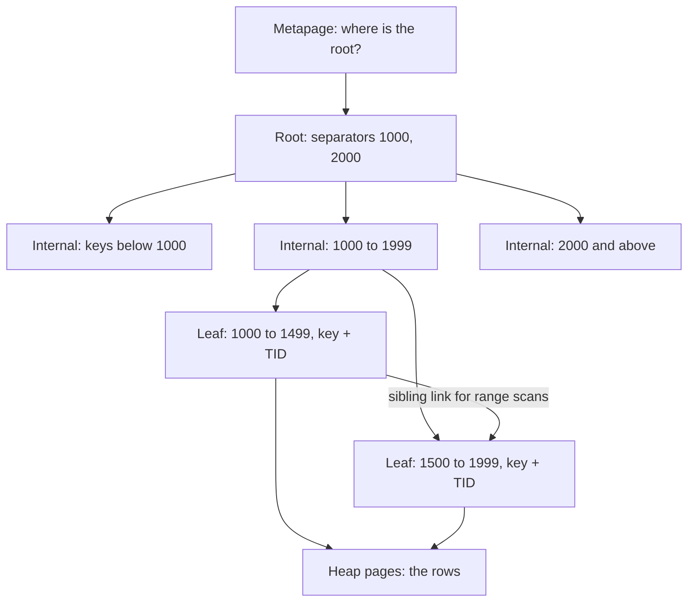

## Explanation

A B-tree index is a balanced, multi-way search tree kept on disk pages, and the index every relational engine builds unless told otherwise. Bayer and McCreight described it in 1972 so that a search, an insert and a delete on a large ordered index each touch only a handful of pages. A root page holds separator keys and child pointers; internal pages repeat that one level down; leaf pages, all at the same depth, hold the real index entries in sorted order, each a key plus a row locator (a tuple identifier, or TID, in PostgreSQL; a row ID or the clustering key in SQL Server). A page is typically 8 kB and holds hundreds of keys, so a few levels cover billions of rows and a lookup costs about one page read per level, mostly cached.

Nearly every implementation is really a B+ tree: entries live only in the leaves, internal pages carry only separators, and each level's pages are linked into a list, so a range scan is one descent and a walk along the leaf chain. PostgreSQL implements Lehman and Yao's B-link variant: every page also stores a right-link and a high key (an upper bound on the keys it may hold), so a reader that lands on a just-split page can detect it and step right. Readers therefore lock only one page at a time and never wait for a split to finish, which lets writers and readers share the tree at high concurrency. Inserts fill a page, then split it; a root split adds a level, recorded in the metapage at the start of the index. `fillfactor` (90 by default) only governs how full `CREATE INDEX` packs the leaves and how full a split of the rightmost leaf leaves the old page, so ever-increasing keys keep 10 percent headroom for later updates.

That is why it is the default: it serves `=`, `<`, `<=`, `>=` and `>` and the constructs built from them (`BETWEEN`, `IN`, `IS NULL`), anchored prefix patterns such as `LIKE 'foo%'`, and `ORDER BY` without a sort step, on any type with a linear ordering. A unique B-tree enforces `PRIMARY KEY` and `UNIQUE`, which is what deduplicates an [idempotency key](idempotency-key.md) or a [transactional outbox](transactional-outbox.md). When the index holds every column a query needs, PostgreSQL can run an index-only scan, consulting the visibility map (a per-page bit saying all rows are visible to every transaction) instead of the heap; `INCLUDE` columns add payload to the leaf for that purpose without widening the key. PostgreSQL 13 added deduplication, storing a repeated key once with a posting list of TIDs, and PostgreSQL 14 added bottom-up deletion, removing entries for dead row versions before a page split; both exist because, under [MVCC](mvcc.md), each row version gets its own index entry.

The cost is in writes and size: every insert touches a leaf page, random keys touch random pages, and the index grows with the row count, so a B-tree on the timestamp of a 2 TB append-only tick table is huge. That is where a [BRIN index](brin-index.md) wins: when a column is correlated with physical order and queries are range scans rather than point lookups, BRIN gives most of the pruning for a tiny fraction of the space and write cost, losing seeks, ordering and uniqueness. Keep the B-tree for the selective path, for example `(symbol, time)`, and let BRIN or chunk exclusion on a [hypertable](hypertable.md) handle the time dimension.

In SQL Server terms, a clustered index is the table itself stored as a B+ tree ordered by the key, with data pages at the leaf level, and a nonclustered index is a separate B+ tree whose leaves hold the key, a row locator and any included columns; [Relational Databases](../data/relational/relational-databases.md) covers the choice between them.



## How it differs

**[BRIN index](brin-index.md).** BRIN keeps one small summary (by default a minimum and maximum) per range of physically adjacent pages, so it is thousands of times smaller than a B-tree on the same column and almost free to maintain. In exchange it can only say which page ranges might match; every surviving row is rechecked, there is no seek, no ordering and no uniqueness, and it only works while the column stays correlated with the physical row order. Decide by access pattern: point lookups, selective filters, sorting and constraints need a B-tree; range scans over huge, append-mostly, naturally ordered data are BRIN territory.

**[Columnar storage](columnar-storage.md).** A column store (TimescaleDB's columnstore, SQL Server columnstore indexes, Redshift, Parquet) reorganises data by column, compresses it, and skips segments using per-segment minimum and maximum values. It usually has no row-level index because its queries scan and aggregate rather than locate. A B-tree is the opposite instrument: it finds a few rows in a row-oriented heap fast and makes single-row writes cheap. The common split in a time-series system is B-trees on hot rowstore chunks and columnar layout for cold ones.

**[Table partitioning](table-partitioning.md).** Partitioning does not replace an index; it bounds one. Each partition gets its own B-tree, which stays small and cache-friendly, and the planner prunes whole partitions before any index is consulted. Dropping a partition removes its index with it, which is why age-based deletion on a partitioned or chunked table costs nothing in index maintenance, whereas deleting the same rows from one giant indexed table leaves dead entries behind.

**[MVCC](mvcc.md).** Multi-version concurrency control answers "how do readers avoid blocking writers" by writing a new row version on every update. The B-tree pays for that: unless the new version fits on the same heap page without touching an indexed column (a heap-only tuple update), it needs a fresh index entry, and the old entry lingers until vacuum or bottom-up deletion removes it. Index bloat on hot, frequently updated tables is an MVCC symptom, and the remedies (fewer indexes on volatile columns, a lower `fillfactor`, `REINDEX CONCURRENTLY`) are B-tree hygiene.

**[Partition pruning](partition-pruning.md).** Pruning is the planner's decision to leave whole partitions or chunks out of a plan because their declared bounds cannot satisfy the predicate. It happens before any index is opened and costs nothing per row, but it works only on the partitioning key and only at partition granularity. A B-tree then narrows the search inside each surviving partition. On a time-partitioned table the two divide the work: pruning handles the time range, the B-tree handles the selective key within it.

| | B-tree | BRIN | Column store |
|---|---|---|---|
| Entry granularity | one per row version | one per page range | one segment or block, with min/max |
| Point lookup, uniqueness | yes | no | no |
| Ordered output | yes | no | only if data is stored sorted |
| Write cost | leaf write per insert | near zero | batch convert, expensive point updates |
| Depends on physical order | no | yes | yes, for segment skipping |
| Typical role | OLTP access paths, constraints | huge append-only range scans | cold analytical scans |

## Examples

Access paths for an orders table in PostgreSQL:

```sql
-- Seek by customer, then walk recent orders in time order.
-- INCLUDE carries a payload column for index-only scans without widening the key.
CREATE INDEX ix_orders_customer_placed_at
    ON orders (customer_id, placed_at DESC)
    INCLUDE (total_amount);

-- Uniqueness is a B-tree feature: this is what deduplicates outbox retries.
CREATE UNIQUE INDEX ux_outbox_idempotency ON outbox (idempotency_key);

-- Anchored prefixes are indexable (text_pattern_ops is needed outside the C locale);
-- suffix patterns are not.
EXPLAIN SELECT * FROM customers WHERE email LIKE 'nitin%';      -- Index Scan
EXPLAIN SELECT * FROM customers WHERE email LIKE '%gmail.com';  -- Seq Scan

-- Column order matters: this index serves "customer_id = ?" and
-- "customer_id = ? AND placed_at > ?", but not "placed_at > ?" on its own.

-- Build without blocking writers; CONCURRENTLY cannot run inside a transaction block.
CREATE INDEX CONCURRENTLY ix_orders_placed_at ON orders (placed_at);
```

=== "C#"

    ```csharp
    // EF Core 9 with Npgsql.EntityFrameworkCore.PostgreSQL
    protected override void OnModelCreating(ModelBuilder modelBuilder)
    {
        var orders = modelBuilder.Entity<Order>();

        // Composite key: seek on customer, ordered walk on placed_at, payload in the leaf.
        // Declared here so the model matches the database; the scaffolded migration body
        // is replaced by the hand-written concurrent build below.
        orders.HasIndex(o => new { o.CustomerId, o.PlacedAt })
              .HasDatabaseName("ix_orders_customer_placed_at")
              .IsDescending(false, true)
              .IncludeProperties(o => o.TotalAmount);

        // Unique B-tree doubling as the idempotency guard.
        orders.HasIndex(o => o.IdempotencyKey).IsUnique();
    }

    // A hand-written migration when the table is already large: build the index
    // concurrently, outside the migration transaction.
    public partial class AddOrdersCustomerPlacedAtIndex : Migration
    {
        protected override void Up(MigrationBuilder migrationBuilder)
            => migrationBuilder.Sql(
                "CREATE INDEX CONCURRENTLY IF NOT EXISTS ix_orders_customer_placed_at " +
                "ON orders (customer_id, placed_at DESC) INCLUDE (total_amount);",
                suppressTransaction: true);

        protected override void Down(MigrationBuilder migrationBuilder)
            => migrationBuilder.Sql("DROP INDEX CONCURRENTLY IF EXISTS ix_orders_customer_placed_at;",
                                    suppressTransaction: true);
    }

    // Time-ordered keys keep inserts on the rightmost leaf instead of splitting random pages.
    var orderId = Guid.CreateVersion7();   // .NET 9; PostgreSQL 18 has uuidv7() server-side
    ```

=== "Python"

    ```python
    import psycopg

    # CREATE INDEX CONCURRENTLY refuses to run inside a transaction block,
    # so the connection is opened in autocommit mode.
    with psycopg.connect("postgresql://app@localhost/shop", autocommit=True) as conn:
        conn.execute("""
            CREATE INDEX CONCURRENTLY IF NOT EXISTS ix_orders_customer_placed_at
                ON orders (customer_id, placed_at DESC) INCLUDE (total_amount)
        """)

        # With the visibility map mostly set, expect "Index Only Scan" and no Sort node.
        plan = conn.execute("""
            EXPLAIN SELECT placed_at, total_amount FROM orders
            WHERE customer_id = %s AND placed_at >= now() - interval '30 days'
            ORDER BY placed_at DESC
        """, (42,)).fetchall()
        print("\n".join(line for (line,) in plan))
    ```

=== "Azure"

    Azure SQL Database, Azure SQL Managed Instance and SQL Server store every rowstore index as a B+ tree. The clustered index is the table (data pages at the leaf), a nonclustered index stores a row locator at the leaf (the row ID for a heap, the clustering key otherwise) plus any `INCLUDE` columns, and the design guide's rules follow from that: narrow, unique, static, ever-increasing clustering keys; included columns rather than wide keys; and columnstore rather than B-trees for analytical scans. Azure SQL Database's automatic tuning can create and drop nonclustered indexes from observed workload (both options are off by default, and Managed Instance only offers plan correction), which is convenient and worth reviewing before trusting.

    Azure Database for PostgreSQL flexible server is standard PostgreSQL: the index above works unchanged, and the `hypopg` extension in its catalogue lets you test a hypothetical index against `EXPLAIN` before paying to build it.

=== "AWS"

    Amazon RDS for PostgreSQL and Aurora PostgreSQL run the standard B-tree access method, including `INCLUDE` columns, deduplication and `CREATE INDEX CONCURRENTLY`.

    Amazon Redshift does not support secondary indexes. Its substitute is the sort key: data is stored in 1 MB blocks whose minimum and maximum are kept as metadata, so a range predicate on the sort key skips blocks, and `SORTKEY AUTO` lets the service pick the key. Amazon DynamoDB has no B-tree you can tune either: the partition key chooses the partition and the sort key gives you ordered range queries inside it, with global secondary indexes for alternative keys. Both are the same design question as a composite B-tree, asked in a different vocabulary: which column do you seek on, and which do you walk in order?

## Misconceptions

- **"A B-tree is a binary tree."** Each node holds hundreds of keys, so the tree is wide and only a few levels deep; Bayer and McCreight never said what the "B" stands for (balanced, broad and Bayer have all been suggested), but it is not binary. A lookup in a billion-row index touches three or four pages, not thirty.
- **"Index every column in the `WHERE` clause separately."** One composite index with the right leading column usually beats several single-column indexes, and a composite index serves prefixes of its column list only; `(customer_id, placed_at)` does nothing for a query that filters on `placed_at` alone.
- **"If the index exists the planner must use it."** The planner estimates cost from statistics. A predicate that selects a large fraction of the table, a tiny table, or stale statistics after a bulk load will all send it to a sequential scan, and correctly so.
- **"More indexes never hurt reads."** Every index is rewritten on every insert and on every update that touches its columns, and dead entries from MVCC versions accumulate until vacuum. Write amplification and bloat are read costs too, because they push working pages out of cache.
- **"Random UUID primary keys are harmless."** Version 4 UUIDs land on random leaf pages, causing page splits and cache misses across the whole index. Time-ordered keys (`Guid.CreateVersion7()` in .NET 9, `uuidv7()` in PostgreSQL 18, or an identity column) keep inserts at the right edge of the tree.

## Exam notes

DP-300 is the exam that tests this directly: clustered versus nonclustered indexes, included columns, filtered indexes, fill factor and fragmentation, the missing-index and unused-index DMVs, and when a columnstore index should replace a rowstore one. DP-900 only asks what an index is for. DEA-C01 asks for indexing, partitioning and compression best practices, where the catch is that Redshift has no indexes (sort keys and zone maps instead) and vector indexes such as HNSW and IVF are a different family from B-trees entirely. DP-420 tests Cosmos DB indexing policies, which are declarative range and composite indexes maintained by the service, with the cost of indexing every property paid in request units on each write. AZ-305 and SAA-C03 stay at store selection. The recurring trap is a scenario describing many single-column indexes on a hot table with slow writes: the answer is fewer, composite, covering indexes, not more indexes.

## Self-check

??? question "An orders table has separate indexes on customer_id, placed_at and status, yet the query filtering on customer and a date range still sorts in memory. What do you change?"
    Replace the single-column indexes that the query needs with one composite index on `(customer_id, placed_at DESC)`, optionally including the columns the query returns. The seek on `customer_id` lands on the right leaf, the walk along the leaf chain delivers rows already in `placed_at` order, so the sort disappears, and an index-only scan becomes possible if the visibility map is mostly set. Keep `status` out of the key unless queries filter on it with the customer.

??? question "Writes to a 2 TB append-only tick table are slowing down and the index on time is larger than the rest of the database. The queries are range scans by day. What is the fix?"
    The B-tree on `time` is paying one leaf write per tick for a capability nobody uses, because the queries never seek to a single timestamp. Replace it with a BRIN index on `time` (rows arrive in order, so correlation is high) or move the table to a TimescaleDB hypertable and rely on chunk exclusion, and keep a B-tree only on the selective path such as `(symbol, time)`.

??? question "After a month of heavy updates a B-tree index has tripled in size while the row count is flat. Why, and what do you do?"
    Under MVCC every update that touches an indexed column, or that cannot fit on the same heap page, creates a new index entry while the old one stays until it is reclaimed. Bottom-up deletion and vacuum limit this, but a high update rate outruns them. Rebuild with `REINDEX CONCURRENTLY`, lower the table's `fillfactor` so updates find room on the same heap page and qualify as heap-only tuple updates, and ask whether the volatile column needs to be indexed at all (updating an indexed column always rules out a heap-only update).

## Further reading

- [Relational Databases](../data/relational/relational-databases.md), for clustered versus nonclustered indexes and engine differences.
- [High-Frequency Indexing & Partitioning](../data/time-series/high-frequency-indexing-partitioning.md), where B-tree and BRIN are weighed for time-series tables.
- [BRIN Index](brin-index.md), [Partition Pruning](partition-pruning.md), [Table Partitioning](table-partitioning.md), [Hypertable](hypertable.md), [MVCC](mvcc.md), [Columnar Storage](columnar-storage.md).
- [PostgreSQL: CREATE INDEX](https://www.postgresql.org/docs/current/sql-createindex.html) and [Index-Only Scans and Covering Indexes](https://www.postgresql.org/docs/current/indexes-index-only-scans.html).
- [The Ubiquitous B-Tree (Comer, ACM Computing Surveys 11(2), 1979)](https://doi.org/10.1145/356770.356776), the survey that fixed the B+ tree vocabulary.
- [PostgreSQL nbtree README](https://github.com/postgres/postgres/blob/master/src/backend/access/nbtree/README), the implementation notes on right-links, high keys and deduplication.
