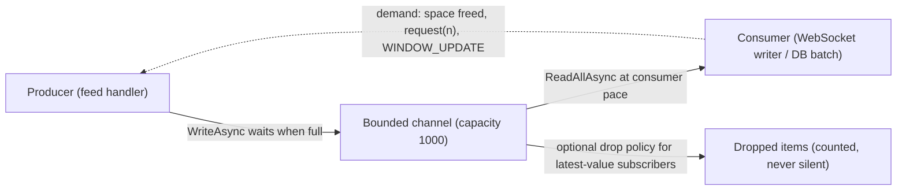

## Explanation

Backpressure is what a well-behaved pipeline does when data arrives faster than it can be processed: instead of letting the gap pile up in an unbounded buffer, the slow side tells the fast side to slow down. The Reactive Streams specification exists to standardise asynchronous stream processing with non-blocking backpressure, and its design notes explain the payoff: with demand mandatory, queues between stages stay bounded and unbounded buffers are never needed. Without it, a producer that outruns a consumer has only two outcomes, growing memory until the process dies or growing latency until the data is useless.

There are three responses to overload, and naming them is most of the design work. *Buffer* absorbs bursts with a bounded queue; it is lossless only while the burst is shorter than the buffer. *Drop* (also called sampling, throttling or load shedding) discards some items by policy, which is right when only the latest value matters and wrong when every item is a business event. *Block or signal* makes the producer wait, or hands it explicit demand so it never produces more than requested; this is backpressure proper, lossless and bounded, at the price of pushing the slowdown upstream until something at the edge either waits (a client) or sheds (a market-data feed that cannot be paused). The three compose: a bounded buffer with a drop policy for the UI, a blocking channel for the persistence path.

The mechanism shows up at every layer of the reader's stack, usually under another name. TCP's receive window is backpressure: the receiver advertises how many octets it is willing to accept, and a zero window stops the sender. HTTP/2 adds credit-based flow control per stream and per connection through `WINDOW_UPDATE` frames (initial window 65,535 octets, `DATA` frames only, controlled by the receiver, hop-by-hop rather than end-to-end). Reactive Streams defines it as `Subscription.request(n)`: a publisher must never signal more `onNext` than the subscriber has requested, demand is additive, and a request of `Long.MAX_VALUE` is treated as effectively unbounded. The WHATWG Streams Standard behind `fetch()` bodies defines a *queuing strategy* with a *high water mark*; `pull()` is only called while the queue is below it, and `pipeTo()` propagates the signal back through the chain. In .NET, `System.Threading.Channels` makes it a one-line choice: a bounded channel's `WriteAsync` waits for space (`BoundedChannelFullMode.Wait`, the default) or sheds with `DropOldest`, `DropNewest` or `DropWrite`. Python's `asyncio.Queue(maxsize)` blocks `await put()` at capacity. SignalR's `ApplicationMaxBufferSize` and `TransportMaxBufferSize` (64 KB on the server by default) are the bytes buffered before backpressure applies.

Messaging systems encode the same idea in their consumption model. Kafka's design chooses pull over push precisely so that a consumer that cannot keep up falls behind and catches up later, with long-poll requests avoiding busy waiting, whereas a push broker overwhelms a consumer whose rate drops below production. Redis Streams consumers pull with `XREADGROUP ... COUNT n BLOCK ms`, so the in-flight work is bounded by `COUNT` and the pending entries list. Where there is no demand signal, as in RxJS, [Server-Sent Events](server-sent-events.md) and [WebSocket](websocket.md) pushes, the only backpressure is the TCP window, which protects sockets, not application semantics: the hub's buffer grows and a disconnect loses everything buffered. That is why a tick flood into an Angular dashboard is handled with lossy operators (`auditTime` emits the newest value after each window, `throttleTime` emits the first and drops the rest) or lossless batching (`bufferTime`), chosen per subscriber, as the [real-time UI streaming](../frontend/realtime/real-time-ui-streaming.md) article discusses.



## How it differs

| Neighbour | Question it answers | Loses data? | Scope |
| --- | --- | --- | --- |
| Backpressure | how fast may the producer go? | no (blocking or demand) | one hop, any layer |
| [MAXLEN trim](maxlen-trim.md) | how much history is kept? | yes, oldest | the Redis stream |
| [Server-Sent Events](server-sent-events.md) | how does the server push? | n/a (transport) | server to client |
| [WebSocket](websocket.md) | how do both sides push? | n/a (transport) | one duplex connection |
| [Horizontal scaling](horizontal-scaling.md) | how much capacity exists? | no | the fleet |
| [Consumer group](consumer-group.md) | who processes which entries? | no | the stream's readers |

**Versus MAXLEN trim.** Trimming is a budget on stored history: it discards the oldest entries so memory stays flat, and a slow consumer silently misses what was trimmed. Backpressure is a budget on work in progress: the producer waits, nothing is discarded, and the delay is visible. Ticks that only matter when fresh are a trimming problem; order events that must all be processed are a backpressure problem.

**Versus Server-Sent Events.** SSE and WebSocket are push transports with no application-level demand signal; the browser cannot say "send fewer". Backpressure in such a design is added by the application, with a bounded channel per connection on the server, a drop policy for subscribers that only need the latest value, and TCP's window as the last resort. The transport is the pipe; backpressure is the valve.

**Versus WebSocket.** The same holds with both directions open: the protocol frames messages but never says how many the receiver can take. A server that awaits each send and feeds the socket from a bounded channel inherits TCP's brake; one that queues sends without limit has none. A browser cannot tell the server to slow down except by ceasing to read, which only stalls the socket, so the policy still has to live on the server.

**Versus horizontal scaling.** Adding consumers raises throughput and is the answer when the steady-state load exceeds one instance. It is not a brake: bursts above the new capacity still need bounded buffers, autoscaling lags by minutes, and some stages (a single-partition stream, a database primary) cannot be scaled by adding readers. Backpressure protects the system in the gap and reveals, through wait time, where the capacity is actually needed.

**Versus a consumer group.** A consumer group is a pull mechanism that happens to give backpressure, because each reader asks for `COUNT` entries when it is ready. The group itself is about partitioning work across readers and tracking acknowledgements; the demand-driven pacing is a consequence of pull, and it disappears the moment a reader pushes what it pulled into an unbounded in-memory queue.

## Examples

A market-data gateway reads a firehose, hands ticks to a WebSocket writer through a bounded channel (lossless), and offers a latest-value path for dashboards (lossy, counted).

=== "C#"

    ```csharp
    using System.Net.WebSockets;
    using System.Text.Json;
    using System.Threading.Channels;

    var channel = Channel.CreateBounded<Tick>(new BoundedChannelOptions(capacity: 1_000)
    {
        SingleWriter = true,
        SingleReader = true,
        FullMode = BoundedChannelFullMode.Wait,   // lossless: the producer awaits when the channel is full
    });

    async Task ProduceAsync(IAsyncEnumerable<Tick> feed, CancellationToken ct)
    {
        await foreach (var tick in feed.WithCancellation(ct))
            await channel.Writer.WriteAsync(tick, ct);   // completes only when there is room: this is the backpressure
        channel.Writer.Complete();
    }

    async Task ConsumeAsync(WebSocket socket, CancellationToken ct)
    {
        await foreach (var tick in channel.Reader.ReadAllAsync(ct))
            await socket.SendAsync(JsonSerializer.SerializeToUtf8Bytes(tick), WebSocketMessageType.Text, true, ct);
    }

    // Latest-value subscribers: shed instead of wait, but count what was shed.
    var dropped = 0;
    var latest = Channel.CreateBounded<Tick>(
        new BoundedChannelOptions(capacity: 1) { FullMode = BoundedChannelFullMode.DropOldest },
        itemDropped: _ => Interlocked.Increment(ref dropped));

    record Tick(string Symbol, decimal Bid, decimal Ask);
    ```

=== "Python"

    ```python
    import asyncio
    import json

    queue: asyncio.Queue[dict] = asyncio.Queue(maxsize=1_000)   # bounded: await put() blocks when full
    DONE = {"type": "done"}

    async def produce(feed):
        async for tick in feed:
            await queue.put(tick)        # backpressure: waits until the consumer makes room
        await queue.put(DONE)

    async def consume(ws):
        while (tick := await queue.get()) is not DONE:
            await ws.send(json.dumps(tick))
            queue.task_done()

    # Latest-value variant: shed the oldest instead of waiting, and count it.
    latest: asyncio.Queue[dict] = asyncio.Queue(maxsize=1)
    dropped = 0

    def offer_latest(tick: dict) -> None:
        global dropped
        if latest.full():
            latest.get_nowait()
            dropped += 1
        latest.put_nowait(tick)
    ```

=== "TypeScript"

    ```typescript
    import { auditTime, bufferTime, throttleTime } from 'rxjs';

    // ticks$ is a hot stream of WebSocket or SSE messages; RxJS has no demand signal, so choose a policy per subscriber.
    const latestPerFrame$ = ticks$.pipe(auditTime(16));       // at most ~60 updates/s, always the newest value (lossy)
    const firstPerSecond$ = ticks$.pipe(throttleTime(1000));  // emits the first value, ignores the rest for 1 s (lossy)
    const batches$ = ticks$.pipe(bufferTime(250));            // arrays of everything seen in 250 ms (lossless, bounded by time)
    ```

## Misconceptions

- **"Backpressure is just a buffer."** A buffer without a bound is the absence of backpressure; it only moves the failure from latency to memory. Backpressure is the bound plus the signal that stops or slows the producer when the bound is reached.
- **"RxJS handles backpressure."** RxJS is push-based with no `request(n)`; operators such as `auditTime`, `throttleTime` and `sampleTime` are *lossy* strategies and `bufferTime` is bounded batching. Reactive Streams, Project Reactor and `System.Threading.Channels` are the demand-driven designs.
- **"TCP flow control is enough."** It protects the socket, one hop at a time (HTTP/2 flow control is explicitly hop-by-hop), and says nothing about application buffers above it: a SignalR hub or a WebSocket writer still accumulates messages, and a disconnect discards them.
- **"Dropping data is always wrong."** For a latest-price dashboard, dropping stale ticks is the correct, bounded behaviour; for fills, orders and audit events it is data loss. The error is not choosing; it is dropping silently or buffering without limit.
- **"Just scale out."** Capacity and brakes are different controls. Autoscaling reacts late, bursts exceed any fixed capacity, and some stages cannot be parallelised; bounded buffers with explicit policies are what keep the system up while capacity catches up.

## Exam notes

Backpressure rarely appears by name, but the trade-off it names is examined constantly as "decoupling" and "throttling". AWS Certified Solutions Architect – Associate (SAA-C03) expects queues such as SQS between producers and consumers so components scale independently and bursts are absorbed, and asks about streaming data architectures; the trap is choosing fan-out when the scenario needs a buffer with bounded consumer concurrency. AWS Certified Data Engineer – Associate (DEA-C01) covers throttling and overcoming rate limits on Kinesis and databases, and fan-in and fan-out for streaming distribution, which is backpressure at the service-quota level. AWS Certified Generative AI Developer – Professional (AIP-C01) treats streaming and latency-cost trade-offs for token streams, where the client-side question is lossy versus lossless rendering. AWS Certified Developer – Associate (DVA-C03) and DevOps Engineer – Professional (DOP-C02) test the consumer side, batch sizes, dead-letter queues and event lifecycle handling. Across these, the reasoning to carry is: identify the slow stage, bound the buffer in front of it, decide per consumer whether to wait or to shed, and never let an unbounded queue hide the problem until it becomes an outage.

## Self-check

??? question "An Angular dashboard freezes during market opens because it renders every tick from a WebSocket, while a .NET persistence service behind the same feed must store every tick. What policy belongs where?"
    The dashboard subscriber only needs the latest value per symbol, so apply a lossy policy in the UI pipeline (auditTime per animation frame, or a capacity-one DropOldest channel on the server per connection). The persistence path must be lossless, so feed it through a bounded channel whose WriteAsync waits, batch the writes to TimescaleDB, and let the wait propagate to the feed handler rather than buffering without limit. Two policies, one source.

??? question "A Kafka consumer pulls 500 records per poll, pushes them into an in-memory List for a background thread, and the service runs out of memory under load. Where did the backpressure go?"
    The pull from Kafka was demand-driven, but the hand-off to the background thread was an unbounded push, so the consumer kept polling and the list grew without bound. Replace the list with a bounded channel (or process in the polling loop) so that a full channel pauses the next poll; Kafka then lets the consumer fall behind and catch up instead of the process dying.

??? question "Your SSE endpoint streams LLM tokens to browsers, and under load the server's memory climbs even though clients are slow. What is accumulating and what bounds it?"
    Each connection has server-side buffers above TCP: the response body buffer and any per-connection queue you fill from the model stream. Bound them with a per-connection bounded channel sized in tokens, await the write to the response body so a slow client slows the read from the model, and close idle or stalled connections. TCP's window only backs up to the socket; the application must stop pulling from the model when the client is not draining.

## Further reading

- [Real-time UI streaming](../frontend/realtime/real-time-ui-streaming.md), [RxJS state management](../frontend/angular/rxjs-state-management.md) and [async and threading](../messaging/runtime/async-threading.md).
- [SignalR and WebSockets](../messaging/realtime/signalr-websockets.md) and [Redis Streams vs. Kafka](../messaging/eventing/redis-streams-vs-kafka.md).
- [MAXLEN trim](maxlen-trim.md), [Server-Sent Events](server-sent-events.md), [WebSocket](websocket.md), [horizontal scaling](horizontal-scaling.md) and [consumer group](consumer-group.md).
- Reactive Streams specification: <https://github.com/reactive-streams/reactive-streams-jvm/blob/v1.0.4/README.md>
- System.Threading.Channels: <https://learn.microsoft.com/en-us/dotnet/core/extensions/channels>
