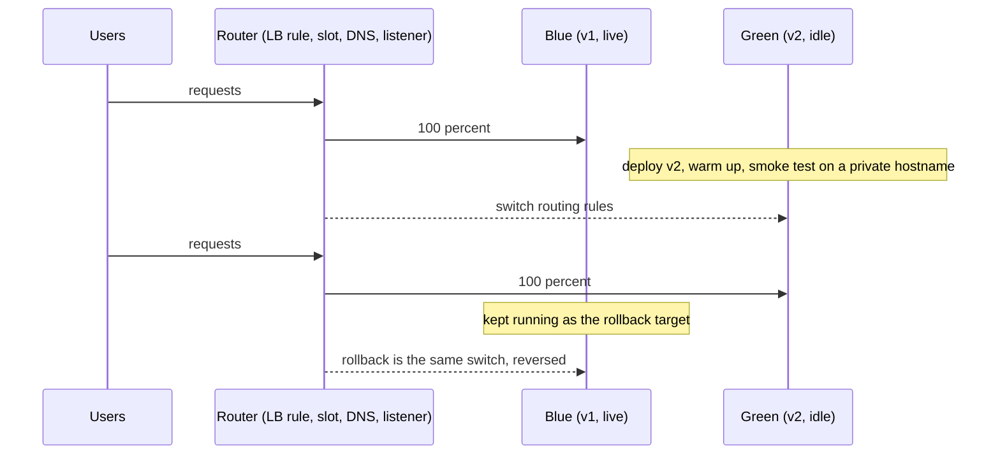

## Explanation

Martin Fowler wrote up blue-green deployment in 2010 as a way to make cut-over fast and reversible: run two production environments as identical as you can make them, call the live one blue, deploy and test the next release in the idle one, green, and when green is ready flip the router so every new request lands on green. Blue stays running but idle; if green misbehaves, flip back. Rollback is the same operation as release, which is why the pattern is loved by anyone who has tried to "undeploy" a bad build at three in the morning.



The "router" is whatever decides where a request goes: a load balancer listener rule, an App Service slot's routing table, a DNS record, a Kubernetes Service selector, a Lambda alias. The more atomic the switch, the better the pattern works. DNS-based switches (Elastic Beanstalk's CNAME swap, Traffic Manager) are the weakest because resolvers cache records and some clients keep hitting blue after the flip; a listener rule or slot swap moves new connections at once.

What makes blue-green hard is state, and the paragraph Fowler added in a 2015 update is about exactly that: the database. Both colours usually share one database, so green's schema changes must be applied before the switch in a form blue still understands, the expand phase of the [parallel change](https://martinfowler.com/bliki/ParallelChange.html) pattern; the contract phase that drops old columns waits until blue is retired. Alternatives are a read-only mode across the cut-over, or feeding writes to both environments. The same compatibility rule applies to message formats on Redis Streams, cache entries, and anything else that outlives a request.

The platforms use different vocabulary:

- **Azure App Service deployment slots** (Standard tier and above; five slots on Standard, twenty on Premium and Isolated). A swap applies the production slot's sticky settings to the staging instances, restarts them, warms them up by requesting the application root or `WEBSITE_SWAP_WARMUP_PING_PATH`, and only then switches the routing rules. Deployment-slot settings stay with their slot; scale settings, custom domains, managed identities and VNet integration never swap. Swap with preview pauses after the first phase so you can test staging with production settings; rolling back is swapping again.
- **Azure Container Apps** uses revisions, traffic weights and labels: deploy a new revision at weight 0, test it on its label hostname, then set blue=0 and green=100.
- **AWS CodeDeploy** on EC2 provisions a replacement fleet (by copying the Auto Scaling group or from tagged instances), installs the revision, optionally waits for manual verification, registers the green instances with the load balancer, deregisters blue, and terminates or keeps blue after a wait. Lambda and ECS deployments in CodeDeploy are always blue/green, with the traffic shift all-at-once, linear or canary; ECS also has a native blue/green deployment type with a bake time, lifecycle hooks and a test listener for validating green before production traffic moves.
- **Kubernetes** has no built-in blue-green: run two Deployments and repoint the Service selector, or use Argo Rollouts, which adds a preview service and an active service.

For the reader's stack the practical details are the usual ones: EF Core migrations are applied in expand form before the swap, the readiness endpoint refuses to report ready until the required migration is present, hashed Angular assets for both versions stay available during the flip so a browser holding v1's `index.html` can still fetch v1's chunks, SignalR clients reconnect to green and need a backplane or Azure SignalR Service, and green's background consumers stay paused until cut-over so both colours do not process the same stream concurrently.

## How it differs

**[Canary release](canary-release.md)** and blue-green are often confused because both start by deploying the new version alongside the old. The difference is the exposure curve. Blue-green exposes 0 percent of real traffic to green until the moment it exposes 100 percent; its confidence comes from tests, smoke checks and a swap-with-preview phase. A canary exposes a small slice of real traffic and builds confidence from production metrics, widening step by step. Many platforms blend the two (App Service lets you route 10 percent to the staging slot before swapping; CodeDeploy ECS and Lambda blue/green deployments shift traffic on a canary or linear schedule), which is useful but muddies the vocabulary: ask whether the decision to proceed is based on live-traffic measurement, and if so you are running a canary.

**[Rolling deployment](rolling-deployment.md)** needs no second environment: it replaces instances in batches within the one you have, so capacity cost is small but old and new versions serve concurrently behind one endpoint and rollback is a second roll in reverse. Blue-green needs the capacity for two environments for the duration of the release (slots share the App Service plan's instances, so there the cost is memory rather than extra VMs), never mixes versions for a given endpoint, and rolls back in seconds. Choose rolling when capacity is tight and versions are compatible; choose blue-green when instant rollback and a clean verification window matter more.

**[Immutable infrastructure](immutable-infrastructure.md)** describes what green is built from. CodeDeploy's EC2 blue/green provisions fresh instances, which is both immutable and blue-green; a slot swap moves routing between two long-lived slots that were each deployed by copying files, which is blue-green on mutable hosts. The two concepts are independent axes.

**[Health check](health-check.md)** is the gate, not the strategy. App Service will not swap until every staging instance answers the warm-up request; CodeDeploy will not reroute until green instances pass the load balancer's health checks. A health check answers "is this instance up?", while the blue-green decision needs "is this version correct?", which comes from smoke tests, swap-with-preview validation, or a canary phase.

| | Blue-green | Canary | Rolling |
| --- | --- | --- | --- |
| Environments needed | Two full environments during the release | One, plus a small canary slice | One |
| Versions serving one endpoint at once | One | Two, by design | Two, transiently |
| Decision input before full exposure | Tests and verification of idle green | Live-traffic metrics versus control | Health checks per batch |
| Rollback | Switch back, seconds | Route the slice back, seconds | Roll back batch by batch |
| Database requirement | Schema compatible with both versions | Same | Same |

## Examples

**Green must prove it is ready before the switch.** The readiness endpoint checks that the schema migration this build depends on has already been applied, and every response reveals which colour served it so you can verify the flip from the outside.

=== "C#"

    ```csharp
    // Program.cs (.NET 9, EF Core, Npgsql.EntityFrameworkCore.PostgreSQL). App Service warm-up:
    // WEBSITE_SWAP_WARMUP_PING_PATH=/ready, WEBSITE_SWAP_WARMUP_PING_STATUSES=200, so a failing
    // readiness check stops the swap.
    using Microsoft.AspNetCore.Diagnostics.HealthChecks;
    using Microsoft.EntityFrameworkCore;
    using Microsoft.Extensions.Diagnostics.HealthChecks;

    var builder = WebApplication.CreateBuilder(args);
    builder.Services.AddDbContext<OrdersDbContext>(o => o.UseNpgsql(builder.Configuration.GetConnectionString("Orders")));
    builder.Services.AddHealthChecks()
        .AddCheck<SchemaCompatibilityCheck>("schema", tags: ["ready"]);

    var app = builder.Build();
    // A normal (non-sticky) app setting: it travels with the code on a swap, so after the flip
    // the production hostname answers "green". A slot-sticky setting would always say "blue".
    var colour = app.Configuration["DEPLOYMENT_COLOUR"] ?? "unknown";
    app.Use(async (ctx, next) =>
    {
        ctx.Response.Headers["X-Deployment-Colour"] = colour;
        await next(ctx);
    });
    app.MapHealthChecks("/healthz");
    app.MapHealthChecks("/ready", new HealthCheckOptions { Predicate = r => r.Tags.Contains("ready") });
    app.Run();

    public sealed class SchemaCompatibilityCheck(OrdersDbContext db) : IHealthCheck
    {
        // Applied in the expand phase, before the swap; blue keeps working because the change is additive.
        private const string RequiredMigration = "20261020103000_AddOrderChannel";

        public async Task<HealthCheckResult> CheckHealthAsync(HealthCheckContext context, CancellationToken ct = default)
        {
            var applied = await db.Database.GetAppliedMigrationsAsync(ct);
            return applied.Contains(RequiredMigration)
                ? HealthCheckResult.Healthy()
                : HealthCheckResult.Unhealthy($"Migration {RequiredMigration} is not applied; refusing to go live.");
        }
    }
    ```

=== "Python"

    ```python
    # app.py (Python 3.12, FastAPI, SQLAlchemy, Alembic). The readiness check refuses to report
    # ready until the expand-phase migration is present, so the swap or cut-over is blocked.
    import os

    from fastapi import FastAPI, Request, Response
    from sqlalchemy import create_engine, text

    REQUIRED_REVISION = "c3a1f2e9d7b4"          # the Alembic revision this build depends on
    COLOUR = os.environ.get("DEPLOYMENT_COLOUR", "unknown")
    engine = create_engine(os.environ["ORDERS_DSN"], pool_pre_ping=True)
    app = FastAPI()


    @app.middleware("http")
    async def stamp_colour(request: Request, call_next):
        response = await call_next(request)
        response.headers["X-Deployment-Colour"] = COLOUR
        return response


    @app.get("/ready")
    def ready(response: Response) -> dict[str, str]:
        with engine.connect() as conn:
            current = conn.execute(text("SELECT version_num FROM alembic_version")).scalar_one()
        if current != REQUIRED_REVISION:
            response.status_code = 503
            return {"status": "schema-mismatch", "current": current}
        return {"status": "ready"}
    ```

=== "Azure"

    ```bash
    # App Service deployment slots: production is always the target of the swap.
    az webapp deployment slot create --resource-group rg-app --name orders-api --slot staging

    # --slot-settings KEY=VALUE pins a setting to its slot; --settings travel with the code on a swap.
    # Production's sticky values are applied to the staging instances during phase one of the swap.
    az webapp config appsettings set --resource-group rg-app --name orders-api \
      --slot-settings ASPNETCORE_ENVIRONMENT=Production
    az webapp config appsettings set --resource-group rg-app --name orders-api --slot staging \
      --slot-settings ASPNETCORE_ENVIRONMENT=Staging \
      --settings DEPLOYMENT_COLOUR=green WEBSITE_SWAP_WARMUP_PING_PATH=/ready WEBSITE_SWAP_WARMUP_PING_STATUSES=200

    # Deploy green, then swap with preview: phase one applies production settings to staging and pauses.
    az webapp deploy --resource-group rg-app --name orders-api --slot staging --type zip --src-path ./orders-api.zip
    az webapp deployment slot swap --resource-group rg-app --name orders-api --slot staging --target-slot production --action preview
    curl -sI https://orders-api-staging.azurewebsites.net/ready       # test with production settings applied
    az webapp deployment slot swap --resource-group rg-app --name orders-api --slot staging --target-slot production --action swap
    # Rollback: run the same swap again. Cancel a paused preview with --action reset.

    # Container Apps: revisions with labels, traffic switched by weight.
    az containerapp ingress traffic set --resource-group rg-app --name orders-api --label-weight blue=0 green=100
    ```

=== "AWS"

    ```bash
    # CodeDeploy, EC2 compute platform: a blue/green deployment group that copies the Auto Scaling
    # group for green, waits up to 30 minutes for manual verification, then terminates blue after an hour.
    cat > bluegreen.json <<'EOF'
    {
      "terminateBlueInstancesOnDeploymentSuccess": { "action": "TERMINATE", "terminationWaitTimeInMinutes": 60 },
      "deploymentReadyOption": { "actionOnTimeout": "STOP_DEPLOYMENT", "waitTimeInMinutes": 30 },
      "greenFleetProvisioningOption": { "action": "COPY_AUTO_SCALING_GROUP" }
    }
    EOF
    aws deploy create-deployment-group --application-name orders-api --deployment-group-name orders-api-bg \
      --service-role-arn arn:aws:iam::123456789012:role/CodeDeployServiceRole \
      --auto-scaling-groups asg-orders-api \
      --deployment-style deploymentType=BLUE_GREEN,deploymentOption=WITH_TRAFFIC_CONTROL \
      --load-balancer-info targetGroupInfoList=[{name=tg-orders-api}] \
      --blue-green-deployment-configuration file://bluegreen.json

    # Elastic Beanstalk: two environments, switched by swapping their CNAMEs (DNS, so respect TTLs).
    aws elasticbeanstalk swap-environment-cnames \
      --source-environment-name orders-api-blue --destination-environment-name orders-api-green

    # Lambda: an alias update is an atomic blue/green switch between two published versions.
    aws lambda update-alias --function-name orders --name live --function-version 42
    ```

## Misconceptions

- **"Blue-green makes rollback risk-free."** Rolling back the code is instant; rolling back the data is not. Writes that green accepted after the flip still exist when blue returns, and any schema or message-format change that blue cannot read turns the switch back into an outage. Expand-and-contract migrations and read-only windows exist for this reason.
- **"An App Service swap moves the app to different machines."** Slots are separate live apps on the same App Service plan, sharing its instances. The swap applies settings, restarts and warms the staging instances, and then switches routing; the former production workers are recycled, which abandons long-running work in them.
- **"Blue-green doubles the bill permanently."** It needs double capacity only for the release window. CodeDeploy can terminate blue after a configurable wait, Container Apps can deactivate the old revision, and slots share a plan.
- **"A DNS switch is instantaneous."** Recursive resolvers and clients cache records, so an Elastic Beanstalk CNAME swap or a Traffic Manager change drains over the TTL and sometimes longer, which is why the Beanstalk guidance is to keep the old environment alive until the old records expire.
- **"Green passed health checks, so it is safe."** Health checks prove liveness, not correctness. Use swap with preview, smoke tests against the green hostname, or a short canary phase to test behaviour before committing all traffic.

## Exam notes

AZ-104 (objective "Configure deployment slots for an App Service") tests the mechanics: which tiers support slots, what a swap does, which settings are swapped and which are slot-sticky, swap with preview, auto swap (not available on Linux apps or Web App for Containers), warm-up settings, and the fact that rollback is another swap. AZ-400 and its successor AZ-401 name blue-green, canary, ring, progressive exposure, feature flags and A/B testing in the same objective and ask you to pick one for a scenario, with slot swaps and rolling deployments listed under minimising downtime; AZ-305 frames it as a zero-downtime and recovery design choice. On AWS, DVA-C02/C03 cover CodeDeploy deployment types, Elastic Beanstalk environment URL swaps and Lambda alias switching; DOP-C02 goes deep on CodeDeploy's EC2 blue/green options (replacement fleet provisioning, wait time, blue instance termination), ECS blue/green with test listeners, and CloudFormation-driven ECS blue/green; SAA-C03 and SAP-C03 reach for Route 53 weighted or failover records and Beanstalk swaps. CKAD names blue/green explicitly ("use Kubernetes primitives for common deployment strategies"), so expect to implement it with two Deployments and a Service selector change.

Traps that recur: Lambda and ECS deployments in CodeDeploy are always blue/green, while EC2 can be in-place or blue/green and on-premises instances cannot do blue/green at all; a blue/green EC2 deployment requires a load balancer; swap with preview is unavailable when App Service authentication is enabled on a slot; scale settings, custom domains, managed identities and VNet integration never swap; and the Beanstalk CNAME swap is DNS-based, so it is the slow kind of switch.

## Self-check

??? question "After swapping the staging slot into production, users report that uploads started during the last minute before the swap vanished. The upload handler writes to the local disk and finishes asynchronously. Why, and what should change?"
    The former production instances are swapped into the staging slot and recycled at the end of the swap, abandoning long-running work in those worker processes, and local disk state does not follow the swap. Uploads should be written to durable storage (Blob Storage) and long-running work should be queued, for example to a Redis Stream processed by a worker that acknowledges only after completion. Blue-green assumes the environment being retired holds nothing that matters.

??? question "You need to add a non-nullable column to the orders table for v2. The team plans to run the migration as part of the green deployment and swap immediately. What will go wrong, and what is the safe sequence?"
    Blue and green share the database. A non-nullable column without a default breaks blue's inserts the moment the migration runs, and if the swap is rolled back, blue is now running against a schema it never expected. Use parallel change: expand first by adding the column as nullable or with a default (a change both versions tolerate), deploy and verify, swap to green, and only after blue is retired contract by making the column non-nullable and removing legacy code. The readiness endpoint on green should check that the expand migration is applied before the swap is allowed.

??? question "A CodeDeploy EC2 blue/green deployment succeeded, but the on-call engineer cannot roll back because the blue instances are gone. Which setting controls this, and what is the trade-off?"
    `terminateBlueInstancesOnDeploymentSuccess` with `action: TERMINATE` and a `terminationWaitTimeInMinutes`. A short wait saves money but removes the instant rollback path, after which recovery means redeploying the previous revision as a new blue/green deployment. Keeping blue alive for a longer window (or `KEEP_ALIVE`) preserves the switch-back option at the cost of running two fleets for that time.

## Further reading

- [CI/CD pipelines](../devops/ci-cd-pipelines.md) for where the swap or traffic switch is triggered, and [Docker and containerization](../devops/docker-containerization.md) for building the green artifact.
- [Real-time UI streaming](../frontend/realtime/real-time-ui-streaming.md) and [SignalR and WebSockets](../messaging/realtime/signalr-websockets.md) for what happens to persistent connections during a switch.
- Neighbouring terms: [Canary Release](canary-release.md), [Rolling Deployment](rolling-deployment.md), [Immutable Infrastructure](immutable-infrastructure.md), [Health Check](health-check.md), [Readiness Probe](readiness-probe.md).
- [Martin Fowler, BlueGreenDeployment](https://martinfowler.com/bliki/BlueGreenDeployment.html) and [Danilo Sato, ParallelChange](https://martinfowler.com/bliki/ParallelChange.html): the pattern and its database companion.
- [Azure App Service deployment slots](https://learn.microsoft.com/en-us/azure/app-service/deploy-staging-slots), [Azure Container Apps blue-green deployment](https://learn.microsoft.com/en-us/azure/container-apps/blue-green-deployment), [CodeDeploy deployment types](https://docs.aws.amazon.com/codedeploy/latest/userguide/welcome.html) and [Amazon ECS blue/green deployments](https://docs.aws.amazon.com/AmazonECS/latest/developerguide/deployment-type-blue-green.html): the platform mechanics.
