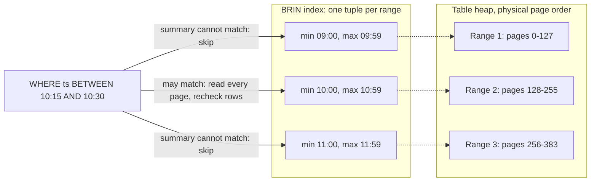

## Explanation

A Block Range Index (BRIN) is a PostgreSQL index access method that summarises a table instead of enumerating it. PostgreSQL stores every table as an array of fixed-size pages (8 kB by default). A BRIN index groups physically adjacent pages into *block ranges* and stores one index tuple per range. The `pages_per_range` storage parameter, 128 pages by default, fixes the range size at creation, so one BRIN tuple normally describes 1 MB of heap. With the default `minmax` operator classes that tuple holds only the lowest and highest value of the indexed column within the range.

A scan works by elimination. For `WHERE ts >= '2026-10-23' AND ts < '2026-10-24'` the executor reads the whole index (it is tiny), discards every range whose minimum and maximum cannot overlap the predicate, and builds a bitmap of the pages that remain. A range summary says nothing about individual rows, so the index is *lossy*: every row in a surviving range is fetched and rechecked against the predicate in a bitmap heap scan. BRIN therefore never answers a point lookup, enforces no uniqueness and returns nothing in sorted order; its one job is to shrink the heap a range query touches.

The index exists for append-mostly tables. A [B-tree index](b-tree-index.md) on the timestamp of a billion-row trades table holds a billion entries and is written on every insert. The BRIN equivalent holds one tuple per megabyte of table and barely changes, because an insert only touches the summary when the new value falls outside the current bounds of its range. Ranges added after the index was built stay unsummarised until `VACUUM` (manual or autovacuum) summarises them or `brin_summarize_new_values()` is called; the `autosummarize` parameter, off by default, queues that work during autovacuum instead. Unsummarised ranges are always scanned, so results stay correct.

The design rests on one requirement: the indexed column must be well correlated with the physical row order. PostgreSQL measures this as `pg_stats.correlation`, which runs from -1 to +1. Values near either extreme mean physical order tracks logical order; values near zero mean every range spans nearly the whole domain, nothing is skipped, and the scan ends up reading the entire table plus the recheck overhead. Correlation decays quietly: late-arriving backfills, `UPDATE`s that relocate row versions under [MVCC](mvcc.md), bulk deletes whose freed space is refilled with newer rows, and random keys such as UUIDv4 all widen ranges, and a range never shrinks on its own. `CLUSTER` rewrites the table in index order but is a one-time operation under an `ACCESS EXCLUSIVE` lock, `pg_repack` does the same online, and [table partitioning](table-partitioning.md) keeps each partition naturally ordered. PostgreSQL 14 added `minmax_multi` operator classes, which keep several intervals per range (32 values by default) so a few outliers do not poison a summary, and `bloom` classes for equality checks on columns that are not localised at all.

In the reader's stack BRIN has two uses. A TimescaleDB [hypertable](hypertable.md) already creates a B-tree on `(time DESC)` per chunk and excludes chunks by their time bounds, so BRIN is a candidate for a second column that rides along with time, such as an exchange sequence number, or for a plain PostgreSQL partition. The same idea sits inside every analytical engine: TimescaleDB's columnstore keeps a min/max sparse index per compressed segment, Amazon Redshift keeps the minimum and maximum of each 1 MB block in its zone maps, and SQL Server columnstore indexes eliminate segments and rowgroups from stored minimum and maximum values.



## How it differs

**[B-tree index](b-tree-index.md).** A B-tree is a balanced tree whose leaf pages hold one sorted entry per row, each pointing at the row's location. It can seek to one row, walk a range in order, feed `ORDER BY` without a sort and enforce uniqueness, and it does all of that regardless of how rows are laid out on disk. The price is an index that grows with the row count and a leaf-page write on every insert. BRIN inverts the trade: one tuple per block range, almost free writes, but only a lossy "which ranges might match" answer. Choose B-tree for selective lookups and ordering, BRIN for range scans over very large, naturally ordered, append-mostly columns, and expect to keep both on the same table (B-tree on `(symbol, time)`, BRIN on `time` or a sequence number).

**[Partition pruning](partition-pruning.md).** Pruning happens in the planner: declared partition bounds, or chunk bounds in TimescaleDB, let it drop whole partitions before any I/O. BRIN happens in the executor inside one relation and depends on statistics that must stay true as the heap changes. Pruning is exact and never decays, but its granularity is a whole partition and it needs a partitioning scheme; BRIN is finer, needs no schema change, and decays. The common pattern is both: partition by month, and let BRIN or a B-tree narrow the search inside the month.

**[Columnar storage](columnar-storage.md).** Column stores (TimescaleDB's columnstore, SQL Server columnstore indexes, Redshift, Parquet files) keep per-segment or per-block minimum and maximum values and skip segments that cannot match. That is BRIN's trick built into the storage format, usually with compression and vectorised scans on top. The decisive difference is the layout: a column store reorganises the data and makes point updates expensive, whereas BRIN leaves the row-oriented heap untouched and only adds a summary beside it. Use BRIN on hot, row-oriented data that must still take fast inserts and updates; convert to columnar once the data is cold.

**[Hypertable](hypertable.md).** A hypertable partitions by time into chunks, excludes chunks from a query by their bounds, and by default builds a B-tree on `(time DESC)` in every chunk. For the time column that combination already gives you what BRIN would, so a BRIN there is rarely worth it. BRIN earns its place on a secondary column correlated with time, or on a plain PostgreSQL table where you do not want partitioning at all.

| | BRIN | B-tree |
|---|---|---|
| Index entries | one per block range (128 pages by default) | one per row version |
| Size | grows with table size divided by range size | grows with row count |
| Point lookup, uniqueness, `ORDER BY` | no | yes |
| Needs physical correlation | yes, decisively | no |
| Insert cost | near zero unless a range's bounds widen | one leaf-page write per row |
| Scan result | lossy bitmap, rows rechecked | exact row locations |

## Examples

A plain PostgreSQL tick table (no TimescaleDB) whose rows arrive in time order:

```sql
CREATE TABLE trades (
  id      bigint GENERATED ALWAYS AS IDENTITY,
  time    timestamptz   NOT NULL,
  symbol  text          NOT NULL,
  price   numeric(18,8) NOT NULL,
  size    bigint        NOT NULL
);

-- One summary per 32 pages (256 kB) instead of one entry per row
CREATE INDEX trades_time_brin ON trades USING brin (time) WITH (pages_per_range = 32);

-- Is the column actually correlated with physical order? ANALYZE first.
ANALYZE trades;
SELECT correlation FROM pg_stats WHERE tablename = 'trades' AND attname = 'time';
-- 0.99: tight ranges.  0.10: the index skips almost nothing.

-- Summarise ranges that autovacuum has not reached yet
SELECT brin_summarize_new_values('trades_time_brin');

-- Expect "Bitmap Index Scan on trades_time_brin" feeding a "Bitmap Heap Scan"
-- that reports "Rows Removed by Index Recheck"
EXPLAIN (ANALYZE, BUFFERS)
SELECT count(*) FROM trades WHERE time >= '2026-10-23' AND time < '2026-10-24';
```

=== "C#"

    ```csharp
    // EF Core 9 with Npgsql.EntityFrameworkCore.PostgreSQL
    public sealed class Trade
    {
        public long Id { get; set; }
        public DateTime Time { get; set; }          // timestamptz, UTC
        public string Symbol { get; set; } = "";
        public decimal Price { get; set; }
        public long Size { get; set; }
    }

    public sealed class MarketDbContext(DbContextOptions<MarketDbContext> options) : DbContext(options)
    {
        public DbSet<Trade> Trades => Set<Trade>();

        protected override void OnModelCreating(ModelBuilder modelBuilder)
        {
            var trades = modelBuilder.Entity<Trade>();

            // Append-only table: physical order tracks time, so a range summary is enough.
            trades.HasIndex(t => t.Time)
                  .HasMethod("brin")
                  .HasStorageParameter("pages_per_range", 32);

            // Selective lookups and symbol-scoped ranges still need a B-tree.
            trades.HasIndex(t => new { t.Symbol, t.Time });
        }
    }

    // Operational check from a health endpoint: is the BRIN still worth having?
    public static async Task<float?> TimeCorrelationAsync(NpgsqlDataSource dataSource, CancellationToken ct)
    {
        await using var cmd = dataSource.CreateCommand(
            "SELECT correlation FROM pg_stats WHERE tablename = 'trades' AND attname = 'time'");
        return await cmd.ExecuteScalarAsync(ct) as float?;   // null until ANALYZE has run
    }
    ```

=== "Python"

    ```python
    import psycopg

    # The context manager commits on a clean exit and closes the connection.
    with psycopg.connect("postgresql://app@localhost/market") as conn:
        conn.execute("""
            CREATE INDEX IF NOT EXISTS trades_time_brin
                ON trades USING brin (time) WITH (pages_per_range = 32)
        """)
        conn.execute("ANALYZE trades")
        (corr,) = conn.execute(
            "SELECT correlation FROM pg_stats WHERE tablename = 'trades' AND attname = 'time'"
        ).fetchone()
        print(f"correlation={corr:.3f}")        # near +1 or -1 means tight ranges

        plan = conn.execute("""
            EXPLAIN (ANALYZE, BUFFERS)
            SELECT count(*) FROM trades
            WHERE time >= '2026-10-23' AND time < '2026-10-24'
        """).fetchall()
        print("\n".join(line for (line,) in plan))   # look for Bitmap Index Scan on trades_time_brin
    ```

=== "Azure"

    Azure Database for PostgreSQL flexible server is unmodified PostgreSQL, so `USING brin`, `pg_stats.correlation`, `CLUSTER` and `pg_repack` (listed in its extension catalogue) all work as shown above.

    Azure SQL Database and SQL Server have no BRIN access method. Rowstore indexes are B+ trees; the equivalent of a range summary lives in columnstore indexes, where each column segment stores its minimum and maximum so the engine can skip rowgroups that cannot satisfy a predicate (*segment elimination*, extended to string, binary and GUID columns from SQL Server 2022). The same correlation rule applies: Microsoft's guidance is to load in the order you filter by, or use an ordered columnstore index, because the engine never maintains the order for you.

=== "AWS"

    Amazon RDS for PostgreSQL and Aurora PostgreSQL run the standard access methods, so BRIN is available and behaves as above.

    Amazon Redshift has no secondary indexes at all. It stores columnar data in 1 MB blocks and keeps the minimum and maximum of every block as metadata (zone maps); a range-restricted predicate skips blocks that cannot match, up to 98 percent of them in the documentation's five-years-of-data, one-month-query example. The tuning knob is the sort key (`SORTKEY AUTO` is the recommendation, compound keys when you update regularly): keeping data sorted by the filter column is the same correlation requirement BRIN has, enforced by `VACUUM` rather than by `CLUSTER`.

## Misconceptions

- **"BRIN is just a smaller B-tree."** It is a different contract. A B-tree locates rows; BRIN only rules out page ranges and hands every surviving row to the executor for a recheck. It cannot seek, sort or enforce uniqueness, and a `WHERE id = 42` lookup gains nothing from it.
- **"If the index exists the planner will use it."** The planner weighs `pg_stats.correlation`. On a column with correlation near zero it will correctly prefer a sequential scan, and even when BRIN is chosen the result is always a bitmap heap scan with recheck, never an index-only scan.
- **"Inserts maintain BRIN like any other index."** Only a value outside the current bounds changes a summary, and brand-new ranges are not summarised at all until `VACUUM`, `autosummarize` or `brin_summarize_new_values()` runs. Queries stay correct meanwhile because unsummarised ranges are always scanned.
- **"A smaller `pages_per_range` is always better."** Smaller ranges mean tighter summaries but a bigger index that must be read in full on every scan. The right size depends on how many pages a typical query touches; 128 is the default for a reason.
- **"Updates do not matter because BRIN only summarises."** Under MVCC an `UPDATE` writes a new row version, possibly on a distant page, which widens that range's bounds permanently until the range is desummarised and rebuilt. Heap-only tuple updates on the same page avoid it; a `CLUSTER` or `pg_repack` undoes the damage.

## Exam notes

No current exam names BRIN, but the idea behind it is tested constantly in other vocabulary. DP-300 frames index design as rowstore (B+ tree) versus columnstore, and the columnstore questions hinge on segment and rowgroup elimination plus the advice to load data in filter order; recognise that as the BRIN correlation rule. DEA-C01 asks for indexing, partitioning and compression best practices, where the Redshift answer is a sort key whose zone maps skip blocks and the data-lake answer is partitioned columnar files whose footers carry min/max statistics. AZ-305 and SAA-C03 stay at the level of choosing a time-series or columnar store for append-heavy, range-scanned data. The trap in all of them is assuming an index is free: a question that mentions billions of rows arriving in time order and queried by range is steering you towards range summaries and partitioning, not a B-tree on every column.

## Self-check

??? question "A 2 TB table of exchange ticks is written strictly in time order and queried by symbol over time ranges. Which indexes do you create, and why not just one?"
    Two. A B-tree on `(symbol, time)` gives the selective seek (one symbol, then an ordered walk through its range), which BRIN cannot provide. A BRIN on `time` or on the exchange sequence number serves whole-market range scans and backfill jobs at a tiny fraction of the space and write cost of a second B-tree. If the table is a TimescaleDB hypertable, chunk exclusion and the default per-chunk `(time DESC)` B-tree already cover the time dimension, so you would add the composite B-tree and consider BRIN only for the correlated secondary column.

??? question "A BRIN index that used to prune well now makes the query read the whole table. Nothing in the schema changed. What happened and how do you fix it?"
    Correlation decayed. A backfill of late data, updates that relocated row versions, or deletes whose freed space was refilled by newer rows widened the min/max of many ranges, and ranges never shrink by themselves. Confirm with `pg_stats.correlation` after `ANALYZE`. Fix physically: `CLUSTER` (offline, `ACCESS EXCLUSIVE` lock) or `pg_repack` (online) to restore order, partition so each partition is naturally ordered, or rebuild the index with the `minmax_multi` operator class so a few outliers no longer poison a whole range.

??? question "The team wants to enforce that (symbol, exchange_seq) is unique and proposes a BRIN index because the table is huge. What do you say?"
    BRIN cannot enforce uniqueness or perform point lookups; it only summarises ranges and rechecks rows. Uniqueness needs a unique B-tree. If the index size is the worry, point out that the unique index also serves the point lookups the application will need, and that partitioning, not BRIN, is the lever for keeping each index small.

## Further reading

- [High-Frequency Indexing & Partitioning](../data/time-series/high-frequency-indexing-partitioning.md), the library article on these trade-offs.
- [Row-Oriented vs. Columnar Storage](../data/time-series/row-vs-columnar-storage.md), for where per-segment min/max metadata replaces BRIN.
- [B-Tree Index](b-tree-index.md), [Partition Pruning](partition-pruning.md), [Hypertable](hypertable.md), [Table Partitioning](table-partitioning.md), [MVCC](mvcc.md).
- [PostgreSQL 14 release notes](https://www.postgresql.org/docs/release/14.0/), the release that added `minmax_multi` and `bloom` BRIN operator classes.
- [Amazon Redshift sort keys](https://docs.aws.amazon.com/redshift/latest/dg/t_Sorting_data.html) and [SQL Server columnstore query performance](https://learn.microsoft.com/en-us/sql/relational-databases/indexes/columnstore-indexes-query-performance), the zone-map and segment-elimination cousins.
