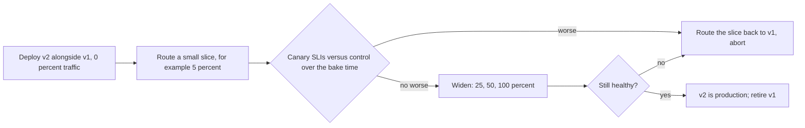

## Explanation

The name is the coal-mine canary: a small, sensitive population that shows distress before the whole mine is in danger. Danilo Sato's 2014 write-up defines a canary release as rolling a change out to a small subset of users first, and Google's SRE Workbook sharpens it into a partial, time-limited deployment of a change plus an *evaluation*. The evaluation is the point. The subset that receives the change is the canary; the rest of the fleet, still on the old version, is the control; the release proceeds only if the canary's service-level indicators (SLIs: error rate, latency, saturation, business conversions) are no worse than the control's over a bake period long enough to be representative.



Mechanically a canary needs four things. A **routing layer** that can split traffic by percentage or by cohort: a load balancer with weighted target groups, an App Service slot routing rule, Container Apps revision weights, a service mesh, a Lambda alias with version weights, an API Gateway stage with canary settings, or a feature flag inside the application. **Coexisting versions**, which means every change crossing the boundary (API contracts, message formats on Redis Streams, the database schema) must be compatible with both, exactly as for blue-green. **Observability that can attribute**: metrics must carry a dimension that says which version served the request, otherwise the canary's errors dissolve into the fleet average. And a **decision rule**, automated where possible: CodeDeploy's canary configurations roll back on CloudWatch alarms, Argo Rollouts queries Prometheus between steps, Azure Pipelines' canary strategy runs a `postRouteTraffic` hook before the next increment.

The SRE Workbook's advice on canary design is worth internalising. Pick a canary population and duration large enough to see a signal: a 1 percent canary of a low-traffic service at 3 a.m. proves nothing, and performance regressions often appear only under peak load. Run one canary at a time so that effects are attributable. Choose a dozen or fewer metrics that reflect what users feel, tied to SLIs; HTTP status codes and latency are strong signals, CPU is noisy. Compare canary against control concurrently rather than against yesterday, because time of day is itself a cause of metric change. The Azure Well-Architected Framework's safe deployment practices (OE:11) say the same in release-ring vocabulary: progressive exposure, health models that gate each ring, and bake times measured in hours or days rather than minutes.

Where it shows up: Lambda weighted aliases and CodeDeploy's `LambdaCanary10Percent5Minutes` family; CodeDeploy-managed ECS blue/green deployments with `CodeDeployDefault.ECSCanary10Percent5Minutes`, and since October 2025 the canary and linear strategies built into ECS itself; Elastic Beanstalk traffic-splitting deployments; API Gateway stage canaries; App Service slot traffic routing (which pins a client to its slot with the `x-ms-routing-name` cookie for an hour, so a user's experience stays consistent); Container Apps revision weights; the canary strategy in Azure Pipelines deployment jobs for Kubernetes; and Argo Rollouts or a [service mesh](service-mesh.md) on AKS or EKS. In the reader's stack, an ASP.NET Core API tags its metrics with the deployment colour so a Prometheus or Azure Monitor query can compare the two populations; an Angular front end is canaried by routing a slice of users to the new static build; a new version of a Redis Streams worker joins the same consumer group as the old one and therefore takes a proportional share of messages, which is a canary for free as long as you watch per-version failures; a new MCP tool server gets a small share of agent sessions behind the gateway before it replaces the old one.

## How it differs

**[Blue-green deployment](blue-green-deployment.md)** switches all traffic in one step after verifying green in isolation. A canary never trusts isolated verification alone; it uses production traffic as the test. The operational difference is who decides: in blue-green an engineer (or a swap-with-preview gate) decides before exposure, in a canary the metrics decide during exposure. The two combine naturally: deploy green, route 5 percent to it, watch, then swap. If the decision to proceed depends on live-traffic measurement, it is a canary regardless of the platform feature's name.

**[Rolling deployment](rolling-deployment.md)** also runs two versions concurrently, but the mix is a by-product of batch replacement rather than a controlled experiment. A rolling update advances when the new pods are ready, not when they are *better*; it has no notion of control group, no fixed exposure plateau and no metric comparison. Argo Rollouts exists precisely because the native Kubernetes Deployment cannot hold at 10 percent, cannot steer traffic, and cannot abort on an analysis result.

**[Health check](health-check.md)** results are inputs to a canary, not the canary itself. A health check says an instance accepts requests; canary analysis says whether the version serving them produces acceptable outcomes compared with its peers. CodeDeploy's canary configurations illustrate the layering: the deployment pauses on the health of the new task set and also on CloudWatch alarms over application metrics.

Canaries are also not **A/B tests**, although both split traffic. An A/B test compares feature variants for business outcomes and may run for weeks to reach statistical significance; a canary compares two builds for regressions and should resolve in minutes or hours. Mixing them skews both.

| | Canary release | Blue-green deployment | Rolling deployment |
| --- | --- | --- | --- |
| What justifies going further | Live SLIs of canary versus control | Pre-switch verification | Readiness of each batch |
| Exposure curve | Small, plateau, widen | 0 then 100 | Linear by batch size |
| Rollback | Route the slice back | Switch back | Roll the batches back |
| Extra capacity | A few percent | A full second environment | A surge batch |
| Needs attributable metrics | Essential | Helpful | Helpful |

## Examples

**Metrics that can tell the canary from the control.** Every request counter carries the deployment colour as a dimension, so the analysis query can compare error rates of `canary` and `control` for the same window.

=== "C#"

    ```csharp
    // Program.cs (.NET 9). Packages: OpenTelemetry.Extensions.Hosting, OpenTelemetry.Exporter.OpenTelemetryProtocol
    using System.Diagnostics;            // TagList
    using System.Diagnostics.Metrics;    // Meter, Counter, Histogram

    var builder = WebApplication.CreateBuilder(args);
    var colour = builder.Configuration["DEPLOYMENT_COLOUR"] ?? "control";   // set per slot, revision or task set

    var meter = new Meter("Orders.Api");
    var requests = meter.CreateCounter<long>("orders.http.requests");
    var latency = meter.CreateHistogram<double>("orders.http.duration", unit: "ms");

    builder.Services.AddOpenTelemetry().WithMetrics(m => m.AddMeter("Orders.Api").AddOtlpExporter());

    var app = builder.Build();
    app.Use(async (ctx, next) =>
    {
        var started = TimeProvider.System.GetTimestamp();
        await next(ctx);
        var tags = new TagList
        {
            { "deployment", colour },                       // the dimension canary analysis groups by
            { "route", ctx.GetEndpoint()?.DisplayName ?? "unmatched" },
            { "status", ctx.Response.StatusCode }
        };
        requests.Add(1, tags);
        latency.Record(TimeProvider.System.GetElapsedTime(started).TotalMilliseconds, tags);
    });
    app.MapGet("/orders/{id:guid}", (Guid id) => Results.Ok(new { id }));
    app.Run();
    ```

=== "Python"

    ```python
    # app.py (Python 3.12, FastAPI, prometheus_client). The deployment label is what lets a query
    # such as rate(orders_http_requests_total{deployment="canary",status=~"5.."}[5m]) exist at all.
    import os
    import time

    from fastapi import FastAPI, Request
    from prometheus_client import Counter, Histogram, make_asgi_app

    COLOUR = os.environ.get("DEPLOYMENT_COLOUR", "control")
    REQUESTS = Counter("orders_http_requests_total", "Requests", ["deployment", "route", "status"])
    LATENCY = Histogram("orders_http_duration_seconds", "Latency", ["deployment", "route"])

    app = FastAPI()
    app.mount("/metrics", make_asgi_app())


    @app.middleware("http")
    async def observe(request: Request, call_next):
        started = time.perf_counter()
        response = await call_next(request)
        route = getattr(request.scope.get("route"), "path", "unmatched")   # template, not raw URL
        REQUESTS.labels(COLOUR, route, response.status_code).inc()
        LATENCY.labels(COLOUR, route).observe(time.perf_counter() - started)
        return response
    ```

=== "Azure"

    ```bash
    # App Service: route 10 percent of production traffic to the staging slot, widen, then swap.
    # Clients are pinned to a slot by the x-ms-routing-name cookie for an hour; ?x-ms-routing-name=staging opts in.
    az webapp traffic-routing set --resource-group rg-app --name orders-api --distribution staging=10
    az webapp traffic-routing set --resource-group rg-app --name orders-api --distribution staging=50
    az webapp deployment slot swap --resource-group rg-app --name orders-api --slot staging --target-slot production
    az webapp traffic-routing clear --resource-group rg-app --name orders-api

    # Container Apps: weights across revisions in multiple-revision mode.
    az containerapp ingress traffic set --resource-group rg-app --name orders-api \
      --revision-weight orders-api--v1-4-1=90 orders-api--v1-4-2=10
    ```

    ```yaml
    # Azure Pipelines deployment job, canary strategy for an AKS namespace: 10 percent of pods, then 30,
    # with a postRouteTraffic hook that must pass before each increment is promoted.
    jobs:
      - deployment: canary
        environment: prod.orders
        strategy:
          canary:
            increments: [10, 30]
            deploy:
              steps:
                - task: KubernetesManifest@1
                  inputs:
                    action: $(strategy.action)
                    strategy: $(strategy.name)
                    percentage: $(strategy.increment)
                    manifests: manifests/orders-api.yaml
            postRouteTraffic:
              steps:
                - script: ./scripts/compare-canary-slis.sh --window 15m
            on:
              failure:
                steps:
                  - task: KubernetesManifest@1          # remove the canary and baseline workloads
                    inputs:
                      action: reject
                      strategy: $(strategy.name)
                      manifests: manifests/orders-api.yaml
    ```

=== "AWS"

    ```yaml
    # AWS SAM: CodeDeploy shifts 10 percent of the alias traffic to the new Lambda version, waits
    # 10 minutes, and rolls back automatically if the alarm fires.
    Resources:
      OrdersFunction:
        Type: AWS::Serverless::Function
        Properties:
          Handler: Orders::Orders.Function::Handler
          Runtime: dotnet10
          AutoPublishAlias: live
          DeploymentPreference:
            Type: Canary10Percent10Minutes
            Alarms:
              - !Ref OrdersErrorAlarm
    ```

    ```bash
    # The same primitive by hand: a weighted alias between exactly two published versions (never $LATEST).
    aws lambda update-alias --function-name orders --name live \
      --function-version 41 --routing-config AdditionalVersionWeights={"42"=0.10}

    # ECS through CodeDeploy: a predefined canary configuration for the traffic shift
    # (10 percent, then the remaining 90 percent five minutes later). The AppSpec lives in S3.
    aws deploy create-deployment --application-name orders-api --deployment-group-name orders-api-ecs \
      --deployment-config-name CodeDeployDefault.ECSCanary10Percent5Minutes \
      --revision '{"revisionType":"S3","s3Location":{"bucket":"releases","key":"orders-api/appspec.yaml","bundleType":"YAML"}}'

    # API Gateway (REST): a canary on the stage with its own CloudWatch log group under /Canary.
    aws apigateway create-deployment --rest-api-id a1b2c3 --stage-name prod \
      --canary-settings percentTraffic=10.0,useStageCache=false
    ```

## Misconceptions

- **"A canary is a smoke test in staging."** A canary runs in production on real traffic; that exposure is the whole value. Staging tests reduce the chance of needing to abort, they do not replace the measurement.
- **"10 percent for 5 minutes is a canary."** It is a canary only if 10 percent of this service's traffic over 5 minutes produces enough requests to show a regression, at a time of day that resembles peak. The SRE Workbook's guidance is to size population and duration to the traffic, not to a round number.
- **"If the canary is healthy, we are done."** Health checks test liveness. Canary analysis needs a control group measured over the same window; comparing the canary to last week's numbers confuses time-of-day effects with the change.
- **"Canaries need a service mesh."** A mesh gives fine-grained traffic splitting, but slot routing, revision weights, weighted aliases, API Gateway canaries, Beanstalk traffic splitting and feature flags all work without one.
- **"A canary is an A/B test."** An A/B test measures a product hypothesis and may run for weeks; a canary measures a build for regressions and should resolve quickly. Mixing them contaminates both results.

## Exam notes

AZ-400, and its successor AZ-401 (AZ-400 retires on 2027-02-01), test canaries most directly: the shared objective lists blue-green, canary, ring, progressive exposure, feature flags and A/B testing, and you are expected to know the canary strategy in Azure Pipelines deployment jobs and to connect bake time and health monitoring to safe deployment practices. AZ-104's deployment-slot objective covers slot traffic routing percentages and the opt-in query parameter; AZ-305 frames canaries as a risk-reduction design choice. On AWS, DVA-C03 names canary, blue/green and rolling in its deployment-strategy objective, and DVA-C02/C03 cover Lambda weighted aliases (two versions, no `$LATEST`), the CodeDeploy canary versus linear versus all-at-once configurations, API Gateway canary stages and Elastic Beanstalk traffic splitting; DOP-C02 goes deeper into custom deployment configurations, alarms-driven rollback and CloudWatch-based verification; SAA-C03 and SAP-C03 use Route 53 weighted routing for the cross-region version. CKAD names canary explicitly among the deployment strategies to build from Kubernetes primitives: two Deployments sharing a Service with differing replica counts, which gives only coarse percentages; KCNA asks the conceptual version.

Traps: CodeDeploy's "canary" configurations shift traffic in exactly two steps (for example 10 percent, then the remaining 90 after the wait), while "linear" shifts equal increments on a fixed interval; a CodeDeploy-managed ECS deployment behind a Network Load Balancer supports only `CodeDeployDefault.ECSAllAtOnce` (ECS's own canary and linear strategies have supported NLB since February 2026); App Service's automatic routing is a random percentage, not a user attribute (opting in is only through the `x-ms-routing-name` query parameter), and it pins clients by cookie for an hour; Traffic Manager weights are applied per DNS query, so client and resolver caching skews small-population canaries.

## Self-check

??? question "Your API handles 40 requests per minute at night. The pipeline runs a 5 percent canary for 10 minutes and promotes automatically if the error rate is below 1 percent. Why is this decision rule worthless, and what would you change?"
    Five percent of 40 requests per minute is about 20 requests over the whole window, so a single error is a 5 percent error rate and zero errors proves nothing; the canary cannot reach a signal, and nighttime traffic is unrepresentative of peak behaviour anyway. Size the canary to the traffic (a larger percentage, a longer bake, or a daytime window), compare against the control population over the same window rather than a fixed threshold, and include latency and saturation, which are more likely than status codes to reveal a regression at low volume.

??? question "A new worker version joins the Redis Streams consumer group used by the old version. Operations say this is a canary. What is missing before it deserves the name?"
    Exposure exists, because the group hands the new consumer a share of messages, but evaluation does not. Add per-version metrics (processing failures, latency, pending entries claimed back by other consumers) tagged with the worker version, define the comparison against the old consumers over the bake window, and decide in advance what triggers removal of the new consumer. Also confirm that both versions can process every message shape currently on the stream, since the canary is reading the same entries.

??? question "A team wants to canary a change that renames a field in the JSON contract between the Angular front end and the .NET API. What constraint makes this unsafe as planned, and how would you make it canary-able?"
    During a canary both API versions serve the same front-end population, and a client pinned to the canary may be running the old UI build (or vice versa). A renamed field breaks whichever pairing is mismatched. Apply parallel change: ship the API accepting and emitting both field names (expand), canary that, then update the client, and only remove the old name once no client sends it (contract). Slot routing's cookie pinning helps keep a given user on one colour, but it does not remove the need for compatibility.

## Further reading

- [CI/CD pipelines](../devops/ci-cd-pipelines.md) for where canary gates and analysis steps live.
- [Redis Streams vs Kafka](../messaging/eventing/redis-streams-vs-kafka.md) and [Delivery semantics](../messaging/eventing/delivery-semantics.md) for why canary workers must share message compatibility.
- [MCP tool orchestration](../ai/protocols/mcp-tool-orchestration.md) for canarying a new tool server behind an agent gateway.
- Neighbouring terms: [Blue-Green Deployment](blue-green-deployment.md), [Rolling Deployment](rolling-deployment.md), [Health Check](health-check.md), [Readiness Probe](readiness-probe.md), [Service Mesh](service-mesh.md), [Immutable Infrastructure](immutable-infrastructure.md).
- [Danilo Sato, CanaryRelease](https://martinfowler.com/bliki/CanaryRelease.html) and [Google SRE Workbook, Canarying Releases](https://sre.google/workbook/canarying-releases/): the definition and the analysis discipline.
- [Lambda canary deployments with a weighted alias](https://docs.aws.amazon.com/lambda/latest/dg/configuring-alias-routing.html), [API Gateway canary release deployments](https://docs.aws.amazon.com/apigateway/latest/developerguide/canary-release.html), [Azure Pipelines deployment jobs](https://learn.microsoft.com/en-us/azure/devops/pipelines/process/deployment-jobs) and [Argo Rollouts](https://argo-rollouts.readthedocs.io/en/stable/): the implementations referenced above.
