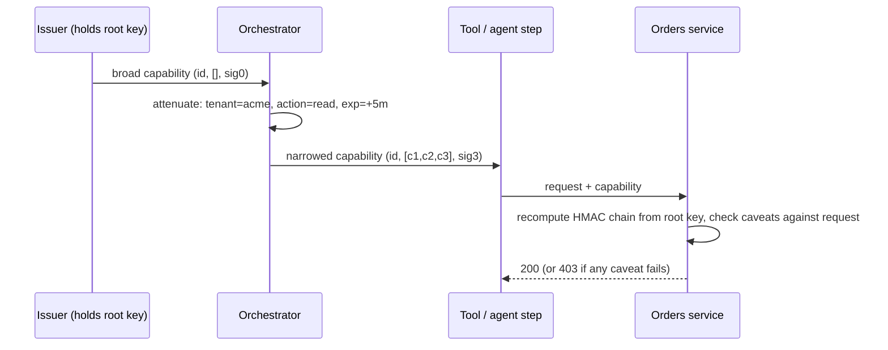

## Explanation

A *capability* is an unforgeable reference that both **designates** a resource and **carries the authority** to use it. The term comes from Dennis and Van Horn's 1966 paper on multiprogrammed computations, where a process could reach an object only through an entry in its capability list, so the set of references a program held *was* its set of permissions. Capability-based authorization applies the same rule to tokens exchanged between services: the verifier checks that the token is genuine and that its constraints hold for this request, and never looks the caller up in a role table.

Mechanically, a capability token has three parts: an identifier that tells the issuer which key it was minted from, a list of constraints (macaroons call them *caveats*; Biscuit carries blocks of Datalog facts and checks; UCAN carries a delegated command with arguments), and a signature that binds everything together. Two operations make the model distinctive:

- **Attenuation.** Anyone holding a capability can derive a narrower one ("this token, but read-only, for tenant acme, expiring in five minutes") without contacting the issuer, because adding a constraint only extends the signature chain. Nobody can remove a constraint, because that would require a signature they never had.
- **Delegation.** Handing the attenuated token to another party transfers exactly that authority and nothing else.

Verification walks the chain. A macaroon verifier recomputes `HMAC(rootKey, id)`, then `HMAC(previousSignature, caveat)` for each caveat, checks every caveat predicate against the request context and compares the result with the presented signature; third-party caveats additionally require a *discharge* macaroon from another service (an identity provider, an audit service). Biscuit replaces the symmetric chain with Ed25519 signatures (each block carries the public key whose private half signs the next block, so the verifier needs only the root public key) and evaluates Datalog checks, then ordered allow/deny policies. UCAN 1.0 identifies issuer and audience with decentralized identifiers (DIDs), chains delegations by content hash, requires each link to restate or narrow what it received, and separates the *invocation* that exercises the authority.

Why the model exists: the **confused deputy**. Hardy (1988) described a compiler on a commercial timesharing system that wrote usage statistics into the system directory and therefore held write permission there. A user named the billing file in that directory as the compiler's debugging-output location; the compiler, acting on its own *ambient authority* rather than the user's, overwrote the bill. Identity-based checks cannot fix this, because the compiler *was* allowed to write there. Capabilities fix it by construction: the user hands over a capability for the output file, and the compiler never holds one for the bill. The same bug appears today when an MCP server forwards a user's token upstream, which is why the MCP authorization specification requires audience-bound tokens (RFC 8707 resource indicators) and forbids token passthrough.

Where it shows up: Azure shared access signatures (a signed URI naming a blob, rights and an expiry), AWS presigned URLs and session policies (a role session attenuated to the intersection of its identity policy and an inline scope-down policy), OAuth token exchange (RFC 8693), and, most relevant to agentic systems, scoping what an AI agent's tools may do. An orchestrator holding a broad capability for an orders API should attenuate it to one tenant, one action and a short expiry before handing it to the tool that executes a single step, so a prompt-injected tool can do no more than that step. With [workload identity](workload-identity.md) for the caller and [mTLS](mtls.md) for the channel, this gives [zero trust](zero-trust.md) per-request authorization without a policy lookup on the hot path.



## How it differs

| Neighbour | What it is | The decisive difference | Choose it when |
| --- | --- | --- | --- |
| [RBAC](rbac.md) | Permissions attached to roles; users assigned to roles; checked at call time | Authority is looked up from identity; a service acting for many callers uses its own role, so it can be confused | Administrators must reason about people and job functions; coarse, stable permissions |
| [API key](api-key.md) | A bearer secret identifying a client, mapped to that client's full entitlement | A key is ambient authority for one caller; a capability is scoped authority for one task | Simple machine-to-machine access with no delegation needs |
| [Workload identity](workload-identity.md) | A platform-issued, short-lived identity for a running process | Identity says *who*; a capability says *what, on which object, until when* | Always, as the thing a capability is issued to and logged against |
| [Least privilege](least-privilege.md) | The design principle that every actor holds only what its task needs | A principle, not a mechanism; capabilities make per-request minimisation cheap | Always; capabilities are one way to honour it |
| [Wasm sandboxing](wasm-sandboxing.md) | A runtime that grants a module only the imports (files, sockets) it is given | Same philosophy, different layer: imports in a VM versus tokens between services | Running untrusted code; combine both for agent tools |

**Versus RBAC.** In a role-based system the server asks "what is this principal allowed to do?" and consults an identity-to-role-to-permission mapping. That works until a trusted intermediary acts on behalf of many principals: the intermediary's own role is what gets checked, and a caller can trick it into using that authority for the caller's purposes. A capability design asks instead "does this request carry proof of authority for exactly this operation?", so the intermediary can only pass along what it was given. Choose RBAC when humans must administer permissions through job functions; choose capabilities at the boundaries where delegation, multi-tenancy and untrusted intermediaries (plugins, agents, partner services) meet.

**Versus API keys.** Both are bearer credentials, so both leak the same way. The difference is blast radius: a leaked API key is every right its owner has, for as long as the key lives; a leaked capability is one object, one set of rights, one short window. An API key also cannot be narrowed by its holder, so the only way to give a partner less is to mint a second key at the issuer.

**Versus workload identity.** A [SPIFFE](../security/iam/workload-identity.md)-style identity tells the receiver which service is calling and lets it audit that. It does not say which tenant's data the call concerns. Most production designs authenticate the workload *and* require a capability for the specific resource; the identity is what you revoke in bulk, the capability is what you scope per request.

**Versus least privilege and Wasm sandboxing.** Least privilege is the destination; capabilities are a road. WASI's capability model reaches the same destination one layer down by giving a module only the directory handles and sockets it is explicitly passed, which is why Wasm is a natural host for agent tools that are then also handed scoped service capabilities.

## Examples

A minimal macaroon-style capability shows the mechanics: a root key known only to the issuing service, an identifier, caveats appended by whoever holds the token, and a chained HMAC. The verifier recomputes the chain and checks each caveat against the request.

=== "C#"

    ```csharp
    using System.Security.Cryptography;
    using System.Text;

    // Issuer (orders service) mints; the orchestrator narrows; the tool presents.
    var rootKey = RandomNumberGenerator.GetBytes(32);        // never leaves the issuer
    var broad = Capability.Mint(rootKey, "orders-api:key-7f3a");

    var scoped = broad
        .Attenuate("tenant = acme")
        .Attenuate("action = read")
        .Attenuate($"exp < {DateTimeOffset.UtcNow.AddMinutes(5).ToUnixTimeSeconds()}");

    var request = new { Tenant = "acme", Action = "read", Now = DateTimeOffset.UtcNow.ToUnixTimeSeconds() };
    bool allowed = Verifier.Verify(rootKey, scoped, caveat => caveat.Split(' ') switch
    {
        ["tenant", "=", var t] => t == request.Tenant,
        ["action", "=", var a] => a == request.Action,
        ["exp", "<", var e]    => request.Now < long.Parse(e),
        _ => false                                           // unknown caveat: fail closed
    });

    public sealed record Capability(string Id, IReadOnlyList<string> Caveats, byte[] Signature)
    {
        public static Capability Mint(byte[] rootKey, string id) =>
            new(id, [], HMACSHA256.HashData(rootKey, Encoding.UTF8.GetBytes(id)));

        // Anyone holding a capability can narrow it; nobody can widen it.
        public Capability Attenuate(string caveat) => this with
        {
            Caveats = [.. Caveats, caveat],
            Signature = HMACSHA256.HashData(Signature, Encoding.UTF8.GetBytes(caveat))
        };
    }

    public static class Verifier
    {
        public static bool Verify(byte[] rootKey, Capability cap, Func<string, bool> caveatHolds)
        {
            var sig = HMACSHA256.HashData(rootKey, Encoding.UTF8.GetBytes(cap.Id));
            foreach (var caveat in cap.Caveats)
            {
                if (!caveatHolds(caveat)) return false;
                sig = HMACSHA256.HashData(sig, Encoding.UTF8.GetBytes(caveat));
            }
            return CryptographicOperations.FixedTimeEquals(sig, cap.Signature);
        }
    }
    ```

=== "Python"

    ```python
    import hashlib, hmac, os, time
    from dataclasses import dataclass
    from typing import Callable

    @dataclass(frozen=True)
    class Capability:
        key_id: str
        caveats: tuple[str, ...]
        signature: bytes

        @staticmethod
        def mint(root_key: bytes, key_id: str) -> "Capability":
            return Capability(key_id, (), hmac.new(root_key, key_id.encode(), hashlib.sha256).digest())

        def attenuate(self, caveat: str) -> "Capability":      # narrow only, never widen
            sig = hmac.new(self.signature, caveat.encode(), hashlib.sha256).digest()
            return Capability(self.key_id, (*self.caveats, caveat), sig)

    def verify(root_key: bytes, cap: Capability, caveat_holds: Callable[[str], bool]) -> bool:
        sig = hmac.new(root_key, cap.key_id.encode(), hashlib.sha256).digest()
        for caveat in cap.caveats:
            if not caveat_holds(caveat):
                return False
            sig = hmac.new(sig, caveat.encode(), hashlib.sha256).digest()
        return hmac.compare_digest(sig, cap.signature)

    root_key = os.urandom(32)                                 # never leaves the issuer
    scoped = (Capability.mint(root_key, "orders-api:key-7f3a")
              .attenuate("tenant = acme")
              .attenuate("action = read")
              .attenuate(f"exp < {int(time.time()) + 300}"))

    request = {"tenant": "acme", "action": "read", "now": int(time.time())}

    def holds(caveat: str) -> bool:
        match caveat.split(" "):
            case ["tenant", "=", t]: return t == request["tenant"]
            case ["action", "=", a]: return a == request["action"]
            case ["exp", "<", e]:    return request["now"] < int(e)
            case _:                  return False              # unknown caveat: fail closed

    allowed = verify(root_key, scoped, holds)
    ```

=== "Azure"

    A **user delegation SAS** is the closest first-party capability token in Azure Storage: a signed URI that names one blob or container, a permission set and a validity window, signed with a *user delegation key* obtained through Microsoft Entra credentials rather than the account key (the key, and therefore the SAS, lives at most seven days). The service does not track issued SAS tokens, so keep expiries short and plan revocation: `az storage account revoke-delegation-keys` invalidates every user delegation SAS on the account, and a service SAS can reference a stored access policy you can delete.

    ```bash
    # Read-only, HTTPS-only access to one report for 10 minutes, signed as the caller
    az storage blob generate-sas \
      --account-name stmarketreports --container-name reports --name 2026-10-24.pdf \
      --permissions r --https-only \
      --expiry "$(date -u -d '+10 minutes' '+%Y-%m-%dT%H:%MZ')" \
      --auth-mode login --as-user --full-uri -o tsv
    ```

    The caller needs a role that includes `Microsoft.Storage/storageAccounts/blobServices/generateUserDelegationKey`. Azure RBAC still decides *who may mint*; the SAS decides *what the holder may do*.

=== "AWS"

    Two AWS primitives are capability-shaped. A **presigned URL** is a bearer URL for one object and one HTTP method, valid for a chosen interval (up to seven days with IAM user credentials, and never longer than the credentials that signed it), and the bucket owner can bound it further with the `s3:signatureAge` condition. A **session policy** attenuates an assumed role: the session's permissions are the intersection of the role's identity-based policies and the inline policy passed to `AssumeRole`.

    ```bash
    # Capability for one object, five minutes
    aws s3 presign s3://market-reports/2026-10-24.pdf --expires-in 300

    # Attenuated role session: the role may be broad, this session may only read one prefix
    aws sts assume-role --role-arn arn:aws:iam::111122223333:role/ReportsReader \
      --role-session-name agent-step-42 \
      --policy '{"Version":"2012-10-17","Statement":[{"Effect":"Allow","Action":"s3:GetObject",
                 "Resource":"arn:aws:s3:::market-reports/acme/*"}]}'
    ```

    AWS also documents the confused deputy directly: a role trust policy should require `sts:ExternalId` when a third party assumes it on your behalf, and resource policies that trust an AWS service principal should pin `aws:SourceArn` or `aws:SourceAccount`, so the service cannot be steered into using its authority for a different customer.

For agent tooling, the same pattern applies at the protocol level. The current MCP authorization specification lets a server challenge with the exact `scope` an operation needs and lets clients step up incrementally, which is the capability idea expressed in OAuth terms; see [MCP tool orchestration](../ai/protocols/mcp-tool-orchestration.md).

## Misconceptions

- **"Capabilities cannot be revoked."** They can: through short expiries, revocation identifiers (Biscuit uses each block's signature as its revocation ID, so a verifier can deny-list one token or one delegation step), stored access policies (Azure service SAS), or invalidating the signing credential (an AWS presigned URL dies with the credentials that signed it). What capabilities avoid is a *lookup on every request*; revocation is a separate, usually coarser, channel.
- **"Any bearer token is a capability."** A bearer token is a capability only if it designates a specific resource and rights and can be narrowed by its holder. A long-lived API key that unlocks a whole account is a bearer credential for ambient authority, which is the opposite design.
- **"Capabilities replace authentication."** You still need to know which workload to issue to, which to log, and which identity to revoke in bulk. Workload identity and capabilities answer different questions and are layered, not substituted.
- **"OAuth scopes are already capabilities."** Scopes are coarse strings interpreted by the resource server and are not attenuable by the client without a round trip to the authorization server; token exchange (RFC 8693) and resource indicators (RFC 8707) move OAuth closer, but the token still identifies a subject whose entitlements the server may consult.
- **"This is operating-systems research, not production practice."** Shared access signatures, presigned URLs, session policies and macaroon-style tokens handle enormous production traffic today; the research vocabulary (ambient authority, attenuation, confused deputy) simply names what those products do.

## Exam notes

CISSP and CCSP test the access-control-matrix view: a capability table is a *row* (one subject, its rights over many objects), an access control list is a *column* (one object, the subjects allowed), and candidates are expected to know which representation makes delegation easy and which makes per-object review easy. SC-100 and AZ-500 approach the idea through Azure storage: when a scenario asks for time-limited, scoped access for an external party without creating an identity, the answer is a user delegation SAS, and the trap is reaching for a role assignment or the account key. SCS-C03 and SAP-C03 test presigned URLs, session policies as scope-down, and the confused deputy mitigations (`sts:ExternalId`, `aws:SourceArn`, `aws:SourceAccount`); a classic trap is a trust policy that names a vendor's account without an external ID. CSSLP and the MCP-oriented MCPA certification frame the same material as secure design: least-privilege tokens for intermediaries, audience validation and no token passthrough. Expect wording like "the service should act only with the authority delegated by the caller" to signal a capability answer.

## Self-check

??? question "An MCP orchestration server receives the user's access token for the orders API and forwards it unchanged to a billing tool. What is wrong, and how does a capability-style design fix it?"
    The orchestrator has become a confused deputy and a token-passthrough proxy: the billing tool receives a token issued for a different audience and could use the user's full orders authority, while the billing API cannot distinguish the orchestrator from the user in its logs. The MCP specification forbids this: the orchestrator must validate that the token's audience is itself, then obtain (or mint) a separate credential for the upstream call. In capability terms, it should hand the tool an attenuated token naming the one resource and action the step needs, with a short expiry, so a compromised or prompt-injected tool can only do that step.

??? question "A storage service must let a partner download one report for ten minutes without creating an account for them. What do you issue, and how would you revoke it if the link leaks?"
    Issue a capability: in Azure a user delegation SAS scoped to that blob with read permission, HTTPS only and a ten-minute expiry; in AWS a presigned GET URL with a short expiration. Revocation is coarse by design: let it expire (the main defence), rotate the user delegation key or the signing credentials to kill every token derived from them, or, for an Azure service SAS, reference a stored access policy you can delete. A role assignment would be the wrong tool because it grants an identity standing authority rather than a scoped, expiring right.

??? question "A colleague argues that OAuth scopes already give you capabilities, so macaroons or Biscuit add nothing. Where does the analogy hold and where does it break?"
    It holds in that a scoped access token is a bearer credential naming a resource server (audience) and a set of rights, so it limits blast radius like a capability. It breaks on attenuation and delegation: a client cannot narrow an OAuth token offline for one downstream call, so it either forwards the whole token (confused deputy) or goes back to the authorization server (RFC 8693 token exchange). Macaroons and Biscuit let any holder add caveats locally, verifiable without a round trip, which is what a multi-step agent pipeline needs when each step should see less than the previous one.

## Further reading

- [Capability-Based AuthZ vs. RBAC](../security/iam/capability-based-authz.md), the library article that works through the migration and revocation trade-offs.
- [Workload Identity](../security/iam/workload-identity.md) and [mTLS vs. API Keys](../security/iam/mtls-vs-api-keys.md) for the identity and channel layers a capability sits on.
- [MCP tool orchestration](../ai/protocols/mcp-tool-orchestration.md) for scoping agent tools, and [Wasm Sandboxing vs. Container Isolation](../security/appsec/wasm-sandboxing.md) for the runtime-level capability model.
- Term pages: [Role-Based Access Control](rbac.md), [Principle of Least Privilege](least-privilege.md), [Zero Trust Architecture](zero-trust.md), [API Key](api-key.md).
- Primary sources: the MCP authorization specification (<https://modelcontextprotocol.io/specification/2026-07-28/basic/authorization>), RFC 8693 OAuth 2.0 Token Exchange (<https://www.rfc-editor.org/rfc/rfc8693>), AWS on the confused deputy problem (<https://docs.aws.amazon.com/IAM/latest/UserGuide/confused-deputy.html>) and Azure shared access signatures (<https://learn.microsoft.com/en-us/azure/storage/common/storage-sas-overview>).
