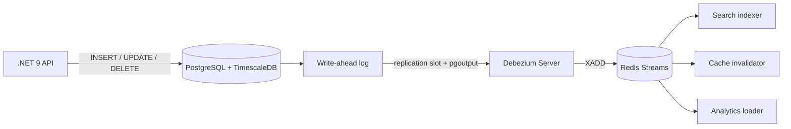

## Explanation

Change data capture is the practice of observing what changed in a database (which rows were inserted, updated or deleted, in commit order) and delivering those changes as events to something else: a search index, a cache, a reporting store, another service, or a stream such as Redis Streams or Kafka. The database stays the system of record; CDC is how the rest of the system finds out what it did without being told twice.

There are two families, and the difference is the whole point of the term:

- **Query-based CDC** polls the tables. A job runs `SELECT ... WHERE updated_at > :last_seen` every few seconds, or compares snapshots, or reads a version column. It needs a trustworthy timestamp or version on every table, it cannot see a row that was deleted, it misses intermediate versions when a row changes twice between polls, and it loads the database with reads that mostly return nothing.
- **Log-based CDC** reads the transaction log, the append-only record every durable database already keeps for crash recovery (PostgreSQL's [write-ahead log](write-ahead-log.md), SQL Server's transaction log, MySQL's binlog). The log contains every committed change, including deletes and every intermediate version, in commit order, without touching the tables or requiring schema changes.

In PostgreSQL the mechanism is **logical decoding**: with `wal_level = logical`, the server can replay committed transactions from the WAL through an *output plugin* that turns storage-level records into row events; `pgoutput` is the built-in plugin. A consumer attaches to a **replication slot**, a server-side cursor that persists across restarts and retains the WAL the consumer has not yet confirmed. In normal operation a slot emits each change once, but after a crash it may rewind and resend recent changes, so consumers must tolerate duplicates. Only committed transactions appear, at commit time; DDL is not part of the stream, and PostgreSQL's logical replication does not carry sequence state or large objects either. The table's `REPLICA IDENTITY` decides whether updates and deletes carry the old row image.

[Debezium](https://debezium.io/documentation/reference/stable/connectors/postgresql.html) is the common open-source consumer. It takes an initial snapshot, then streams from the slot, emitting one event per row change with `before`, `after`, `op` (`c`, `u`, `d`, or `r` for snapshot reads) and `source` metadata such as the log sequence number (LSN). It runs as a Kafka Connect source connector, as the standalone Debezium Server (which can write straight to Redis Streams, Kinesis, Event Hubs or Pub/Sub), or as an embedded engine. The delivery guarantee is [at-least-once](at-least-once-delivery.md): after a crash the connector replays from its last committed offset.

The same idea exists in managed form: SQL Server and Azure SQL CDC read the transaction log into `cdc.<capture_instance>_CT` change tables; DynamoDB Streams and the Cosmos DB change feed expose item-level changes without any log plumbing.



CDC matters to this stack in two places. First, a TimescaleDB [hypertable](hypertable.md) is physically a set of chunk tables in the `_timescaledb_internal` schema, so raw change events refer to chunks; Debezium ships a TimescaleDB transformation that reroutes chunk events back to the hypertable's topic. Second, the cost is operational rather than developer-facing: a slot that nobody drains retains WAL forever, and a database with little traffic on the captured tables cannot advance the slot unless a heartbeat writes something. Treat a replication slot as a production dependency with monitoring, not as a free feature.

## How it differs

**[Transactional outbox](transactional-outbox.md).** An outbox row is written by the application, in the business transaction, and describes *what happened* in domain language (`OrderPlaced` with a curated payload). CDC describes *what the database did* in table language (`orders` row `op=u`, `before`/`after`). The two are often combined: log-based CDC is the best relay for an outbox table, which is exactly what Debezium's outbox event router does. Choose the outbox when consumers should see a stable contract rather than your schema; choose plain CDC when you want every change of existing tables with no application changes, for example to feed a search index or a warehouse.

**[Write-ahead log](write-ahead-log.md).** The WAL exists so the database can survive a crash; its records are physical and private. Logical decoding is a *reader* of that log that exposes committed changes in a public, logical shape. The WAL is a mechanism of the database; CDC is a capability built on top of it, and the replication slot is the contract between them.

**[Materialized view](materialized-view.md).** A materialized view is a precomputed query stored in the same database and refreshed by the database. If the derived data must live elsewhere (a different engine, a cache, a service's own store), the view cannot help; CDC is how you keep that external copy current without full reloads.

**[Log compaction](log-compaction.md).** A CDC feed is a history: every change, in commit order. A compacted Kafka topic keeps only the newest record per key, which makes it the natural landing place for a CDC stream of *current state*: a new consumer reads the compacted topic to bootstrap, then follows the live changes. Compaction is a retention policy on the destination; CDC is the source of what gets retained, and if you need the intermediate versions you keep an uncompacted copy as well.

| Dimension | Query-based CDC | Log-based CDC | Transactional outbox |
|---|---|---|---|
| Sees deletes | No (unless soft-delete) | Yes | Only if the app emits them |
| Sees every intermediate version | No | Yes | Only events the app writes |
| Schema requirements | Timestamp or version column | None, but `REPLICA IDENTITY` for old images | An outbox table |
| Load on the database | Repeated polling reads | Streaming from the log | One extra insert per transaction |
| Event shape | Rows | Rows | Domain events |
| Needs application changes | Usually | No | Yes |

## Examples

**A sensor pipeline.** Trades land in a TimescaleDB hypertable through the .NET 9 API. A Debezium Server instance streams the inserts into a Redis Stream; a risk service reads that stream through a [consumer group](consumer-group.md) and updates its own position cache. No service ever queries the trades table for "what is new".

=== "SQL"

    ```sql
    -- postgresql.conf (restart required): wal_level = logical
    CREATE PUBLICATION orders_pub FOR TABLE orders, order_lines;
    ALTER TABLE orders REPLICA IDENTITY FULL;      -- old row images on UPDATE/DELETE

    -- A built-in plugin for exploring; production tools use pgoutput.
    SELECT * FROM pg_create_logical_replication_slot('demo_slot', 'test_decoding');
    UPDATE orders SET status = 'shipped' WHERE id = 42;
    SELECT lsn, data FROM pg_logical_slot_get_changes('demo_slot', NULL, NULL);
    -- BEGIN 7731 / table public.orders: UPDATE: ... / COMMIT 7731

    SELECT slot_name, active, wal_status FROM pg_replication_slots;
    SELECT pg_drop_replication_slot('demo_slot');   -- never leave a slot undrained
    ```

=== "C#"

    ```csharp
    // Npgsql's replication API consumes pgoutput directly from .NET.
    using Npgsql.Replication;
    using Npgsql.Replication.PgOutput;
    using Npgsql.Replication.PgOutput.Messages;

    await using var conn = new LogicalReplicationConnection(connectionString);
    await conn.Open();

    var slot = new PgOutputReplicationSlot("orders_slot");   // created once, in SQL
    var options = new PgOutputReplicationOptions("orders_pub", PgOutputProtocolVersion.V1);

    await foreach (var message in conn.StartReplication(slot, options, ct))
    {
        if (message is InsertMessage insert)
        {
            var values = new List<string?>();
            await foreach (var column in insert.NewRow)
                values.Add(column.IsDBNull ? null : await column.Get<string>(ct));
            await publisher.PublishAsync(insert.Relation.RelationName, values, ct);
        }
        // Confirm progress so the server can recycle WAL behind us.
        conn.SetReplicationStatus(message.WalEnd);
    }
    ```

=== "Python"

    ```python
    # psycopg2 exposes the streaming replication protocol.
    import psycopg2
    import psycopg2.errors
    from psycopg2.extras import LogicalReplicationConnection

    conn = psycopg2.connect(DSN, connection_factory=LogicalReplicationConnection)
    cur = conn.cursor()
    try:
        cur.create_replication_slot("orders_slot", output_plugin="test_decoding")
    except psycopg2.errors.DuplicateObject:
        pass                                        # slot survives restarts: resume from it
    cur.start_replication(slot_name="orders_slot", decode=True)

    def on_change(msg):
        publish(msg.payload)                        # e.g. XADD to a Redis Stream
        msg.cursor.send_feedback(flush_lsn=msg.data_start)   # acknowledge progress

    cur.consume_stream(on_change)
    ```

=== "Docker Compose"

    ```yaml
    # Debezium Server: PostgreSQL -> Redis Streams, no Kafka involved.
    services:
      debezium:
        image: quay.io/debezium/server:3.7         # Docker Hub stopped at 3.0; current images are on quay.io
        volumes: ["./conf:/debezium/config"]       # application.properties below
        depends_on: [postgres, redis]
    # conf/application.properties
    # debezium.sink.type=redis
    # debezium.sink.redis.address=redis:6379
    # debezium.source.connector.class=io.debezium.connector.postgresql.PostgresConnector
    # debezium.source.plugin.name=pgoutput
    # debezium.source.topic.prefix=lwd
    # debezium.source.table.include.list=public.orders
    # debezium.source.offset.storage=io.debezium.storage.redis.offset.RedisOffsetBackingStore
    ```

=== "Azure"

    - **Azure SQL Database CDC** uses the same `sys.sp_cdc_enable_db` / `sys.sp_cdc_enable_table` model as SQL Server, but a built-in scheduler replaces SQL Agent: capture runs every 20 seconds, cleanup hourly, with a three-day default retention. Any vCore tier qualifies; in the DTU model only S3 and above. Change rows carry `__$operation` (1 delete, 2 insert, 3 update before-image, 4 update after-image).
    - **Azure Cosmos DB change feed** is on by default. *Latest version* mode gives the most recent change per item and never shows deletes; *all versions and deletes* mode captures every change including deletes and TTL expirations but requires continuous backup. Order is guaranteed per partition key only, and the change feed processor gives at-least-once semantics with automatic checkpoints.
    - **Azure Database for PostgreSQL flexible server** supports logical decoding (`wal_level = logical` plus a restart; for example `pgoutput` or `wal2json`) and names Debezium as a consumer. When storage crosses its threshold it auto-drops an inactive logical slot rather than let the server go read-only, and from PostgreSQL 17 it can synchronise failover-enabled slots to the HA standby (`sync_replication_slots`, `hot_standby_feedback`).

=== "AWS"

    - **AWS DMS** full-load-plus-CDC tasks read PostgreSQL through a logical replication slot using `test_decoding`, or `pglogical` when that extension is installed; on RDS and Aurora you set `rds.logical_replication = 1`. The `HeartbeatEnable` setting writes dummy transactions so an idle slot does not pin old WAL.
    - **DynamoDB Streams** records every item modification for 24 hours, each record exactly once and in order per item, with `KEYS_ONLY`, `NEW_IMAGE`, `OLD_IMAGE` or `NEW_AND_OLD_IMAGES` views; Lambda event source mappings read it shard by shard.
    - **Amazon MSK Connect** runs Debezium connectors as custom plugins against Aurora or RDS, streaming change events into an MSK cluster.

## Misconceptions

- **"Polling `updated_at` is CDC."** It is the weak form. It cannot see deletes, misses intermediate versions, depends on every table having a reliable timestamp, and costs a read sweep per poll. Log-based capture sees everything the database committed.
- **"CDC events arrive exactly once."** Replication slots persist their position only at checkpoints, so after a crash recent changes can be resent, and Debezium commits offsets periodically, so it can re-emit events it already produced. Consumers need an [idempotency key](idempotency-key.md) (the LSN or event id) or naturally idempotent writes.
- **"Turning on CDC is free."** A slot retains WAL until it is confirmed, so a stalled consumer fills the disk; SQL Server will not truncate the log past unread changes even in simple recovery; low-traffic captured tables need a heartbeat. Monitor `pg_replication_slots` and log usage like any other production dependency.
- **"The change stream includes schema changes."** PostgreSQL logical decoding does not decode DDL, sequences or large objects, and logical replication does not replicate schema. Plan schema evolution explicitly; Debezium emits schema-change events for some connectors, but your consumers still have to cope.
- **"Debezium means Kafka."** Kafka Connect is the usual deployment, but Debezium Server targets Redis Streams, Kinesis, Event Hubs, Pub/Sub and others, and the embedded engine runs inside a Java application.

## Exam notes

Microsoft data exams test the managed forms: DP-300 expects you to enable and clean up CDC on Azure SQL and to know the tiers that cannot run it; DP-420 asks which change feed mode captures deletes and what continuous backup has to do with it; AZ-305 frames CDC as the integration choice when a system of record must feed other stores without dual writes. On AWS, DEA-C01 and SAP-C03 lean on DMS (full load plus CDC, replication slots, the `rds.logical_replication` parameter) and on DynamoDB Streams versus Kinesis Data Streams for DynamoDB; DVA-C02 and DVA-C03 test the Streams-to-Lambda trigger, its 24-hour retention and ordering per item. The traps: assuming polling catches deletes, assuming exactly-once delivery, forgetting that an abandoned slot or a stopped capture job grows the log, and confusing a change feed in latest-version mode (which drops intermediate changes) with a full history.

## Self-check

??? question "A search index must mirror the orders table within seconds, including deletions, and the application team refuses to change their code. Which CDC family do you pick and what do you watch in production?"
    Log-based CDC, because it needs no application change and captures deletes and every intermediate version. Attach Debezium (or a direct logical-decoding consumer) to a replication slot with a publication limited to the orders tables, set `REPLICA IDENTITY` so deletes carry enough columns to remove the document, and monitor slot lag and WAL retention: an undrained slot pins WAL until the disk fills. Make the indexer idempotent on the primary key because delivery is at-least-once.

??? question "Your TimescaleDB hypertable is captured by Debezium, but events show up on topics named after chunk tables. Why, and what fixes it?"
    A hypertable stores rows in chunk tables under `_timescaledb_internal`, so logical decoding reports changes against the chunks. Add Debezium's TimescaleDB transformation, which reroutes chunk events to a topic named after the hypertable and attaches headers with the chunk and hypertable names. Because TimescaleDB creates chunks on demand, use a publication for all tables rather than enumerating chunks.

??? question "A warehouse job polls `WHERE modified > @last_run` nightly and the row counts never reconcile. What is the most likely cause?"
    Polling cannot observe deletes (the deleted rows simply vanish from the result), and a row updated twice between runs appears once. Either introduce soft deletes with a tombstone column or move to log-based capture, which delivers deletes and every version in commit order.

## Further reading

- [Outbox Pattern vs. Dual-Write](../messaging/eventing/outbox-pattern.md) covers CDC as the relay for an outbox table.
- [Redis Streams vs. Kafka](../messaging/eventing/redis-streams-vs-kafka.md) compares the two sinks Debezium Server can target.
- [High-Frequency Indexing and Partitioning](../data/time-series/high-frequency-indexing-partitioning.md) explains the chunking that makes hypertable capture special.
- Terms: [Transactional outbox](transactional-outbox.md), [Write-ahead log](write-ahead-log.md), [Log compaction](log-compaction.md), [At-least-once delivery](at-least-once-delivery.md).
- [Debezium Server](https://debezium.io/documentation/reference/stable/operations/debezium-server.html) and the [TimescaleDB transformation](https://debezium.io/documentation/reference/stable/transformations/timescaledb.html).
- [Npgsql replication](https://www.npgsql.org/doc/replication.html) for consuming `pgoutput` from .NET.
