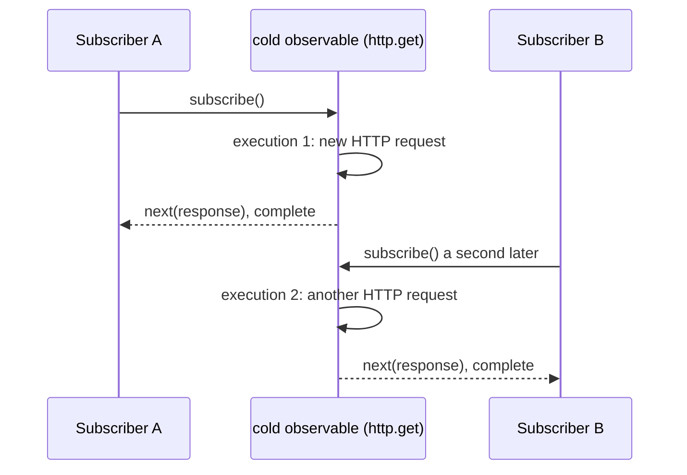

## Explanation

In RxJS an observable is a function waiting to be called. `new Observable(subscriber => ...)` stores the *subscribe logic*; nothing inside it runs until `subscribe()` is invoked, and every call to `subscribe()` runs that logic again, with its own state, its own side effects and its own teardown. The RxJS guide draws the analogy with a zero-argument function: calling it twice performs the work twice, and nothing is shared between callers. An observable with these properties is **cold**: the *producer*, the thing that emits values (a timer, an HTTP request, a file read), is created inside the subscribe logic, so it exists once per subscriber and starts from the beginning for each. ReactiveX gives the same definition from the consumer's side: a cold observable waits until an observer subscribes before it begins emitting, so every observer sees the whole sequence from the start.

Most creation functions are cold: `of`, `from`, `range`, `timer`, `interval`, `defer`, `ajax`, Angular's `HttpClient.get()` (each subscription is a fresh request) and anything built with `new Observable`. The execution follows the contract `next* (error | complete)?`: zero or more values, then at most one terminal notification, after which nothing is delivered. `subscribe()` returns a `Subscription`, and `unsubscribe()` runs the teardown the subscribe logic returned (clear the interval, abort the request, close the handle). Because the producer belongs to the subscription, unsubscribing really stops the work, which is what makes cold observables cancellable, retryable and composable: `retry()` works by re-subscribing, which re-creates the producer, and `switchMap` works by unsubscribing the previous inner observable, which tears its producer down.

Cold also means **unicast**: one execution serves one observer. That is the property that surprises people. A component that pipes `http.get('/api/quotes')` into two `async` pipes issues two HTTP requests; an `interval(1000)` subscribed twice runs two timers that drift apart; a cold observable wrapping `new WebSocket(url)` opens one socket per subscriber. The remedy is *multicasting*, routing one execution through a `Subject` so that all observers share it; `share()` and `shareReplay()` do this with reference counting, and that is the mechanism by which a cold observable becomes [hot](hot-observable.md). Conversely `defer(() => fetch(url))` makes an eager source cold by postponing its creation until subscription, which is how a promise-returning call becomes retryable.

Laziness is a feature. A cold observable is a description of work, so it can be assembled, passed around, stored in a service and composed with operators long before anyone decides to run it, and it costs nothing until then. [Signals](angular-signals.md) use the same property in a different direction: `toSignal()` subscribes immediately, and an `rxResource()` stream is re-subscribed when its parameters change, so the cold observable is executed by the framework at a well-defined moment instead of by a template at an accidental one. The data-infrastructure analogue is replay from a log: reading a Redis Stream with `XRANGE` from the first ID gives every reader the full history from the start (see [Redis Streams versus Kafka](../messaging/eventing/redis-streams-vs-kafka.md)), whereas Redis Pub/Sub, like a hot observable, delivers only what happens while you are listening.



## How it differs

**[Hot Observable](hot-observable.md).** The single question is where the producer lives. Inside the subscribe logic: cold, created per subscriber, started on subscribe, stopped on unsubscribe, replayable from the start, retryable by re-subscribing. Outside it: hot, shared by all subscribers, emitting whether anyone listens or not, with late subscribers missing earlier values. The temperature is not changed by operators (`map`, `filter`, `switchMap` keep a cold source cold) but only by multicasting (`share`, `shareReplay`, `connectable`, a `Subject`). Choose cold when each consumer should get its own run (a request, a computation, a file) and hot when consumers must observe one shared source (a socket, a DOM event, an in-app bus). The frequent bug is the opposite of each: duplicated requests from a cold source bound twice, and missed messages from a hot source subscribed late.

**[Angular Signals](angular-signals.md).** A cold observable is executed; a signal is read. The observable has subscriptions, teardown, completion and an error channel, and it may emit nothing for a long time or ever; the signal always holds a current value and has no notion of completion. The bridge is deliberate: `toSignal()` subscribes once and exposes the latest value, `rxResource()` subscribes to a fresh stream (and `resource()` awaits a fresh loader) whenever its parameters change, and `toObservable()` turns a signal into a stream that coalesces intermediate writes. Keep requests, cancellation and retries in the observable; hand the view a signal.

| | Cold observable | Hot observable | Signal |
|---|---|---|---|
| Producer created | Per subscription | Once, outside | Not applicable |
| Starts | On subscribe | On its own | Exists from creation |
| Late subscriber sees | Everything, from the start | Only what follows | The current value |
| Cancel and retry | Unsubscribe and re-subscribe | Not by a single subscriber | Not applicable |
| Angular example | `HttpClient.get()` | `fromEvent`, `webSocket()`, a `Subject` | `signal()`, `computed()` |

## Examples

=== "TypeScript"

    ```typescript
    // The classic duplicate-request bug: a cold HttpClient observable bound twice.
    import { Component, inject } from '@angular/core';
    import { AsyncPipe } from '@angular/common';
    import { HttpClient } from '@angular/common/http';
    import { shareReplay } from 'rxjs';

    @Component({
      selector: 'app-quote',
      imports: [AsyncPipe],
      template: `
        <h2>{{ (quote$ | async)?.symbol }}</h2>
        <p>{{ (quote$ | async)?.bid }}</p>      <!-- second async pipe: second HTTP request -->
      `,
    })
    export class QuoteBroken {
      readonly quote$ = inject(HttpClient).get<Quote>('/api/quotes/BTC-USD');
    }

    @Component({ selector: 'app-quote', imports: [AsyncPipe], template: `@if (quote$ | async; as q) { <h2>{{ q.symbol }}</h2><p>{{ q.bid }}</p> }` })
    export class QuoteFixed {
      // One subscription via @if ... as; or multicast with shareReplay(1) if several
      // consumers are unavoidable. Both keep the source cold until someone subscribes.
      readonly quote$ = inject(HttpClient).get<Quote>('/api/quotes/BTC-USD').pipe(shareReplay(1));
    }
    ```

    ```typescript
    // A hand-written cold observable with teardown, and defer() to make a promise cold.
    import { Observable, defer, retry } from 'rxjs';

    // Each subscriber gets its own EventSource: cold and unicast.
    export function candles(symbol: string): Observable<Candle> {
      return new Observable<Candle>(subscriber => {
        const source = new EventSource(`/api/candles/${symbol}/stream`);
        source.onmessage = e => subscriber.next(JSON.parse(e.data));
        source.onerror = () => subscriber.error(new Error('stream failed'));
        return () => source.close();                 // teardown runs on unsubscribe or error
      });
    }

    // fetch() starts immediately when called; defer() postpones the call until subscription,
    // so retry() can re-create the request instead of re-delivering one failed promise.
    export const config$ = defer(() => fetch('/api/config').then(r => r.json() as Promise<Config>)).pipe(retry(3));
    ```

=== "C#"

    ```csharp
    // Rx.NET: Observable.Create is cold exactly like new Observable in RxJS, and
    // IAsyncEnumerable<T> is cold in the same sense: each enumeration re-runs the method.
    using System.Reactive.Linq;

    IObservable<long> ticks = Observable.Create<long>(async (observer, ct) =>
    {
        var n = 0L;
        while (!ct.IsCancellationRequested)            // one loop per subscriber
        {
            observer.OnNext(n++);
            await Task.Delay(TimeSpan.FromSeconds(1), ct);
        }
    });

    using var a = ticks.Subscribe(v => Console.WriteLine($"A {v}"));
    await Task.Delay(2500);
    using var b = ticks.Subscribe(v => Console.WriteLine($"B {v}"));   // B starts at 0 with its own loop

    IObservable<long> shared = ticks.Publish().RefCount();              // the Rx.NET share(): one loop for all

    static async IAsyncEnumerable<string> ReadLines(string path)        // cold: re-runs per await foreach
    {
        using var reader = File.OpenText(path);                          // opened per enumeration
        while (await reader.ReadLineAsync() is { } line) yield return line;
    }
    ```

## Misconceptions

- **"Cold means asynchronous."** `of(1, 2, 3)` is cold and delivers synchronously during `subscribe()`. Temperature is about who owns the producer; timing is a separate axis.
- **"Cold means it emits once and completes."** `interval(1000)` is cold and never completes; each subscriber simply gets its own infinite timer. Cold is about per-subscriber execution, not about cardinality.
- **"Adding operators or a service wrapper makes it shared."** `pipe(map(...))` returns another cold observable; so does storing it in a field. Only multicasting (`share`, `shareReplay`, `connectable`, a `Subject`) changes the execution model.
- **"`HttpClient` caches, so two subscriptions are fine."** It does not. Every subscription is a new request, which is why a template with two `async` pipes on the same cold observable makes two calls, and why `shareReplay` or a single `@if ... as` binding is the fix.
- **"Unsubscribing always stops the work."** It runs the teardown the subscribe logic returned. A hand-written observable that forgets to return one leaks its timer or socket; a `defer`red promise cannot be cancelled at all, only ignored, unless the loader honours an abort signal.

## Exam notes

No certification examines RxJS temperature, but the underlying idea, lazy per-consumer execution versus a shared running source, is a recurring interview topic and underlies several exam-relevant patterns: at-least-once delivery by re-subscription, consumer-side replay from a log (Redis Streams, Kafka offsets) versus fire-and-forget pub/sub, and idempotent retries. In front-end interviews the discriminators are the duplicate-request bug, why `retry` and `switchMap` need cold sources to work, and how `toSignal` and `resource` decide when a cold observable runs. The trap is equating "cold" with "slow" or "single-value".

## Self-check

??? question "A dashboard component shows the same quote in a header and in a sidebar, each bound with `| async` to the same `http.get()` observable from a shared service, and the network tab shows two requests per load. The team proposes caching in the service with a `Map`. What is the better fix?"
    The observable is cold and unicast, so each `async` pipe subscribes separately and creates its own request; a hand-written cache fixes the symptom while duplicating what RxJS provides. Multicast the observable in the service with `shareReplay({ bufferSize: 1, refCount: true })` so overlapping subscribers share one request and late subscribers receive the cached value, or expose the quote as a signal via `toSignal` or `httpResource`, which subscribe once and hand both templates the same value. If the two views must refresh at different times, keep the source cold and let a single parent subscribe and pass the value down.

??? question "A `retry(3)` on an observable built from a promise never re-sends the request; it just re-emits the same rejection. Why?"
    The promise was created eagerly, outside the subscribe logic, so the observable wraps a producer that has already run and is therefore hot in the relevant sense: re-subscribing only re-delivers the settled result. `retry` works by unsubscribing and subscribing again, which only helps if subscription creates a new producer. Wrap the call in `defer(() => fetch(...))` (or use `HttpClient`, whose observables are cold) so that each subscription issues a fresh request.

??? question "A price feed is implemented as a cold observable that opens a WebSocket in its subscribe logic. Three widgets subscribe and the server reports three connections per user. What should change, and what new behaviour must the widgets accept?"
    The socket is the producer and it is created per subscription, so three subscribers mean three sockets. Share one execution: either build the feed on `webSocket()` from `rxjs/webSocket`, which is a subject that opens on the first subscriber and closes when the last one leaves, or pipe the cold observable through `share()` so the connection is reference-counted. The widgets then consume a hot stream: a widget that subscribes after the first message misses it, so give the shared stream a replay of the last value (`shareReplay({ bufferSize: 1, refCount: true })`) or expose it through `toSignal` with an initial value, and apply backpressure such as `auditTime` before rendering.

## Further reading

- [RxJS versus store-based state](../frontend/angular/rxjs-state-management.md) and [Real-time UI streaming](../frontend/realtime/real-time-ui-streaming.md) in this library
- [Redis Streams versus Kafka](../messaging/eventing/redis-streams-vs-kafka.md) for the replay-from-log analogue, and [delivery semantics](../messaging/eventing/delivery-semantics.md)
- [Hot Observable](hot-observable.md), [Angular Signals](angular-signals.md) and [Backpressure](backpressure.md)
- [Observable](https://rxjs.dev/guide/observable) and [Subject](https://rxjs.dev/guide/subject) in the RxJS guide; [Observable](https://reactivex.io/documentation/observable.html) on ReactiveX
