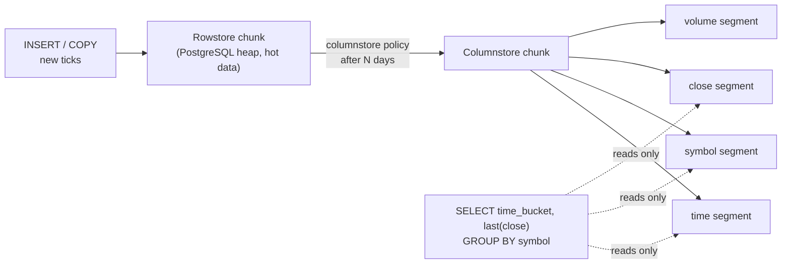

## Explanation

Columnar storage lays a table out on disk one column at a time: every `price` value sits next to the other `price` values, then every `volume` value, instead of one complete record following another. Logically the table is still rows and columns and the SQL does not change; what changes is which bytes are physically adjacent, and that decides which queries are cheap.

Mechanically, a columnar engine never writes a row on its own. It buffers a batch of rows, cuts the batch into one segment per column, encodes each segment with a compression scheme suited to that column's type, and stores the segments with small metadata such as each segment's minimum, maximum and null count. Vendors name the batch differently: a Parquet *row group* holds *column chunks*, a SQL Server *rowgroup* of up to 1,048,576 rows holds *column segments*, and TimescaleDB columnises rows in batches of up to 1,000 values per column. Because a segment holds values of one type from one domain, encodings such as dictionary (repeated strings become small integers), run-length (a value plus a repeat count), delta (differences between neighbours) and bit packing work far better than compressing a mixed row, usually with a general-purpose codec such as zstd or lz4 on top; SQL Server documents up to ten times compression, Tiger Data 90 to 98 percent reduction.

Reading reverses the process. A query naming three of fifty columns opens three segments; Redshift's documentation uses a hundred-column table whose five-column query reads about five percent of the data. Before opening a segment the engine compares the predicate with the segment's min/max metadata and skips segments that cannot match, which SQL Server calls segment elimination. The survivors are processed a batch of values at a time rather than row by row, so the CPU can use vector instructions; SQL Server calls this *batch mode execution* and documents a typical two- to four-fold speed-up from it.

The design comes from the 2005 C-Store paper, which argued that most databases were *write-optimised* while analytics needed a *read-optimised* system, trading cheap CPU cycles for scarce disk bandwidth. C-Store also described the compromise every modern engine still makes: writes land in a small writeable row store and a *tuple mover* periodically migrates them into the read-optimised column store. SQL Server's deltastore and tuple-mover, and TimescaleDB's rowstore chunks and columnstore policy, are direct descendants.

The compromise exists because columnar layouts punish transactional access: a point lookup reassembles one row from many segments, an `UPDATE` cannot overwrite in place and becomes a delete marker plus a new version, and inserting a few rows at a time yields tiny, badly compressed segments. Hence columnar storage lives in analytical warehouses (Redshift, Synapse, Azure Data Explorer), in data-lake file formats (Parquet, and Delta Lake on top of it) and in *hybrid* operational databases that keep hot data in rows.

In the reader's stack the hybrid is TimescaleDB hypercore. New ticks land in a row-oriented [hypertable](hypertable.md) chunk where inserts and upserts are fast; a columnstore policy converts chunks older than a chosen age, segmenting by `symbol` and ordering by `time DESC`, after which the Angular dashboard's "one year of daily closes" query touches only the `time`, `symbol` and `close` segments of a few chunks. Since TimescaleDB 2.18.0 the API speaks columnstore: `timescaledb.enable_columnstore`, `timescaledb.segmentby`, `timescaledb.orderby`, `add_columnstore_policy()` and `convert_to_columnstore()` replace the deprecated `timescaledb.compress`, `add_compression_policy()` and `compress_chunk()`. `INSERT`, `UPDATE`, `DELETE` and upsert still work on columnstore chunks, only more slowly. The columnstore is a Community Edition feature under the Tiger Data License, absent from the Apache 2 edition that some managed services ship.



## How it differs

**[Row-oriented storage](row-oriented-storage.md)** is the layout columnar storage replaces, and the two are mirror images. A row store answers "give me order 42" with one page read and writes a new order with one page write, but a scan of two columns over a billion rows must read every byte of every row. A column store reads only the two columns and compresses them well, but reconstructing one full row touches as many segments as there are columns, and single-row writes are expensive enough that engines stage them in a row-shaped buffer first. Choose by the dominant access pattern: entity-at-a-time (OLTP, meaning online transaction processing) favours rows; column-at-a-time over many rows (OLAP, online analytical processing) favours columns. Most real systems need both, which is why hybrids exist.

**[Hypertable](hypertable.md)** is often confused with columnar storage because TimescaleDB's compression is applied per chunk. A hypertable is the partitioning scheme: it decides *which* rows live in *which* chunk by time. Each chunk is initially an ordinary row-oriented table. Columnar storage is a property a chunk acquires later when a policy converts it. You can have a hypertable with no columnstore at all (the Apache 2 edition), and you can have columnar storage with no hypertable (Parquet files, SQL Server columnstore indexes).

**[BRIN index](brin-index.md)** solves a smaller version of the same problem on a row store: it records the min and max of a column per range of pages so a scan can skip ranges, which works only when the column correlates with physical order. A columnstore keeps equivalent min/max metadata inside every column segment, so skipping is a built-in part of reading rather than a separate structure, and because segments are often sorted on `orderby` columns the correlation is engineered rather than hoped for. If you are on a row store and cannot change the layout, BRIN is the cheap approximation; if you can convert the data, the columnstore subsumes it.

**[Continuous aggregate](continuous-aggregate.md)** attacks query cost from the other side by precomputing the answer to one specific aggregate query (say, hourly candles per symbol) and refreshing it incrementally. It is unbeatable for that query and useless for any other. Columnar storage makes every scan-heavy query cheaper without committing to a question in advance, at the price of still scanning the raw data. In practice you layer them: raw ticks compressed in the columnstore, a continuous aggregate for the dashboard's fixed charts.

**[B-tree index](b-tree-index.md)** is the instrument for finding a few rows fast inside a row store: one sorted entry per row, a few page reads per lookup, ordered range scans. A columnstore rarely carries one, because its queries scan and aggregate rather than locate, and because a segment's min/max metadata already skips most of what an index would skip. When a workload needs both, point lookups on recent rows and scans over history, the usual answer is B-trees on the hot rowstore chunks and columnar layout for the cold ones rather than a B-tree over compressed segments.

| | Row store | Columnstore | BRIN on row store | Continuous aggregate |
|---|---|---|---|---|
| Unit of I/O | Page of whole rows | Column segment | Page, skipped by range | Materialised rows |
| Best for | Point reads, single-row writes | Wide scans, aggregates | Append-ordered range filters | One known aggregate query |
| Compression | Per page, modest | Per column, high | Same as row store | Same as row store |
| Update cost | Low | High (delete marker + reinsert) | Low | Refresh job |

## Examples

=== "SQL"

    ```sql
    -- TimescaleDB 2.23+ (Community Edition): raw ticks arrive in the rowstore.
    -- CREATE TABLE ... WITH enables the columnstore and schedules a default
    -- columnstore policy that converts chunks one chunk interval old.
    CREATE TABLE ticks (
        time   TIMESTAMPTZ NOT NULL,
        symbol TEXT        NOT NULL,
        price  DOUBLE PRECISION,
        volume BIGINT
    ) WITH (
        tsdb.hypertable,
        tsdb.partition_column = 'time',
        tsdb.segmentby = 'symbol',
        tsdb.orderby   = 'time DESC');

    -- Replace the default policy: convert chunks once they are older than 7 days.
    CALL remove_columnstore_policy('ticks', if_exists => true);
    CALL add_columnstore_policy('ticks', after => INTERVAL '7 days');

    -- On an existing hypertable (2.18+) enable the columnstore explicitly instead:
    -- ALTER TABLE ticks SET (timescaledb.enable_columnstore,
    --     timescaledb.segmentby = 'symbol', timescaledb.orderby = 'time DESC');

    -- Convert one chunk by hand and compare sizes.
    CALL convert_to_columnstore('_timescaledb_internal._hyper_1_3_chunk');
    SELECT pg_size_pretty(before_compression_total_bytes) AS before,
           pg_size_pretty(after_compression_total_bytes)  AS after
    FROM hypertable_columnstore_stats('ticks');

    -- This scan touches only the time, symbol and price segments.
    SELECT time_bucket('1 day', time) AS day, symbol, last(price, time) AS close
    FROM ticks
    WHERE time > now() - INTERVAL '365 days'
    GROUP BY day, symbol;
    ```

=== "C#"

    ```csharp
    // .NET 9 + Npgsql: the query shape decides whether the columnstore helps.
    // Few columns, many rows, a time filter: a columnstore-friendly scan.
    await using var dataSource = NpgsqlDataSource.Create(connectionString);

    const string sql = """
        SELECT time_bucket('1 day', time) AS day, last(price, time) AS close
        FROM ticks
        WHERE symbol = $1 AND time > now() - INTERVAL '365 days'
        GROUP BY day
        ORDER BY day
        """;

    await using var cmd = dataSource.CreateCommand(sql);
    cmd.Parameters.Add(new NpgsqlParameter { Value = "MSFT" });   // binds $1

    var closes = new List<(DateTime Day, double Close)>();
    await using var reader = await cmd.ExecuteReaderAsync();
    while (await reader.ReadAsync())
        closes.Add((reader.GetDateTime(0), reader.GetDouble(1)));
    ```

=== "Python"

    ```python
    # Python 3.12 + psycopg 3: same scan, then hand the result to a dashboard
    # or write it out as Parquet, which is itself a columnar format.
    import psycopg
    import pyarrow as pa
    import pyarrow.parquet as pq

    with psycopg.connect(conninfo) as conn:
        rows = conn.execute(
            """
            SELECT time_bucket('1 day', time) AS day, symbol, last(price, time) AS close
            FROM ticks
            WHERE time > now() - INTERVAL '365 days'
            GROUP BY day, symbol
            """
        ).fetchall()

    table = pa.table(
        {"day": [r[0] for r in rows],
         "symbol": [r[1] for r in rows],
         "close": [r[2] for r in rows]}
    )
    # pyarrow cuts row groups of at most 1,048,576 rows by default; each row group
    # carries per-column min/max statistics that readers use to skip it.
    pq.write_table(table, "daily_closes.parquet", compression="zstd")
    ```

=== "Azure"

    - **Azure SQL Database, Azure SQL Managed Instance, SQL Server and SQL database in Microsoft Fabric** implement columnar storage as *columnstore indexes*: a clustered columnstore index is the whole table in columnar form; a nonclustered columnstore index is a columnar copy of selected columns over a rowstore table, which is how "real-time operational analytics" runs analytics and OLTP on the same table. Rows arrive in the deltastore until a rowgroup is full, then the tuple-mover compresses them; ordered columnstore indexes improve segment elimination.
    - **Microsoft Fabric** lakehouses and warehouses store tables as Delta Lake files, which are Parquet underneath; **Azure Data Explorer** and Fabric Eventhouse store immutable extents whose records are physically arranged by column.
    - **Azure Database for PostgreSQL flexible server** ships the TimescaleDB Apache 2 edition, so hypertables work but the columnstore does not; the managed Citus-based **Azure Cosmos DB for PostgreSQL** offered append-only `USING columnar` tables but is closed to new projects and retires on 31 March 2029.

=== "AWS"

    - **Amazon Redshift** is columnar by design: each 1 MB block holds values of one column, and each column gets a compression encoding chosen for its type.
    - **Amazon Athena** and **Amazon S3**: store lake data as Parquet (optionally partitioned by date prefix) so queries read and pay for only the columns and partitions they touch; this is the standard "convert CSV to Parquet" exam answer.
    - **Amazon RDS for PostgreSQL and Aurora PostgreSQL** do not include the TimescaleDB extension at all; for the TimescaleDB columnstore on AWS you run Tiger Cloud (available through AWS Marketplace) or self-host on EC2 or EKS.
    - **Amazon Timestream for LiveAnalytics** closed to new customers on 20 June 2025; AWS points new time-series workloads at Timestream for InfluxDB.

## Misconceptions

- **"Columnar storage is just compression."** Compression is a consequence, not the mechanism. The win comes first from reading only the needed columns and skipping segments by metadata; compression ratios are high because single-type segments encode well. A compressed row store (page compression) gives neither column selectivity nor segment skipping.
- **"Converting a table to columnar makes every query faster."** Point lookups and single-row updates get slower, because one row is spread across many segments and updates become delete-plus-insert. That is why SQL Server keeps a deltastore and TimescaleDB keeps recent chunks in the rowstore.
- **"A TimescaleDB hypertable is columnar."** Chunks are ordinary PostgreSQL heaps until a columnstore policy or `convert_to_columnstore()` moves them, and the columnstore is a Community Edition feature that the Apache 2 edition on Azure does not include.
- **"Columnar tables cannot be updated."** Some implementations are append-only (Citus columnar in Azure Cosmos DB for PostgreSQL), but SQL Server columnstore indexes and the TimescaleDB columnstore support `UPDATE` and `DELETE`; they are simply more expensive than on a row store.
- **"Parquet is a database."** Parquet is a file layout: row groups of column chunks with a footer written after the data. Query engines (Athena, Fabric, DuckDB, Spark) supply the planner and the skipping; the file only supplies the metadata that makes skipping possible.

## Exam notes

Fundamentals exams (DP-900, CLF-C02) test the vocabulary: OLTP versus OLAP, row store for transactions, column store for analytics, and which Azure or AWS service belongs to which side. DP-300 goes deeper on columnstore indexes: when to choose clustered versus nonclustered, what rowgroups and the deltastore are, why batch mode matters, and that columnstore is the default recommendation for large fact tables. DP-600 and DP-700 assume you know that Parquet and Delta are columnar and that sorted writes improve segment skipping; DEA-C01 asks you to pick Parquet over CSV or JSON to cut Athena scan cost and to understand Redshift compression encodings. AZ-305, SAA-C03 and SAP-C03 test service selection: Redshift, Synapse or Fabric for warehousing, not RDS or Azure SQL general purpose, and the trap answer is usually a transactional store with "more indexes". A recurring trap is the claim that columnstore removes the need for partitioning; partitioning and columnar layout are orthogonal and are usually combined.

## Self-check

??? question "Your Angular dashboard aggregates one year of one-minute bars for 500 symbols and the query takes 40 seconds on a plain PostgreSQL table with a B-tree on (symbol, time). What change addresses the root cause?"
    The query reads a few columns across hundreds of millions of rows, so the cost is I/O over whole rows, not index lookups. Convert the table to a TimescaleDB hypertable and enable the columnstore with `segmentby = 'symbol'` and `orderby = 'time DESC'` for chunks older than the hot window; the scan then reads only the needed segments and skips chunks and segments by min/max metadata. A continuous aggregate for the dashboard's fixed bucket sizes removes the remaining scan entirely. Adding more B-tree indexes does not help a scan that must visit most rows anyway.

??? question "A team proposes storing an order-management system's orders table as a clustered columnstore index because 'reports are slow'. What do you ask?"
    How the table is used the rest of the day. Orders are inserted and updated one at a time and read by key, which is the worst case for a columnstore (row reassembly, delete-plus-insert updates, tiny rowgroups). The right shape is a rowstore table for the OLTP path plus a nonclustered columnstore index over the reporting columns, so analytics run on the columnar copy while transactions keep their B-tree access.

??? question "You moved an Athena data set from gzip CSV to Parquet and costs fell, but a query that selects every column of every row did not get faster. Why?"
    Columnar formats help when a query reads a subset of columns or when metadata lets the engine skip row groups. A `SELECT *` with no selective predicate reads every column chunk, so the only saving is compression. Partition the data by the columns queries filter on, and have writers sort within row groups on common predicates so min/max statistics can prune.

## Further reading

- [Row-Oriented vs. Columnar Storage](../data/time-series/row-vs-columnar-storage.md) in this library
- [High-Frequency Indexing & Partitioning](../data/time-series/high-frequency-indexing-partitioning.md) in this library
- [Time-Series Financial Schemas](../data/time-series/time-series-financial-schemas.md) in this library
- Term pages: [Row-Oriented Storage](row-oriented-storage.md), [Hypertable (TimescaleDB)](hypertable.md), [BRIN index](brin-index.md), [Continuous aggregate](continuous-aggregate.md), [Table Partitioning](table-partitioning.md)
- [C-Store: A Column-oriented DBMS (VLDB 2005)](https://www.vldb.org/archives/website/2005/program/paper/thu/p553-stonebraker.pdf), the paper that defined the read-optimised column store and the tuple-mover architecture
- [Hypercore: hybrid row-columnar storage](https://www.tigerdata.com/docs/use-timescale/latest/hypercore) and [ALTER TABLE (hypercore)](https://www.tigerdata.com/docs/api/latest/hypercore/alter_table), Tiger Data documentation
- [Columnstore indexes: Overview](https://learn.microsoft.com/en-us/sql/relational-databases/indexes/columnstore-indexes-overview), Microsoft Learn
- [Columnar storage in Amazon Redshift](https://docs.aws.amazon.com/redshift/latest/dg/c_columnar_storage_disk_mem_mgmnt.html), AWS documentation
- [Apache Parquet file format](https://parquet.apache.org/docs/file-format/)
