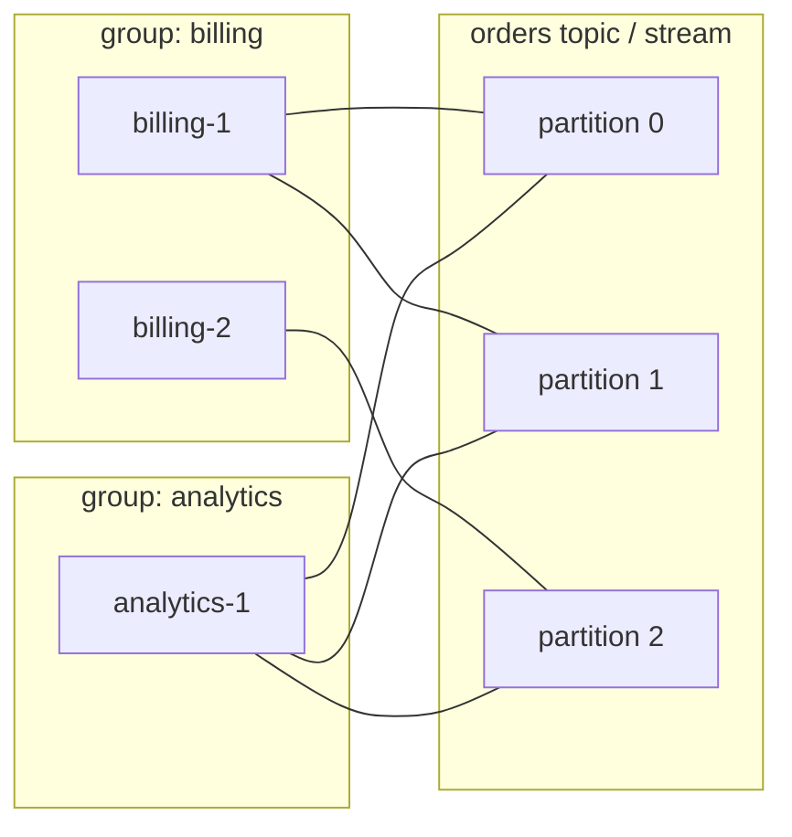

## Explanation

A plain stream or topic delivers every entry to every reader: right for fan-out, wrong when ten workers should split a backlog of orders. A **consumer group** names a set of consumers the stream treats as one logical reader: each entry (Redis Streams) or each partition or shard (Kafka, Event Hubs, Kinesis) goes to exactly one member at a time, the group records how far it has read, and other groups read the same data from their own position. Within a group the members compete, the *Competing Consumers* of the Enterprise Integration Patterns; across groups the stream fans out.

The two implementations in this stack divide the work differently:

- **Redis Streams** hand out individual entries. `XGROUP CREATE orders billing $ MKSTREAM` creates the group with a last-delivered id (`$` for new entries, `0` for the whole history). `XREADGROUP GROUP billing worker-3 ... STREAMS orders >` returns entries never delivered to anyone and records them in the group's **pending entries list (PEL)** with owner, delivery time and delivery counter until `XACK` removes them. A consumer reads its own pending history by passing an id instead of `>`, so a restarted worker can finish what it started. `XPENDING` inspects the list; `XAUTOCLAIM` (Redis 6.2) moves entries idle beyond a threshold to a live consumer and bumps their delivery counter; Redis 8.4 folds that into `XREADGROUP ... CLAIM`, and 8.8's `XNACK` hands entries back on shutdown. Entries go out one by one, so a Redis group scales to any number of consumers but orders only what one consumer receives.
- **Kafka** hands out partitions. Consumers sharing a `group.id` join through a broker-side group coordinator, which assigns each partition of the subscribed topics to exactly one member; extra members idle. Each partition's position is an offset the consumer commits to an internal compacted topic. Membership changes trigger a **rebalance**. The classic protocol computes assignments on the clients (`RangeAssignor` then `CooperativeStickyAssignor` by default) behind a group-wide barrier; `group.instance.id` (static membership) lets a known member restart without one. KIP-848, generally available in Kafka 4.0 and enabled on brokers by default, moves assignment into the coordinator with incremental, heartbeat-driven reconciliation and server-side `uniform` and `range` assignors; clients opt in with `group.protocol=consumer` (default `classic`).



Managed services follow the Kafka shape. An **Event Hubs** consumer group is an independent view of the hub with client-stored checkpoints (typically in Blob Storage); one epoch reader owns a partition per group (five non-epoch readers may share one), so partitions cap parallelism and the tier caps groups (Basic 1, Standard 20, Premium 100, Dedicated 1,000 per hub). **Kinesis** has no group noun: a Kinesis Client Library application is one, with a DynamoDB lease table mapping each shard to a worker and holding its checkpoint; shared readers split 2 MB/s per shard, while each enhanced fan-out consumer gets a dedicated 2 MB/s per shard (20 per stream). **Service Bus** expresses it structurally: a queue is one group of competing receivers; each topic subscription is a group with its own copy of every message.

Operationally, consumer names must be stable and unique, or a crashed worker's pending entries wait for a sweep; acknowledgements and offset commits must follow the work, or the group quietly becomes [at-most-once](at-most-once-delivery.md); rebalances and claims deliver entries twice, so handlers stay idempotent; and lag is the metric to alert on. In the .NET 9 worker that means a pod-derived consumer name, a startup pass over its own pending history before switching to `>`, a periodic `XAUTOCLAIM` sweep, and a [dead-letter](dead-letter-queue.md) stream for entries whose delivery counter keeps climbing.

## How it differs

**[At-least-once delivery](at-least-once-delivery.md).** The guarantee says a message is redelivered until acknowledged. The group is how that promise is kept across several consumers: the pending list or committed offset is the group's memory of what is unfinished, and claiming or reassignment is redelivery. You cannot have a reliable group without the guarantee, and in a stream you cannot have the guarantee for a fleet without the group.

**[Dead-letter queue](dead-letter-queue.md).** Claiming handles a dead *consumer*: its entries move to a live one. It does not help with a dead *message* that fails for every claimant; the delivery counter grows and the group stalls. The DLQ is where the group puts that entry so it can move on.

**[Backpressure](backpressure.md).** When consumers fall behind, backpressure makes the producer slow down or shed load; a consumer group lets you add members to catch up. Both are needed: the group raises capacity up to the partition count, backpressure (or [MAXLEN trimming](maxlen-trim.md)) protects the stream when even that is not enough.

**[Horizontal scaling](horizontal-scaling.md).** Stateless replicas scale almost linearly; a group scales to the number of partitions, shards or sessions and no further, and every scaling event triggers a rebalance with a pause and possible duplicates. Plan partition counts for peak parallelism up front, especially where they cannot be increased later (Event Hubs basic and standard tiers).

**[MAXLEN trimming](maxlen-trim.md).** A group remembers what it has and has not acknowledged; trimming does not ask. `XADD ... MAXLEN` and `XTRIM` delete the oldest entries whether or not a lagging group has read them, and a pending entry that was trimmed comes back as a null payload when its owner re-reads its history. Redis 8.2's `ACKED` trimming mode deletes only entries every group has acknowledged, and `XAUTOCLAIM` reports and removes dangling pending ids; without those, size the trim limit so it never overtakes the slowest group's lag.

| Platform | Unit handed to a member | Position stored in | Takeover after a crash | Parallelism limit |
|---|---|---|---|---|
| Redis Streams | Individual entry | Group last-delivered id plus PEL in Redis | `XAUTOCLAIM`, `XCLAIM`, `XREADGROUP CLAIM` | None (ordering per consumer only) |
| Kafka | Partition | Internal compacted offsets topic | Rebalance (classic or KIP-848) | Partitions |
| Event Hubs | Partition | Client checkpoint store (Blob) | Load balancing in the processor client | Partitions; groups per tier |
| Kinesis (KCL) | Shard lease | DynamoDB lease table | Lease expiry and reassignment | Shards; 20 or 50 enhanced fan-out consumers |
| Service Bus | Message (queue) or subscription copy | Broker | Lock expiry | Sessions, if ordering matters |

## Examples

**Billing on Redis Streams.** Three `billing` workers share the `orders` stream. Each starts by draining its own pending history, then reads new entries, acknowledges after writing to TimescaleDB, and once a minute claims entries other workers left idle. A fourth group, `analytics`, reads the same stream from `0` without affecting billing.

=== "C#"

    ```csharp
    // StackExchange.Redis: a group worker with a stable name and a reclaim sweep.
    const string Stream = "orders", Group = "billing";
    var me = $"{Group}-{Environment.MachineName}";

    try { await db.StreamCreateConsumerGroupAsync(Stream, Group, StreamPosition.Beginning, createStream: true); }
    catch (RedisServerException ex) when (ex.Message.StartsWith("BUSYGROUP")) { /* already exists */ }

    // 1. Finish our own unacknowledged work from before a restart (id "0" reads the PEL).
    var position = StreamPosition.Beginning;
    while (true)
    {
        var entries = await db.StreamReadGroupAsync(Stream, Group, me, position, count: 100);
        if (entries.Length == 0)
        {
            if (position == StreamPosition.NewMessages) { await Task.Delay(50, ct); continue; }
            position = StreamPosition.NewMessages;              // history drained: switch to ">"
            continue;
        }
        foreach (var e in entries)
        {
            await HandleAsync(e, ct);
            await db.StreamAcknowledgeAsync(Stream, Group, e.Id);
        }
    }

    // 2. Timer: take over entries that have sat idle for a minute in anyone's PEL.
    var result = await db.StreamAutoClaimAsync(Stream, Group, me, minIdleTimeInMs: 60_000, startAtId: "0-0", count: 100);
    foreach (var e in result.ClaimedEntries) { await HandleAsync(e, ct); await db.StreamAcknowledgeAsync(Stream, Group, e.Id); }

    // Kafka equivalent: the group is a config, the broker assigns partitions.
    var config = new ConsumerConfig
    {
        BootstrapServers = brokers,
        GroupId = "billing",
        GroupInstanceId = $"billing-{podOrdinal}",            // static membership: a restart is not a rebalance
        PartitionAssignmentStrategy = PartitionAssignmentStrategy.CooperativeSticky,
        EnableAutoCommit = false,
        AutoOffsetReset = AutoOffsetReset.Earliest,
    };
    using var consumer = new ConsumerBuilder<string, string>(config)
        .SetPartitionsRevokedHandler((c, revoked) => c.Commit())   // commit before giving partitions away
        .Build();
    consumer.Subscribe("orders");
    ```

=== "Python"

    ```python
    # redis-py worker: same lifecycle.
    import socket, redis
    r = redis.Redis()
    STREAM, GROUP = "orders", "billing"
    me = f"{GROUP}-{socket.gethostname()}"
    try:
        r.xgroup_create(STREAM, GROUP, id="0", mkstream=True)
    except redis.ResponseError as e:
        if "BUSYGROUP" not in str(e):
            raise

    position = "0"                                   # own pending history first
    while True:
        batches = r.xreadgroup(GROUP, me, {STREAM: position}, count=100, block=1000)
        entries = batches[0][1] if batches else []
        if not entries and position == "0":
            position = ">"                           # then new entries only
            continue
        for entry_id, fields in entries:
            handle(fields)
            r.xack(STREAM, GROUP, entry_id)

    # Reclaim sweep (run from a timer): entries idle > 60 s, any owner.
    _next, claimed, _gone = r.xautoclaim(STREAM, GROUP, me, min_idle_time=60_000, start_id="0-0", count=100)

    # confluent-kafka: the group is configuration.
    from confluent_kafka import Consumer
    consumer = Consumer({"bootstrap.servers": BROKERS, "group.id": "billing",
                         "group.instance.id": f"billing-{POD_ORDINAL}",
                         "partition.assignment.strategy": "cooperative-sticky",
                         "enable.auto.commit": False, "auto.offset.reset": "earliest"})
    consumer.subscribe(["orders"])
    ```

=== "Azure"

    - **Event Hubs**: create one consumer group per application (`billing`, `analytics`), give each its own Blob container for checkpoints, and run `EventProcessorClient` instances up to the partition count; the processor balances partition ownership between instances and takes over from a failed one. Watch the per-tier limits on groups and partitions, and that partition counts are fixed after creation on basic and standard tiers. Kafka clients use `group.id` against the Kafka endpoint, with `group.instance.id` recommended to avoid rebalances on transient disconnects.
    - **Service Bus**: competing receivers on a queue form the implicit group; for several independent readers, use a topic with one subscription per reader. Use sessions when a group of messages must be processed in order by one receiver at a time.

=== "AWS"

    - **Kinesis Data Streams**: a KCL 3.x application name is the group; its DynamoDB lease table holds one row per shard with `leaseOwner` and `checkpoint`, and workers rebalance leases when instances come and go. Register an enhanced fan-out consumer (`RegisterStreamConsumer`) when several applications read the same stream, so each gets its own 2 MB/s per shard instead of sharing it.
    - **Lambda**: an event source mapping on Kinesis or DynamoDB Streams processes each shard with one invocation at a time; `ParallelizationFactor` (up to 10) runs several batches per shard while preserving order per partition key. For SQS, Lambda pollers are competing consumers on the queue.
    - **SNS fan-out**: subscribe one SQS queue per consuming application; each queue is that application's group, and workers compete within it.

## Misconceptions

- **"More consumers always mean more throughput."** In Kafka, Event Hubs and Kinesis a group's parallelism is capped by partitions or shards; extra members idle. Redis Streams have no partitions, so they scale by entry, but then ordering across consumers is gone.
- **"A consumer group preserves order."** Order is preserved per partition, shard or session, and in Redis only within the entries one consumer receives. Two members of a group process different keys concurrently.
- **"Each group gets its own copy of the data."** Kafka, Event Hubs, Kinesis and Redis keep one copy with a position per group. Service Bus subscriptions are the exception: each subscription really holds a copy.
- **"Rebalances are harmless."** A classic Kafka rebalance pauses the whole group and reassigns partitions, which replays uncommitted records; cooperative assignors, static membership and the KIP-848 protocol reduce the pause but not the need for idempotent handlers.
- **"Consumer names are cosmetic."** In Redis the name owns the pending entries. A random name on every restart strands the previous instance's unacknowledged work until a sweep claims it; a stable name lets the restarted worker read its own history first.

## Exam notes

AZ-204 and AZ-305 test Event Hubs consumer groups as independent views, the recommendation of one active reader per partition per group, checkpointing in Blob Storage, the `$Default` group and the per-tier group and partition quotas, plus Service Bus topics and subscriptions as the way to give several readers their own copy. SAA-C03, DEA-C01 and SAP-C03 test the Kinesis numbers: shared throughput of 2 MB/s per shard across readers versus dedicated 2 MB/s per enhanced fan-out consumer, the 20-consumer registration limit, and the KCL lease table in DynamoDB; DVA-C02 and DVA-C03 add Lambda's per-shard processing and `ParallelizationFactor`. The traps: thinking groups copy data, adding consumers past the partition count, forgetting that a rebalance or lease takeover reprocesses records, and picking a queue when several applications each need every message.

## Self-check

??? question "You scale the billing group from 4 to 8 pods on a 4-partition Kafka topic and throughput does not change. Why, and what would help?"
    A partition is owned by one member per group, so four of the eight pods have nothing assigned. Increase the partition count (planning for the key distribution and knowing it changes key-to-partition mapping), or move to a model that hands out entries rather than partitions, such as a Redis Stream, if ordering per key is not required.

??? question "After each deploy, some Redis Stream entries stay unacknowledged for hours even though all workers are healthy. What is the likely cause?"
    Workers use a fresh random consumer name on every start, so the entries delivered to the old names remain in their PELs with nobody reading that history. Use stable names tied to the pod identity and read the own history with id `0` on startup, and run an XAUTOCLAIM sweep for entries idle beyond a threshold so orphaned work is always recovered.

??? question "Three teams each want every order event from one Event Hubs hub on the standard tier, and a fourth asks for a copy next quarter. What do you set up and what limit are you watching?"
    One consumer group per team (plus `$Default`), each with its own checkpoint container, reading the same partitions independently. The standard tier allows 20 consumer groups per hub, so four is fine; the watch item is partitions, which cap each group's parallelism and cannot be changed after creation on that tier.

## Further reading

- [Redis Streams vs. Kafka](../messaging/eventing/redis-streams-vs-kafka.md) compares entry-based and partition-based groups.
- [Delivery Semantics](../messaging/eventing/delivery-semantics.md) for the guarantees a group implements.
- [Async and Threading](../messaging/runtime/async-threading.md) for running group members as hosted services.
- Terms: [At-least-once delivery](at-least-once-delivery.md), [Dead-letter queue](dead-letter-queue.md), [Backpressure](backpressure.md), [Horizontal scaling](horizontal-scaling.md), [MAXLEN trimming](maxlen-trim.md).
- [Kafka consumer configuration](https://kafka.apache.org/43/generated/consumer_config.html) and the [Redis Streams introduction](https://redis.io/docs/latest/develop/data-types/streams/).
- [Kinesis Client Library lease table](https://docs.aws.amazon.com/streams/latest/dev/shared-throughput-kcl-consumers.html).
