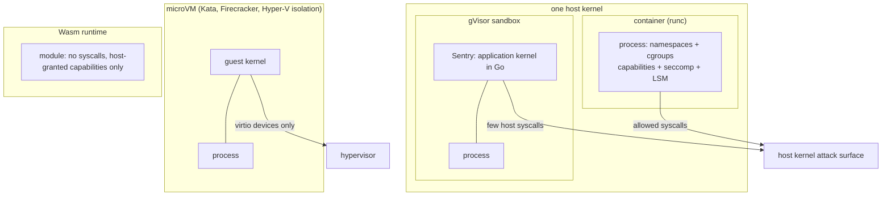

## Explanation

A container is not something the kernel knows about. It is an ordinary process tree that a runtime such as `runc` has wrapped in several independent kernel mechanisms, each removing one way the process could see or affect the rest of the machine. Every hardening switch in Docker, Kubernetes and the cloud maps onto one of them.

**Namespaces** limit what the process can see. Linux has eight: mount (its own filesystem tree), PID (its own process numbering), network (interfaces, addresses and ports), IPC (message queues and shared memory), UTS (hostname), user (its own UID and GID mapping), cgroup (its own cgroup root) and time (boot and monotonic clocks). Creating most of them needs `CAP_SYS_ADMIN`; user namespaces are the exception, unprivileged since Linux 3.8, and let root inside a container be an unprivileged user outside it. Kubernetes gives the containers of one Pod a shared network and IPC namespace, which is why `localhost` works between an app and its [sidecar](sidecar-pattern.md), and runs a Pod in its own user namespace when `hostUsers: false` is set (on by default since v1.33, stable since v1.36).

**Control groups** limit what the process can consume. In the unified cgroup v2 hierarchy (official since Linux 4.5) `memory.max` is a hard limit enforced by the OOM killer, `cpu.max` is a quota per period and `pids.max` caps process creation. Runtimes read the same files: by default .NET caps its GC heap at 75% of the memory limit and rounds the CPU quota up for `Environment.ProcessorCount`.

**Capabilities** limit what root may do. Linux splits superuser privilege into 41 named capabilities. Docker starts a container with 14 of them (`CHOWN`, `NET_BIND_SERVICE`, `SETUID`, `KILL` and so on) and nothing else; the norm is `--cap-drop ALL` plus exactly what the process needs. `CAP_SYS_ADMIN` is the one to fear: the manual calls it overloaded and "the new root".

**Seccomp** limits which system calls may be made at all. Docker's default profile is an allowlist that blocks about 44 of the 300-plus syscalls, among them `mount`, `reboot`, `kexec_load`, `keyctl` and the namespace-creating flags of `clone`. Kubernetes applies the runtime's default profile only when a Pod sets `seccompProfile.type: RuntimeDefault` or the kubelet runs with `--seccomp-default` (stable since v1.27); otherwise Pods run `Unconfined`. AppArmor or SELinux add mandatory access control, `no_new_privs` stops setuid binaries regaining privilege, and a read-only root filesystem removes the obvious persistence path.

Kubernetes bundles these switches into the Pod Security Standards (`privileged`, `baseline` and `restricted`), which Pod Security Admission (stable since v1.25) enforces per namespace through the `pod-security.kubernetes.io/enforce`, `audit` and `warn` labels.



What none of this changes is the boundary itself: every container on a node makes system calls into the same kernel, so a kernel bug reachable through an allowed syscall is a host compromise. NIST SP 800-190 lists the shared kernel as a host OS risk and recommends a container-specific host OS and grouping only workloads of the same purpose, sensitivity and threat posture on one kernel. Where that is not enough, a sandboxed runtime (gVisor), a lightweight VM per Pod (Kata Containers, Firecracker) or [Wasm sandboxing](wasm-sandboxing.md) shrinks the shared surface at a cost in compatibility and speed, and Kubernetes selects such runtimes per Pod with `RuntimeClass` (stable since v1.20); the comparison below sets the tiers side by side.

For an agent platform the choice follows trust: first-party .NET services run as restricted-profile containers, while MCP tool servers executing untrusted or agent-written code belong in gVisor, Kata, a microVM or a Wasm runtime.

## How it differs

**[Wasm sandboxing](wasm-sandboxing.md).** A container narrows a process's view of a kernel it still talks to; a Wasm module has no kernel to talk to. Its only exits are the imports the host linked, so the attack surface is the host functions you expose rather than the syscall table. The price is that the code must target the Wasm runtime, which rules out most existing binaries and native dependencies. Choose containers for native workloads and mature tooling, Wasm for plugins and untrusted functions you compile yourself.

**[Sidecar pattern](sidecar-pattern.md).** Everything above describes one container, but Kubernetes shares the network and IPC namespaces across the containers of a Pod and lets them share volumes. The unit you must reason about is therefore the Pod: a compromised sidecar sees the application's traffic on `localhost` and its shared files, and the classic `istio-init` needing `NET_ADMIN` and `NET_RAW` is why meshes moved that work to a privileged node agent.

**[Least privilege](least-privilege.md).** The principle says a subject should hold only the access its task needs. Container isolation is its implementation for a process: a non-root user, `cap-drop ALL`, a seccomp profile, a read-only root filesystem and no host namespaces. The Pod Security Standards are least privilege written down as admission policy: `baseline` forbids host namespaces, privileged mode, `hostPath` volumes and all but a short list of added capabilities; `restricted` also requires `runAsNonRoot`, `allowPrivilegeEscalation: false`, dropping `ALL` capabilities (only `NET_BIND_SERVICE` may come back), a `RuntimeDefault` or `Localhost` seccomp profile and a short list of volume types. The principle still has to be applied separately to the workload's cloud identity and RBAC.

**[Immutable infrastructure](immutable-infrastructure.md).** Immutability is a change boundary: a running container is never patched, only replaced from a new image. Isolation is a reach boundary: what the container may see and touch while it runs. The two meet at a read-only root filesystem, which prevents both drift and persistence, but neither implies the other: `kubectl exec` followed by an editor mutates an isolated container without crossing any namespace, and an image that runs as root with every capability is immutable yet poorly confined.

**Stronger boundaries.** gVisor's `runsc` places an application kernel written in Go, the Sentry, between the container and the host and services most syscalls itself; its default `systrap` platform intercepts them with seccomp traps, and syscall-heavy workloads pay for it. Kata Containers runs each Pod in a lightweight virtual machine with its own guest kernel through a containerd shim and a Rust `kata-agent`, on QEMU or Cloud Hypervisor; Firecracker, the Rust microVM monitor AWS built for Lambda and Fargate, boots in under 125 ms with under 5 MiB of overhead. AKS Pod Sandboxing exposes Kata as `runtimeClassName: kata-vm-isolation`, and Windows offers the same two tiers as process isolation and Hyper-V isolation. At the far end a WebAssembly module makes no system calls at all and holds only the capabilities its host granted.

| Boundary | Kernel | Syscall surface exposed to the host | Start-up | Runs unmodified binaries | Typical use |
| --- | --- | --- | --- | --- | --- |
| Container (`runc`) | shared with host | allowed syscalls (seccomp) | milliseconds | yes | trusted first-party services |
| gVisor (`runsc`) | shared, behind the Sentry | the Sentry's own host calls | milliseconds | mostly (compatibility gaps) | untrusted code, multi-tenant |
| Kata / Firecracker microVM | own guest kernel | virtio devices to the hypervisor | sub-second | yes | hostile tenants, serverless |
| Full VM | own kernel | hypervisor | seconds to minutes | yes, any OS | different OS or compliance boundary |
| Wasm module | none | host imports only | microseconds | no, must be compiled to Wasm | plugins, untrusted functions |

## Examples

=== "C#"

    ```csharp
    // Inspect the boundary from inside a Linux container (.NET 9)
    var interesting = new[] { "CapEff", "CapBnd", "Seccomp", "NoNewPrivs", "NSpid" };
    foreach (var line in File.ReadLines("/proc/self/status"))
        if (interesting.Any(k => line.StartsWith(k, StringComparison.Ordinal)))
            Console.WriteLine(line);       // CapEff: 00000000a80425fb is Docker's 14 default capabilities

    static string Cg(string file) =>
        File.Exists($"/sys/fs/cgroup/{file}") ? File.ReadAllText($"/sys/fs/cgroup/{file}").Trim() : "n/a";

    Console.WriteLine($"memory.max={Cg("memory.max")}  cpu.max={Cg("cpu.max")}  pids.max={Cg("pids.max")}");

    // The runtime reads the same cgroup files: CPU quota rounded up, 75% of the memory limit for the GC heap
    Console.WriteLine($"ProcessorCount = {Environment.ProcessorCount}");
    Console.WriteLine($"GC budget      = {GC.GetGCMemoryInfo().TotalAvailableMemoryBytes / (1024 * 1024)} MiB");
    ```

=== "Python"

    ```python
    # Python 3.12+: create a new user + UTS namespace and change the hostname inside it only.
    # Run as a plain single-threaded script; some distributions restrict unprivileged user namespaces.
    import os
    import socket

    print("before:", socket.gethostname())
    os.unshare(os.CLONE_NEWUSER | os.CLONE_NEWUTS)   # unprivileged since Linux 3.8
    socket.sethostname("sandboxed")                   # CAP_SYS_ADMIN inside the new user namespace is enough
    print("inside:", socket.gethostname())            # the host's hostname is untouched

    with open("/proc/self/status") as status:
        for line in status:
            if line.startswith(("CapEff", "Seccomp", "NoNewPrivs")):
                print(line.rstrip())                  # CapEff is full inside the user namespace, meaningless outside it
    ```

=== "Docker"

    ```bash
    # Least-privilege defaults for a .NET 9 API: non-root, read-only root, no capabilities, no privilege escalation,
    # cgroup limits, and the default seccomp profile (applied automatically unless --privileged or unconfined)
    docker run --rm -p 8080:8080 \
      --user 10001:10001 --read-only --tmpfs /tmp \
      --cap-drop ALL --security-opt no-new-privileges \
      --memory 512m --cpus 1 --pids-limit 256 \
      ghcr.io/example/market-api:2.3.0

    # Stronger boundary for untrusted code: run the same image under gVisor
    docker run --rm --runtime=runsc ghcr.io/example/untrusted-tool:0.4.1
    ```

=== "Kubernetes"

    ```yaml
    apiVersion: v1
    kind: Namespace
    metadata:
      name: tools
      labels:
        pod-security.kubernetes.io/enforce: restricted
        pod-security.kubernetes.io/warn: restricted
    ---
    apiVersion: node.k8s.io/v1
    kind: RuntimeClass
    metadata: { name: gvisor }
    handler: runsc                        # the containerd runtime handler configured on the nodes
    ---
    apiVersion: v1
    kind: Pod
    metadata: { name: mcp-code-runner, namespace: tools }
    spec:
      runtimeClassName: gvisor            # application kernel between the tool and the host
      hostUsers: false                    # own user namespace (stable since v1.36; Linux 6.3+, containerd 2.0+ or CRI-O 1.25+)
      securityContext:
        runAsNonRoot: true
        runAsUser: 10001
        seccompProfile: { type: RuntimeDefault }
      containers:
        - name: runner
          image: ghcr.io/example/mcp-code-runner:0.4.1
          securityContext:
            allowPrivilegeEscalation: false
            readOnlyRootFilesystem: true
            capabilities: { drop: ["ALL"] }
          resources:
            limits: { cpu: "1", memory: 512Mi }
          volumeMounts: [{ name: scratch, mountPath: /tmp }]
      volumes:
        - { name: scratch, emptyDir: { sizeLimit: 256Mi } }
    ```

=== "Azure"

    ```bash
    # AKS Pod Sandboxing: Kata Containers on Azure Linux with Cloud Hypervisor; each sandboxed Pod gets its own guest kernel
    az aks nodepool add --cluster-name aks-trading --resource-group rg-trading --name sandbox \
      --workload-runtime KataVmIsolation --os-sku AzureLinux --node-vm-size Standard_D4s_v3 --node-count 1
    ```

    ```yaml
    spec:
      runtimeClassName: kata-vm-isolation   # pod VM sized from the Pod's limits (512Mi memory if none set)
      nodeSelector: { kubernetes.azure.com/agentpool: sandbox }
    ```

    The pod VM is a compute boundary only: Microsoft's guidance is that it does not isolate the control plane, storage or cluster-admin actions, so it is combined with network policy and Azure Policy. Azure Container Instances isolates each container group at the hypervisor level and refuses privileged operations; Azure Container Apps likewise does not allow privileged containers.

=== "AWS"

    Every Fargate task runs in its own isolated virtual environment and shares no kernel, CPU, memory, network interface or ephemeral storage with other tasks; Firecracker was built for Lambda and Fargate. Inside the task, privileged mode is unavailable, added capabilities are restricted (only `CAP_SYS_PTRACE` can be granted, for observability agents), and neither customers nor AWS operators can reach the host. Containers in one task still share the network namespace, as in a Pod.

    ```json
    {
      "name": "api",
      "image": "123456789012.dkr.ecr.eu-west-1.amazonaws.com/market-api:2.3.0",
      "essential": true,
      "user": "10001:10001",
      "readonlyRootFilesystem": true,
      "linuxParameters": { "initProcessEnabled": true }
    }
    ```

    For EC2 and EKS nodes, Bottlerocket is the container-specific host OS NIST recommends: SELinux in enforcing mode, seccomp, dm-verity integrity checking of the root filesystem, atomic image-based updates with rollback, and an admin container instead of a general-purpose shell.

## Misconceptions

- **"Containers are lightweight VMs."** A VM has its own kernel behind a hypervisor; a container is a process with a restricted view of the host kernel. The shared kernel is the shared attack surface, which is the whole reason gVisor, Kata and Firecracker exist.
- **"Root in a container is harmless."** Without a user namespace, UID 0 in the container is UID 0 on the host, carrying Docker's 14 default capabilities, and a writable `hostPath` or the Docker socket turns that into host root. `runAsNonRoot`, `hostUsers: false` and `cap-drop ALL` are what make "root" harmless.
- **"Kubernetes applies the default seccomp profile."** Only if the Pod requests `RuntimeDefault` or the kubelet runs with `--seccomp-default`; otherwise the Pod is `Unconfined`, and a privileged container is always unconfined.
- **"A sandboxed runtime is a drop-in switch."** gVisor does not implement every syscall or `/proc` file and adds overhead per syscall; Kata on AKS does not support host networking and sizes a VM from the Pod's limits. Test the workload under the new `RuntimeClass` before relying on it.
- **"`--privileged` with a non-root user is fine."** Privileged mode grants every capability, exposes all host devices and disables the seccomp and AppArmor profiles regardless of the user; the user id alone does not restore any of that.

## Exam notes

CKS is the exam built around this term: the three Pod Security Standards and the Pod Security Admission labels, `securityContext` fields (`runAsNonRoot`, `allowPrivilegeEscalation`, `readOnlyRootFilesystem`, `capabilities`), seccomp and AppArmor profiles, `RuntimeClass` for gVisor or Kata, and the reasoning that a shared kernel is the limit of container isolation. CKA and CKAD stay with `securityContext` and resource limits; a typical question gives a Pod that needs port 80 as non-root and expects `NET_BIND_SERVICE` rather than root or `privileged`.

CISSP and CCSP ask the conceptual version: containers are OS-level virtualisation sharing a kernel, VMs are hardware virtualisation with a hypervisor boundary, and workloads of different sensitivity should not share a kernel, which is NIST SP 800-190's grouping recommendation. CCSK takes the same position from the Cloud Security Alliance guidance.

AZ-500 and AZ-305 cover AKS hardening (Pod Security Admission, Defender for Containers, Azure Policy for Kubernetes) and the isolation offered by ACI and Container Apps; Pod Sandboxing appears as the answer when a scenario demands kernel-level isolation between tenants on one cluster. On AWS, SCS-C02 and SAA-C03 test the Fargate model (no privileged mode, task-level isolation, restricted capabilities, read-only root filesystem) versus EC2 launch type where you own the host, plus Bottlerocket as the hardened node OS. The recurring trap across all of them is treating a namespace (Kubernetes or Linux) as a security boundary equivalent to a VM.

## Self-check

??? question "An agent platform will run MCP tool servers that execute code generated by the model. The team proposes the restricted Pod Security Standard on a shared AKS node pool. Is that enough?"
    No. The restricted profile is the right baseline (non-root, no capabilities, seccomp, no host namespaces), but the code is untrusted by construction and the kernel is still shared with every other Pod on the node. Add a stronger boundary: AKS Pod Sandboxing (Kata, its own guest kernel) or gVisor through a `RuntimeClass`, on a dedicated node pool reached by `nodeSelector` and taints, which is NIST's advice to keep workloads of different threat posture off one kernel. If the tools can be compiled to Wasm, a Wasm runtime gives an even smaller surface.

??? question "A .NET 9 API in a container with a 512 MiB memory limit is OOM-killed under load although its GC heap never exceeds 400 MiB. What is going on?"
    The GC heap is not the whole process. By default the GC caps its heap at 75% of the container limit (384 MiB here), but native memory (JIT code, thread stacks, buffers, the runtime itself) counts against the cgroup's `memory.max` too, and the OOM killer enforces that total. Either raise the limit, lower the heap budget with `DOTNET_GCHeapHardLimitPercent`, or reduce native usage; `GC.GetGCMemoryInfo().TotalAvailableMemoryBytes` shows the budget the runtime believes it has.

??? question "A colleague says the Istio sidecar needs NET_ADMIN, so the whole namespace must drop from the restricted Pod Security level. What is the alternative?"
    Dropping to baseline would not even help: baseline allows only a short list of added capabilities, and `NET_ADMIN` is not on it, so the namespace would need the privileged level. The capability is needed only by `istio-init` to rewrite iptables inside the Pod. Install the Istio CNI node agent instead: it is a privileged DaemonSet that configures the redirection during Pod network setup, so application Pods no longer need `NET_ADMIN` or `NET_RAW` and can stay under the restricted standard. The privilege moves to one audited per-node component instead of every workload.

??? question "Why does `docker run --user 10001 --privileged` not count as a least-privilege container?"
    Because `--privileged` grants all capabilities, exposes every host device and switches off the default seccomp and AppArmor profiles; the user id only changes file ownership checks and can be bypassed with the capabilities it now has. Least privilege for a container means the opposite set of switches: a non-root user, `--cap-drop ALL`, `no-new-privileges`, a read-only root filesystem and the default or a stricter seccomp profile.

## Further reading

- [Wasm Sandboxing vs. Container Isolation](../security/appsec/wasm-sandboxing.md), [Docker & Containerization Trade-offs](../devops/docker-containerization.md), [Bare-Metal Linux Home Servers & Hypervisors](../devops/bare-metal-linux-hypervisors.md) and [MCP Tool Orchestration](../ai/protocols/mcp-tool-orchestration.md) in this library.
- Term pages: [Wasm Sandboxing](wasm-sandboxing.md), [Sidecar Pattern](sidecar-pattern.md), [Least Privilege](least-privilege.md), [Zero Trust](zero-trust.md), [Service Mesh](service-mesh.md).
- [namespaces(7)](https://man7.org/linux/man-pages/man7/namespaces.7.html), [cgroups(7)](https://man7.org/linux/man-pages/man7/cgroups.7.html), [capabilities(7)](https://man7.org/linux/man-pages/man7/capabilities.7.html) and the kernel's [cgroup v2 guide](https://www.kernel.org/doc/html/latest/admin-guide/cgroup-v2.html).
- [Docker Engine security](https://docs.docker.com/engine/security/), [Seccomp profiles](https://docs.docker.com/engine/security/seccomp/) and [Runtime privilege and Linux capabilities](https://docs.docker.com/engine/containers/run/#runtime-privilege-and-linux-capabilities).
- [Pod Security Standards](https://kubernetes.io/docs/concepts/security/pod-security-standards/), [Pod Security Admission](https://kubernetes.io/docs/concepts/security/pod-security-admission/), [User namespaces](https://kubernetes.io/docs/concepts/workloads/pods/user-namespaces/), [RuntimeClass](https://kubernetes.io/docs/concepts/containers/runtime-class/) and the [seccomp tutorial](https://kubernetes.io/docs/tutorials/security/seccomp/).
- [gVisor documentation](https://gvisor.dev/docs/), [Kata Containers architecture](https://github.com/kata-containers/kata-containers/blob/main/docs/design/architecture/README.md) and [Firecracker](https://firecracker-microvm.github.io/).
- [NIST SP 800-190](https://csrc.nist.gov/pubs/sp/800/190/final), [Windows container isolation modes](https://learn.microsoft.com/en-us/virtualization/windowscontainers/manage-containers/hyperv-container), [AKS Pod Sandboxing](https://learn.microsoft.com/en-us/azure/aks/use-pod-sandboxing), [Fargate security considerations](https://docs.aws.amazon.com/AmazonECS/latest/developerguide/fargate-security-considerations.html) and [.NET GC configuration (heap limits)](https://learn.microsoft.com/en-us/dotnet/core/runtime-config/garbage-collector).
