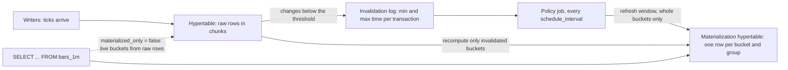

## Explanation

A continuous aggregate is TimescaleDB's incrementally maintained [materialized view](materialized-view.md). You define it with `CREATE MATERIALIZED VIEW ... WITH (timescaledb.continuous)` as a `SELECT` over a [hypertable](hypertable.md), or over another continuous aggregate, that groups by `time_bucket()` on the partitioning column plus any other grouping expressions, with aggregate functions in the select list. The classic example turns raw ticks into OHLCV bars: one row per symbol per minute holding `first(price, time)`, `max`, `min`, `last(price, time)` and `sum(size)`.

The difference from a plain materialized view is the machinery underneath. The results live in a *materialization hypertable*, one column per grouping expression and one per aggregate, which is itself chunked, compressible and subject to its own [data retention policy](data-retention-policy.md). An *invalidation engine* tracks a materialization threshold: inserts newer than the threshold need no bookkeeping, while any transaction that modifies older data is logged by the lowest and highest timestamps it touched. A refresh then recomputes only the buckets covered by those logged ranges instead of rebuilding the whole view. A policy drives refreshing, `add_continuous_aggregate_policy(view, start_offset, end_offset, schedule_interval)`: each run materialises the window from `now() - start_offset` to `now() - end_offset`, aligned to bucket boundaries, so only buckets lying wholly inside the window are refreshed. The `end_offset` lags the present so the current, still-filling bucket is left out. Since 2.19 a policy run commits its window in batches, newest buckets first (`buckets_per_batch`, 10 by default since 2.25), and since 2.28 a manual refresh can batch the same way.

Freshness is a choice. With `timescaledb.materialized_only = true`, the default since TimescaleDB 2.13, a query sees exactly what the last refresh materialised. Setting it to `false` turns on *real-time aggregation*: the view becomes a union of the materialised rows and an aggregate computed on the fly from raw rows newer than the materialisation watermark, so a dashboard sees the in-progress minute without the ingest path doing any aggregation. The live part is recomputed on every query, and corrections to already materialised buckets still wait for the next refresh (eventually consistent for historical data, in the documentation's words). When a late correction arrives you can force the matter with `CALL refresh_continuous_aggregate(view, window_start, window_end)`. It is a procedure that commits internally, so it refuses to run inside a transaction block, which matters for drivers such as psycopg that open one implicitly.

Hierarchical continuous aggregates (TimescaleDB 2.9 and later) stack rollups: minute bars feed hourly bars, which feed daily bars, provided each bucket width is a multiple of the one below and a fixed-width bucket never sits on a variable-width month. Not every aggregate stacks: a maximum of maximums is a maximum, but an average of averages is not an average, which is why the Toolkit hyperfunctions keep a partial state (`percentile_agg`, `rollup`) and finish the calculation at query time.

Two practical boundaries. First, continuous aggregates, their policies and `refresh_continuous_aggregate()` are Community Edition features; a build running in Apache-2 mode (check with `SHOW timescaledb.license`) does not have them, and Azure Database for PostgreSQL flexible server ships that edition. Second, a hypertable's retention policy never touches its aggregates, but a refresh window that overlaps dropped chunks deletes the matching aggregate rows, so retention must reach further back than `start_offset`. In the reader's stack: Redis Streams for ingest, a `BackgroundService` writing ticks into the hypertable, a minute-bar aggregate with real-time aggregation on, and an Angular chart fed over server-sent events from the view ([Time-Series / Financial Data Schemas](../data/time-series/time-series-financial-schemas.md), [Real-Time UI Streaming](../frontend/realtime/real-time-ui-streaming.md)).



## How it differs

**[Materialized view](materialized-view.md).** A PostgreSQL materialized view stores a query result and forgets how it got there; `REFRESH MATERIALIZED VIEW` re-runs the whole query and replaces every row, blocking readers unless you use `CONCURRENTLY` with a unique index. It knows nothing about time, so a nightly refresh of a year of data recomputes the year. A continuous aggregate knows which buckets changed, refreshes only those on a schedule, and can merge live data on read. Choose the plain view for small or non-temporal results, arbitrary SQL (window functions, `DISTINCT`, complex joins) and engines without TimescaleDB; choose the continuous aggregate for time-bucketed rollups over a hypertable that must stay cheap to refresh as history grows.

**[Hypertable](hypertable.md).** The hypertable holds every raw row, partitioned into chunks by time and optionally by a space key such as the symbol. The continuous aggregate is derived from it and stored in a second hypertable with far fewer rows, so it can be compressed earlier, retained longer and queried faster. The two are managed separately: retention, columnstore and tiering policies on the raw hypertable do not propagate to the aggregate, and a join in the aggregate's definition to a plain table is not tracked by the invalidation engine.

**[Data retention policy](data-retention-policy.md).** Retention and aggregation are complementary halves of downsampling: keep one-minute bars for two years and raw ticks for thirty days. The dependency runs one way. Dropping raw chunks does not delete aggregate rows by itself, but if the refresh window later covers the dropped range the refresh sees no raw data and removes the aggregate rows too. The rule is that `drop_after` on the hypertable must exceed `start_offset` on the policy, and the aggregate needs its own `add_retention_policy` call if it should ever expire.

**[Columnar storage](columnar-storage.md).** Converting old chunks to the columnstore keeps every raw row and makes scans and aggregates over them cheaper; a continuous aggregate removes the need to scan them at all by storing the answer per bucket. They compose rather than compete: raw chunks move to the columnstore after a few days, the aggregate serves the dashboards, and the aggregate's own materialization hypertable can be compressed too. Choose compression when you still need row-level detail, the aggregate when the questions are fixed and bucketed.

| | Plain view | Materialized view | Continuous aggregate |
|---|---|---|---|
| Storage | none | full result set | materialization hypertable |
| Refresh | every query | whole result, on demand | changed buckets, by policy |
| Freshness | always current | as of last refresh | as of last refresh, or live with real-time aggregation |
| Blocks readers on refresh | n/a | yes, unless `CONCURRENTLY` | no |
| Allowed SQL | anything | anything | `time_bucket` grouping, aggregates, limited joins |
| Requires | nothing | PostgreSQL | TimescaleDB Community Edition |

## Examples

Minute and daily OHLCV bars from raw ticks:

```sql
CREATE TABLE ticks (
  time   timestamptz   NOT NULL,
  symbol text          NOT NULL,
  price  numeric(18,8) NOT NULL,
  size   bigint        NOT NULL
);
SELECT create_hypertable('ticks', 'time', chunk_time_interval => INTERVAL '1 day');

-- One-minute bars. WITH NO DATA defers the first materialisation to the policy.
CREATE MATERIALIZED VIEW bars_1m
WITH (timescaledb.continuous) AS
SELECT time_bucket('1 minute', time) AS bucket,
       symbol,
       first(price, time) AS open,
       max(price)         AS high,
       min(price)         AS low,
       last(price, time)  AS close,
       sum(size)          AS volume
FROM ticks
GROUP BY bucket, symbol
WITH NO DATA;

-- Every minute, materialise buckets between one hour ago and one minute ago.
-- The current minute is excluded on purpose: it is still being written.
SELECT add_continuous_aggregate_policy('bars_1m',
  start_offset      => INTERVAL '1 hour',
  end_offset        => INTERVAL '1 minute',
  schedule_interval => INTERVAL '1 minute');

-- Let dashboards see the in-progress minute (real-time aggregation; off by default since 2.13)
ALTER MATERIALIZED VIEW bars_1m SET (timescaledb.materialized_only = false);

-- Hierarchical rollup: daily bars built from the minute bars (a multiple of the lower bucket).
-- The output column is named "day" because GROUP BY resolves "bucket" to the input column first.
CREATE MATERIALIZED VIEW bars_1d
WITH (timescaledb.continuous) AS
SELECT time_bucket('1 day', bucket) AS day,
       symbol,
       first(open, bucket)  AS open,
       max(high)            AS high,
       min(low)             AS low,
       last(close, bucket)  AS close,
       sum(volume)          AS volume
FROM bars_1m
GROUP BY day, symbol;

SELECT add_continuous_aggregate_policy('bars_1d',
  start_offset => INTERVAL '3 days', end_offset => INTERVAL '1 hour',
  schedule_interval => INTERVAL '1 hour');

-- Downsampling: raw ticks for 30 days, minute bars for 600 days.
SELECT add_retention_policy('ticks',   drop_after => INTERVAL '30 days');
SELECT add_retention_policy('bars_1m', drop_after => INTERVAL '600 days');

-- Backfill after a late correction: a procedure, called outside any transaction block.
CALL refresh_continuous_aggregate('bars_1m', '2026-10-23 00:00+00', '2026-10-24 00:00+00');
```

=== "C#"

    ```csharp
    public sealed record Bar(DateTime Bucket, string Symbol, decimal Open, decimal High,
                             decimal Low, decimal Close, long Volume);

    public sealed class BarRepository(NpgsqlDataSource dataSource)
    {
        // With real-time aggregation on, TimescaleDB merges the current minute from raw
        // ticks into this result; the API does no aggregation of its own.
        public async Task<IReadOnlyList<Bar>> LatestAsync(string symbol, int minutes, CancellationToken ct)
        {
            await using var cmd = dataSource.CreateCommand("""
                SELECT bucket, symbol, open, high, low, close, volume
                FROM bars_1m
                WHERE symbol = $1 AND bucket >= now() - make_interval(mins => $2)
                ORDER BY bucket
                """);
            cmd.Parameters.AddWithValue(symbol);
            cmd.Parameters.AddWithValue(minutes);

            var bars = new List<Bar>();
            await using var reader = await cmd.ExecuteReaderAsync(ct);
            while (await reader.ReadAsync(ct))
            {
                bars.Add(new Bar(reader.GetDateTime(0), reader.GetString(1), reader.GetDecimal(2),
                                 reader.GetDecimal(3), reader.GetDecimal(4), reader.GetDecimal(5),
                                 reader.GetInt64(6)));
            }
            return bars;
        }

        // After a late correction. Npgsql runs this in auto-commit mode, which the
        // procedure requires: it manages its own transactions and refuses a transaction block.
        public async Task BackfillAsync(DateTime fromUtc, DateTime toUtc, CancellationToken ct)
        {
            await using var cmd = dataSource.CreateCommand(
                "CALL refresh_continuous_aggregate('bars_1m', $1, $2)");
            cmd.Parameters.AddWithValue(DateTime.SpecifyKind(fromUtc, DateTimeKind.Utc));
            cmd.Parameters.AddWithValue(DateTime.SpecifyKind(toUtc, DateTimeKind.Utc));
            await cmd.ExecuteNonQueryAsync(ct);
        }
    }
    ```

=== "Python"

    ```python
    from datetime import datetime, timezone
    import psycopg

    # refresh_continuous_aggregate() refuses to run inside a transaction block, and
    # psycopg opens one implicitly, so use autocommit for the CALL.
    with psycopg.connect("postgresql://app@localhost/market", autocommit=True) as conn:
        start = datetime(2026, 10, 23, tzinfo=timezone.utc)
        end = datetime(2026, 10, 24, tzinfo=timezone.utc)
        conn.execute("CALL refresh_continuous_aggregate('bars_1m', %s, %s)", (start, end))

        rows = conn.execute(
            """
            SELECT bucket, open, high, low, close, volume
            FROM bars_1m
            WHERE symbol = %s AND bucket >= now() - interval '2 hours'
            ORDER BY bucket
            """,
            ("BTC-USD",),
        ).fetchall()
        for bucket, o, h, l, c, v in rows:
            print(f"{bucket:%H:%M} O={o} H={h} L={l} C={c} V={v}")
    ```

=== "Azure"

    Azure Database for PostgreSQL flexible server lists the `timescaledb` extension (2.24.0 for PostgreSQL 15 to 18 at the time of writing) but ships the Apache-2 edition, which has hypertables and `drop_chunks()` and does not have continuous aggregates, refresh policies, retention policies or the columnstore. To use the feature on Azure you run the Community Edition yourself on a VM or AKS (the `timescale/timescaledb-ha` image), or use Tiger Cloud, the vendor's managed service, which runs on Azure as well as AWS.

    The native Azure analogue is the materialized view in Azure Data Explorer and Fabric Eventhouse: an aggregation over a source table kept as a materialized part plus a delta of not-yet-processed rows, combined at query time so results are always fresh, with `materialized_view('Name')` to read the materialized part alone when staleness is acceptable. The design is the same as real-time aggregation; the difference is that it is always on and the engine decides when to materialise.

=== "AWS"

    Amazon RDS for PostgreSQL and Aurora PostgreSQL do not include the `timescaledb` extension, so on AWS the choices are Tiger Cloud (which runs on AWS) or self-hosting on EC2 or EKS. Amazon Timestream for LiveAnalytics, the managed time-series store, closed to new customers on 20 June 2025; AWS points new workloads at Timestream for InfluxDB instead.

    For the rollup pattern itself, Amazon Redshift materialized views are the closest managed equivalent: refreshes are incremental where the SQL allows, `AUTO REFRESH` keeps them current as base tables change, the optimizer rewrites queries to use them without being told, and a materialized view can ingest directly from a Kinesis Data Streams or MSK stream, which gives you the ticks-to-bars pipeline without an intermediate table.

A development stack for this page, with the Community Edition included:

```yaml
services:
  timescaledb:
    image: timescale/timescaledb-ha:pg18    # self-hosted builds default to timescaledb.license = 'timescale'
    environment:
      POSTGRES_PASSWORD: dev
      PGDATA: /pgdata
    ports: ["5432:5432"]
    volumes: ["tsdata:/pgdata"]
volumes:
  tsdata: {}
```

## Misconceptions

- **"A continuous aggregate always shows the latest data."** By default (`materialized_only = true` since 2.13) it shows what the last policy run materialised, and the policy deliberately stops `end_offset` short of now. You get the current bucket only by enabling real-time aggregation, and corrections to old buckets only after the next refresh.
- **"Retention on the hypertable trims the aggregate too."** It does not; the aggregate has its own retention. The opposite failure is the real one: a refresh window that reaches into dropped chunks deletes the aggregate rows for that range.
- **"Daily bars are just the average of the hourly rows."** Averages, percentiles and distinct counts do not re-aggregate from their finished values. Stack them with partial states (`percentile_agg` plus `rollup`) or compute them from the raw hypertable; `max`, `min`, `sum`, `count`, `first` and `last` stack correctly.
- **"It is a materialized view with a cron job."** The invalidation log is the point: a refresh touches only buckets that changed, and a hierarchical aggregate reads the lower aggregate rather than the raw table. A cron job over a plain materialized view recomputes everything every time.
- **"Any SQL works in the definition."** The `GROUP BY` must include `time_bucket()` on the partitioning column, the source must be a hypertable or another aggregate, joins are limited (inner joins with a plain table since 2.10; left and lateral joins from 2.16), and window functions and `SELECT DISTINCT` are rejected.

## Exam notes

No certification names continuous aggregates, but the pattern is examined under other names. DP-700 and DP-600 cover Fabric Real-Time Intelligence, where Kusto materialized views (materialized part plus delta, always fresh) and update policies are the way to pre-aggregate streaming data; expect to choose between them. DEA-C01 covers Amazon Redshift materialized views, including automatic refresh and streaming ingestion from Kinesis or MSK, as a data-store management skill. AZ-305 asks you to pick an analytics store and a pre-aggregation strategy from latency and cost requirements. The common trap is confusing "pre-computed" with "stale": questions that demand sub-second dashboards over a live stream are looking for an engine that merges the unprocessed tail at query time, which is real-time aggregation in TimescaleDB, the delta in Kusto, and streaming ingestion into a materialized view in Redshift.

## Self-check

??? question "Dashboards show minute bars that stop two minutes behind the live price feed. The ingest is healthy. What are the two settings involved and which one do you change?"
    The policy's `end_offset` (one minute in the example) keeps the current bucket out of materialisation, and the view's `materialized_only` setting (true by default since 2.13) hides everything not yet materialised. Leave the offset alone; the current bucket should not be materialised while it is being written. Set `timescaledb.materialized_only = false` so queries union the materialised bars with a live aggregate of the newest raw ticks.

??? question "You set a 24-hour retention policy on the ticks hypertable to save space. A day later the minute-bar aggregate is empty for everything older than a day. Why?"
    The aggregate's refresh policy had `start_offset => INTERVAL '7 days'`, so each run re-materialised the last week. Once the raw chunks for days two to seven were dropped, the refresh found no rows there and deleted the corresponding aggregate rows. Retention on the raw table must reach further back than the refresh window (`drop_after` greater than `start_offset`), and the aggregate itself gets its own, longer retention policy.

??? question "A compliance job must recompute yesterday's bars after a batch of corrected trades is inserted at 03:00. The job runs inside an EF Core transaction and fails. What is wrong?"
    `refresh_continuous_aggregate()` is a procedure that commits between its internal steps and batches, so it cannot run inside a transaction block. Issue the `CALL` on its own, in auto-commit mode (Npgsql's default when no transaction is open; `autocommit=True` in psycopg), with a window aligned to bucket boundaries covering the corrected day. The invalidation log already marks the touched buckets, so the regular policy would also pick them up on its next run if the window includes them.

## Further reading

- [Time-Series / Financial Data Schemas](../data/time-series/time-series-financial-schemas.md), raw ticks versus pre-aggregated bars.
- [High-Frequency Indexing & Partitioning](../data/time-series/high-frequency-indexing-partitioning.md) and [Row-Oriented vs. Columnar Storage](../data/time-series/row-vs-columnar-storage.md).
- [Redis Streams vs Kafka](../messaging/eventing/redis-streams-vs-kafka.md) for the ingest side, and [Real-Time UI Streaming](../frontend/realtime/real-time-ui-streaming.md) for the Angular side.
- [Materialized View](materialized-view.md), [Hypertable](hypertable.md), [Data Retention Policy](data-retention-policy.md), [Columnar Storage](columnar-storage.md).
- [Hierarchical continuous aggregates](https://www.tigerdata.com/docs/learn/continuous-aggregates/hierarchical-continuous-aggregates), [Refresh policies](https://www.tigerdata.com/docs/build/continuous-aggregates/refresh-policies) and [Data retention with continuous aggregates](https://www.tigerdata.com/docs/learn/data-lifecycle/data-retention/data-retention-with-continuous-aggregates).
- [TimescaleDB editions](https://www.tigerdata.com/docs/get-started/choose-your-path/timescaledb-editions), which features need the Community Edition.
- [TimescaleDB changelog](https://github.com/timescale/timescaledb/blob/main/CHANGELOG.md), for the release that introduced each behaviour above.
