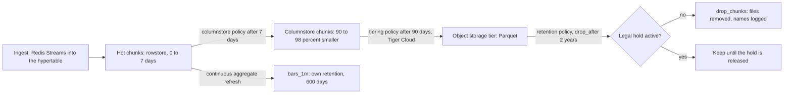

## Explanation

A data retention policy answers three questions for each class of data: how long to keep it, where it lives meanwhile, and what happens when the period ends. Its technical half is the automation that compresses, tiers and deletes; its governance half is the schedule that says why 30 days or seven years, who approved it, and how a legal hold (a suspension of deletion during litigation or an investigation) overrides it. The cheapest design is worthless if it deletes what a regulator requires; the most careful archive is a liability if it keeps personal data past its purpose.

In TimescaleDB the unit of retention is the chunk, a [hypertable](hypertable.md)'s time-bounded partition. `drop_chunks('ticks', older_than => INTERVAL '2 years')` removes every chunk whose entire range predates the cut-off and returns their names; a chunk holding any newer row stays, so data lingers until its whole chunk ages out, making the chunk interval a retention decision. Dropping a chunk removes a file, avoiding the dead tuples and `VACUUM` work of a row-by-row `DELETE`. `add_retention_policy(relation, drop_after => ...)` schedules the same as a background job for a hypertable or a continuous aggregate; a hypertable's policy never touches its aggregates, which keep their own. Tiering sits between hot and gone: `add_columnstore_policy(hypertable, after => INTERVAL '7 days')` (2.18 and later, replacing `add_compression_policy`) converts chunks to the columnstore, documented at 90 to 98 percent smaller, and Tiger Cloud can tier cold chunks to object storage as Parquet. These policies are Community Edition features; on the Apache-2 build in Azure Database for PostgreSQL flexible server you schedule `drop_chunks()` with `pg_cron`.

The same shape repeats across the stack: Redis Streams trim by length or ID ([MAXLEN trim](maxlen-trim.md)), Kafka deletes log segments by age or size unless a topic is compacted ([log compaction](log-compaction.md)), DynamoDB and Cosmos DB expire items from a time-to-live attribute, CloudWatch Logs and Log Analytics expire tables by a per-table setting, and S3 and Azure Blob lifecycle rules tier and expire objects by age. Managed services delete asynchronously: DynamoDB removes expired items typically within a few days, CloudWatch Logs within about 72 hours, and Log Analytics waits 30 days before honouring a shorter retention so a mistake can be reverted. "Deleted by policy" means "eligible for deletion": a privacy deadline needs verification, queries should filter expired-but-present rows, and backups and replicas keep copies on their own clocks.

Compliance cuts both ways. GDPR's storage limitation principle allows personal data to be kept in identifiable form no longer than its purpose needs, Article 17 adds a right to erasure, and the UK ICO expects a documented retention schedule with standard periods, periodic review and deletion that reaches backups. Financial records point the other way: SEC Rule 17a-4 makes broker-dealers preserve specified records for not less than six years (others three), the first two in an easily accessible place, on systems that keep a complete time-stamped audit trail or store records in a non-rewriteable, non-erasable format. Deleting too early is spoliation when litigation is foreseeable and a breach when a statutory minimum applies, which is why retention automation must check for legal holds before dropping anything, why S3 Object Lock in compliance mode and Azure immutable storage with a locked policy exist (write once, read many: not even the account owner can delete before the period ends), and why Azure's lifecycle delete action fails on an immutable container. Where immutable media or old backups make deletion impossible, crypto-shredding (destroying the key that protects the data) puts it beyond use.



## How it differs

**[MAXLEN trim](maxlen-trim.md).** Redis Streams trimming is capacity management: `MAXLEN` keeps roughly the newest N entries and `MINID` drops entries below an ID, applied on the write path, approximately (`~`) for speed, with no notion of why the data should live that long. A retention policy is a time-based commitment, runs as a separate job, and is something an auditor can read. Use trimming to bound a hot buffer; use a retention policy on the durable store the buffer feeds.

**[Log compaction](log-compaction.md).** Compaction and retention answer different questions about a log. Retention asks "how old may a record be" and deletes whole segments by age or size; compaction asks "is this record superseded" and keeps the latest value per key forever, so a compacted topic can rebuild a current-state table. A topic may use both, but a compacted topic is not a retention mechanism for personal data: the latest record per key survives until a tombstone (a null value for the key) is written and itself compacted away.

**[Continuous aggregate](continuous-aggregate.md).** Downsampling is retention plus aggregation: drop the raw ticks after 30 days and keep the minute bars for 600. The aggregate is what makes the deletion safe for analytics, and the ordering constraint is strict: the raw retention period must exceed the aggregate's refresh `start_offset`, or a refresh over the dropped range will erase the aggregate rows for it. The aggregate gets its own retention policy because the hypertable's does not apply to it.

**[Table partitioning](table-partitioning.md).** Partitioning is the enabling mechanism. Dropping a partition or chunk is a metadata and file operation that leaves no dead rows, no index garbage and no vacuum debt, whereas `DELETE ... WHERE time < ...` on a monolithic table is slow and leaves everything behind. The policy decides what to drop and when; the partition boundary decides the granularity, so data is never deleted earlier than the youngest row in its partition allows.

**[Hypertable](hypertable.md).** The hypertable supplies the chunks; the retention policy decides their fate. Because `drop_chunks()` only removes chunks whose whole range has aged out, the chunk interval chosen when the hypertable was created is the finest granularity at which retention can act: a one-month chunk interval means data expires up to a month late. Retention, columnstore and tiering policies are each declared per hypertable (or per continuous aggregate) and never cascade from one to another.

| | Retention policy | Stream trim | Log compaction | Downsampling |
|---|---|---|---|---|
| Decides by | age (or creation time) | count or ID | key supersession | age, after summarising |
| Unit | chunk, partition, object, item | stream entry | log segment record | raw chunk kept as aggregate |
| Runs | scheduled job | on write | background cleaner | policy on both tables |
| Keeps | nothing older than the period | the newest entries | the latest per key | the summary |
| Legal hold aware | must be | no | no | must be |

## Examples

A TimescaleDB tick store with hot, compressed and dropped stages, and a longer-lived summary:

```sql
-- Hot for 7 days, then columnstore (2.18+; add_compression_policy on older releases)
ALTER TABLE ticks SET (timescaledb.enable_columnstore,
                       timescaledb.segmentby = 'symbol',
                       timescaledb.orderby   = 'time DESC');
CALL add_columnstore_policy('ticks', after => INTERVAL '7 days');

-- Raw ticks for 30 days; the job returns its id for monitoring in timescaledb_information.jobs
SELECT add_retention_policy('ticks', drop_after => INTERVAL '30 days');

-- The minute-bar aggregate keeps its own, longer policy; the hypertable's does not apply to it
SELECT add_retention_policy('bars_1m', drop_after => INTERVAL '600 days');

-- One-off deletion: only chunks whose whole range is older than the cut-off are dropped
SELECT drop_chunks('ticks', older_than => INTERVAL '2 years');

-- Apache-2 edition (Azure flexible server): no add_retention_policy, so schedule the drop yourself
SELECT cron.schedule('ticks-retention', '15 3 * * *',
                     $$SELECT drop_chunks('ticks', older_than => INTERVAL '30 days')$$);
```

=== "C#"

    ```csharp
    // A retention job that honours legal holds and leaves an audit trail of what it deleted.
    public sealed class RetentionJob(NpgsqlDataSource dataSource, ILogger<RetentionJob> log)
        : BackgroundService
    {
        protected override async Task ExecuteAsync(CancellationToken stoppingToken)
        {
            using var timer = new PeriodicTimer(TimeSpan.FromHours(24));
            do
            {
                // A legal hold suspends every age-based deletion for its scope.
                await using var hold = dataSource.CreateCommand(
                    "SELECT count(*) FROM legal_holds WHERE scope = 'ticks' AND released_at IS NULL");
                if ((long)(await hold.ExecuteScalarAsync(stoppingToken))! > 0)
                {
                    log.LogWarning("Legal hold active on ticks; retention run skipped");
                    continue;
                }

                // Whole chunks only: a chunk goes when its entire range is older than 2 years.
                await using var drop = dataSource.CreateCommand(
                    "SELECT drop_chunks('ticks', older_than => INTERVAL '2 years')");
                await using var reader = await drop.ExecuteReaderAsync(stoppingToken);
                while (await reader.ReadAsync(stoppingToken))
                {
                    log.LogInformation("Retention dropped {Chunk} at {Time}",
                                       reader.GetString(0), DateTimeOffset.UtcNow);
                }
            }
            while (await timer.WaitForNextTickAsync(stoppingToken));
        }
    }
    ```

=== "Python"

    ```python
    import logging
    import psycopg

    log = logging.getLogger("retention")

    def run_retention(conninfo: str) -> None:
        with psycopg.connect(conninfo) as conn:
            (holds,) = conn.execute(
                "SELECT count(*) FROM legal_holds WHERE scope = 'ticks' AND released_at IS NULL"
            ).fetchone()
            if holds:
                log.warning("legal hold active on ticks; retention run skipped")
                return

            dropped = conn.execute(
                "SELECT drop_chunks('ticks', older_than => interval '2 years')"
            ).fetchall()
            for (chunk,) in dropped:
                log.info("retention dropped %s", chunk)   # the audit trail of deletions
    ```

=== "Azure"

    Azure Blob Storage lifecycle management is a JSON policy of rules with conditions on creation, modification or last-access time and actions that tier (`tierToCool`, `tierToCold`, `tierToArchive`) or `delete` block blobs, versions and snapshots. The delete action does nothing to a blob in an immutable container, and on accounts with soft delete it only moves the blob into the soft-deleted state.

    ```json
    {
      "rules": [{
        "enabled": true,
        "name": "tick-exports",
        "type": "Lifecycle",
        "definition": {
          "filters": { "blobTypes": ["blockBlob"], "prefixMatch": ["ticks-export/"] },
          "actions": {
            "baseBlob": {
              "tierToCool":    { "daysAfterModificationGreaterThan": 30 },
              "tierToArchive": { "daysAfterModificationGreaterThan": 180 },
              "delete":        { "daysAfterModificationGreaterThan": 2555 }
            }
          }
        }
      }]
    }
    ```

    For regulated records, immutable storage adds a time-based retention policy (one day to 400 years; lock it, because only a locked policy satisfies SEC 17a-4(f), and a locked policy can be extended but never shortened or deleted) and legal holds that keep blobs in a write-once, read-many state until the hold is cleared. Elsewhere on Azure: Log Analytics tables default to 30 days of analytics retention and can keep data in long-term retention for up to 12 years; Azure Data Explorer and Fabric Eventhouse use a `SoftDeletePeriod` that defaults to 1,000 years with 14 days of recoverability; Azure Cosmos DB expires items a configurable number of seconds after their last modification and hides them from queries immediately, deleting them in the background with spare request units.

=== "AWS"

    S3 Lifecycle rules combine transitions between storage classes with expiration. A bucket policy cannot prevent a lifecycle rule from transitioning or deleting objects, and rules apply to existing objects as soon as they are added.

    ```json
    {
      "Rules": [{
        "ID": "tick-exports",
        "Status": "Enabled",
        "Filter": { "Prefix": "ticks-export/" },
        "Transitions": [
          { "Days": 30,  "StorageClass": "STANDARD_IA" },
          { "Days": 180, "StorageClass": "DEEP_ARCHIVE" }
        ],
        "Expiration": { "Days": 2555 }
      }]
    }
    ```

    S3 Object Lock provides the regulatory floor: a default retention in compliance mode cannot be shortened or removed by any user, including the account root, while governance mode allows bypass by principals holding `s3:BypassGovernanceRetention`; legal holds have no end date and stay until removed. AWS cites Cohasset's assessment of Object Lock against SEC 17a-4, CFTC and FINRA requirements.

    ```bash
    aws s3api put-object-lock-configuration --bucket broker-records \
      --object-lock-configuration '{"ObjectLockEnabled":"Enabled","Rule":{"DefaultRetention":{"Mode":"COMPLIANCE","Years":7}}}'
    aws logs put-retention-policy --log-group-name /app/api --retention-in-days 365
    ```

    CloudWatch Logs keeps data forever by default and deletes expired events up to about 72 hours after the retention setting is reached; DynamoDB deletes items with an expired TTL attribute typically within a few days, without consuming write throughput, so scans and queries should filter on the attribute. Amazon Timestream for LiveAnalytics tiers from a memory store to a magnetic store on per-table retention settings, but it closed to new customers on 20 June 2025 and AWS recommends Timestream for InfluxDB for new workloads.

## Misconceptions

- **"Retention deletes data at exactly the configured age."** Chunk-based retention keeps a row until its whole chunk is older than the cut-off; managed services delete asynchronously, from hours (CloudWatch Logs) to days (DynamoDB) after expiry. Treat the age as the earliest deletion time and verify when a deadline matters.
- **"Setting retention on the hypertable also expires its aggregates."** It does not; each continuous aggregate needs its own policy. The dangerous interaction runs the other way: a refresh window that reaches into dropped raw data erases the aggregate rows for that range.
- **"Deleting the row satisfies an erasure request."** Backups, replicas, exports, caches and compacted topics hold copies. The ICO's standard is to put the data beyond use, which includes backups; crypto-shredding is how you meet it where media are immutable.
- **"Immutable storage means the data can never be deleted."** A time-based policy expires; after that the object can be deleted. A legal hold lasts until someone removes it, and governance-mode locks can be bypassed by authorised principals. Only compliance mode and a locked Azure policy remove the option to shorten the period.
- **"Shorter retention is always cheaper."** Log Analytics includes 31 days of retention in the ingestion price, so cutting below it saves nothing, and S3 storage classes have minimum storage durations that are billed even if an object expires early. Tier first, delete second, and model the cost.

## Exam notes

Retention is a first-class topic on every cloud architecture and security exam in this library. SAA-C03 lists data retention and classification, S3 object lifecycles and backup and retention policies; SAP-C03 adds data retention, sensitivity and regulatory requirements; SCS-C03 asks you to design lifecycle and retention with S3 Lifecycle, S3 Object Lock, EFS lifecycle and backup policies; DEA-C01 covers S3 Lifecycle transitions and expiry plus DynamoDB TTL, where the trap is that TTL deletion is asynchronous. CISSP tests the data lifecycle, retention and end-of-life handling in the asset security domain and immutable backups in security operations; CCSP has an explicit objective on retention, deletion and archiving policies, with legal hold, data destruction and crypto-shredding as the usual distractors. AZ-305 expects Log Analytics retention and archive-to-storage choices, DP-420 expects Cosmos DB TTL behaviour, and DP-300 and DP-700 touch backup retention and Eventhouse retention policies. The recurring trap is a scenario that quietly contains both a privacy maximum and a regulatory minimum: the answer tiers and immutably retains the regulated subset while expiring everything else, and it always mentions legal holds.

## Self-check

??? question "A broker-dealer stores order records in TimescaleDB with a 90-day retention policy to save space and exports a daily copy to S3. An auditor asks how you meet the six-year, first-two-years-easily-accessible requirement. What changes?"
    The database policy is fine only if the export is the system of record, so make it one: write the daily export to an S3 bucket with Object Lock in compliance mode and a seven-year default retention (or Azure immutable storage with a locked time-based policy), keep at least two years in a class and layout that allows prompt retrieval, and keep an audit trail of the export and any changes. Add a legal-hold check to the database retention job so a hold suspends the 90-day drop, and document the schedule so the auditor can read why each period was chosen.

??? question "A GDPR erasure request arrives for a customer whose events sit in a hypertable, in a Kafka compacted topic and in nightly backups kept for a year. What does 'erased' require?"
    Delete the customer's rows from the hypertable (a targeted `DELETE`, not `drop_chunks`, which only works on whole time ranges), write a tombstone for the customer's key to the compacted topic so compaction removes the record, and handle the backups: either document the backup retention as a justified exception with deletion on restore, or, if the backups are encrypted per customer, destroy the key. Record what was done and when; the accountability principle requires you to demonstrate it.

??? question "You shorten a Log Analytics table's retention from 365 to 30 days to satisfy a privacy policy and report completion the same day. Why is that report wrong?"
    Azure Monitor waits 30 days before removing data when total retention is shortened, so the older data remains queryable for a month, and a workspace at 30-day retention may keep data for 31 days unless `immediatePurgeDataOn30Days` is set. The same lesson applies to CloudWatch Logs (up to 72 hours) and DynamoDB TTL (days): a retention change is complete when the deletion is verified, not when the setting is saved.

??? question "The minute-bar aggregate must be kept for two years while raw ticks are dropped after 30 days. The refresh policy uses start_offset of 45 days. What goes wrong and what is the fix?"
    Every refresh re-materialises the last 45 days, but days 31 to 45 no longer exist in the raw table, so the refresh deletes the aggregate rows for them and the two-year history erodes from the oldest refreshed day forward. Set `start_offset` below the raw retention period (for example 7 days), keep the 30-day retention on the raw hypertable, and give the aggregate its own `add_retention_policy` of two years.

## Further reading

- [High-Frequency Indexing & Partitioning](../data/time-series/high-frequency-indexing-partitioning.md), for tiering and rollup policies in context.
- [Redis Streams vs Kafka](../messaging/eventing/redis-streams-vs-kafka.md), stream trimming versus log retention and compaction.
- [Security](../security/index.md) and [Cloud](../cloud/index.md) hubs, for the compliance and lifecycle services this page draws on.
- [MAXLEN Trim](maxlen-trim.md), [Log Compaction](log-compaction.md), [Continuous Aggregate](continuous-aggregate.md), [Table Partitioning](table-partitioning.md), [Hypertable](hypertable.md), [Columnar Storage](columnar-storage.md).
- [Azure Blob Storage lifecycle management](https://learn.microsoft.com/en-us/azure/storage/blobs/lifecycle-management-overview), [Immutable storage for Blob Storage](https://learn.microsoft.com/en-us/azure/storage/blobs/immutable-storage-overview) and [S3 Object Lock](https://docs.aws.amazon.com/AmazonS3/latest/userguide/object-lock.html).
- [ICO guidance on the storage limitation principle](https://ico.org.uk/for-organisations/uk-gdpr-guidance-and-resources/data-protection-principles/a-guide-to-the-data-protection-principles/storage-limitation/), retention schedules and putting data beyond use.
- [Data retention with continuous aggregates](https://www.tigerdata.com/docs/use-timescale/latest/data-retention/data-retention-with-continuous-aggregates) and [drop_chunks()](https://www.tigerdata.com/docs/api/latest/hypertable/drop_chunks).
