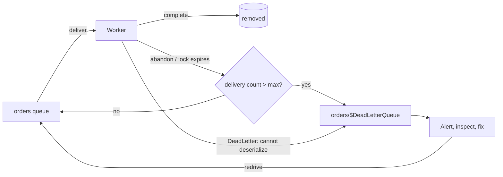

## Explanation

Every [at-least-once](at-least-once-delivery.md) system must answer one question: what happens to a message the consumer fails on every time? A malformed payload, a reference to a deleted customer, a bug that throws on one input. If the broker simply redelivers, the consumer wastes capacity re-failing, and on an ordered partition or session every message behind the bad one waits. If the broker drops it, data vanishes without a trace. The **dead-letter queue** is the third option: after a bounded number of attempts (or for a reason that makes retrying pointless) the message is moved to a separate queue where it no longer blocks anything, is not lost, and is visible to operators.

The Enterprise Integration Patterns call this the *Dead Letter Channel*: a messaging system that cannot or should not deliver a message moves it there, typically recording where and why. Modern brokers add a **delivery counter** that drives the automatic move and an **application-level** dead-letter operation for a consumer to reject a message it can never process.

The mechanics vary, but the shape is the same:

- **Azure Service Bus**: every queue and subscription has a `$DeadLetterQueue` subqueue. A message delivered under peek-lock that is abandoned or whose lock expires increments its delivery count; when that exceeds `MaxDeliveryCount` (default 10) it is dead-lettered with reason `MaxDeliveryCountExceeded`. Other system reasons are TTL expiry (when dead-lettering on expiration is enabled), header size, missing session id, too many auto-forward hops, and subscription filter errors. The consumer can also call `DeadLetterMessageAsync` with its own reason and description. Messages in the DLQ ignore TTL and stay until someone receives and completes them.
- **Amazon SQS**: a *redrive policy* on the source queue names the DLQ and a `maxReceiveCount` (1 to 1,000); a message received that many times without being deleted moves. The DLQ must be the same type (FIFO for FIFO, standard for standard) and in the same account and Region. For standard queues the message keeps its original enqueue timestamp, so give the DLQ a longer retention than the source. A *redrive* task moves messages back to the source (or elsewhere) at a controlled rate.
- **RabbitMQ**: a queue's `dead-letter-exchange` receives messages that were rejected without requeue, expired, overflowed the length limit, or exceeded a quorum queue's delivery limit (20 by default since RabbitMQ 4.0). An `x-death` header records the history.
- **Logs and streams**: Kafka has no consumer-side DLQ; Kafka Connect sinks can route failed records to `errors.deadletterqueue.topic.name`, and applications implement a dead-letter *topic* themselves. Redis Streams keep a pending entries list per [consumer group](consumer-group.md) with a delivery counter that `XPENDING` and `XAUTOCLAIM` expose; the Redis documentation suggests moving entries whose counter is high to another stream and alerting an administrator. Redis 8.8's `XNACK ... FATAL` marks an entry as permanently failed for exactly this flow.



The design decisions that matter are about *when* to dead-letter and *what to do after*. Transient failures (a dependency timeout) deserve retries with backoff; permanent ones (schema violation, business rule that can never pass) should go straight to the DLQ with the exception type and message attached, which Service Bus explicitly recommends. A DLQ needs an alarm on its depth, a retention long enough to investigate, and a redrive procedure that does not blindly replay poison messages into the same bug. In this stack a .NET 9 Redis Streams worker wraps the loop: read, process, `XACK`; periodically `XAUTOCLAIM` entries idle too long; and when `XPENDING` shows a delivery count past the budget, `XADD` the entry to `orders:dlq` and `XACK` it in the source group.

## How it differs

**[At-least-once delivery](at-least-once-delivery.md).** At-least-once promises not to lose a message, and keeps that promise by redelivering until acknowledged. Without a DLQ that is an infinite loop for a poison message. The DLQ bounds the loop: the message is still not lost, but it is no longer in the delivery path. The two are complementary; a DLQ is only meaningful where redelivery exists.

**[Consumer group](consumer-group.md).** The group's pending list answers "who is working on this and for how long" and lets a healthy member claim an entry from a dead one. That handles consumer *crashes*. The DLQ handles message *failures*: an entry that every claimant fails on. The delivery counter the group maintains is the input to the dead-letter decision.

**[MAXLEN trimming](maxlen-trim.md).** Trimming caps a stream's length by discarding the oldest entries regardless of whether anyone processed them; it is a memory policy, and it can silently delete a pending entry. Dead-lettering targets specific entries that failed and preserves them for action. Confusing the two produces either unbounded growth or silent data loss.

**[Choreography](choreography.md).** In an event-driven flow with no central coordinator, a message that lands in a DLQ is a business process silently stuck halfway: the stock was reserved but never billed, and nothing will emit the compensating event. The DLQ gives you the signal, not the recovery. Choreographed systems therefore need a named owner for every DLQ and a documented redrive or compensation path, or an [orchestrator](orchestration.md) that treats the failed step as an outcome it can react to.

| Broker | Trigger | Where it goes | Expires there? | Redrive |
|---|---|---|---|---|
| Service Bus | Delivery count > `MaxDeliveryCount` (default 10), TTL, size, session, filter error, explicit call | `<entity>/$DeadLetterQueue` | No | Receive and resend (Service Bus Explorer or code) |
| SQS | Received > `maxReceiveCount` (1 to 1,000) | Separate queue of the same type | Yes, from original enqueue time (standard) | `StartMessageMoveTask` |
| RabbitMQ | Reject without requeue, TTL, length limit, delivery limit (default 20 on quorum queues) | Dead-letter exchange | Per DLQ policy | Shovel or consumer |
| Redis Streams | Your threshold on the delivery counter | A stream you create | Per your trimming policy | `XADD` back to the source |
| Kafka | Application or Connect `errors.*` settings | A topic you create | Per topic retention | Produce back |

## Examples

**Billing worker on Redis Streams.** The group `billing` reads `orders`. A worker that fails on an entry does not acknowledge it; a reclaim loop hands idle entries to a live worker; once an entry's delivery count reaches five, it is copied to `orders:dlq` with the last error and acknowledged in `billing` so the group moves on.

=== "C#"

    ```csharp
    // Service Bus: dead-letter immediately on permanent failures, abandon on transient ones.
    var processor = client.CreateProcessor("orders", new ServiceBusProcessorOptions
    {
        ReceiveMode = ServiceBusReceiveMode.PeekLock,
        AutoCompleteMessages = false,
        MaxConcurrentCalls = 8,
    });
    processor.ProcessMessageAsync += async args =>
    {
        try
        {
            await HandleAsync(args.Message, args.CancellationToken);
            await args.CompleteMessageAsync(args.Message);
        }
        catch (JsonException ex)                       // can never succeed: no retry
        {
            await args.DeadLetterMessageAsync(args.Message, ex.GetType().Name, ex.Message);
        }
        catch (Exception)                              // transient: let the delivery count climb
        {
            await args.AbandonMessageAsync(args.Message);
        }
    };
    processor.ProcessErrorAsync += args => Task.CompletedTask;
    await processor.StartProcessingAsync();

    // Redis Streams: promote entries that keep failing into a dead-letter stream.
    var pending = await db.StreamPendingMessagesAsync("orders", "billing", count: 50,
        consumerName: RedisValue.Null, minId: "-", maxId: "+");
    foreach (var p in pending.Where(p => p.DeliveryCount >= 5))
    {
        var entry = (await db.StreamRangeAsync("orders", p.MessageId, p.MessageId)).SingleOrDefault();
        if (entry.IsNull) { await db.StreamAcknowledgeAsync("orders", "billing", p.MessageId); continue; }
        await db.StreamAddAsync("orders:dlq", [.. entry.Values,
            new NameValueEntry("source_id", p.MessageId.ToString()),
            new NameValueEntry("deliveries", p.DeliveryCount)]);
        await db.StreamAcknowledgeAsync("orders", "billing", p.MessageId);   // unblock the group
    }
    ```

=== "Python"

    ```python
    # SQS: redrive policy on the source queue, then a consumer that deletes only on success.
    import json, boto3
    sqs = boto3.client("sqs")
    sqs.set_queue_attributes(QueueUrl=SRC_URL, Attributes={
        "RedrivePolicy": json.dumps({"deadLetterTargetArn": DLQ_ARN, "maxReceiveCount": "5"})})

    while True:
        resp = sqs.receive_message(QueueUrl=SRC_URL, MaxNumberOfMessages=10, WaitTimeSeconds=20,
                                   MessageSystemAttributeNames=["ApproximateReceiveCount"])
        for m in resp.get("Messages", []):
            try:
                handle(json.loads(m["Body"]))
                sqs.delete_message(QueueUrl=SRC_URL, ReceiptHandle=m["ReceiptHandle"])
            except Exception:
                pass   # not deleted: visible again after the visibility timeout; 5th receive -> DLQ

    # Redis Streams: same promotion loop with redis-py.
    for msg_id, consumer, idle_ms, deliveries in r.xpending_range("orders", "billing", "-", "+", 50):
        if deliveries >= 5:
            entry = r.xrange("orders", msg_id, msg_id)
            if entry:
                fields = dict(entry[0][1])
                fields.update({"source_id": msg_id, "deliveries": deliveries})
                r.xadd("orders:dlq", fields)
            r.xack("orders", "billing", msg_id)
    ```

=== "Azure"

    - **Service Bus**: set `MaxDeliveryCount` and `DeadLetteringOnMessageExpiration` on the queue or subscription; read the DLQ with `ServiceBusReceiverOptions.SubQueue = SubQueue.DeadLetter`; inspect `DeadLetterReason` and `DeadLetterErrorDescription`; resubmit from Service Bus Explorer. Auto-forwarding and send-via failures land in the *transfer* DLQ of the source entity. Remember that the DLQ cannot be dead-lettered again and that settling after the receiver closed leaves the lock to expire, which quietly inflates delivery counts.
    - **Event Grid**: dead-lettering is off by default; enable it by naming a Blob Storage container. Events are dead-lettered when retries (default 30 attempts or 24 hours) are exhausted or the endpoint returns 400 or 413, with up to a five-minute batching delay.
    - **Event Hubs**: a log has no DLQ; the consumer writes failures to its own error hub or storage and checkpoints past them.

=== "AWS"

    - **SQS**: configure the redrive policy and, optionally, a redrive allow policy on the DLQ; alarm on `ApproximateNumberOfMessagesVisible`; move messages back with `StartMessageMoveTask`. For FIFO sources the DLQ must be FIFO, and dead-lettering breaks the group's order, so consider whether that is acceptable.
    - **Lambda**: for SQS triggers, put the DLQ on the queue, not the function, and prefer partial batch responses (`ReportBatchItemFailures`) so one bad record does not fail the batch. For Kinesis and DynamoDB streams, configure an on-failure destination (SQS, SNS or S3) plus `BisectBatchOnFunctionError` and `MaximumRetryAttempts`; the destination record contains shard and sequence metadata, not the payload. For asynchronous invocations, use an on-failure destination (which includes the response) rather than the older `DeadLetterConfig`.
    - **EventBridge**: a rule target can have a standard SQS DLQ; events arrive with `ERROR_CODE`, `ERROR_MESSAGE`, `RULE_ARN`, `TARGET_ARN` and `EXHAUSTED_RETRY_CONDITION` attributes.

## Misconceptions

- **"Messages in the DLQ expire like any other."** In Service Bus they never expire and the DLQ has no automatic cleanup; in SQS standard queues they expire from their *original* enqueue time, so a DLQ needs a longer retention than its source.
- **"A DLQ is a retry mechanism."** It is where messages go after retries are over. Retrying transient failures belongs in the consumer with backoff, or in a delayed-retry queue; the DLQ is for messages that need a human or a code fix.
- **"Redriving the DLQ fixes the problem."** Redriving replays the same messages into the same consumer; if the bug is not fixed they return. Redrive after the fix, at a controlled rate, and watch for the same message ids reappearing.
- **"Streams need no DLQ because nothing is lost."** A poison entry in a Redis Stream or Kafka partition blocks or endlessly re-fails its consumer; you still need a dead-letter *stream* built on the delivery counter.
- **"The DLQ is only for consumer failures."** Brokers dead-letter for their own reasons too: expired TTL, oversized headers, missing session ids, filter evaluation errors, auto-forward hops, and undeliverable transfers.

## Exam notes

AZ-204 tests the Service Bus mechanics directly: `MaxDeliveryCount` and its default, which system reasons move a message, how to address the `$DeadLetterQueue` subqueue, and that a DLQ message must be explicitly received and completed; it also expects Event Grid dead-lettering to a storage container. SAA-C03, DVA-C02 and DVA-C03 test the SQS redrive policy, `maxReceiveCount`, the rule that a FIFO source needs a FIFO DLQ, the retention gotcha, and that a Lambda consuming SQS should have the DLQ on the queue rather than on the function; SOA-C03 adds alarms on DLQ depth and redrive. The traps are treating a DLQ as a retry queue, forgetting the retention interaction, and assuming Kafka or Event Hubs give you one for free.

## Self-check

??? question "A Service Bus queue keeps dead-lettering messages with reason MaxDeliveryCountExceeded, but the handler never logs an exception. What is the likely cause?"
    The handler completes the message after the receiver or connection has closed, or holds messages past the lock duration, so the settlement never reaches the service. The lock expires, the message is redelivered, the delivery count climbs silently, and after ten attempts it is dead-lettered. Settle while the receiver is open, size the lock duration to the processing time, or renew locks.

??? question "Your SQS source queue retains messages for four days and so does its DLQ. Messages dead-lettered on day three disappear almost immediately. Why, and what is the fix?"
    For standard queues the retention clock keeps running from the original enqueue time; a message that spent three days in the source has one day left in the DLQ. Set the DLQ retention longer than the source (up to 14 days) so there is time to investigate and redrive.

??? question "A Redis Streams worker keeps re-reading the same entry and the billing group has fallen behind. Nothing is lost, so is there a problem?"
    Yes: the poison entry consumes every attempt and the group's pending list never drains. Use the delivery counter from XPENDING or XAUTOCLAIM, move entries over your retry budget to a dead-letter stream with the error attached, acknowledge them in the source group, and alert on the dead-letter stream's length.

## Further reading

- [Delivery Semantics](../messaging/eventing/delivery-semantics.md) for the retry loop a DLQ terminates.
- [Redis Streams vs. Kafka](../messaging/eventing/redis-streams-vs-kafka.md) for how each platform handles failed entries.
- [Broker and Exchange API Integrations](../messaging/integration/broker-exchange-api-integrations.md) for dead-lettering third-party callbacks.
- Terms: [At-least-once delivery](at-least-once-delivery.md), [Consumer group](consumer-group.md), [Idempotency key](idempotency-key.md), [Data retention policy](data-retention-policy.md).
- [Message transfers, locks and settlement](https://learn.microsoft.com/en-us/azure/service-bus-messaging/message-transfers-locks-settlement) and [Quorum queue poison message handling](https://www.rabbitmq.com/docs/quorum-queues).
