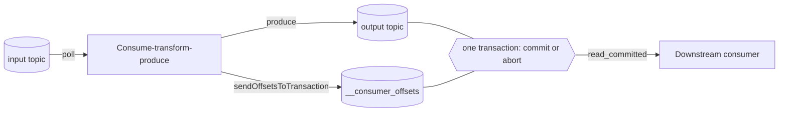

## Explanation

Over an unreliable network two parties cannot agree that a message was delivered exactly once: the acknowledgement of the acknowledgement can always be lost (the Two Generals problem). Every real "exactly-once" system therefore works on a different level. It keeps [at-least-once](at-least-once-delivery.md) retries, then makes the *effect* of a duplicate zero, by giving the receiver enough state to recognise a repeat and by binding "I consumed this" to "I produced that" in one atomic step. Kafka's documentation phrases the goal as *each message is processed once and only once*; the honest name is exactly-once **processing**, and achieving it on top of at-least-once delivery is often called **effectively-once**.

Three mechanisms recur; Kafka's implementation (KIP-98, shipped in 0.11) shows all of them in one system:

1. **Idempotent producer.** The broker assigns each producer an id; each batch carries a per-partition sequence number; a resend after a lost acknowledgement is recognised and not written again. Since Kafka 3.0 this is on by default (`enable.idempotence=true`, which forces `acks=all`). Redis 8.6 added the same idea to streams with `XADD ... IDMP producer-id iid`, which its documentation calls at-most-once production; SQS FIFO does it with `MessageDeduplicationId` over a five-minute window; Service Bus does it with `MessageId` duplicate detection.
2. **Transactions binding input position to output.** A transactional producer (`transactional.id`) writes to several partitions atomically and includes the consumer's offsets in the same transaction (`sendOffsetsToTransaction`). Consumers set `isolation.level=read_committed` and only see records whose transaction committed. A crash mid-transaction aborts everything, the offsets are not advanced, and the loop replays from the last committed position with no visible duplicate. The producer epoch fences "zombie" instances of the same `transactional.id`. Kafka Streams wraps this as `processing.guarantee=exactly_once_v2` (brokers 2.5 or newer; the older `exactly_once` and `exactly_once_beta` values are gone from the 4.x configuration). Service Bus offers the equivalent with transactions and *send via*: complete the input message and send the output message as one atomic operation across a transfer queue.
3. **Checkpoint-and-replay with transactional or idempotent sinks.** Flink snapshots operator state with barriers so a restart replays the source from the checkpoint while state reflects each record once; end-to-end exactly-once then depends on the sink, so Flink lists its Kafka sink as exactly-once with transactional producers, Cassandra as exactly-once only for idempotent updates, and Kinesis as at-least-once.



The limit is the **boundary**. Kafka's transaction covers Kafka topics and Kafka-stored offsets. Once processing writes to PostgreSQL, calls an HTTP API or sends an email, that side effect is outside the transaction; Kafka's design notes offer two ways out: a two-phase commit between position store and output, or storing the offset *in the same place as the output* so both commit together. The second is the pragmatic pattern: write the row and the consumed offset (or the event id) in one database transaction, and treat the broker as at-least-once. That is effectively-once, and it is what an [idempotency key](idempotency-key.md) buys at every boundary.

The cost is real: coordinator round trips and a commit interval (Kafka Streams drops `commit.interval.ms` to 100 ms under exactly-once), `read_committed` consumers that wait for the transaction to end, a three-way replicated transaction log in production, and clients tied to one broker's protocol. Deduplication windows are bounded (SQS: 5 minutes; Service Bus: 20 seconds to 7 days) and scoped to one entity. For this stack the sensible default is Redis Streams at-least-once with idempotent consumers writing to TimescaleDB, reserving transactional exactly-once for a Kafka-based ledger or a financially sensitive consume-transform-produce step.

## How it differs

**[At-least-once delivery](at-least-once-delivery.md).** Exactly-once is at-least-once with deduplication and atomic position handling layered on top; the transport still retries. The difference is who absorbs the duplicate: the broker and transaction coordinator (exactly-once) or your consumer code (at-least-once plus idempotency). Choose exactly-once machinery when the processing stays inside one broker and the extra latency is acceptable; choose idempotent consumers when effects cross boundaries, which is most of the time.

**[At-most-once delivery](at-most-once-delivery.md).** Neither delivers duplicates, which is where the confusion starts. At-most-once gets there by never retrying and tolerating loss; exactly-once retries and suppresses. If loss is acceptable, at-most-once is far cheaper.

**[Idempotency key](idempotency-key.md).** The key is the receiver's half of effectively-once: the stable identity that makes a second application a no-op. Transactional exactly-once makes it unnecessary inside the broker, and necessary again at the edge.

**[Transactional outbox](transactional-outbox.md).** The outbox solves the *producer's* dual write (database plus publish). It does not stop the relay from publishing twice, nor the consumer from applying twice; exactly-once (or idempotent consumption) is the next link in the chain.

**[Orchestration](orchestration.md).** Workflow engines (Step Functions standard workflows, Durable Functions orchestrations) record each step's completion so a replay does not re-run a finished step, which sounds like exactly-once. It is the same boundary problem in another shape: the step's call to a payment API or a database is a side effect the engine cannot roll back, so a step that timed out and is retried repeats that call unless the activity is idempotent. Orchestration gives once-only *scheduling* of steps; exactly-once *effects* still come from the activity's own transaction or an idempotency key.

| Approach | Boundary | Mechanism | Cost |
|---|---|---|---|
| Kafka idempotent producer | One producer session, per partition | Producer id and sequence numbers | Negligible; default |
| Kafka transactions / Streams EOS | One Kafka cluster | Transaction coordinator, control markers, `read_committed`, offsets in the transaction | Latency, commit interval, 3 brokers |
| SQS FIFO deduplication | One FIFO queue, 5 minutes | `MessageDeduplicationId` or body hash | Throughput limits of FIFO |
| Service Bus transactions and send-via | One Service Bus namespace (standard or premium) | Atomic complete plus send through a transfer queue | 2-minute transaction timeout |
| Checkpoint plus transactional sink (Flink) | Pipeline plus sinks that participate | Barriers, replay, two-phase-commit sinks | Checkpoint overhead, sink support |
| Effectively-once (idempotent consumer) | Any | Processed-ids or natural key in the same transaction as the effect | One lookup per message |

## Examples

**Position ledger.** Fills arrive on a `fills` Kafka topic; a .NET 9 service computes positions and writes them to a `positions` topic. One transaction per batch commits the produced positions and the consumed offsets together, so a crash never double-counts a fill. A separate consumer persists positions into TimescaleDB with the fill id as a unique key, because the database is outside the Kafka transaction.

=== "C#"

    ```csharp
    // Confluent.Kafka consume-transform-produce with transactions.
    var producer = new ProducerBuilder<string, string>(new ProducerConfig
    {
        BootstrapServers = brokers,
        TransactionalId = "positions-1",          // stable per instance: fences zombies
        EnableIdempotence = true,
    }).Build();
    var consumer = new ConsumerBuilder<string, string>(new ConsumerConfig
    {
        BootstrapServers = brokers,
        GroupId = "positions",
        IsolationLevel = IsolationLevel.ReadCommitted,
        EnableAutoCommit = false,
    }).Build();

    producer.InitTransactions(TimeSpan.FromSeconds(30));
    consumer.Subscribe("fills");

    while (!ct.IsCancellationRequested)
    {
        var fill = consumer.Consume(ct);
        producer.BeginTransaction();
        try
        {
            producer.Produce("positions", new Message<string, string>
            {
                Key = fill.Message.Key,
                Value = Apply(fill.Message.Value),
            });
            producer.SendOffsetsToTransaction(
                [new TopicPartitionOffset(fill.TopicPartition, new Offset(fill.Offset.Value + 1))],
                consumer.ConsumerGroupMetadata, TimeSpan.FromSeconds(30));
            producer.CommitTransaction();          // output + offset, or nothing
        }
        catch (KafkaException ex) when (!ex.Error.IsFatal)
        {
            producer.AbortTransaction();           // output discarded, offsets not advanced
            // The in-memory position has moved on: rewind to the committed offsets so the input is re-read.
            foreach (var committed in consumer.Committed(consumer.Assignment, TimeSpan.FromSeconds(10)))
                if (committed.Offset != Offset.Unset) consumer.Seek(committed);
        }
    }

    // Effectively-once at the database boundary: effect and event id in one transaction.
    await conn.ExecuteAsync("""
        WITH seen AS (
            INSERT INTO processed_events (event_id) VALUES (@EventId) ON CONFLICT DO NOTHING RETURNING 1)
        INSERT INTO positions (symbol, qty)
        SELECT @Symbol, @Qty WHERE EXISTS (SELECT 1 FROM seen)
        ON CONFLICT (symbol) DO UPDATE SET qty = positions.qty + EXCLUDED.qty;
        """, new { EventId = fillId, Symbol = symbol, Qty = qty });
    ```

=== "Python"

    ```python
    # confluent-kafka: the same loop in Python 3.12.
    from confluent_kafka import Consumer, Producer, KafkaException

    producer = Producer({"bootstrap.servers": BROKERS, "transactional.id": "positions-1",
                         "enable.idempotence": True})
    consumer = Consumer({"bootstrap.servers": BROKERS, "group.id": "positions",
                         "isolation.level": "read_committed", "enable.auto.commit": False,
                         "auto.offset.reset": "earliest"})
    producer.init_transactions()
    consumer.subscribe(["fills"])

    while True:
        msg = consumer.poll(1.0)
        if msg is None:
            continue
        if msg.error():
            raise KafkaException(msg.error())
        producer.begin_transaction()
        try:
            producer.produce("positions", key=msg.key(), value=apply(msg.value()))
            producer.send_offsets_to_transaction(consumer.position(consumer.assignment()),
                                                 consumer.consumer_group_metadata())
            producer.commit_transaction()
        except KafkaException:
            producer.abort_transaction()
            # rewind to the committed offsets so the aborted input is re-read
            for tp in consumer.assignment():
                committed = consumer.committed([tp])[0]
                if committed.offset >= 0:
                    consumer.seek(committed)
    ```

=== "Azure"

    - **Service Bus**: enable duplicate detection (sender-side `MessageId`) and process with peek-lock; for exactly-once hand-off between entities, open a `TransactionScope` with `EnableCrossEntityTransactions`, complete the input and send the output *via* the receiving entity so both commit together (standard and premium tiers; receive itself is outside the scope; transactions time out after two minutes).
    - **Event Hubs**: the Kafka endpoint supports idempotent producers and, in public preview on premium and dedicated tiers, Kafka transactions with `read_committed` consumers; the AMQP path is at-least-once with consumer checkpoints.
    - **Azure Stream Analytics** guarantees exactly-once *processing* (deterministic results on restart) but at-least-once *delivery* to most outputs; Cosmos DB (upsert), SQL with a unique key on the natural key, and Table storage (upsert on `PartitionKey` plus `RowKey`) are the outputs where delivery becomes exactly-once.

=== "AWS"

    - **SQS FIFO**: exactly-once processing means the queue does not introduce duplicates for a `SendMessage` retried within the five-minute deduplication interval (explicit `MessageDeduplicationId` or SHA-256 of the body). The consumer side is still visibility-timeout based, so a message whose timeout expires mid-processing is redelivered; the documentation says there is no absolute guarantee against that.
    - **Amazon MSK** is Kafka, so idempotent producers, transactions and Streams `exactly_once_v2` apply unchanged.
    - **Amazon Managed Service for Apache Flink** gives exactly-once state through checkpoints (and snapshots during updates); end-to-end exactly-once requires a transactional sink such as the Kafka sink, while the Kinesis sink is at-least-once. **DynamoDB** `TransactWriteItems` with a `ClientRequestToken` is idempotent for ten minutes.

## Misconceptions

- **"Exactly-once delivery is a network property."** No network guarantees it; what systems provide is exactly-once *processing* inside a boundary, built from retries plus deduplication and atomic position handling.
- **"Kafka transactions make my whole pipeline exactly-once."** They cover Kafka topics and Kafka-stored offsets. A write to PostgreSQL, Redis or an HTTP API inside the loop is not rolled back on abort and can happen twice; make it idempotent or store the offset with the output.
- **"SQS FIFO guarantees a consumer processes each message once."** It guarantees the producer side will not introduce duplicates within five minutes. Consumer-side redelivery after a visibility timeout still happens.
- **"Exactly-once is just a flag I should turn on."** It costs latency, throughput, a three-broker transaction log in production, and lock-in to one broker's protocol; `read_committed` consumers also see data only after the transaction ends.
- **"Effectively-once is a weaker, hand-wavy version."** It is the same observable outcome (each effect once) achieved with idempotent consumers, and it is the only version that survives crossing a system boundary.

## Exam notes

AWS exams use the phrase on SQS FIFO queues: SAA-C03, DVA-C02 and DVA-C03 test that FIFO queues provide exactly-once *processing* via deduplication ids within five minutes, that standard queues do not, and that consumers must still handle visibility-timeout redelivery; DEA-C01 touches Kafka and Flink guarantees on MSK and Managed Flink. AZ-204 and AZ-305 test Service Bus duplicate detection plus peek-lock as the exactly-once-processing answer and transactions with send-via for atomic forwarding; DP-700 and the Stream Analytics material distinguish exactly-once processing from at-least-once output. The traps: confusing ordering (FIFO) with deduplication, assuming exactly-once extends past the broker, and picking a transactional feature when idempotent consumers would do.

## Self-check

??? question "A Kafka Streams job with exactly_once_v2 writes enriched events to a topic and also updates a Redis counter per event. After a broker failover the counters are too high. Why?"
    The Redis increment is a side effect outside the Kafka transaction. When the transaction aborted and the input was replayed, the topic output was discarded but the increments were not. Make the counter update idempotent (store the last applied event id per key, or compute counts from the committed topic) or move the counter into state the transaction covers.

??? question "A team proposes replacing Redis Streams with Kafka to get exactly-once delivery into TimescaleDB. What do you tell them?"
    Kafka's exactly-once stops at Kafka; the write into TimescaleDB is outside its transaction either way. The database write must be idempotent (unique key on the event id, or offset stored in the same transaction as the row). Once that is in place, Redis Streams at-least-once already yields effectively-once, so the migration buys nothing for this goal.

??? question "An order service sends to an SQS FIFO queue with content-based deduplication. A retry eight minutes after the first send created a duplicate order. Was the queue misconfigured?"
    No. Content-based deduplication only suppresses duplicates within the five-minute interval. A later retry is a new message. The consumer needs its own idempotency check keyed on the order id, and the producer should reuse an explicit deduplication id derived from the order rather than relying on timing.

## Further reading

- [Delivery Semantics](../messaging/eventing/delivery-semantics.md) for the stack's default of at-least-once plus idempotency.
- [Redis Streams vs. Kafka](../messaging/eventing/redis-streams-vs-kafka.md) for where transactional exactly-once is and is not available.
- [Outbox Pattern vs. Dual-Write](../messaging/eventing/outbox-pattern.md) for the producer side of the chain.
- Terms: [At-least-once delivery](at-least-once-delivery.md), [At-most-once delivery](at-most-once-delivery.md), [Idempotency key](idempotency-key.md), [Transactional outbox](transactional-outbox.md).
- [Apache Kafka design: message delivery semantics](https://kafka.apache.org/43/design/design/) and [Kafka Streams configuration](https://kafka.apache.org/43/configuration/kafka-streams-configs/).
- [Idempotent message processing in Redis Streams](https://redis.io/docs/latest/develop/data-types/streams/idempotency/).
