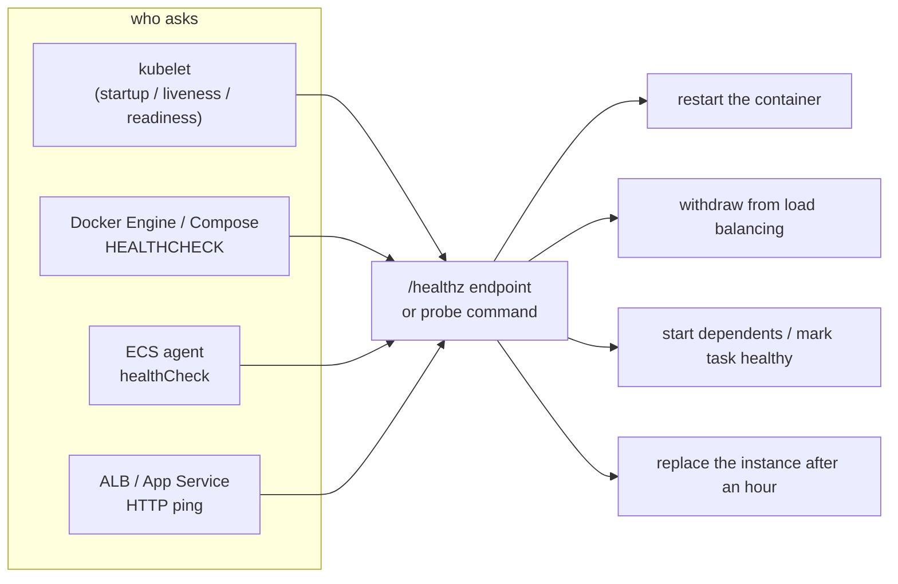

## Explanation

A health check is a question that something outside your process asks it on a schedule, and the action that follows the answer. The question is always cheap and binary: an HTTP `GET` that must return a status in a given range, a TCP connect that must succeed, a command that must exit 0, or a gRPC `Check` that must answer `SERVING`. Different askers attach different consequences to the same answer, so a good endpoint is designed for its asker.

Kubernetes asks three distinct questions through the kubelet. A **startup probe** asks "has the container finished starting?" and, while it fails, suppresses the other two; its failure kills the container. A **[liveness probe](liveness-probe.md)** asks "is the process stuck?" and, after `failureThreshold` consecutive failures, kills the container so the Pod's restart policy can bring it back. A **[readiness probe](readiness-probe.md)** asks "may this instance receive traffic?" and, while it fails, removes the Pod's IP from the Service's EndpointSlices without touching the process. They share one set of fields: `initialDelaySeconds` (default 0), `periodSeconds` (10), `timeoutSeconds` (1), `failureThreshold` (3) and `successThreshold` (1, and it must be 1 for liveness and startup). HTTP success means a status from 200 up to but not including 400; the kubelet runs HTTP, TCP and gRPC probes from the node, and only `exec` probes run inside the container. A container with no probe is treated as passing.



Other askers draw other conclusions. Docker's `HEALTHCHECK` instruction (defaults: interval 30s, timeout 30s, retries 3, start period 0s) only records `starting`, `healthy` or `unhealthy` on the container; the Engine restarts nothing, but Compose's `depends_on: condition: service_healthy` waits for it and Swarm replaces unhealthy tasks. The kubelet never reads that instruction, so a Dockerfile `HEALTHCHECK` has no effect under Kubernetes. Amazon ECS runs the task definition's `healthCheck` command inside the container, derives task health from the essential containers and lets `dependsOn: HEALTHY` order startup. An Application Load Balancer checks each target from outside (defaults: every 30 seconds, 5-second timeout, 2 failures to go unhealthy, 5 successes to recover, success code 200) and fails open when every target is unhealthy. Azure App Service pings a path every minute, removes an instance after ten consecutive non-2xx responses (configurable down to two) and replaces it after an hour.

ASP.NET Core gives you one registry for all of them. `AddHealthChecks()` registers `IHealthCheck` implementations with names and tags, `MapHealthChecks("/healthz")` exposes them, and each result is `Healthy`, `Degraded` or `Unhealthy`, mapped by default to HTTP 200, 200 and 503. Tags plus `HealthCheckOptions.Predicate` carve one registry into several endpoints: a liveness endpoint with `Predicate = _ => false` that reports healthy whenever the process can answer, and a readiness endpoint running only checks tagged `ready`. .NET Aspire's service defaults make the same split with `/health` and `/alive` (checks tagged `live`) and map them only in Development, because an unauthenticated endpoint that opens database connections is a denial-of-service vector; the remedies are `RequireHost` on a separate port, authorization, a request timeout and output caching. `IHealthCheckPublisher` runs the same checks on a timer for push-based monitoring, and `AddApplicationLifecycleHealthCheck` (package `Microsoft.Extensions.Diagnostics.HealthChecks.Common`) reports `Unhealthy` until the host has started and again once shutdown begins.

Design rules follow from the askers. Keep the endpoint fast, side-effect free and anonymous, with a timeout shorter than the probe's. Never test a dependency in a check whose failure restarts you. Return a minimal body: the kubelet stops reading after 10 KiB and an early close shows up as connection resets in your logs. Treat `Degraded` as a metric, not a signal, because load balancers only see the 200.

## How it differs

**[Liveness probe](liveness-probe.md).** Liveness is the health check with the most expensive consequence, a kill and restart, so it must answer the narrowest question: can this process still make progress? A liveness check that pings Redis turns a Redis outage into a fleet of restarting APIs. Prefer a watchdog over the main loop or an endpoint that runs no checks at all.

**[Readiness probe](readiness-probe.md).** Readiness is the health check whose consequence is reversible, so it may be opinionated about dependencies and warm-up. It keeps running for the whole life of the container, which lets you take an instance out of rotation for maintenance or during overload and bring it back without a restart.

**[Rolling deployment](rolling-deployment.md).** A deployment strategy is a consumer of health checks: Kubernetes counts a new Pod as available only when its readiness probe passes (and stays passing for `minReadySeconds`), ECS waits for `HEALTHY` dependencies and ALB health, App Service pings new instances before sending them traffic. A check that never passes stops a bad rollout rather than finishing it, and `progressDeadlineSeconds` (default 600) reports the stall.

**[Blue-green deployment](blue-green-deployment.md).** Blue-green is the cutover; the health check is the per-instance gate that permits it. App Service will not swap until the staging instances answer, and CodeDeploy will not reroute until the green instances pass the load balancer's checks, but green answering 200 proves only that it can serve, not that the version is correct. Correctness needs smoke tests, swap-with-preview validation or a canary phase; the health check cannot carry that judgement.

**[Canary release](canary-release.md).** A health check is a binary signal from one instance; canary analysis is a statistical comparison of SLIs (error rate, latency, business metrics) between the canary population and a control. A canary can pass every health check and still fail its users, which is why canary tooling pauses on health and on alarms over application metrics. Keep the health check honest and simple, and let the canary system own the comparison.

| Asker | Where the check runs | Success | Consequence of failure |
| --- | --- | --- | --- |
| kubelet startup probe | node (HTTP/TCP/gRPC) or container (exec) | 200-399, connect, exit 0, SERVING | container killed, restart policy applies |
| kubelet liveness probe | same | same | container killed after `failureThreshold` failures |
| kubelet readiness probe | same | same | Pod removed from EndpointSlices; no restart |
| Docker `HEALTHCHECK` | container | exit 0 | status `unhealthy`; Compose/Swarm act on it |
| ECS `healthCheck` | container | exit 0 | container and task `UNHEALTHY` |
| ALB target group | load balancer node | matcher (default 200) | target out of service; fail-open if all fail |
| App Service Health check | platform, every minute | 200-299 | instance removed from LB, replaced after 1 hour |

## Examples

=== "C#"

    ```csharp
    using Microsoft.AspNetCore.Diagnostics.HealthChecks;
    using Microsoft.Extensions.Diagnostics.HealthChecks;
    using StackExchange.Redis;

    var builder = WebApplication.CreateBuilder(args);
    builder.Services.AddSingleton<IConnectionMultiplexer>(_ =>
        ConnectionMultiplexer.Connect(builder.Configuration.GetConnectionString("redis")!));

    builder.Services.AddHealthChecks()
        .AddApplicationLifecycleHealthCheck("ready")            // Unhealthy before start and while stopping
        .AddCheck<RedisStreamsCheck>("redis-streams", tags: ["ready"]);

    var app = builder.Build();

    // Liveness: runs no checks; answering at all is the test
    app.MapHealthChecks("/healthz/live", new HealthCheckOptions { Predicate = _ => false });

    // Readiness: only checks tagged "ready"; Unhealthy -> 503 -> Pod leaves the Service
    app.MapHealthChecks("/healthz/ready", new HealthCheckOptions
    {
        Predicate = r => r.Tags.Contains("ready")
    });

    app.Run();

    sealed class RedisStreamsCheck(IConnectionMultiplexer redis) : IHealthCheck
    {
        public async Task<HealthCheckResult> CheckHealthAsync(HealthCheckContext context, CancellationToken ct = default)
        {
            try
            {
                var rtt = await redis.GetDatabase().PingAsync();
                return rtt < TimeSpan.FromMilliseconds(250)
                    ? HealthCheckResult.Healthy($"ping {rtt.TotalMilliseconds:F0} ms")
                    : HealthCheckResult.Degraded($"slow ping {rtt.TotalMilliseconds:F0} ms"); // still HTTP 200
            }
            catch (RedisException ex)
            {
                return HealthCheckResult.Unhealthy("redis unreachable", ex);
            }
        }
    }
    ```

=== "Python"

    ```python
    from contextlib import asynccontextmanager
    from fastapi import FastAPI, Response
    from redis.asyncio import Redis

    state = {"started": False}

    @asynccontextmanager
    async def lifespan(app: FastAPI):
        app.state.redis = Redis.from_url("redis://redis:6379")
        state["started"] = True          # warm caches, create consumer groups, etc. before this line
        yield
        state["started"] = False         # readiness fails during shutdown; liveness keeps passing
        await app.state.redis.aclose()

    app = FastAPI(lifespan=lifespan)

    @app.get("/healthz/live")
    async def live() -> dict:
        return {"status": "Healthy"}     # no dependencies: a hung event loop simply times out

    @app.get("/healthz/ready")
    async def ready(response: Response) -> dict:
        if not state["started"]:
            response.status_code = 503
            return {"status": "Unhealthy", "reason": "not started or stopping"}
        try:
            await app.state.redis.ping()
        except Exception as exc:         # redis.exceptions.RedisError and connection errors
            response.status_code = 503
            return {"status": "Unhealthy", "reason": f"redis: {exc}"}
        return {"status": "Healthy"}
    ```

=== "Docker"

    ```dockerfile
    # Docker Engine, Swarm and Compose read this; Kubernetes ignores it.
    # The official .NET images do not ship curl: install it or use a tiny probe binary.
    HEALTHCHECK --interval=10s --timeout=3s --start-period=20s --retries=3 \
      CMD curl -f http://localhost:8080/healthz/ready || exit 1
    ```

    ```yaml
    # Compose: start the API only once its dependencies report healthy
    services:
      api:
        build: .
        depends_on:
          redis: { condition: service_healthy }
          timescaledb: { condition: service_healthy }
      redis:
        image: redis:7
        healthcheck:
          test: ["CMD", "redis-cli", "ping"]
          interval: 5s
          timeout: 2s
          retries: 5
      timescaledb:
        image: timescale/timescaledb:latest-pg17
        healthcheck:
          test: ["CMD-SHELL", "pg_isready -U postgres"]
          interval: 5s
          timeout: 2s
          retries: 10
          start_period: 15s
    ```

=== "Azure"

    Azure Container Apps supports startup, liveness and readiness probes over HTTP(S) or TCP only (no `exec`, no gRPC, one of each type per container). With ingress enabled and no probes defined, the portal adds TCP probes on the ingress port to the main container: a startup probe with `failureThreshold` 240 at one-second intervals, a readiness probe with `failureThreshold` 48 every five seconds, and a liveness probe.

    ```yaml
    containers:
      - name: market-api
        image: ghcr.io/example/market-api:2.3.0
        probes:
          - type: Startup
            httpGet: { path: /healthz/live, port: 8080 }
            periodSeconds: 3
            failureThreshold: 40
          - type: Liveness
            httpGet: { path: /healthz/live, port: 8080 }
            periodSeconds: 10
            failureThreshold: 3
          - type: Readiness
            httpGet: { path: /healthz/ready, port: 8080 }
            periodSeconds: 5
            failureThreshold: 3
    ```

    App Service's Health check is one path (for example `/healthz/ready`) pinged every minute on every instance; `WEBSITE_HEALTHCHECK_MAXPINGFAILURES` (2-10, default 10) sets how many failures remove an instance from the load balancer, and the request can be authenticated by comparing the `x-ms-auth-internal-token` header with the SHA-256 hash of `WEBSITE_AUTH_ENCRYPTION_KEY`.

=== "AWS"

    ```json
    {
      "name": "api",
      "image": "123456789012.dkr.ecr.eu-west-1.amazonaws.com/market-api:2.3.0",
      "essential": true,
      "healthCheck": {
        "command": ["CMD-SHELL", "curl -f http://localhost:8080/healthz/ready || exit 1"],
        "interval": 10,
        "timeout": 3,
        "retries": 3,
        "startPeriod": 30
      }
    }
    ```

    ```bash
    # The ALB check is independent of the container check and runs from the load balancer nodes
    aws elbv2 modify-target-group --target-group-arn "$TG_ARN" \
      --health-check-path /healthz/ready --health-check-interval-seconds 15 \
      --health-check-timeout-seconds 5 --healthy-threshold-count 2 --unhealthy-threshold-count 2 \
      --matcher HttpCode=200
    ```

    ECS only monitors checks declared in the task definition; a `HEALTHCHECK` baked into the image is ignored unless repeated there, and the command must exist inside the image.

## Misconceptions

- **"A Dockerfile `HEALTHCHECK` is enough for Kubernetes."** The kubelet runs only the probes in the Pod spec. The image instruction is used by Docker Engine, Compose and Swarm, and by ECS only when copied into the task definition.
- **"A good health check tests all dependencies."** Only a readiness check should, and even then selectively: if every replica's readiness depends on one database, a database blip empties the Service and Kubernetes does not fail open the way an ALB does. A liveness check must never test dependencies.
- **"200 means healthy."** ASP.NET Core returns 200 for `Degraded` by default, so every external asker treats a degraded instance as fine. Either map `Degraded` to a non-2xx code with `ResultStatusCodes` for endpoints that gate traffic, or accept it as a monitoring signal only.
- **"Health endpoints are harmless."** They are unauthenticated by necessity and often open connections or run queries. Put them on a separate port with `RequireHost("*:8081")`, add a timeout, and keep the body minimal.
- **"Health checks are monitoring."** They are binary gates with immediate consequences. Latency percentiles, error budgets and saturation belong in metrics and traces; a probe that encodes them will flap.

## Exam notes

CKAD tests probes more than any other exam: the three probe types, their fields and defaults, the fact that `successThreshold` must be 1 for liveness and startup, HTTP success as 200-399, and reading `kubectl describe pod` events such as `Liveness probe failed`. CKA adds troubleshooting (a Service with no endpoints because readiness fails; a Pod in `CrashLoopBackOff` because liveness kills it during a slow start, fixed with a startup probe).

AZ-204 covers App Service Health check (path, failure threshold, instance replacement) and Container Apps probes, including the restriction to HTTP and TCP and the default probes added with ingress. AZ-305 expects you to pair health checks with the right deployment strategy and to know that App Service needs at least two instances for rerouting to help.

DVA-C02 and SAA-C03 cover ECS container health checks (command runs inside the container, task health from essential containers, agent version requirements) and ALB target group health (thresholds, matcher, fail-open behaviour, no WebSocket support). SAP-C03 scenarios combine them: Route 53 health checks for failover, ALB health for instances, ECS health for containers, each with its own thresholds and timing. The CISSP and CCSP treat health checks as availability controls under operations; the trap there is confusing a health check with monitoring and alerting.

## Self-check

??? question "Your order service exposes one /healthz endpoint that pings Redis and TimescaleDB, and it is used for both liveness and readiness in Kubernetes. Redis goes down for five minutes. What happens, and how should the endpoints be split?"
    Every replica's liveness probe fails three times in a row, the kubelet kills every container, and they restart into a crash-and-backoff loop that outlives the Redis outage, so a cache incident becomes a full outage. Split the registry with tags: `/healthz/live` runs no dependency checks (`Predicate = _ => false`, or a watchdog over the main loop) so the kubelet restarts only hung processes, and `/healthz/ready` runs the Redis and TimescaleDB checks so replicas are merely withdrawn from the Service while Redis is down and return the moment it recovers.

??? question "A reviewer notes that your readiness endpoint returns 200 with the body 'Degraded' when the Redis ping exceeds 250 ms. Is the load balancer doing anything with that?"
    No. ASP.NET Core maps `Degraded` to HTTP 200 by default, and every asker (kubelet, ALB, App Service) only looks at the status code, so the instance keeps full traffic. Decide which you want: if a slow Redis should take the instance out of rotation, map `Degraded` to 503 on that endpoint with `ResultStatusCodes`; if it should only alert, keep 200 and publish the report through `IHealthCheckPublisher` or metrics.

??? question "The same image runs under Docker Compose locally and on ECS Fargate in production. Locally the API waits for TimescaleDB; in production it starts before the database is reachable and fails. Why?"
    Compose honours the `healthcheck` in the Compose file and `depends_on: condition: service_healthy`. ECS ignores the image's `HEALTHCHECK` and has no cross-service dependency concept: `dependsOn` orders containers within one task only, so a database in another service is invisible to it. The production fix is in the application: fail readiness (or the ALB check) until the database is reachable and retry the connection, which also covers the database restarting later.

## Further reading

- [Docker & Containerization Trade-offs](../devops/docker-containerization.md) and [CI/CD Pipeline Design Trade-offs](../devops/ci-cd-pipelines.md) in this library.
- Term pages: [Liveness Probe](liveness-probe.md), [Readiness Probe](readiness-probe.md), [Rolling Deployment](rolling-deployment.md), [Sidecar Pattern](sidecar-pattern.md).
- [Liveness, Readiness, and Startup Probes](https://kubernetes.io/docs/concepts/configuration/liveness-readiness-startup-probes/) and [Configure Liveness, Readiness and Startup Probes](https://kubernetes.io/docs/tasks/configure-pod-container/configure-liveness-readiness-startup-probes/) (Kubernetes).
- [Health checks in ASP.NET Core](https://learn.microsoft.com/en-us/aspnet/core/host-and-deploy/health-checks?view=aspnetcore-9.0) and [.NET Aspire health checks](https://aspire.dev/fundamentals/health-checks/).
- [Dockerfile `HEALTHCHECK`](https://docs.docker.com/reference/dockerfile/#healthcheck) and the [Compose `healthcheck` and `depends_on` attributes](https://docs.docker.com/reference/compose-file/services/).
- [Health probes in Azure Container Apps](https://learn.microsoft.com/en-us/azure/container-apps/health-probes) and [Monitor App Service instances with Health check](https://learn.microsoft.com/en-us/azure/app-service/monitor-instances-health-check).
- [Amazon ECS container health checks](https://docs.aws.amazon.com/AmazonECS/latest/developerguide/healthcheck.html) and [ALB target group health checks](https://docs.aws.amazon.com/elasticloadbalancing/latest/application/target-group-health-checks.html).
