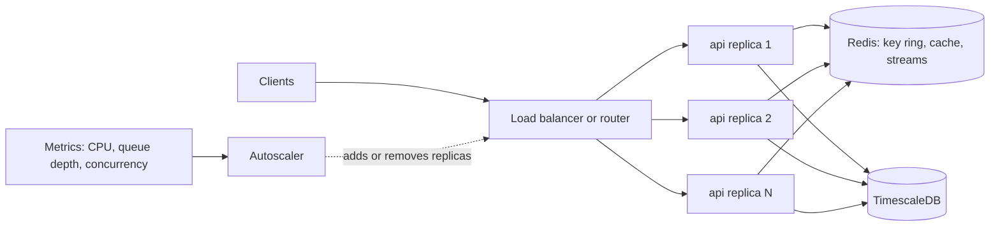

## Explanation

Horizontal scaling means changing *how many* instances of a component run: more VMs in a scale set, more pods behind a Service, more App Service plan instances, more Container Apps replicas, more ECS tasks, more consumers in a Redis Streams group. Adding instances is scaling out; removing them is scaling in. The Azure Well-Architected Framework defines it simply as adding instances of a given resource type, in contrast to [vertical scaling](vertical-scaling.md), which adds capacity to an existing one. The cloud prefers the horizontal axis for three reasons: there is no ceiling set by the largest machine you can buy, the loss of any single instance is survivable, and capacity can be added without restarting what is already running.



Mechanically, an autoscaling loop has three parts: instrumentation that produces a load metric, decision logic that compares it with a target or a schedule, and an actuator that adds or removes instances and registers them with the router. The Kubernetes Horizontal Pod Autoscaler (HPA) runs the loop every 15 seconds by default, computing the desired replica count as the current count multiplied by the ratio of the observed metric to its target, rounded up; it ignores ratios within a 10 percent tolerance and smooths scale-in with a 300-second stabilisation window so that noisy metrics do not whipsaw the fleet. Azure Monitor autoscale works from profiles with minimum, maximum and default counts, scale-out rules (any one triggers) and scale-in rules (all must hold), per-rule cooldowns, and a flapping guard that refuses a scale-in that would immediately provoke a scale-out. Container Apps delegates to KEDA, which polls event sources every 30 seconds, scales on HTTP concurrency, TCP connections, CPU, memory or queue depth (Service Bus, Event Hubs, Kafka, Redis), and scales to zero after a 300-second cool-down; defaults are 0 to 10 replicas, the ceiling 1,000. Amazon EC2 Auto Scaling keeps a group between its minimum and maximum sizes, replaces instances that fail health checks, registers them with Elastic Load Balancing, and scales by target tracking, step or simple policies, on a schedule, or predictively.

The hard part is not the autoscaler; it is making the application indifferent to which instance serves a request. The Well-Architected guidance lists the requirements: no server-side session state, no client affinity, no data locking, dynamic service discovery, and background work that can be distributed. In ASP.NET Core terms that means a shared Data Protection key ring (Redis or Blob Storage), otherwise authentication cookies and antiforgery tokens fail intermittently on instances that cannot decrypt them; a distributed cache or `HybridCache` with a Redis second level rather than a per-instance memory cache; session affinity (App Service's ARR cookie) switched off for stateless apps; and, for SignalR, sticky sessions with a Redis backplane or Azure SignalR Service, because a hub message must reach clients on every instance. For workers, a Redis Streams [consumer group](consumer-group.md) does the distribution: each entry is delivered to one consumer, so adding replicas adds throughput, and a crashed replica's unacknowledged entries are reclaimed by survivors with `XAUTOCLAIM`.

Two limits remain. New instances take time to provision and warm up, so autoscaling always lags demand: keep a buffer, schedule scaling for predictable peaks, and gate traffic on a [readiness probe](readiness-probe.md) so half-started instances receive no requests. And scaling the compute tier multiplies load beneath it: each new API replica opens its own connection pool against TimescaleDB, which since version 2.14 is single-node and scales writes only vertically, so the data tier must be evaluated separately, through read replicas, [partitioning](table-partitioning.md) and caching, rather than assumed to follow.

## How it differs

**[Vertical scaling](vertical-scaling.md)** changes the size of one instance; horizontal scaling changes the count. Vertical needs no application changes but typically restarts the instance, caps out at the largest SKU, and leaves a single point of failure. Horizontal needs the application to externalise state and tolerate any instance disappearing, but has no fixed ceiling and gives resilience as a by-product. The Well-Architected trade-off note is blunt: vertical tends to cost more because large instances are expensive, horizontal lets you use many small instances that come and go with demand. Most systems use both: scale the stateless tiers out, scale the single-writer database up.

**[Consumer group](consumer-group.md)** is what makes scale-out safe for message processing. Without it, every consumer reading a stream sees every entry (fan-out); with it, the broker hands each entry to one member and tracks acknowledgements, so the number of members becomes a capacity dial. The group is the mechanism; horizontal scaling is the policy deciding how many members to run, and an event-driven autoscaler such as KEDA closes the loop by scaling on pending entries.

**[Table partitioning](table-partitioning.md)** improves a single node by letting queries skip irrelevant chunks and by making maintenance incremental; it does not add compute or I/O. Scaling the data tier out means more nodes (read replicas, sharding, a distributed database) and brings consistency and routing problems that partitioning never had. Partition first, because it is cheap and often enough; add nodes when a single node's write throughput is genuinely the bottleneck.

**[Backpressure](backpressure.md)** is the short-term answer to overload; scaling out is the medium-term one. During the minute or more that new replicas take to appear, bounded queues, rate limits and `429` responses keep the existing replicas alive. A system with autoscaling but no backpressure falls over during the lag; a system with backpressure but no scaling survives but never grows.

**[Infrastructure as Code](infrastructure-as-code.md)** and autoscaling contend for one attribute: the instance count. A template that asserts a fixed count snaps capacity back on every apply. Declare the minimum, maximum and the scaling rules in code, and let the autoscaler own the live count (Terraform's `ignore_changes` on the desired capacity is the usual idiom).

| | Horizontal scaling | Vertical scaling |
| --- | --- | --- |
| What changes | Number of instances | Size of one instance |
| Application requirement | Stateless or shared state, idempotent consumers | None |
| Ceiling | Distribution of work and state; downstream capacity | Largest SKU |
| Disruption | None for existing instances | Usually a restart or connection drop |
| Resilience effect | Improves (N+1) | Unchanged single point of failure |
| Automation | Standard (HPA, autoscale, ASG, KEDA) | Rare (Aurora Serverless v2, in-place pod resize) |

## Examples

**Making an ASP.NET Core API safe to scale out.** Everything an instance would otherwise keep to itself moves to Redis, and each replica joins the stream's consumer group under its own name.

=== "C#"

    ```csharp
    // Program.cs (.NET 9). Packages: Microsoft.AspNetCore.DataProtection.StackExchangeRedis,
    // Microsoft.Extensions.Caching.StackExchangeRedis, Microsoft.Extensions.Caching.Hybrid,
    // Microsoft.AspNetCore.SignalR.StackExchangeRedis
    using StackExchange.Redis;

    var builder = WebApplication.CreateBuilder(args);
    var redisConnection = builder.Configuration["REDIS_CONNECTION"]!;
    var redis = await ConnectionMultiplexer.ConnectAsync(redisConnection);
    builder.Services.AddSingleton<IConnectionMultiplexer>(redis);

    // 1. What one replica encrypts, every other replica must be able to decrypt.
    builder.Services.AddDataProtection().PersistKeysToStackExchangeRedis(redis, "dataprotection-keys");
    // 2. Cache: L1 in each process, L2 shared in Redis, with stampede protection.
    builder.Services.AddStackExchangeRedisCache(o => o.Configuration = redisConnection);
    builder.Services.AddHybridCache();
    // 3. SignalR: a backplane so a hub message from this replica reaches clients on all the others.
    builder.Services.AddSignalR().AddStackExchangeRedis(redisConnection);
    // 4. Each replica is one consumer in the group; scaling out adds consumers.
    builder.Services.AddHostedService<TickConsumer>();

    var app = builder.Build();
    app.MapHub<PricesHub>("/hubs/prices");
    app.Run();

    public sealed class TickConsumer(IConnectionMultiplexer redis) : BackgroundService
    {
        private const string Stream = "ticks", Group = "pricers";

        protected override async Task ExecuteAsync(CancellationToken ct)
        {
            var db = redis.GetDatabase();
            var consumer = Environment.MachineName;   // unique per replica
            try { await db.StreamCreateConsumerGroupAsync(Stream, Group, StreamPosition.NewMessages, createStream: true); }
            catch (RedisServerException e) when (e.Message.StartsWith("BUSYGROUP")) { /* group already exists */ }

            while (!ct.IsCancellationRequested)
            {
                var entries = await db.StreamReadGroupAsync(Stream, Group, consumer, StreamPosition.NewMessages, count: 100);
                if (entries.Length == 0) { await Task.Delay(200, ct); continue; }
                foreach (var entry in entries)
                {
                    await PriceAsync(entry, ct);                                  // idempotent: entries can be redelivered
                    await db.StreamAcknowledgeAsync(Stream, Group, entry.Id);
                }
            }
        }

        private static Task PriceAsync(StreamEntry entry, CancellationToken ct) => Task.CompletedTask;
    }
    ```

=== "Python"

    ```python
    # worker.py (Python 3.12, redis-py). One consumer per replica; before reading new entries,
    # take over entries a crashed peer left pending for more than 60 seconds.
    import os

    import redis

    STREAM, GROUP = "ticks", "pricers"
    ME = os.environ.get("HOSTNAME", "pricer")
    r = redis.Redis.from_url(os.environ["REDIS_URL"])

    try:
        r.xgroup_create(STREAM, GROUP, id="$", mkstream=True)
    except redis.ResponseError as exc:
        if "BUSYGROUP" not in str(exc):
            raise


    def price(fields: dict) -> None:
        ...   # must be idempotent: a reclaimed entry may already have been partly processed


    while True:
        _, reclaimed, _ = r.xautoclaim(STREAM, GROUP, ME, min_idle_time=60_000, count=10)
        fresh = r.xreadgroup(GROUP, ME, {STREAM: ">"}, count=100, block=2000) or []
        for entry_id, fields in reclaimed + [e for _, entries in fresh for e in entries]:
            price(fields)
            r.xack(STREAM, GROUP, entry_id)
    ```

=== "Azure"

    ```bash
    # Container Apps: KEDA-driven HTTP scaling, 1 to 20 replicas, a new replica per 50 concurrent requests.
    az containerapp update --resource-group rg-app --name orders-api \
      --min-replicas 1 --max-replicas 20 \
      --scale-rule-name http-concurrency --scale-rule-type http --scale-rule-http-concurrency 50

    # App Service plan: Azure Monitor autoscale with a safe default, cooldowns and a margin against flapping.
    az monitor autoscale create --resource-group rg-app --name orders-autoscale \
      --resource /subscriptions/<sub>/resourceGroups/rg-app/providers/Microsoft.Web/serverfarms/plan-orders \
      --min-count 2 --max-count 10 --count 2
    az monitor autoscale rule create --resource-group rg-app --autoscale-name orders-autoscale \
      --condition "CpuPercentage > 70 avg 5m" --scale out 2 --cooldown 5
    az monitor autoscale rule create --resource-group rg-app --autoscale-name orders-autoscale \
      --condition "CpuPercentage < 40 avg 10m" --scale in 1 --cooldown 10

    # Virtual Machine Scale Set: manual scale-out is a single property change.
    az vmss scale --resource-group rg-platform --name vmss-orders --new-capacity 8
    ```

=== "AWS"

    ```bash
    # EC2 Auto Scaling group: target tracking keeps average CPU near 60 percent between min and max.
    aws autoscaling update-auto-scaling-group --auto-scaling-group-name asg-orders --min-size 2 --max-size 12
    aws autoscaling put-scaling-policy --auto-scaling-group-name asg-orders --policy-name cpu-60 \
      --policy-type TargetTrackingScaling --target-tracking-configuration \
      '{"PredefinedMetricSpecification":{"PredefinedMetricType":"ASGAverageCPUUtilization"},"TargetValue":60.0}'

    # ECS service: Application Auto Scaling owns DesiredCount; the task definition does not.
    aws application-autoscaling register-scalable-target --service-namespace ecs \
      --resource-id service/prod/orders-api --scalable-dimension ecs:service:DesiredCount \
      --min-capacity 2 --max-capacity 20
    aws application-autoscaling put-scaling-policy --service-namespace ecs \
      --resource-id service/prod/orders-api --scalable-dimension ecs:service:DesiredCount \
      --policy-name cpu-60 --policy-type TargetTrackingScaling --target-tracking-scaling-policy-configuration \
      '{"TargetValue":60.0,"PredefinedMetricSpecification":{"PredefinedMetricType":"ECSServiceAverageCPUUtilization"}}'
    ```

=== "Kubernetes"

    ```yaml
    # HPA v2: CPU target with an explicit scale-down stabilisation window (the default is 300 s).
    apiVersion: autoscaling/v2
    kind: HorizontalPodAutoscaler
    metadata:
      name: orders-api
    spec:
      scaleTargetRef:
        apiVersion: apps/v1
        kind: Deployment
        name: orders-api
      minReplicas: 2
      maxReplicas: 20
      metrics:
        - type: Resource
          resource:
            name: cpu
            target: { type: Utilization, averageUtilization: 60 }
      behavior:
        scaleDown:
          stabilizationWindowSeconds: 300
          policies:
            - type: Percent
              value: 25
              periodSeconds: 60
    ```

## Misconceptions

- **"Stateless means the service has no state."** It means the state is not *in the instance*. Sessions, caches, key rings, uploads and in-flight work move to Redis, a database or storage; the instance becomes a replaceable worker over shared state.
- **"Twice the replicas, twice the throughput."** Only until the next bottleneck: a database connection ceiling, a lock, a single-partition stream, a rate-limited third party. The Architecture Center's advice is to identify the bottleneck before adding compute, and to scale dependencies as their own scale units.
- **"Autoscaling reacts instantly."** Metrics are aggregated over a window, the decision has a cooldown, and a new instance needs minutes to provision and warm up. Keep headroom, scale on leading indicators such as queue depth, and use scheduled or predictive scaling for known peaks.
- **"Sticky sessions make scale-out safe."** Affinity hides state problems by routing a client to the same instance, defeating balancing and making scale-in lose that client's state. It is a requirement for SignalR without Azure SignalR Service, and a smell everywhere else.
- **"Scale-in is free."** Removing an instance mid-request or mid-batch loses work unless connections drain and consumers acknowledge only after completion. Lifecycle hooks, `preStop`, scale-in protection and graceful shutdown exist for this reason.

## Exam notes

Fundamentals exams (AZ-900, CLF-C02) test the vocabulary: scale out versus scale up, elasticity, and why horizontal scaling gives resilience. AZ-104 expects you to configure App Service plan scale-out and Azure Monitor autoscale rules for VM scale sets and plans, including minimum, maximum and default counts and the tier limits on instance counts; AZ-204 adds Container Apps scale rules and the App Service automatic scaling feature, and the rule that a plan should use only one of Azure Monitor autoscale or automatic scaling. AZ-305 pushes scale-unit and deployment-stamp design, externalised state and data partitioning. On AWS, SAA-C03 and SOA-C03 cover Auto Scaling groups (minimum, desired, maximum), launch templates, target tracking versus step versus scheduled policies, health checks, warm-up and cooldown, stateless design with ElastiCache for sessions, and Application Auto Scaling for ECS and DynamoDB; SAP-C03 extends this to multi-region stamps; DVA-C02/C03 focus on the application side. CKA and CKAD test the HPA: the `autoscaling/v2` API, resource and custom metrics, the need for Metrics Server, and the fact that a DaemonSet cannot be autoscaled horizontally.

Traps: Azure Monitor autoscale is plan-level and affects every app in the plan; scale-in needs every scale-in rule to hold while scale-out needs any one; HPA cannot target objects that cannot scale; an Auto Scaling group's desired capacity is managed by the scaling policy, so a template asserting it causes drift; and TimescaleDB, like most relational engines, scales writes vertically, so "add API replicas" is not an answer to a saturated database.

## Self-check

??? question "After scaling an ASP.NET Core API from one to three App Service instances, users are intermittently logged out and some form posts fail with antiforgery errors. Session affinity is off. What is wrong?"
    The Data Protection key ring is being generated per instance, so a cookie encrypted by instance A cannot be decrypted by instance B, and the same applies to antiforgery tokens. Persist the key ring to a shared store (Blob Storage or Redis) with `AddDataProtection().PersistKeysTo...`, so every instance of every version uses the same keys. Turning session affinity back on would mask the symptom while defeating load balancing.

??? question "Your HPA scales the API from 4 to 16 pods during the morning peak, after which TimescaleDB starts refusing connections. The database host has spare CPU. What happened and what are the options?"
    Each pod opens its own connection pool, so 16 pods multiplied the connection count past PostgreSQL's limit, a capacity ceiling that horizontal scaling of the compute tier moved rather than removed. Options: cap the per-pod pool so that pods times pool size stays within the database's budget, put a pooler such as PgBouncer in front of the database, serve reads from a replica, cache hot queries in Redis through `HybridCache`, and set `maxReplicas` with the database's limits in mind rather than the cluster's.

??? question "A worker that consumes a Redis Stream is scaled from one replica to five, but throughput barely changes and one consumer does all the work. Why?"
    Scaling out consumers only helps if they are members of the same consumer group reading with `XREADGROUP`; if the replicas each read the stream directly with `XREAD`, or each created its own group, every replica sees every entry and the work is duplicated rather than divided. Put all replicas in one group with a unique consumer name per replica, size the per-read `COUNT` so entries spread across members, and add `XAUTOCLAIM` so entries left pending by a dead replica are reclaimed.

## Further reading

- [Redis Streams vs Kafka](../messaging/eventing/redis-streams-vs-kafka.md) and [Delivery semantics](../messaging/eventing/delivery-semantics.md) for how consumer groups distribute work and why handlers must be idempotent.
- [SignalR and WebSockets](../messaging/realtime/signalr-websockets.md) for backplanes and affinity, and [High-frequency indexing and partitioning](../data/time-series/high-frequency-indexing-partitioning.md) for scaling the data tier.
- [Microservices vs modular monoliths](../messaging/integration/microservices-vs-modular-monoliths.md) for scaling components independently.
- Neighbouring terms: [Vertical Scaling](vertical-scaling.md), [Consumer Group](consumer-group.md), [Table Partitioning](table-partitioning.md), [Backpressure](backpressure.md), [Infrastructure as Code](infrastructure-as-code.md), [Readiness Probe](readiness-probe.md), [Hypertable](hypertable.md).
- [Azure Well-Architected PE:05](https://learn.microsoft.com/en-us/azure/well-architected/performance-efficiency/scale-partition), [Azure autoscaling guidance](https://learn.microsoft.com/en-us/azure/architecture/best-practices/auto-scaling) and [Amazon EC2 Auto Scaling](https://docs.aws.amazon.com/autoscaling/ec2/userguide/what-is-amazon-ec2-auto-scaling.html): the design guidance behind the preconditions.
- [Kubernetes HPA](https://kubernetes.io/docs/tasks/run-application/horizontal-pod-autoscale/), [Scaling in Azure Container Apps](https://learn.microsoft.com/en-us/azure/container-apps/scale-app), [ASP.NET Core web farms](https://learn.microsoft.com/en-us/aspnet/core/host-and-deploy/web-farm), [SignalR hosting and scaling](https://learn.microsoft.com/en-us/aspnet/core/signalr/scale) and [HybridCache](https://learn.microsoft.com/en-us/aspnet/core/performance/caching/hybrid): the mechanics quoted above.
