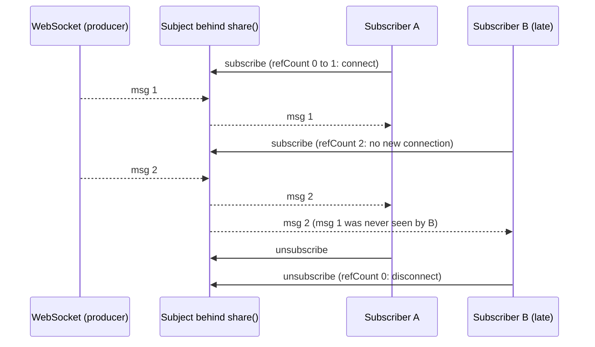

## Explanation

A hot observable is one whose producer lives outside the subscribe logic. The source (a DOM element firing events, a WebSocket connection, a `Subject` that someone calls `next()` on, a SignalR hub) exists and may emit whether or not anyone is subscribed. Subscribing does not start it; it attaches an observer to a running stream, so, as ReactiveX puts it, a hot observable may begin emitting as soon as it is created and a late observer may see only part of the sequence. All observers share the one execution, which is why hot is also called **multicast**, in contrast with the per-subscriber executions of a [cold observable](cold-observable.md).

RxJS builds hot streams from three ingredients. The first is `Subject`, which is both an `Observable` (observers register in a list; subscribing starts no new execution) and an `Observer` (`next`, `error` and `complete` are forwarded to every registered observer). `BehaviorSubject` additionally stores the current value and hands it to each new subscriber, `ReplaySubject(bufferSize, windowTime)` replays the last *n* values or the last *t* milliseconds, and `AsyncSubject` delivers only the final value on completion. The second ingredient is the *multicasting operators*, which stand a Subject between a cold source and its subscribers. `share()` is the modern one: its `connector` (default `() => new Subject()`) creates the inner subject, it subscribes to the source when the subscriber count goes from 0 to 1 and tears it down at 0, and `resetOnError`, `resetOnComplete` and `resetOnRefCountZero` (all `true` by default) decide whether the next subscriber gets a fresh execution. `shareReplay(n)` is `share` with a `ReplaySubject` connector and different defaults: `refCount: false`, so the source keeps running after the last subscriber leaves, and `resetOnComplete: false`, so a completed source stays cached; pass `{ bufferSize: 1, refCount: true }` to get teardown on zero subscribers, and remember that a completed value stays cached even then. The older `multicast`, `publish*` and `refCount` operators were deprecated in RxJS 7 and become breaking in 8; `connectable()` and `connect()` cover the cases where the shared execution must be started by hand. The third ingredient is wrapping a source that is already hot: `fromEvent(button, 'click')`, or `webSocket(url)`, a `WebSocketSubject` that opens the socket on the first subscriber, closes it when the last one leaves, queues outgoing `next()` calls until the connection is open and multiplexes logical channels over one connection.

That last example shows the temperature is really a spectrum. A reference-counted stream is sometimes called **warm**: cold while nobody listens, hot while at least one subscriber keeps the single connection alive. Most real-time Angular services sit here: one SignalR hub connection or one `webSocket` subject, shared through `share()` or `shareReplay({ bufferSize: 1, refCount: true })` so that late-arriving components get the last value.

The cost of hot streams is that nothing waits for you. There is no retry by re-subscription (the producer does not restart), no cancellation of the source by a single unsubscribe, and no automatic replay unless you add a buffer. Late subscribers miss values, so a component that subscribes after the first price arrives shows nothing until the next one unless the stream is replayed or exposed as a [signal](angular-signals.md) through `toSignal` with an `initialValue`. A fast hot source cannot be slowed by its consumers: [backpressure](backpressure.md) has to be applied with `auditTime`, `sampleTime`, `bufferTime` or by dropping (see [real-time UI streaming](../frontend/realtime/real-time-ui-streaming.md)). The [WebSocket](websocket.md) and [Server-Sent Events](server-sent-events.md) transports underneath are hot by nature, exactly like Redis Pub/Sub, and the observable is the in-process abstraction that gives them teardown, operators and sharing.



## How it differs

**[Cold Observable](cold-observable.md).** The decisive question is whether subscribing creates the producer. Cold: yes, so each subscriber gets a private run from the start and can cancel or retry it. Hot: no, so subscribers share a run that was going on before they arrived and continues after they leave. Operators do not change this; multicasting does. In practice you make things hot on purpose (one socket, one DOM listener, one expensive computation shared by many views) and discover things are cold by accident (two requests for one binding). The design rule is to keep sources cold as long as possible and multicast at the one place where sharing is the intent, with the reset options chosen deliberately.

**[Angular Signals](angular-signals.md).** A hot observable is a sequence; a signal is a value. If three prices arrive while a consumer is busy, the observable delivers three notifications and the signal delivers one read of the latest. If a consumer arrives late, the observable gives it nothing until the next emission (unless replayed) and the signal gives it the current value at once. So the stream is the right place for *events* (every fill must be booked) and the signal for *state* (the last price), and `toSignal` is the conversion that keeps the two honest: it subscribes once, needs an initial value and drops intermediate values. `BehaviorSubject` is the observable that behaves most like a signal, which is why it was the pre-signals state container.

**[WebSocket](websocket.md).** The WebSocket is the wire: a full-duplex TCP connection whose frames arrive whether or not application code has registered a handler, with its own lifecycle (open, message, close, error) and no notion of operators. A hot observable over it (`webSocket()` or a `share()`d wrapper) adds subscriber accounting, so one connection serves many consumers and closes when the last one leaves; a uniform teardown; the operator vocabulary (`retryWhen`-style reconnection with backoff, `auditTime`, `filter` per channel); and multiplexing of logical subscriptions. Confusing the two leads to the classic bugs: a connection per component, or a connection that outlives the page because nobody owned its teardown.

**[Server-Sent Events](server-sent-events.md).** The same distinction holds for the one-directional transport. An `EventSource` delivers server events over a long-lived HTTP response and reconnects on its own, whether or not any component is interested. How it is wrapped decides the temperature: a `new Observable` that creates the `EventSource` inside its subscribe logic is cold (one connection per subscriber), while a `share()`d wrapper or a `Subject` fed by one `EventSource` is hot (one connection for everyone). The transport's own replay, the `Last-Event-ID` header sent on reconnection, is a server-side feature that fills the gap left by a dropped connection; the observable's replay (`shareReplay`, `ReplaySubject`) is in-process and fills the gap left by a late subscriber. A robust feed needs both, and they are configured in different places.

| | Hot observable | Cold observable | Signal |
|---|---|---|---|
| Producer | Shared, outside the subscription | Created per subscription | None; it is a value |
| Emits without subscribers | Yes (values are lost) | No | Not applicable |
| Late subscriber | Misses earlier values unless replayed | Gets everything | Reads the current value |
| Stop the source | Only when the last subscriber leaves (refCount) | Any unsubscribe | Not applicable |
| Backpressure | Consumer-side thinning required | Unsubscribe or pull less | Coalesced by design |

## Examples

=== "TypeScript"

    ```typescript
    // One HTTP request for many consumers, and a cached configuration stream.
    import { Injectable, inject } from '@angular/core';
    import { HttpClient } from '@angular/common/http';
    import { share, shareReplay } from 'rxjs';

    @Injectable({ providedIn: 'root' })
    export class Reference {
      private readonly http = inject(HttpClient);

      // Overlapping subscribers share one request; once it completes, share() resets
      // (resetOnComplete: true), so a later subscriber triggers a new request.
      readonly symbols$ = this.http.get<string[]>('/api/symbols').pipe(share());

      // Late subscribers get the last value. refCount: true tears the source down while
      // it is still running and nobody listens; after completion the value stays cached
      // (resetOnComplete is false for shareReplay), which is what a config cache wants.
      readonly config$ = this.http.get<AppConfig>('/api/config').pipe(
        shareReplay({ bufferSize: 1, refCount: true }),
      );
    }
    ```

    ```typescript
    // A warm WebSocket feed: one socket per browser tab, multiplexed per symbol.
    import { webSocket } from 'rxjs/webSocket';
    import { map, share } from 'rxjs';

    type Frame = { symbol: string; price: number };

    const socket = webSocket<Frame>('wss://feed.example.com/ws');   // opens on the first subscriber

    export function prices(symbol: string) {
      return socket.multiplex(
        () => ({ op: 'sub', symbol }),      // sent when the first subscriber for this symbol arrives
        () => ({ op: 'unsub', symbol }),    // sent when the last one leaves
        frame => frame.symbol === symbol,
      ).pipe(map(f => f.price), share());
    }
    ```

    ```typescript
    // A Subject as an in-app event bus: hot by construction, values emitted before
    // anyone listens are gone. Expose it read-only so consumers cannot call next().
    import { Subject } from 'rxjs';

    const fills = new Subject<{ orderId: string }>();
    export const fills$ = fills.asObservable();

    fills.next({ orderId: 'A1' });               // no subscribers yet: lost
    fills$.subscribe(f => console.log(f.orderId)); // sees A2 onwards
    fills.next({ orderId: 'A2' });
    ```

=== "C#"

    ```csharp
    // Rx.NET uses the same vocabulary: Subject<T> is hot; Publish().RefCount() is share();
    // Replay(1).RefCount() is shareReplay({ bufferSize: 1, refCount: true }).
    using System.Reactive.Linq;
    using System.Reactive.Subjects;

    var fills = new Subject<string>();
    fills.OnNext("A1");                                   // no observers: lost
    using var sub = fills.Subscribe(Console.WriteLine);   // sees A2 onwards
    fills.OnNext("A2");

    IObservable<long> clock = Observable.Interval(TimeSpan.FromSeconds(1));   // cold: a timer per subscriber
    IObservable<long> sharedClock = clock.Publish().RefCount();              // one timer while anyone listens
    IObservable<long> latest = clock.Replay(1).RefCount();                   // late subscribers get the last tick
    ```

## Misconceptions

- **"Hot means it comes from the network."** Temperature is about producer ownership, not origin. `HttpClient.get()` comes from the network and is cold; a `Subject` fed by a `for` loop is hot. What matters is whether subscribing creates the producer.
- **"`share()` caches the last value."** `share()` multicasts and reference-counts; it replays nothing. A subscriber that arrives between emissions waits for the next one. `shareReplay(1)` or a `BehaviorSubject` is what caches.
- **"`shareReplay(1)` is the safe default for everything."** Its defaults keep the source subscribed after the last consumer leaves (`refCount: false`) and cache a completed value forever. On an infinite source that is a leak; on a request that is a stale cache until the page reloads. Choose `refCount` and the reset behaviour on purpose.
- **"Unsubscribing stops the socket."** With a reference-counted stream the source stops only when the count reaches zero; with a plain `Subject` it never stops because the subject does not own the producer. Ownership of the teardown has to be designed, not assumed.
- **"Making a stream hot fixes the duplicate-request bug for good."** It fixes it while subscribers overlap. With `share()` defaults, a subscriber that arrives after completion re-runs the source; that is correct for fresh data and surprising for a cache, which is why the two operators differ in their defaults.

## Exam notes

Hot streams are not on a certification syllabus, but the model they embody recurs in exam-relevant systems: pub/sub topics where unsubscribed consumers miss messages, versus logs that replay (Redis Streams, Kafka, Event Hubs, Kinesis); fan-out of one connection to many consumers; and consumer-side flow control when the producer cannot be slowed. In interviews the discriminating questions are the `share` versus `shareReplay` defaults, what "warm" means and why most real-time services end up there, why a late subscriber needs replay or a signal with an initial value, and where backpressure must be applied for a hot source. The trap is believing that hot equals asynchronous, or that `share()` provides a cache.

## Self-check

??? question "A trading widget subscribes to a shared price stream built with `share()` and sometimes shows an empty price for several seconds after it loads, although the feed is active. What is happening and what are two fixes?"
    The stream is hot: `share()` multicasts the socket but replays nothing, so a widget that subscribes between two emissions waits for the next message, which on a quiet symbol can take seconds. Either add a one-value replay so late subscribers get the latest price immediately (`shareReplay({ bufferSize: 1, refCount: true })`, keeping teardown on zero subscribers), or expose the stream as a signal with `toSignal(price$, { initialValue: lastKnown })` so the view always has a value and renders the first message when it arrives. Both leave the socket shared; they only change what a newcomer sees.

??? question "A service exposes `config$ = http.get('/api/config').pipe(shareReplay(1))`. Operations changed a feature flag, but users keep seeing the old value until they reload the page. Why, and what should change?"
    `shareReplay` sets `resetOnComplete: false`, so once the request completes the cached value is served to every later subscriber for the life of the service, and with the default `refCount: false` it would not reset even if it had not completed. That is the intended behaviour for immutable configuration and the wrong one for a value that changes. Either stop caching at that level and re-fetch on demand (a cold observable plus `share()` while subscribers overlap), or model the configuration as a hot stream that is refreshed on a timer or on a server push and shared with replay, so the cache is updated by design rather than frozen by accident.

??? question "Three components each call `webSocket(url)` with the same URL and subscribe. The server sees three connections per user, and closing one component does nothing to the others. Is this hot, cold, or both, and what is the fix?"
    Each `webSocket()` call creates its own `WebSocketSubject`, and each subject owns a connection that opens on its first subscriber, so the system is three independent warm streams rather than one shared hot stream. Create the subject once (in a root service or a module-level constant) and let all components subscribe to it, using `multiplex()` for per-channel subscriptions, so that one connection is opened on the first subscriber and closed when the last one leaves. Add reconnection with backoff on the shared stream and apply `auditTime` or `bufferTime` before rendering, since the components now share a source they cannot slow down.

## Further reading

- [RxJS versus store-based state](../frontend/angular/rxjs-state-management.md) and [Real-time UI streaming](../frontend/realtime/real-time-ui-streaming.md) in this library
- [SignalR and WebSockets](../messaging/realtime/signalr-websockets.md) and [Redis Streams versus Kafka](../messaging/eventing/redis-streams-vs-kafka.md)
- [Cold Observable](cold-observable.md), [Angular Signals](angular-signals.md), [WebSocket](websocket.md), [Server-Sent Events](server-sent-events.md) and [Backpressure](backpressure.md)
- [Subject](https://rxjs.dev/guide/subject), [share](https://rxjs.dev/api/index/function/share), [shareReplay](https://rxjs.dev/api/index/function/shareReplay) and the [multicasting deprecations](https://rxjs.dev/deprecations/multicasting) on rxjs.dev
