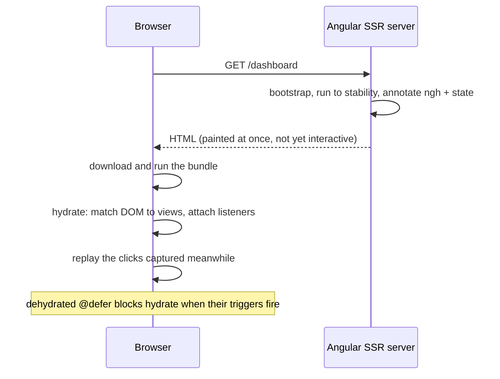

## Explanation

Hydration is the step in which a client-side framework takes ownership of HTML that was rendered elsewhere, by [server-side rendering](server-side-rendering.md) on each request or by prerendering at build time, without discarding it. The browser has already painted that markup; hydration walks the existing DOM, matches each node to the component view that would have produced it, restores component state and attaches event listeners. Without it an SSR'd Angular application would destroy the server's DOM and rebuild it from scratch, which costs a visible flicker, a layout shift and a second large paint, the things the Core Web Vitals CLS and LCP measure.

During server rendering, Angular annotates each component host element with an `ngh` attribute whose value is an index into a serialised description of the view structure, stored under the `__nghData__` key in `TransferState` and emitted as a JSON `<script>` in the page. On the client, `provideClientHydration()` in the bootstrap providers makes Angular read those annotations and *claim* nodes rather than create them. The contract is strict: the DOM Angular finds must be exactly what it produced. Invalid HTML that the browser silently repairs (a `<div>` inside a `<p>`, a `<table>` without a `<tbody>`), direct DOM manipulation (`innerHTML`, `appendChild`, moving nodes), a CDN that strips the comment nodes Angular uses as anchors, or a template that renders differently on the server (an `isPlatformBrowser` check in a condition, `Date.now()` in a binding) produces a *hydration node mismatch* (NG0500), and the affected subtree falls back to client rendering. `ngSkipHydration` on a component's host element opts that component and its children out; the guide calls it a last resort because it hides a bug rather than fixing one. Components with i18n blocks skip hydration unless `withI18nSupport()` is enabled.

Hydration can only start once the application is *stable*: no pending `HttpClient` requests and no open `PendingTasks`. A never-resolving task keeps the page inert; after roughly ten seconds Angular logs NG0506 and, in development, `provideStabilityDebugging()` prints the tasks holding things up. The `HttpClient` transfer cache complements hydration: responses fetched on the server are embedded in the HTML and replayed on the client, so hydration does not refetch the same data or flash a loading state.

Two refinements close the "uncanny valley", the window in which the page looks interactive but is not. **Event replay** (`withEventReplay()`) records user events such as clicks before hydration completes and replays them afterwards, so a click on a server-rendered button is not lost. **Incremental hydration** leaves parts of the page *dehydrated* (server-rendered, visible, inert) and hydrates each `@defer` block when its `hydrate` trigger fires: `hydrate on idle`, `on viewport`, `on interaction`, `on hover`, `on immediate`, `on timer(...)`, `hydrate when <condition>` or `hydrate never`. Several triggers separated by `;` are OR-ed, a nested block cannot hydrate before its parents, and the block's JavaScript is only downloaded when the trigger fires, which shrinks the initial bundle. Since v22 incremental hydration, with event replay, is on by default in `provideClientHydration()`; `withNoIncrementalHydration()` opts out, and the older `withIncrementalHydration()` is deprecated with removal planned for v24.

The idea is cross-framework. React's `hydrateRoot()` has the same equality contract, warns on mismatches in development, recovers by client rendering and offers `suppressHydrationWarning` for an unavoidable one-element difference such as a timestamp; intentional differences use a two-pass render keyed on `useEffect`. Blazor calls the server pass *prerendering*: it is on by default for interactive render modes and disabled per component with `prerender: false`. The web.dev vocabulary of hydration, progressive rehydration and partial rehydration maps onto Angular's incremental hydration.



## How it differs

**[Server-Side Rendering (SSR)](server-side-rendering.md).** SSR answers "who produces the HTML?" and hydration answers "what does the client do with it?". They are separable: an SSR'd page that bootstraps without `provideClientHydration()` is still server-rendered, but the client throws the markup away and re-renders, so the user sees a paint, a blank, and a second paint. Conversely a prerendered (build-time) page hydrates exactly like a per-request one. The decisive difference for an architect is where the constraints bite: SSR constrains your *server code* (no `window`, per-request state, stability), hydration constrains your *templates* (deterministic output, valid HTML, no DOM mutation outside Angular).

**[Angular Change Detection](angular-change-detection.md).** Hydration is a one-time reconciliation of DOM *structure*; change detection is the ongoing reconciliation of binding *values*. A server/client difference in structure is a hydration error; a difference in a bound value after hydration is just the next change detection patch. People conflate them because both "render", and because a hydration mismatch is often caused by code that would be fine under change detection, such as reading `window.innerWidth` in a template expression. After hydration completes, every later update, including the content of hydrated `@defer` blocks, is ordinary change detection.

| Approach | Server output | Client work at load | Risk | When to use |
|---|---|---|---|---|
| CSR, no SSR | Empty shell | Build the whole DOM | Slow first paint | Authenticated, app-like screens |
| SSR without hydration | Full HTML | Destroy and rebuild the DOM | Flicker, layout shift | Legacy; avoid |
| Full hydration | Full HTML + `ngh` annotations | Walk and adopt the DOM | Mismatch errors, large bundle before interactivity | Default for SSR'd apps before v22 |
| Incremental hydration | Full HTML, dehydrated `@defer` blocks | Adopt above the fold, hydrate blocks on triggers | Nested-block ordering, replayed events | Default since v22; content-heavy pages |

## Examples

=== "TypeScript"

    ```typescript
    // app.config.ts — hydration with the v22 defaults (incremental hydration and event
    // replay included). withI18nSupport opts localised components in as well.
    import { ApplicationConfig } from '@angular/core';
    import { provideClientHydration, withI18nSupport } from '@angular/platform-browser';

    export const appConfig: ApplicationConfig = {
      providers: [provideClientHydration(withI18nSupport())],
    };
    ```

    ```html
    <!-- dashboard.html — server-rendered and visible immediately; the heavy chart hydrates
         (and downloads its code) only when it scrolls into view or is touched. -->
    <app-header />
    <app-watchlist />

    @defer (hydrate on viewport; hydrate on interaction) {
      <app-candle-chart [symbol]="symbol()" />
    } @placeholder {
      <div class="chart-skeleton"></div>   <!-- still required for later client-side navigations -->
    }

    @defer (hydrate never) {
      <app-footer-legal />                  <!-- static for the life of the page: never hydrated -->
    }
    ```

    ```typescript
    // A mismatch and its fix. The server has no viewport, so the first version renders
    // differently on the two sides and fails hydration (NG0500) for this subtree.
    @Component({ selector: 'app-layout', template: `@if (narrow) { <app-mobile-nav /> } @else { <app-side-nav /> }` })
    export class LayoutBroken {
      narrow = typeof window !== 'undefined' && window.innerWidth < 720;   // false on the server, maybe true in the browser
    }

    @Component({ selector: 'app-layout', template: `@if (narrow()) { <app-mobile-nav /> } @else { <app-side-nav /> }` })
    export class LayoutFixed {
      readonly narrow = signal(false);                 // identical first render on both sides
      constructor() {
        afterNextRender(() => this.narrow.set(window.innerWidth < 720));   // then adapt, after hydration
      }
    }
    ```

=== "HTML"

    ```html
    <!-- Abridged server output. The ngh attribute indexes the serialised view description;
         the comment nodes are anchors for embedded views and must survive any CDN rewriting. -->
    <app-root ng-version="22.2.3" ngh="0">
      <app-watchlist ngh="1">
        <ul><li>BTC-USD 64,120.50</li><li>ETH-USD 3,210.10</li><!--container--></ul>
      </app-watchlist>
      <div class="chart-skeleton"></div><!--container-->
    </app-root>
    <script id="ng-state" type="application/json">{"__nghData__":[ ...serialised view structure, one entry per ngh index... ]}</script>
    ```

=== "C#"

    ```html
    @* Blazor Web App: prerendering is the server pass, on by default for interactive
       render modes. The interactive runtime then takes over the prerendered markup. *@
    <Watchlist @rendermode="InteractiveServer" />

    @* Opt out where the server cannot render anything useful (user-only data). *@
    <Portfolio @rendermode="@(new InteractiveWebAssemblyRenderMode(prerender: false))" />
    ```

## Misconceptions

- **"Hydration re-renders the page on the client."** Hydration is the opposite: the client *adopts* the server's DOM. A full client re-render is what happens without hydration, or inside a subtree where a mismatch forced the fallback.
- **"SSR makes the page interactive."** Server-rendered HTML is inert until hydration completes. Event replay bridges the gap by capturing and replaying clicks; incremental hydration shortens it by hydrating only what the user reaches.
- **"`ngSkipHydration` fixes a mismatch."** It skips the component and re-renders it from scratch, trading the error for the flicker hydration was meant to remove. Treat it as a marker for a bug in the template or in DOM-manipulating code.
- **"Incremental hydration lazy-loads the content."** The content is already in the server HTML and visible. What is deferred is the JavaScript and the hydration work. A plain `@defer` without a `hydrate` trigger renders only its placeholder on the server.
- **"A mismatch is cosmetic."** It forces client rendering of the subtree, causes flicker and layout shift, and in React can attach event handlers to the wrong elements. Both frameworks say to fix mismatches as bugs.

## Exam notes

No certification examines hydration; cloud exams stop at hosting choices (static files versus a Node render server), which belong to [server-side rendering](server-side-rendering.md). Hydration appears in front-end architecture interviews, where the discriminating questions are: what makes a template non-deterministic between server and client; why event replay exists; what incremental hydration defers (code and work, not content); and how you would diagnose a page that is server-rendered but stays dead for ten seconds (stability, NG0506). The common trap is answering "the client re-renders" for what hydration does, which describes its absence.

## Self-check

??? question "A server-rendered pricing page shows a hydration mismatch error only in production, never in development. Templates are deterministic. What do you check first?"
    Production usually adds a CDN or HTML minifier between the server and the browser. Angular relies on the comment nodes it emits as anchors for embedded views, and on the whitespace structure it produced; an optimiser that strips HTML comments or collapses whitespace changes the DOM the client finds, which raises NG0500 and forces client rendering of the affected subtree. Disable comment removal for application HTML in the CDN configuration (or exclude Angular's anchors) and keep `preserveWhitespaces` consistent between the server and browser builds. Second suspect: a production-only script that mutates the DOM before Angular bootstraps, such as a consent banner injected with `innerHTML`.

??? question "Analytics shows that clicks on the server-rendered Buy button during the first two seconds after navigation do nothing. The page uses SSR on Angular 22 with the default hydration setup. What is the likely cause?"
    On the v22 defaults, event replay is on, so a click on an already server-rendered button is captured and replayed when its component hydrates; the clicks should not be lost. Check whether someone passed `withNoIncrementalHydration()` without re-adding `withEventReplay()`, which disables replay, or whether the button lives in a `@defer` block marked `hydrate never`, whose subtree never hydrates and therefore never attaches the listener that a replayed click would need. Also confirm the application reaches stability promptly: if a pending task keeps it unstable, hydration itself is delayed, the captured clicks wait with it, and after about ten seconds NG0506 appears.

??? question "A dashboard has a heavy candlestick chart below the fold. One engineer writes `@defer (on viewport)`, another `@defer (hydrate on viewport)`. On an SSR'd page, what differs for the user?"
    With `@defer (on viewport)`, the server renders only the placeholder, so the user sees a skeleton until the client downloads the chunk and renders the chart after scrolling; triggers do not run on the server at all. With `hydrate on viewport`, the server renders the real chart markup, the user sees a complete page immediately, and the chart stays a static picture until it scrolls into view, at which point its code is fetched and it hydrates into an interactive component. The hydrate form costs server rendering time and HTML size for the chart; the plain form costs a visible gap. For an above-the-fold or SEO-relevant element choose the hydrate trigger; for a tab the user may never open, a plain `on interaction` is cheaper.

## Further reading

- [Angular: architectural trade-offs](../frontend/angular/angular-fundamentals.md) and [Real-time UI streaming](../frontend/realtime/real-time-ui-streaming.md) in this library
- [Server-Side Rendering (SSR)](server-side-rendering.md), [Angular Change Detection](angular-change-detection.md) and [Angular Signals](angular-signals.md)
- [Hydration](https://angular.dev/guide/hydration) and [Incremental hydration](https://angular.dev/guide/incremental-hydration) on angular.dev; [NG0500: Hydration node mismatch](https://angular.dev/errors/NG0500)
- [hydrateRoot](https://react.dev/reference/react-dom/client/hydrateRoot) in the React reference, and [Rendering on the web](https://web.dev/articles/rendering-on-the-web) on web.dev
