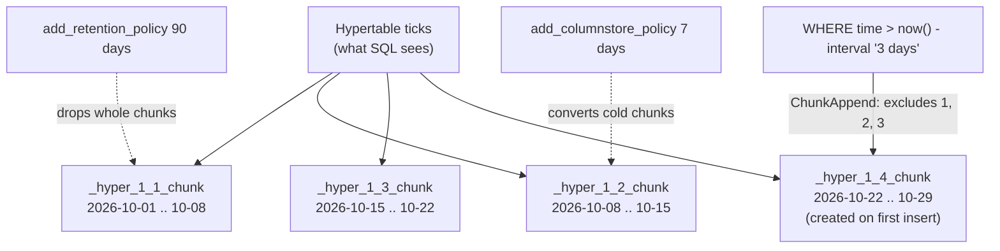

## Explanation

A hypertable is what TimescaleDB turns an ordinary PostgreSQL table into when you ask it to manage time-series data. From outside it is one table: you `INSERT`, `COPY`, `SELECT`, join and index it as before. Underneath, TimescaleDB keeps the rows in child tables called *chunks*, each covering one interval of the partitioning column (almost always a `timestamptz` such as `time`). Chunks live in the `_timescaledb_internal` schema with names like `_hyper_1_7_chunk`, and each is a complete PostgreSQL table with its own heap, indexes and statistics.

Chunk creation is automatic. When a row's timestamp falls outside every existing chunk, TimescaleDB creates a new chunk aligned to the hypertable's *chunk interval*, 7 days by default for timestamp columns. The documented sizing rule is memory-driven: choose an interval so that the indexes of the chunks being actively written fit within about 25% of main memory (in practice `shared_buffers`), because inserts collapse once the working index set spills out of memory; the worked example is a 64 GB server, about 16 GB of `shared_buffers`, where roughly 2 GB of index growth per day suits 7-day chunks. `set_chunk_time_interval()` affects only chunks created afterwards.

There are two ways to make one. Since TimescaleDB 2.20.0 the preferred form is `CREATE TABLE ... WITH (tsdb.hypertable, tsdb.partition_column = 'time', tsdb.chunk_interval = '1 day')`; since 2.23.0 the partition column may be omitted and the first timestamp column is used. The older `create_hypertable()` function converts an existing table, with the generalised dimension-builder interface introduced in 2.13: `create_hypertable('ticks', by_range('time', INTERVAL '1 day'))`. Either way TimescaleDB adds a default index on the time column in descending order (unless `tsdb.create_default_indexes = false`). In the Community Edition `CREATE TABLE ... WITH` also enables the columnstore unless `tsdb.columnstore = false`, and since 2.23.0 it schedules a columnstore policy that converts chunks once they are one chunk interval old.

Time is the primary dimension; a *space* dimension is optional. `add_dimension('ticks', by_hash('symbol', 4))` hashes each row's symbol into one of four partitions inside every time interval. The documentation is blunt: hash partitioning multiplies chunk count and planning overhead, exists mainly to parallelise I/O across several disks or tablespaces within one time interval, and should not be used without extensive testing; for most workloads time-based chunking plus good indexes is the better fit. A dimension can only be added while the hypertable is empty, and every unique index or primary key must include all partitioning columns, because uniqueness is enforced per chunk.

The structure pays off in three places. Queries that filter on time touch only overlapping chunks, through planner constraint exclusion plus TimescaleDB's ChunkAppend node, which also excludes chunks at executor startup (for `now()`-relative predicates, rewritten to constants since 2.7) and at run time (for join parameters); see [partition pruning](partition-pruning.md). Indexes stay small and local: a chunk's B-tree covers one interval, and the recent chunks' indexes stay hot in cache. Lifecycle operations become metadata operations: a [retention policy](data-retention-policy.md) drops whole chunks, a columnstore policy converts cold chunks to [columnar storage](columnar-storage.md), and a [continuous aggregate](continuous-aggregate.md) refreshes only chunks whose data changed.

Two housekeeping facts. TimescaleDB ships in two editions: the Apache 2 edition has hypertables, chunk listing and dropping, `time_bucket`, `first` and `last`; the columnstore, continuous aggregates, retention policies and job scheduling are Community Edition features under the Tiger Data License. And the company behind it, Timescale Inc., became Tiger Data on 17 June 2025; the extension is still TimescaleDB (2.31.0 at the time of writing), the managed service is now Tiger Cloud, and the documentation lives at tigerdata.com.



## How it differs

**[Table partitioning](table-partitioning.md)** in native PostgreSQL gives you the same end state, a parent table with range-partitioned children, but makes partition management your job: every partition's bounds are declared in advance, a row with no matching partition is an error unless a default partition exists, and tools such as `pg_partman` exist precisely to automate what a hypertable does inherently. A hypertable creates chunks on demand, sizes them from one interval setting, and attaches policies (retention, columnstore, reorder) to the chunk lifecycle. Native partitioning wins when you need PostgreSQL-only portability, list or hash partitioning as the primary scheme, or a managed service without the extension; the hypertable wins for append-heavy time-series where chunk count would otherwise be a chore.

**[Partition pruning](partition-pruning.md)** is the optimisation, the hypertable is the structure it operates on. PostgreSQL's own pruning applies only to declaratively partitioned tables; TimescaleDB implements the equivalent for chunks with planner constraint exclusion and the ChunkAppend custom node, including the startup-time and run-time exclusion that make `now()`-relative dashboards cheap. Confusing the two leads to a classic mistake: assuming that creating a hypertable alone makes an unfiltered query faster. It does not; only predicates on the partitioning column (or on columns with chunk-skipping statistics) let chunks be excluded.

**[Columnar storage](columnar-storage.md)** operates one level down. A chunk is a row-oriented heap when created; a columnstore policy later converts it into compressed, column-segmented form. The hypertable is therefore the unit of *placement* and the columnstore the unit of *layout*. The Apache 2 edition proves the separation: hypertables without any columnstore at all.

**[Continuous aggregate](continuous-aggregate.md)** is built from a hypertable and is stored as one (its materialisation is itself chunked, by default with a chunk interval ten times the source's). It is a derived, query-specific rollup; the hypertable holds the raw events. Use the aggregate for dashboards with fixed bucket sizes, the hypertable for ad-hoc analysis and for anything that needs individual rows.

**[Data retention policy](data-retention-policy.md)** is a scheduled job (`add_retention_policy`) that calls `drop_chunks` for chunks older than a threshold. It depends on the chunking but is a lifecycle rule, and in the Apache 2 edition you implement it yourself by scheduling `drop_chunks()`. The hypertable is what makes the deletion cheap: dropping a chunk is a `DROP TABLE`, not a row-by-row delete that bloats the heap.

| | Native partitioned table | Hypertable |
|---|---|---|
| Partition creation | Manual (or pg_partman) | Automatic on insert |
| Primary scheme | Range, list or hash | Time (range), optional hash dimension |
| Pruning | PostgreSQL planner and executor | Planner plus ChunkAppend startup/runtime exclusion |
| Lifecycle | `DETACH`/`DROP` by hand | Policies: retention, columnstore, reorder (Community Edition) |
| Portability | Any PostgreSQL | Requires the extension |

## Examples

=== "SQL"

    ```sql
    -- TimescaleDB 2.23+: partition column inferred from the first timestamptz column.
    -- Community Edition also schedules a columnstore policy (after one chunk interval).
    CREATE TABLE ticks (
        time   TIMESTAMPTZ NOT NULL,
        symbol TEXT        NOT NULL,
        price  DOUBLE PRECISION,
        volume BIGINT
    ) WITH (
        tsdb.hypertable,
        tsdb.chunk_interval = '1 day',
        tsdb.segmentby = 'symbol',
        tsdb.orderby   = 'time DESC'
    );

    -- Converting an existing table instead (generalised API, TimescaleDB 2.13+):
    -- SELECT create_hypertable('ticks', by_range('time', INTERVAL '1 day'), migrate_data => true);

    -- A unique index must include the partitioning column.
    CREATE UNIQUE INDEX ticks_symbol_time ON ticks (symbol, time);

    -- Chunks appear as rows arrive.
    SELECT chunk_name, range_start, range_end, is_compressed
    FROM timescaledb_information.chunks
    WHERE hypertable_name = 'ticks'
    ORDER BY range_start;

    -- Only new chunks get the new interval.
    SELECT set_chunk_time_interval('ticks', INTERVAL '6 hours');

    -- Lifecycle: drop by chunk, never by row.
    SELECT show_chunks('ticks', older_than => INTERVAL '90 days');
    SELECT drop_chunks('ticks', INTERVAL '90 days');              -- Apache 2 edition
    SELECT add_retention_policy('ticks', INTERVAL '90 days');     -- Community Edition
    ```

=== "C#"

    ```csharp
    // .NET 9 + Npgsql: bulk-load ticks with binary COPY. The hypertable routes
    // each row to the chunk for its timestamp; new chunks are created as needed.
    await using var conn = await dataSource.OpenConnectionAsync();

    await using var writer = await conn.BeginBinaryImportAsync(
        "COPY ticks (time, symbol, price, volume) FROM STDIN (FORMAT BINARY)");

    foreach (var t in batch)   // IEnumerable<(DateTime Time, string Symbol, double Price, long Volume)>
    {
        await writer.StartRowAsync();
        await writer.WriteAsync(t.Time, NpgsqlDbType.TimestampTz);   // DateTime.Kind must be Utc
        await writer.WriteAsync(t.Symbol, NpgsqlDbType.Text);
        await writer.WriteAsync(t.Price, NpgsqlDbType.Double);
        await writer.WriteAsync(t.Volume, NpgsqlDbType.Bigint);
    }

    await writer.CompleteAsync();   // without this the COPY is rolled back
    ```

=== "Python"

    ```python
    # Python 3.12 + psycopg 3: the same bulk load through COPY.
    import psycopg

    with psycopg.connect(conninfo) as conn, conn.cursor() as cur:
        with cur.copy("COPY ticks (time, symbol, price, volume) FROM STDIN") as copy:
            for ts, symbol, price, volume in batch:   # ts is a tz-aware datetime
                copy.write_row((ts, symbol, price, volume))

        # Which chunk did the newest rows land in?
        cur.execute(
            """
            SELECT chunk_name, range_start, range_end
            FROM timescaledb_information.chunks
            WHERE hypertable_name = 'ticks'
            ORDER BY range_end DESC LIMIT 1
            """
        )
        print(cur.fetchone())
    ```

=== "Docker Compose"

    ```yaml
    # Local development: the official image bundles the Community Edition.
    services:
      timescaledb:
        image: timescale/timescaledb:latest-pg17
        environment:
          POSTGRES_PASSWORD: dev
        ports:
          - "5432:5432"
        volumes:
          - tsdata:/var/lib/postgresql/data
    volumes:
      tsdata: {}
    ```

=== "Azure"

    - **Azure Database for PostgreSQL flexible server** lists `timescaledb` among its supported extensions (2.24.0 on PostgreSQL 15 to 18 at the time of writing; older versions on 13 and 14) and ships the **Apache 2 edition**. Hypertables, chunk creation, `show_chunks`/`drop_chunks` and `time_bucket` work; the columnstore, continuous aggregates and retention or columnstore policies do not. Enable it by allow-listing the extension and adding it to `shared_preload_libraries`, then `CREATE EXTENSION timescaledb`.
    - For the Community Edition on Azure, self-host TimescaleDB on AKS or a virtual machine; the managed extension on flexible server cannot be upgraded to it.

=== "AWS"

    - **Amazon RDS for PostgreSQL and Aurora PostgreSQL** do not offer the `timescaledb` extension; neither extension list mentions it. The AWS-native route to hypertables is Tiger Cloud, listed on AWS Marketplace, or self-managed TimescaleDB on EC2 or EKS.
    - Without the extension, the equivalent on RDS or Aurora is native range partitioning automated by `pg_partman`, which both services support; you lose automatic chunk creation on insert, ChunkAppend exclusion and the columnstore.
    - **Amazon Timestream for LiveAnalytics** closed to new customers on 20 June 2025; AWS recommends Timestream for InfluxDB for new time-series workloads.

## Misconceptions

- **"A hypertable is a different kind of table."** It is a regular PostgreSQL table plus catalog metadata, and each chunk is a regular table too; `pg_dump`, foreign keys to it, triggers and ordinary indexes all work. The special behaviour comes from the extension's planner and executor hooks.
- **"Smaller chunks are always better."** Each chunk carries catalog entries, per-chunk indexes and planning cost; thousands of tiny chunks slow planning and waste memory. Size chunks so the actively written chunks' indexes fit comfortably in memory, and revisit when ingest rates change.
- **"Space partitioning by symbol speeds up per-symbol queries."** It multiplies chunks and planning time; per-symbol selectivity comes from an index on `(symbol, time)` or from `segmentby = 'symbol'` in the columnstore. The documentation recommends hash dimensions only for spreading I/O across disks after testing.
- **"Creating a hypertable makes queries faster by itself."** Only queries that constrain the partitioning column (or columns with chunk-skipping statistics) benefit, because exclusion needs a predicate to exclude on. An unfiltered `GROUP BY symbol` still reads every chunk.
- **"TimescaleDB on Azure is the same TimescaleDB as on Tiger Cloud."** Azure ships the Apache 2 edition, which has no columnstore, continuous aggregates or policies; the names changed too, since 2.18.0 the compression API is called the columnstore and Timescale the company is Tiger Data.

## Exam notes

No major certification tests TimescaleDB directly, but the hypertable is the practical form of ideas that several exams do test. DP-300 and the AWS data exams (DEA-C01, and database questions in SAA-C03 and SAP-C03) test time-based range partitioning for lifecycle management: drop old partitions rather than delete rows, keep indexes small, prune by date. AZ-305 and SAA-C03 test managed-service limits, and the trap here is assuming any PostgreSQL extension is available on any managed PostgreSQL; RDS and Aurora do not ship TimescaleDB, Azure ships only the Apache 2 edition, and Amazon's own time-series service for new customers is Timestream for InfluxDB. Architecture exams (CPSA-A, AZ-305) expect you to reason about the trade-off between a specialised time-series store and a relational database with partitioning; the hypertable is the "both" answer, and knowing which features need the Community Edition is what separates a confident answer from a guess.

## Self-check

??? question "Your tick ingestion runs at 10 GB of index growth per day on a 64 GB TimescaleDB server, and inserts slowed sharply once the table passed a few hundred million rows. What is the likely cause and fix?"
    With the default 7-day chunk interval, the indexes of the chunk being written exceed what fits in memory, so every insert pays for index pages being read from disk. Set a 1-day chunk interval with `set_chunk_time_interval()` (it applies to new chunks only) so the active chunk's indexes stay within roughly a quarter of main memory, and check that no unnecessary indexes exist on the hypertable.

??? question "A colleague proposes `add_dimension('ticks', by_hash('symbol', 64))` so that queries for one symbol read one sixty-fourth of the data. What is wrong with the reasoning?"
    Hash partitioning does not replace an index: a query for one symbol would still scan the whole partition for that hash bucket, and the 64-way split multiplies the chunk count (64 chunks per time interval), raising planning time and catalog overhead. Per-symbol selectivity comes from a `(symbol, time)` index on the rowstore or `segmentby = 'symbol'` in the columnstore. The documentation reserves hash dimensions for spreading I/O across disks.

??? question "You created a hypertable on Azure Database for PostgreSQL and `add_columnstore_policy()` fails with a licence error. What happened?"
    Azure ships the TimescaleDB Apache 2 edition, which contains hypertables but not the Community Edition features: columnstore, continuous aggregates, retention and columnstore policies. Either run those lifecycle steps yourself (`drop_chunks()` from a scheduler) and accept uncompressed storage, or move to Tiger Cloud or a self-hosted Community Edition.

??? question "Why is `DELETE FROM ticks WHERE time < now() - interval '1 year'` the wrong way to enforce retention on a hypertable?"
    A row-level delete rewrites tuple headers across every old chunk, generates WAL for each row, leaves dead tuples for `VACUUM` and keeps the chunks alive. `drop_chunks()` (or a retention policy) removes whole chunk tables as a metadata operation, instantly freeing space and leaving no bloat.

## Further reading

- [High-Frequency Indexing & Partitioning](../data/time-series/high-frequency-indexing-partitioning.md) in this library
- [Time-Series Financial Schemas](../data/time-series/time-series-financial-schemas.md) in this library
- [Row-Oriented vs. Columnar Storage](../data/time-series/row-vs-columnar-storage.md) in this library
- Term pages: [Table Partitioning](table-partitioning.md), [Partition Pruning](partition-pruning.md), [Columnar Storage](columnar-storage.md), [Continuous aggregate](continuous-aggregate.md), [Data retention policy](data-retention-policy.md)
- [Hypertables](https://www.tigerdata.com/docs/use-timescale/latest/hypertables), [Size hypertable chunks](https://www.tigerdata.com/docs/learn/hypertables/sizing-hypertable-chunks) and [Partition a hypertable](https://www.tigerdata.com/docs/learn/hypertables/partitioning-hypertables), Tiger Data documentation
- [CREATE TABLE with hypertable options](https://www.tigerdata.com/docs/reference/timescaledb/hypertables/create_table) and [create_hypertable()](https://www.tigerdata.com/docs/reference/timescaledb/hypertables/create_hypertable), Tiger Data reference
- [TimescaleDB editions](https://www.tigerdata.com/docs/about/latest/timescaledb-editions), which features need the Community Edition
- [Timescale is now Tiger Data](https://www.tigerdata.com/blog/timescale-becomes-tigerdata), the June 2025 rename announcement
