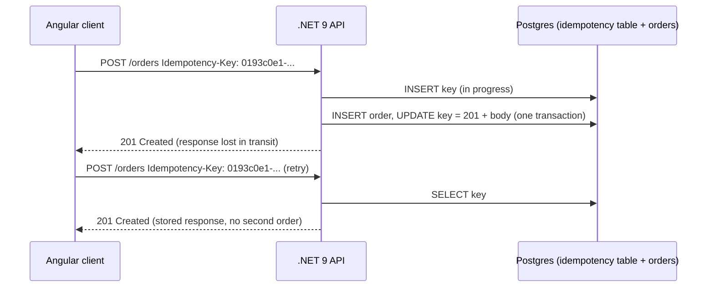

## Explanation

An operation is **idempotent** when doing it several times leaves the system in the same state as doing it once. HTTP already classifies methods this way: RFC 9110 defines `PUT`, `DELETE` and the safe methods as idempotent, which is why a client may repeat them automatically after a connection failure, and leaves `POST` non-idempotent. The trouble is that the operations we most need to retry (create a payment, place an order, send an email) are `POST`s, and in messaging every [at-least-once](at-least-once-delivery.md) broker will redeliver a message whose acknowledgement was lost. Retries are unavoidable; duplicated *effects* are not.

An **idempotency key** is the client-generated identifier that makes a non-idempotent operation safely repeatable. The client attaches the same key to every attempt of the same logical operation. The receiver keeps a record keyed by it: the first time, it performs the work and stores the outcome; on a repeat, it returns the stored outcome without doing the work again. The work and the record should be written in the same transaction, or the record is useless exactly when it matters.



On the HTTP side the convention is converging on the `Idempotency-Key` header. The IETF HTTPAPI working group's draft (version 08, October 2026, still an Internet-Draft) recommends a UUID or similarly random value, requires that a key never be reused with a different payload, and recommends `400` when a required key is missing, `409` while the original request is still being processed, and `422` when the key is reused with a different payload; servers may fingerprint the body to detect that last case and should publish how long keys are retained. Stripe's API, the model most teams copy, accepts keys of up to 255 characters on every v1 `POST`, stores the first response (`500` errors included) once the endpoint starts executing, replays it on retry, rejects reuse with different parameters, and may prune keys once they are 24 hours old (its newer v2 API instead retries failed work to completion).

On the messaging side the same idea appears under other names. Azure Service Bus duplicate detection tracks the application-set `MessageId` for a configurable window (10 minutes by default, 20 seconds to 7 days) and silently drops a resend. SQS FIFO queues de-duplicate on `MessageDeduplicationId`, or a SHA-256 of the body with content-based deduplication, for five minutes. Kafka's idempotent producer attaches a broker-assigned producer id and per-partition sequence numbers so a retried batch is written once. Redis 8.6 added `XADD ... IDMP producer-id iid` so a producer that crashed before reading the reply can resend without creating a second stream entry. DynamoDB's `ClientRequestToken` makes `TransactWriteItems` idempotent for ten minutes; EC2's `ClientToken` does the same for `RunInstances`.

Which keys are good? A random UUID per attempt group is safe but only the client can correlate it. A key derived from the business context (`order-8841:capture`) is predictable, survives client restarts, and lets a replay after a crash find its own earlier result; Service Bus guidance recommends exactly this composite style. Never derive a key from the payload alone unless two identical payloads really are the same operation.

Two design points separate a working implementation from a hopeful one. First, reserve the key *before* doing the work (an insert into a table with the key as primary key, or `SET NX`), so two concurrent attempts cannot both pass the lookup; the loser gets `409`. Second, store the response, not just a flag, so the retry returns the same status and body the original would have. For a stream consumer the equivalent is a `processed_messages` table written in the same transaction as the business update: the Idempotent Receiver of the Enterprise Integration Patterns, the idempotent consumer of microservices.io.

## How it differs

**[At-least-once delivery](at-least-once-delivery.md).** This is the guarantee that produces the duplicates in the first place; it is a property of the transport. The idempotency key is a property of the receiver. You keep at-least-once (because it is cheap and honest) and add keys where a duplicate effect would be visible or costly.

**[Exactly-once delivery](exactly-once-delivery.md).** Exactly-once machinery (transactions, sequence numbers, deduplication windows) tries to stop the second copy before it is applied, and only works inside the boundary where that machinery lives (one Kafka cluster, one Service Bus namespace, one queue for five minutes). An idempotency key works across any boundary, including an HTTP call from a browser, at the price of a lookup per request and a store to keep. Most systems use both: broker-level deduplication for cheap suppression, keys at the edges.

**[Transactional outbox](transactional-outbox.md).** The outbox makes sure the producer emits each event it committed; it cannot stop the relay or broker from emitting it twice. The outbox row's `id` is the natural idempotency key for everything downstream.

**[API key](api-key.md).** Same word, unrelated job. An API key proves *who* is calling and is reused for every request; an idempotency key says *which operation this is* and is unique per logical request. Confusing them produces either keys that leak across tenants or keys that are never unique.

**[Optimistic UI update](optimistic-ui-update.md).** An Angular client that shows the order as placed before the server confirms will, on a timeout, retry the request. Without a key the retry is a second order and the optimistic state was a lie; with a key generated when the user committed the action and reused on every attempt, the retry resolves to the same result and the optimistic state can be confirmed or rolled back correctly. The update is a presentation decision; the key is the correctness guarantee underneath it.

| Mechanism | Scope | Window | Who decides the key |
|---|---|---|---|
| `Idempotency-Key` header | One HTTP endpoint | Server policy (Stripe: 24 h) | Client |
| Service Bus duplicate detection | One queue or topic | 20 s to 7 d, default 10 min | Sender sets `MessageId` |
| SQS FIFO deduplication | One FIFO queue | 5 minutes | Producer, or SHA-256 of body |
| Kafka idempotent producer | One producer session, per partition | Session | Broker (producer id + sequence) |
| Consumer processed-ids table | One consumer and its database | Retention you choose | Producer or outbox id |

## Examples

**Charging a card from an Angular checkout.** The client generates a key when the user lands on the confirm page and reuses it for every retry of the submit. The API records the key, charges once, stores the `201`, and replays it to any retry; a reuse with a different amount is refused with `422`.

=== "C#"

    ```csharp
    // ASP.NET Core minimal API (.NET 9): the key, fingerprint and stored response live in one table.
    app.MapPost("/payments", async (HttpRequest http, PaymentRequest body, AppDb db,
                                    PaymentService payments, CancellationToken ct) =>
    {
        if (!http.Headers.TryGetValue("Idempotency-Key", out var header) || header.Count == 0)
            return Results.Problem(statusCode: 400, title: "Idempotency-Key header is required");

        var key = header.ToString();
        var fingerprint = Convert.ToHexString(SHA256.HashData(JsonSerializer.SerializeToUtf8Bytes(body)));

        var existing = await db.IdempotencyRecords.FindAsync([key], ct);
        if (existing is not null)
        {
            if (existing.Fingerprint != fingerprint)
                return Results.Problem(statusCode: 422, title: "Key reused with a different payload");
            if (existing.StatusCode is null)
                return Results.Problem(statusCode: 409, title: "Request with this key is still in progress");
            return Results.Content(existing.ResponseBody!, "application/json", statusCode: existing.StatusCode);
        }

        db.IdempotencyRecords.Add(new IdempotencyRecord { Key = key, Fingerprint = fingerprint });
        try { await db.SaveChangesAsync(ct); }                // primary key: concurrent duplicate loses
        catch (DbUpdateException) { return Results.Problem(statusCode: 409, title: "In progress"); }

        await using var tx = await db.Database.BeginTransactionAsync(ct);
        try
        {
            var payment = await payments.ChargeAsync(body, ct);    // writes the payment row via db
            var record = await db.IdempotencyRecords.FindAsync([key], ct);
            record!.StatusCode = 201;
            record.ResponseBody = JsonSerializer.Serialize(payment);
            await db.SaveChangesAsync(ct);
            await tx.CommitAsync(ct);                              // payment and stored response commit together
            return Results.Created($"/payments/{payment.Id}", payment);
        }
        catch
        {
            await tx.RollbackAsync(CancellationToken.None);
            db.ChangeTracker.Clear();
            await db.IdempotencyRecords                            // release the reservation so a retry can run
                .Where(r => r.Key == key && r.StatusCode == null)
                .ExecuteDeleteAsync(CancellationToken.None);
            throw;
        }
    });
    ```

=== "Python"

    ```python
    # FastAPI + psycopg 3: same shape, same status codes.
    import hashlib, json, uuid
    from fastapi import FastAPI, Header, HTTPException, Response
    import psycopg

    app = FastAPI()

    @app.post("/payments", status_code=201)
    def create_payment(body: dict, response: Response,
                       idempotency_key: str = Header(alias="Idempotency-Key")):
        fingerprint = hashlib.sha256(json.dumps(body, sort_keys=True).encode()).hexdigest()
        with psycopg.connect(DSN) as conn, conn.cursor() as cur:
            cur.execute("SELECT fingerprint, status_code, body FROM idempotency WHERE key = %s",
                        (idempotency_key,))
            row = cur.fetchone()
            if row:
                stored_fp, status, stored_body = row
                if stored_fp != fingerprint:
                    raise HTTPException(422, "Key reused with a different payload")
                if status is None:
                    raise HTTPException(409, "Request with this key is still in progress")
                response.status_code = status
                return stored_body
            try:
                cur.execute("INSERT INTO idempotency (key, fingerprint) VALUES (%s, %s)",
                            (idempotency_key, fingerprint))
                conn.commit()
            except psycopg.errors.UniqueViolation:
                raise HTTPException(409, "In progress")
            try:
                with conn.transaction():
                    payment = charge(cur, body)                   # inserts the payment row
                    cur.execute("UPDATE idempotency SET status_code = 201, body = %s WHERE key = %s",
                                (json.dumps(payment), idempotency_key))
            except Exception:
                # release the reservation so a retry is not stuck on 409
                cur.execute("DELETE FROM idempotency WHERE key = %s AND status_code IS NULL",
                            (idempotency_key,))
                conn.commit()
                raise
            return payment
    ```

=== "Azure"

    - **Service Bus**: set `ServiceBusMessage.MessageId` to a business-derived value such as `order-8841:capture` and create the queue or topic with `RequiresDuplicateDetection` and a `DuplicateDetectionHistoryTimeWindow`; a resend inside the window is accepted and dropped. Basic tier does not support it.
    - **Azure Cosmos DB**: use the idempotency key as the item `id` within the partition; a second create of the same id fails with `409 Conflict`, which the handler treats as success.
    - **Azure Functions** on Service Bus or Event Hubs triggers are at-least-once; keep a processed-ids table (or use the `MessageId` with duplicate detection) because the trigger itself does not de-duplicate.

=== "AWS"

    - **SQS FIFO**: send with `MessageDeduplicationId` (or content-based deduplication) and `MessageGroupId`; duplicates within five minutes are acknowledged but not delivered. Standard queues have no deduplication, so the consumer must do it.
    - **DynamoDB**: `TransactWriteItems` with a `ClientRequestToken` is idempotent for ten minutes, and a conditional `PutItem` with `attribute_not_exists(pk)` makes a create idempotent indefinitely.
    - **Lambda**: Powertools for AWS Lambda ships an idempotency utility that stores keys and responses in DynamoDB; EC2 and many control-plane APIs accept a `ClientToken` of up to 64 characters and return `IdempotentParameterMismatch` on reuse with different parameters.

## Misconceptions

- **"If my POST is wrapped in a retry policy, I am safe."** The retry is the problem, not the solution: without a key, every retry after a lost response creates another order or charge.
- **"The broker's deduplication makes my consumer idempotent."** Deduplication windows are bounded (5 minutes for SQS FIFO, up to 7 days for Service Bus) and scoped to one entity; a redelivery after lock expiry or a replay from an outbox relay still reaches the consumer.
- **"Checking the key and then doing the work is enough."** Two concurrent retries can both pass the check. Reserve the key first (unique constraint or `SET NX`) and store the response with the work in one transaction.
- **"A random UUID per request is the best key."** It is safe but cannot be regenerated after a client crash. Keys derived from the business operation let a restarted client find its earlier result.
- **"An idempotency key is a kind of API key."** It identifies an operation, not a caller, and must be unique per logical request rather than shared across them.

## Exam notes

AWS developer exams (DVA-C02, DVA-C03) ask how to make Lambda handlers and SQS consumers idempotent, when FIFO deduplication applies and for how long, and why DynamoDB conditional writes or client tokens prevent duplicate records; SAA-C03 and SAP-C03 phrase the same idea as designing for at-least-once delivery. AZ-204 expects Service Bus duplicate detection with a sender-set `MessageId`, and AZ-305 expects you to pair at-least-once messaging with idempotent consumers rather than ask for exactly-once transport. The traps: believing deduplication windows are unbounded, picking standard SQS and expecting deduplication, choosing a key that changes on every retry, and treating idempotency as a property of the transport rather than of the receiver.

## Self-check

??? question "A mobile client times out on POST /orders and retries. The server logs show two orders. The team proposes making the client wait longer. What is the real fix?"
    Add an idempotency key generated by the client for the logical order attempt and sent as `Idempotency-Key` on every retry. The server reserves the key before creating the order, stores the response with the order in one transaction, and replays the stored response on retry. Longer timeouts only make duplicates rarer, not impossible.

??? question "Your Service Bus queue has duplicate detection with a 10-minute window, yet a consumer still processed one message twice, 40 minutes apart. Why?"
    Duplicate detection only suppresses resends of the same `MessageId` by senders inside the window. A redelivery after the consumer abandoned the message or let its lock expire is the same message delivered again, which detection does not cover; and a sender retry after the window is a new message to the broker. The consumer needs its own processed-ids check.

??? question "Two instances of a payment API receive the same Idempotency-Key at the same moment. Both find no record and both charge the card. Which step was missing?"
    Reserving the key atomically before doing the work. Insert the key into a table with a unique constraint (or `SET NX` in Redis) first; the instance whose insert fails returns `409` instead of charging. The stored response is then written together with the charge so a later retry gets the same `201`.

## Further reading

- [Delivery Semantics](../messaging/eventing/delivery-semantics.md) on why the practical default is at-least-once plus idempotent consumers.
- [Outbox Pattern vs. Dual-Write](../messaging/eventing/outbox-pattern.md) on where the key comes from when events originate in a database transaction.
- [REST vs. gRPC APIs](../messaging/apis/rest-vs-grpc-apis.md) for where the header fits in an API contract.
- Terms: [At-least-once delivery](at-least-once-delivery.md), [Exactly-once delivery](exactly-once-delivery.md), [Transactional outbox](transactional-outbox.md), [Dead-letter queue](dead-letter-queue.md).
- [Idempotent Receiver](https://www.enterpriseintegrationpatterns.com/patterns/messaging/IdempotentReceiver.html) and [Pattern: Idempotent consumer](https://microservices.io/patterns/communication-style/idempotent-consumer.html).
- [Idempotent message processing in Redis Streams](https://redis.io/docs/latest/develop/data-types/streams/idempotency/) for `XADD ... IDMP`.
