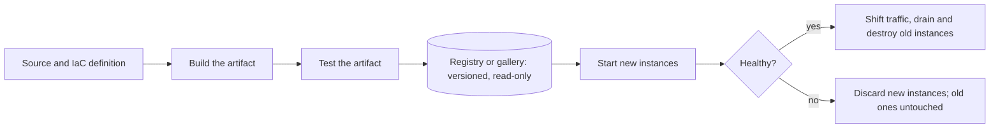

## Explanation

Immutable infrastructure is a discipline rather than a product. Once a server, virtual machine (VM), container or function package is running, nobody changes it: no `apt upgrade` over SSH, no editing a config file on the box, no hot-patching a DLL. When something must change, you build a new artifact (a machine image, a container image, a zipped function), test that artifact, start new instances from it, move traffic over, and destroy the old instances. The running instance is disposable; the artifact and the definition that produced it are what you own.

The name comes from Kief Morris, who described the "immutable server" in 2013 as the logical end-point of Martin Fowler's "phoenix server" from 2012: a server you regularly burn down and rebuild from source so that it can never accumulate hand-applied, undocumented changes. The enemy both were fighting is configuration drift, the slow divergence of long-lived machines from their intended configuration. Drift produces snowflake servers that nobody dares rebuild, "works on node 3 but not node 4" incidents, and rollbacks that cannot restore the previous state because nobody recorded what it was.

Mechanically, immutability moves work from the runtime to the build pipeline:



Three consequences follow. Every instance of a version is byte-for-byte identical, so the version string genuinely identifies behaviour. Rollback becomes "redeploy the previous artifact", which is the same operation as a deploy and therefore rehearsed on every release. And state must live outside the instance: a database, object storage, a Redis cache, a log sink. Anything written to the instance's own disk disappears when the instance is replaced, which is the design, not a bug.

Containers made the pattern mainstream because the image format enforces it. A Docker image is a stack of read-only layers; a running container adds only a thin writable layer that is discarded with the container. Kubernetes lets you refuse even that with `readOnlyRootFilesystem: true` in the container security context. In this library's reference stack that is the default shape: the .NET 9 SDK publishes an ASP.NET Core API straight to an OCI image with `dotnet publish /t:PublishContainer` and no Dockerfile; an Angular 20 production build is a folder of static files served from an image; Docker Compose pins one image per service; Redis Streams, TimescaleDB and your MCP servers hold the state that the replaceable containers must not.

Immutability is also what makes the release strategies in this library mechanically simple. [Blue-green](blue-green-deployment.md) and [canary](canary-release.md) releases assume you can stand up a second copy of the fleet from the same artifact; a [rolling deployment](rolling-deployment.md) assumes a replacement instance is interchangeable with the one it replaces. On Azure the building blocks are VM Image Builder (a managed service built on HashiCorp Packer) feeding Azure Compute Gallery, Virtual Machine Scale Sets (VMSS) that roll a new image reference across the fleet, and Container Apps, where every deployment is an immutable revision. On AWS they are EC2 Image Builder producing AMIs and container images, launch template versions, Auto Scaling group instance refresh, and ECS task definition revisions. The AWS Well-Architected Framework lists deploying with immutable infrastructure as a reliability best practice; the Azure Well-Architected Framework recommends the immutable model for business-critical workloads.

What immutability does not remove is the need to manage the things that stay mutable: the database schema, runtime configuration, feature flags and secrets. Those are versioned and rolled out by other means, and they must remain compatible with both the old and the new artifact for as long as the two overlap.

## How it differs

**[Infrastructure as Code](infrastructure-as-code.md)** is about describing; immutability is about replacing. Terraform or Bicep can happily describe a VM that a nightly Ansible run then mutates (IaC without immutability), and a team can bake golden AMIs by clicking through a console and still run a perfectly immutable fleet (immutability without IaC). The two reinforce each other: IaC gives immutability a source of truth, and immutability gives IaC a runtime that still matches the code. Adopt IaC unconditionally; adopt immutability wherever the artifact can be rebuilt quickly and the state has been moved out of the instance.

**[Blue-green deployment](blue-green-deployment.md)** needs two environments and a switch. It is easiest when green is a fresh immutable build, but Fowler's original description predates containers and works with mutable environments too. Immutability answers "what is green made of"; blue-green answers "how does traffic get there and back".

**[Rolling deployment](rolling-deployment.md)** is batch-wise replacement, and it comes in both flavours. An ECS rolling update replaces tasks with a new task definition revision (immutable); an AWS CodeDeploy in-place deployment stops the application on an existing EC2 instance, installs the new revision and restarts it (mutable). If your rollback story is "redeploy the previous artifact", you are immutable; if it is "run the previous install script again", you are not.

**[Container isolation](container-isolation.md)** is a security boundary built from namespaces, cgroups, seccomp profiles and read-only mounts; immutability is a change boundary. They overlap on a read-only root filesystem, which serves both. But `kubectl exec` followed by editing a file is a mutation that isolation does nothing to prevent, and an image that runs as root is immutable yet poorly isolated.

**[Secrets rotation](secrets-rotation.md)** is the reason images must stay secret-free. Baking a connection string into an image freezes it, copies it into every registry replica, and turns a rotation into a rebuild-and-redeploy of every consumer. Immutable images therefore fetch secrets at start-up (Key Vault references, AWS Secrets Manager, or no secret at all via [workload identity](workload-identity.md)), which is what lets rotation happen without touching the artifact.

| Neighbour | Answers the question | Immutable infrastructure answers |
| --- | --- | --- |
| Infrastructure as Code | What should exist? | How do changes reach it? |
| Blue-green deployment | How is traffic switched between versions? | What each version's environment is made of |
| Rolling deployment | In what order are instances replaced? | Whether a replacement is a new artifact or a patched box |
| Container isolation | What can a running process touch? | What can change inside the process's filesystem |
| Secrets rotation | How do credentials change over time? | Why credentials must never be in the artifact |

## Examples

**A service built to be thrown away.** The .NET and Python examples read configuration from the environment, keep nothing on local disk, and expose the artifact version so that an operator can tell which build served a request.

=== "C#"

    ```csharp
    // Program.cs (.NET 9). Package: Microsoft.AspNetCore.DataProtection.StackExchangeRedis
    var builder = WebApplication.CreateBuilder(args);

    // Configuration is injected at start-up by the platform, never baked into the image.
    var redisConnection = builder.Configuration["REDIS_CONNECTION"]
        ?? throw new InvalidOperationException("REDIS_CONNECTION is not set");

    // Data Protection keys must outlive any single instance: keep the key ring in Redis, not on disk.
    var redis = StackExchange.Redis.ConnectionMultiplexer.Connect(redisConnection);
    builder.Services.AddDataProtection().PersistKeysToStackExchangeRedis(redis, "dataprotection-keys");
    builder.Services.AddHealthChecks();

    var app = builder.Build();
    app.MapHealthChecks("/healthz");
    app.MapGet("/version", () => new
    {
        // The version is a property of the artifact; the instance name changes on every replacement.
        version = typeof(Program).Assembly.GetName().Version?.ToString(),
        instance = Environment.MachineName
    });
    app.Run();
    ```

    ```xml
    <!-- MyApi.csproj: publish straight to an OCI image, no Dockerfile.
         dotnet publish --os linux --arch x64 /t:PublishContainer -p:GitSha=$(git rev-parse --short HEAD) -->
    <PropertyGroup>
      <ContainerRepository>myregistry.azurecr.io/myapi</ContainerRepository>
      <ContainerImageTags>1.4.2;sha-$(GitSha)</ContainerImageTags>
    </PropertyGroup>
    ```

=== "Python"

    ```python
    # app.py (Python 3.12, FastAPI). Same discipline: config from the environment,
    # state in Redis, logs to stdout, nothing written to the container filesystem.
    import logging
    import os
    import socket

    import redis
    from fastapi import FastAPI

    logging.basicConfig(level=logging.INFO)            # stdout only; the log sink lives elsewhere
    REDIS_URL = os.environ["REDIS_URL"]                 # fail fast if the platform did not inject it
    VERSION = os.environ.get("APP_VERSION", "dev")      # stamped by the build, not computed at runtime

    app = FastAPI()
    store = redis.Redis.from_url(REDIS_URL)


    @app.get("/healthz")
    def healthz() -> dict[str, str]:
        store.ping()
        return {"status": "ok"}


    @app.get("/version")
    def version() -> dict[str, str]:
        return {"version": VERSION, "instance": socket.gethostname()}
    ```

**Docker Compose, written immutably.** The image is pinned by digest rather than by a moving tag, the container filesystem is read-only, and the only durable state is a named volume owned by Redis.

```yaml
services:
  api:
    image: myregistry.azurecr.io/myapi@sha256:<digest-from-the-build>
    read_only: true
    tmpfs: ["/tmp"]
    environment:
      REDIS_CONNECTION: redis:6379
    depends_on: [redis]
  redis:
    image: redis:7.4-alpine
    volumes: ["redis-data:/data"]
volumes:
  redis-data:
```

=== "Azure"

    ```bash
    # 1. Bake a golden image. VM Image Builder (managed Packer) runs the template and
    #    publishes a new version into Azure Compute Gallery.
    az image builder run --resource-group rg-platform --name api-image-template

    # 2. Point the scale set at the new gallery image version. With upgradePolicy.mode=Rolling
    #    the scale set replaces instances in batches; nothing is patched in place.
    az vmss update --resource-group rg-platform --name vmss-api \
      --set virtualMachineProfile.storageProfile.imageReference.id="/subscriptions/<sub>/resourceGroups/rg-platform/providers/Microsoft.Compute/galleries/platformGallery/images/api/versions/1.4.2"

    # 3. Containers: each Container Apps deployment is an immutable revision. Rolling back
    #    means shifting traffic to the previous revision, not rebuilding anything.
    az containerapp update --resource-group rg-app --name api \
      --image myregistry.azurecr.io/myapi:1.4.2 --revision-suffix v1-4-2
    ```

=== "AWS"

    ```bash
    # 1. EC2 Image Builder runs the pipeline (base image + build components + test components)
    #    and produces a versioned AMI.
    aws imagebuilder start-image-pipeline-execution \
      --image-pipeline-arn arn:aws:imagebuilder:eu-west-1:123456789012:image-pipeline/api-golden

    # 2. A new launch template version (here based on version 6) references the AMI.
    #    Launch template versions are themselves immutable; running instances are untouched.
    aws ec2 create-launch-template-version --launch-template-name api \
      --source-version 6 --launch-template-data '{"ImageId":"ami-0123456789abcdef0"}'

    # 3. Instance refresh replaces the fleet in a rolling fashion and can roll back on failure.
    #    The group must point at $Latest (or pass --desired-configuration) to pick up version 7.
    aws autoscaling start-instance-refresh --auto-scaling-group-name asg-api \
      --preferences '{"MinHealthyPercentage":90,"MaxHealthyPercentage":110,"AutoRollback":true}'

    # 4. Containers: an ECS task definition revision is immutable; a deployment points the service at it.
    aws ecs update-service --cluster prod --service api --task-definition api:42
    ```

## Misconceptions

- **"Immutable means we stop changing things."** You change constantly; you just never change *in place*. A mature immutable fleet ships more often than a mutable one because every change is a rehearsed, reversible replacement.
- **"Containers are immutable by definition."** Images are. A running container has a writable layer, accepts `docker exec` or `kubectl exec`, and can be edited by anyone with access. Immutability at runtime takes a read-only root filesystem, no shell in the image, and the discipline not to pull a moving tag such as `latest`.
- **"Immutable infrastructure makes configuration management obsolete."** It moves it to build time. Packer provisioners still run shell, Ansible or Chef; they just run once, against the image, instead of forever against the fleet. Runtime configuration (environment variables, Key Vault references, feature flags) remains a separate, mutable channel.
- **"Patching an immutable fleet is slower."** A patch is a rebuild plus a roll, which image pipelines can schedule nightly. The slow case is the mutable fleet, where nobody can say with confidence which patch level each box is on.
- **"Logs and temp data on the instance are safe for a while."** They vanish with the instance, possibly within minutes of a scale-in or a failed health check. Ship logs off-box and keep state in services that outlive the compute.

## Exam notes

The Azure DevOps exam (AZ-400, retiring on 2027-02-01, and its successor AZ-401, which keeps the same deployment-strategy objectives) treats immutable infrastructure as a deployment pattern alongside blue-green, canary and rings, and expects you to recognise that containers and VMSS image upgrades implement it; AZ-104 and AZ-305 touch the building blocks (Azure Compute Gallery, VMSS upgrade policies, Container Apps revisions). On the AWS side, DOP-C02 is the deep one: its objectives explicitly contrast mutable with immutable deployment patterns, it distinguishes CodeDeploy in-place from blue/green, tests EC2 Image Builder and instance refresh, and names the Elastic Beanstalk "Immutable" deployment policy, which launches a full set of new instances in a temporary second Auto Scaling group rather than updating a batch. SAA-C03 lists immutable infrastructure as a named knowledge item under resilient architectures, and DVA-C02/C03 ask the Beanstalk policy and golden-AMI questions at a lighter level. The Kubernetes exams (CKAD, CKS) probe the runtime side: read-only root filesystems, pinning images by digest, and why a moving tag undermines reproducibility. CISSP frames all of this as configuration and change management.

Typical traps: Beanstalk "Immutable" is not "Rolling with additional batch" (the latter still updates existing instances); CodeDeploy in-place deployments are mutable even though they are rolling; Kubernetes `imagePullPolicy` and tag reuse can make two "identical" pods run different code, which is why ECS resolves image tags to digests at deployment time so that every task in a service runs the same bytes.

## Self-check

??? question "Your ops team patches the TLS library on production VMs with a scheduled Ansible run every night, and the VMs are defined in Terraform. A colleague says the fleet is therefore immutable. Is it?"
    No. The fleet is defined as code, but it is mutated in place every night, so it is mutable infrastructure managed by IaC and configuration management. To make it immutable you would bake the patched library into a new image (Image Builder or Packer), publish a new version, and replace the VMs through a rolling upgrade or instance refresh, with the Ansible content moving into the image build. The tell is the rollback story: today it is "re-run last week's playbook", which cannot restore an unknown state; afterwards it is "redeploy image 1.4.1".

??? question "A .NET API image works in staging but fails in production with a decryption error on authentication cookies after every deployment. What immutability rule is being broken?"
    State is living inside the replaceable instance. ASP.NET Core Data Protection stores its key ring on the local filesystem by default, so each fresh container generates its own keys and cannot read cookies issued by the previous container. Move the key ring to shared storage such as Redis or Azure Blob Storage, so that any instance of any version can decrypt what any other instance encrypted. The same reasoning applies to session state, upload folders and local caches.

??? question "Security asks you to rotate the database password monthly. The password is currently set as a build argument when the container image is built. What changes?"
    The image must stop containing the secret. Either inject it at start-up (a Container Apps secret, a Key Vault reference in an App Service setting, an ECS secret from Secrets Manager) or remove the password entirely by authenticating with a managed identity or workload identity. Once the secret is outside the artifact, rotation is a runtime operation that does not require rebuilding or redeploying the immutable image, and old registry copies of the image no longer leak a valid credential.

## Further reading

- [Docker and containerization](../devops/docker-containerization.md) for the image and layer model that makes immutability practical.
- [CI/CD pipelines](../devops/ci-cd-pipelines.md) for where the artifact build and test stages live.
- [Bare metal, Linux and hypervisors](../devops/bare-metal-linux-hypervisors.md) for the mutable world this pattern replaced.
- Neighbouring terms: [Infrastructure as Code](infrastructure-as-code.md), [Blue-Green Deployment](blue-green-deployment.md), [Rolling Deployment](rolling-deployment.md), [Canary Release](canary-release.md), [Container Isolation](container-isolation.md), [Secrets Rotation](secrets-rotation.md).
- [Kief Morris, ImmutableServer](https://martinfowler.com/bliki/ImmutableServer.html) and [Martin Fowler, PhoenixServer](https://martinfowler.com/bliki/PhoenixServer.html): the original write-ups.
- [AWS Well-Architected REL08-BP04](https://docs.aws.amazon.com/wellarchitected/latest/reliability-pillar/rel_tracking_change_management_immutable_infrastructure.html) and [Azure Well-Architected OE:05](https://learn.microsoft.com/en-us/azure/well-architected/operational-excellence/infrastructure-as-code-design): the cloud providers' framing.
- [Containerize an app with dotnet publish](https://learn.microsoft.com/en-us/dotnet/core/containers/sdk-publish), [Azure VM Image Builder](https://learn.microsoft.com/en-us/azure/virtual-machines/image-builder-overview), [EC2 Image Builder](https://docs.aws.amazon.com/imagebuilder/latest/userguide/what-is-image-builder.html) and [Kubernetes security contexts](https://kubernetes.io/docs/tasks/configure-pod-container/security-context/): the tooling referenced above.
