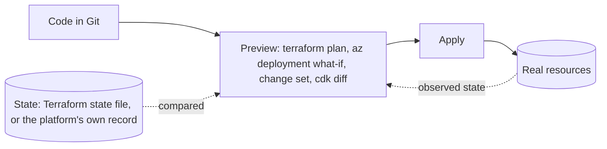

## Explanation

Infrastructure as Code (IaC) means that the virtual networks, subnets, compute, load balancers, databases, queues, identities and permissions a workload needs are written down in files, kept in version control, reviewed in pull requests, and applied by a tool, exactly as application code is. The alternative, clicking through a portal or typing ad-hoc CLI commands, leaves no diff, no review, no reproducible way to build a second environment, and no honest answer to "what changed on Tuesday?"

The decisive design choice is **declarative versus imperative**. A declarative tool takes a file that states the desired end state (there shall be a storage account named X with TLS 1.2 enforced) and computes the actions needed to get there; running it twice produces the same result, which is what idempotent means. An imperative tool runs the steps you wrote (create the account, then set the TLS version), so the author owns ordering, error handling and the "already exists" cases. The Azure Well-Architected Framework's recommendation OE:05 explicitly prefers declarative tooling and reserves scripts for the gaps.



How the tool knows the current state separates the main families:

- **Terraform** (HashiCorp) and its open-source fork **OpenTofu** (created under the Linux Foundation after Terraform moved to the Business Source License in August 2023, and a CNCF sandbox project since April 2025) describe resources in HCL and talk to any platform through providers. They keep a *state file* mapping each declared resource to the real one; `terraform plan` diffs configuration against state and the live API, `terraform apply` executes the plan in dependency order. Teams keep state in a remote backend with locking so that two applies cannot collide.
- **Bicep** and ARM templates are Azure-native and declarative. Bicep is a domain-specific language that the CLI transpiles into an ARM JSON template; Azure Resource Manager then orchestrates ordering and parallelism. There is no state file: Azure's own record of the resource group is the state, `what-if` previews the diff, and deployment stacks add lifecycle management so that removing a resource from the file can delete it (`--action-on-unmanage deleteAll`) and deny settings can block out-of-band edits.
- **CloudFormation** is the AWS equivalent: JSON or YAML templates create *stacks*, change sets preview an update before execution, failed updates roll back, and drift detection reports resources that were edited outside the stack. Detection on its own corrects nothing; since November 2025 a drift-aware change set (`--deployment-mode REVERT_DRIFT`) can put drifted properties back to the template's values as part of an update.
- **AWS CDK** and **Pulumi** let you write infrastructure in a general-purpose language. The CDK supports TypeScript, JavaScript, Python, Java, C#/.NET and Go, and `cdk synth` turns constructs into a CloudFormation template that CloudFormation then applies. The program is imperative; the model it emits and the reconciliation that follows are declarative.
- **Ansible**, Chef and Puppet sit one layer down as configuration management: they shape what runs *inside* a machine. **Kubernetes manifests**, Helm charts and GitOps controllers such as Flux and Argo CD apply the same reconcile-to-desired-state idea to clusters, and a **Docker Compose** file is IaC for a developer's laptop.

For the reader's stack, IaC shows up as the Compose file that starts the API, Redis and TimescaleDB locally, the Bicep or Terraform that creates the Azure resources, a CDK app written in C# when the target is AWS, and the pipeline job that runs the apply using a [workload identity](workload-identity.md) rather than a stored credential. Secrets never appear as values in any of these files; they are referenced by name from Key Vault or Secrets Manager. Policy as code (Azure Policy, Defender for Cloud's IaC scanning, CloudFormation Guard) reviews the templates before they reach production, which is the point: infrastructure changes become reviewable, testable and reversible.

## How it differs

**[Immutable infrastructure](immutable-infrastructure.md)** decides *how* a change reaches a running system; IaC decides *what* the system should look like. A Terraform-defined VM that a nightly playbook patches in place is IaC without immutability; a golden AMI baked by hand is immutability without IaC. They compose: IaC produces the image definition and the fleet definition, immutability makes the fleet match the code because nobody edits it afterwards.

**[Horizontal scaling](horizontal-scaling.md)** is the classic case where IaC and runtime disagree. A template declares a desired instance count; an autoscaler changes that number every few minutes. If the template keeps asserting its number, every apply snaps capacity back, usually at the worst moment. The fix is to let the autoscaler own the attribute: a Terraform `lifecycle { ignore_changes = [desired_capacity] }` on the Auto Scaling group, or, in Bicep, declaring a `Microsoft.Insights/autoscaleSettings` resource that owns the count and keeping the scale set's `sku.capacity` out of routine redeployments (ARM has no ignore-changes equivalent, so a template that sends a capacity resets it until autoscale reacts).

**[Secrets rotation](secrets-rotation.md)** is a runtime lifecycle, and IaC must stay out of its way. The template creates the vault, the secret *object* and the access policy, and the application setting holds a reference such as a Key Vault reference or a CloudFormation dynamic reference to Secrets Manager. The secret's value changes on rotation without a plan, an apply or a redeploy. Putting values in the file would also leak them into Git history and, for Terraform, into the state file, which stores attribute values in plain text and must be protected accordingly.

| Tool | Language | Scope | Source of truth for current state | Preview command |
| --- | --- | --- | --- | --- |
| Bicep / ARM | Declarative DSL to JSON | Azure | Azure Resource Manager | `az deployment group what-if` |
| CloudFormation | Declarative JSON/YAML | AWS | The stack | Change sets |
| AWS CDK | C#, Python, TypeScript, Java, Go | AWS (synthesises CloudFormation) | The stack | `cdk diff` |
| Terraform / OpenTofu | Declarative HCL | Any provider | State file plus live read | `terraform plan` |
| Ansible | Procedural YAML, idempotent modules | Inside machines | Re-checked on each run | `--check` mode |

## Examples

The same intent, "a private, versioned object store for application logs", in each tool. Notice that the Bicep and Terraform examples describe an Azure storage account while the CloudFormation and CDK examples describe an S3 bucket: the vocabulary differs, the shape (declare, preview, apply) does not.

=== "Bicep"

    ```bicep
    // main.bicep: az deployment group what-if -g rg-app -f main.bicep, then ... create
    param location string = resourceGroup().location
    param environment string

    resource logs 'Microsoft.Storage/storageAccounts@2023-05-01' = {
      name: 'stlogs${environment}${uniqueString(resourceGroup().id)}'
      location: location
      sku: { name: 'Standard_LRS' }
      kind: 'StorageV2'
      properties: {
        minimumTlsVersion: 'TLS1_2'
        supportsHttpsTrafficOnly: true
        allowBlobPublicAccess: false
      }
    }

    // Child resource: blob versioning. The symbolic reference creates the dependency; no dependsOn needed.
    resource blobService 'Microsoft.Storage/storageAccounts/blobServices@2023-05-01' = {
      parent: logs
      name: 'default'
      properties: { isVersioningEnabled: true }
    }

    output accountName string = logs.name
    ```

=== "CloudFormation"

    ```yaml
    # template.yaml: aws cloudformation deploy --stack-name logs --template-file template.yaml
    AWSTemplateFormatVersion: "2010-09-09"
    Parameters:
      Environment:
        Type: String
    Resources:
      LogsBucket:
        Type: AWS::S3::Bucket
        Properties:
          BucketName: !Sub "app-logs-${Environment}-${AWS::AccountId}"
          VersioningConfiguration:
            Status: Enabled
          PublicAccessBlockConfiguration:
            BlockPublicAcls: true
            BlockPublicPolicy: true
            IgnorePublicAcls: true
            RestrictPublicBuckets: true
    Outputs:
      BucketName:
        Value: !Ref LogsBucket
    ```

=== "Terraform"

    ```hcl
    # main.tf: terraform init && terraform plan -out=tfplan && terraform apply tfplan
    terraform {
      required_providers {
        azurerm = { source = "hashicorp/azurerm", version = "~> 4.0" }
      }
      backend "azurerm" {}   # remote state with locking; configured per environment
    }

    provider "azurerm" {
      features {}   # azurerm 4.x also needs subscription_id here or in ARM_SUBSCRIPTION_ID
    }

    variable "environment" { type = string }

    resource "azurerm_storage_account" "logs" {
      name                     = "stlogs${var.environment}"
      resource_group_name      = "rg-app"
      location                 = "westeurope"
      account_tier             = "Standard"
      account_replication_type = "LRS"
      min_tls_version          = "TLS1_2"
      allow_nested_items_to_be_public = false   # the azurerm default is true

      blob_properties {
        versioning_enabled = true
      }
    }
    ```

=== "C#"

    ```csharp
    // LogsStack.cs (AWS CDK v2 in C#): cdk diff, then cdk deploy. Package: Amazon.CDK.Lib
    using Amazon.CDK;
    using Amazon.CDK.AWS.S3;
    using Constructs;

    public sealed class LogsStack : Stack
    {
        public LogsStack(Construct scope, string id, IStackProps? props = null) : base(scope, id, props)
        {
            // An L2 construct: the CDK fills in secure defaults and synthesises AWS::S3::Bucket.
            var logs = new Bucket(this, "Logs", new BucketProps
            {
                Versioned = true,
                BlockPublicAccess = BlockPublicAccess.BLOCK_ALL,
                Encryption = BucketEncryption.S3_MANAGED,
                RemovalPolicy = RemovalPolicy.RETAIN   // never let a stack deletion take the logs with it
            });

            new CfnOutput(this, "BucketName", new CfnOutputProps { Value = logs.BucketName });
        }
    }
    ```

=== "Python"

    ```python
    # logs_stack.py (AWS CDK v2 in Python): cdk diff, then cdk deploy. Package: aws-cdk-lib
    from aws_cdk import CfnOutput, RemovalPolicy, Stack
    from aws_cdk import aws_s3 as s3
    from constructs import Construct


    class LogsStack(Stack):
        def __init__(self, scope: Construct, construct_id: str, **kwargs) -> None:
            super().__init__(scope, construct_id, **kwargs)

            logs = s3.Bucket(
                self,
                "Logs",
                versioned=True,
                block_public_access=s3.BlockPublicAccess.BLOCK_ALL,
                encryption=s3.BucketEncryption.S3_MANAGED,
                removal_policy=RemovalPolicy.RETAIN,
            )
            CfnOutput(self, "BucketName", value=logs.bucket_name)
    ```

**Previewing before applying** is the habit that separates IaC from scripting. Each family has a first-class way to see the diff:

```bash
az deployment group what-if --resource-group rg-app --template-file main.bicep --parameters environment=prod
aws cloudformation create-change-set --stack-name logs --change-set-name v2 --template-body file://template.yaml \
  --parameters ParameterKey=Environment,ParameterValue=prod
terraform plan -out=tfplan        # the saved plan is what apply executes, nothing else
cdk diff LogsStack
```

## Misconceptions

- **"IaC means Terraform."** Terraform is one declarative tool among several. Bicep and ARM, CloudFormation, the CDK, Pulumi, Kubernetes manifests, Helm and even a Compose file are all IaC; the discipline is versioned, reviewed, tool-applied definitions, not a vendor.
- **"The CDK is imperative, so it is not real declarative IaC."** You write imperative code, but it runs at synthesis time and emits a declarative CloudFormation template; CloudFormation, not your program, reconciles the stack. The same split applies to Pulumi's engine.
- **"Bicep must be worse than Terraform because it has no state file."** Bicep has no state file because Azure Resource Manager already holds the state; what-if compares against it. The trade-off surfaces on deletion: a resource removed from a Bicep file is not removed from Azure unless you use complete mode or a deployment stack, whereas Terraform's state lets `plan` propose the destroy.
- **"Once everything is IaC, drift is impossible."** IaC detects drift (CloudFormation drift detection, `terraform plan`, what-if); it only prevents drift if you also remove the ability to change resources by hand, through RBAC, deployment stack deny settings, or policy. CloudFormation also only checks properties the template sets explicitly.
- **"A change set or plan that looks fine will apply fine."** Previews validate the diff, not the outcome. Service quotas, runtime conditions and custom resource logic can still fail the apply, which is why rollback behaviour and pipeline gates still matter.

## Exam notes

Fundamentals exams (AZ-900, CLF-C02) ask what IaC is for: consistency, repeatability, version control, and the native tools (ARM/Bicep, CloudFormation). AZ-104 expects hands-on ARM and Bicep knowledge: interpreting and modifying a file, parameters, outputs, modules, what-if, exporting a deployment, and the difference between incremental and complete deployment modes. AZ-305 and AZ-400 (and its successor AZ-401) add tool selection (Bicep versus Terraform), desired state configuration, layering pipelines, policy as code, and treating IaC with the same quality gates as application code. On AWS, SAA-C03 and SAP-C03 test CloudFormation concepts such as stacks, nested stacks, StackSets for multi-account rollout, and change sets; SOA-C03 names CloudFormation, the CDK, StackSets and even Terraform in its objectives; DVA-C02/C03 add SAM and the CDK; DOP-C02 goes deepest, covering change sets, drift detection, stack policies, rollback behaviour, and CDK bootstrapping and pipelines. The HashiCorp Terraform Associate (TA-004) is entirely about the Terraform workflow: providers, the purpose of state, remote backends and locking, workspaces, modules, and reading a plan correctly. The Kubernetes exams (CKA, CKAD) reward the declarative habit of `kubectl apply` over imperative `kubectl create` and `edit`.

Common traps: an ARM incremental deployment never deletes resources that are missing from the template; a CloudFormation change set does not guarantee a successful update; drift detection by itself does not fix drift (a drift-aware change set or a fresh apply does); Terraform state can contain secrets and must be stored and access-controlled like one; and scaling attributes managed by an autoscaler must be excluded from the template or they will be reset on every apply.

## Self-check

??? question "A Bicep deployment that worked for months suddenly deletes a storage container's data on the next run. The team had switched the pipeline to complete mode to 'clean up unused resources'. What happened and what should they have used?"
    Complete mode deletes every resource in the resource group that is not in the template, so anything created outside the file, or in another template targeting the same group, was removed. Lifecycle management of a defined set of resources is what deployment stacks are for: the stack tracks exactly the resources it created, `--action-on-unmanage` controls whether removed resources are detached or deleted, and deny settings can prevent accidental deletion. Alternatively keep incremental mode and handle removals as explicit, reviewed deletions.

??? question "Every Terraform apply at 09:00 drops the production Auto Scaling group from 12 instances back to the 4 in the code, causing a short outage. Which concept is in conflict, and how do you fix it without abandoning IaC?"
    Declared capacity and autoscaler-managed capacity are fighting over the same attribute. Terraform owns `desired_capacity` in the configuration, while target-tracking scaling changes it at runtime. Add `lifecycle { ignore_changes = [desired_capacity] }` to the Auto Scaling group resource so Terraform stops reconciling that attribute, keep `min_size` and `max_size` in code because those are policy, and let the scaling policy own the live count.

??? question "Your .NET team wants to define AWS infrastructure in C# so that it lives in the same repository and review process as the application. A reviewer objects that 'C# is imperative, so it cannot be declarative IaC'. How do you respond?"
    With the AWS CDK, the C# program runs at synthesis time and produces a CloudFormation template; CloudFormation then creates a stack and reconciles it declaratively, with change sets for preview and rollback on failure. The imperative language is a code generator for a declarative model, which also gives you loops, type safety and unit tests over the constructs. The things to watch are the CDK bootstrap resources per account and region, and reviewing `cdk diff` output rather than only the C# diff, since a small code change can synthesise a large template change.

## Further reading

- [CI/CD pipelines](../devops/ci-cd-pipelines.md) for where IaC previews and applies run, and [Docker and containerization](../devops/docker-containerization.md) for Compose as developer-scale IaC.
- [Workload identity](../security/iam/workload-identity.md) for how a pipeline should authenticate when it applies infrastructure.
- Neighbouring terms: [Immutable Infrastructure](immutable-infrastructure.md), [Horizontal Scaling](horizontal-scaling.md), [Secrets Rotation](secrets-rotation.md), [Blue-Green Deployment](blue-green-deployment.md), [Rolling Deployment](rolling-deployment.md).
- [Bicep deployment stacks](https://learn.microsoft.com/en-us/azure/azure-resource-manager/bicep/deployment-stacks), [CloudFormation change sets](https://docs.aws.amazon.com/AWSCloudFormation/latest/UserGuide/using-cfn-updating-stacks-changesets.html), [CloudFormation drift detection](https://docs.aws.amazon.com/AWSCloudFormation/latest/UserGuide/using-cfn-stack-drift.html) and [Purpose of Terraform state](https://developer.hashicorp.com/terraform/language/state/purpose): the mechanics behind the comparison table.
- [OpenTofu introduction](https://opentofu.org/docs/intro/) for the Linux Foundation fork of Terraform.
