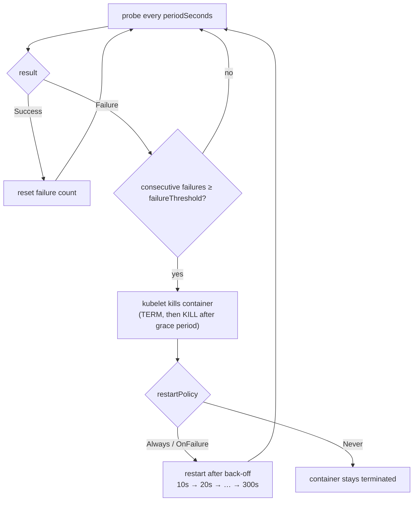

## Explanation

A liveness probe exists for one failure mode: a container whose process is still running but will never make progress again, typically a deadlock, a wedged event loop, or a runtime that has stopped scheduling work. The kubelet already restarts a container whose process exits, according to the Pod's `restartPolicy`; a liveness probe extends that to processes that are alive in the operating-system sense but dead in the application sense. The Kubernetes documentation is explicit that you only need one when the container cannot reliably crash on its own.

Mechanically, the kubelet runs the probe's diagnostic every `periodSeconds` (default 10, minimum 1), after `initialDelaySeconds` (default 0), with a `timeoutSeconds` of 1 by default. Four mechanisms exist: `exec` runs a command inside the container and succeeds on exit code 0; `httpGet` sends a request from the node and succeeds on any status from 200 to 399; `tcpSocket` succeeds if the port accepts a connection; `grpc` (stable since v1.27) calls the gRPC Health Checking Protocol and succeeds on `SERVING`, in plaintext by default and without named-port support. Each run yields `Success`, `Failure` or `Unknown`. After `failureThreshold` consecutive failures (default 3) the kubelet kills the container; `successThreshold` must be 1 for liveness. A kill means the container's processes get the termination signal, then after the grace period a kill signal, and a probe-level `terminationGracePeriodSeconds` can override the Pod's value for this specific case. The restart is governed by `restartPolicy`: `Always` (the default) and `OnFailure` restart, `Never` does not. Repeated restarts back off from 10 seconds, doubling to a cap of 300 seconds, reset after the container has run for 10 minutes; during the wait the Pod shows `CrashLoopBackOff`. Native [sidecar](sidecar-pattern.md) containers restart regardless of the Pod's policy.



Three interactions decide whether a liveness probe helps or hurts. First, a liveness probe does not wait for readiness; if the application needs longer than `initialDelaySeconds + failureThreshold × periodSeconds` to start, the probe kills it mid-startup, forever. The fix is a **startup probe** on the same endpoint with a large `failureThreshold`, because liveness and readiness are suspended until the startup probe succeeds. Second, the liveness diagnostic must not include dependencies: a probe that pings Redis turns a Redis outage into every API replica restarting at once, and the documentation warns that misconfigured liveness probes cause cascading failures under load. Third, timeouts are failures. A .NET service whose thread pool is starved or a Python service whose event loop is blocked will time out the HTTP probe; if the cause is a genuine hang the restart is right, if the cause is overload the restart throws away a replica exactly when capacity is scarce, which is why many teams raise `failureThreshold` for liveness above the readiness value, or probe a watchdog instead of the HTTP stack.

A watchdog is the most honest liveness signal for a worker. A Redis Streams consumer loop updates a timestamp each iteration; the liveness check fails only if the loop has been silent longer than its worst legitimate blocking time. That distinguishes "stuck" from "slow", which an HTTP round trip cannot.

The idea exists outside Kubernetes under other names. Azure Container Apps has a liveness probe with the same fields, limited to HTTP and TCP, and restarts the replica. Amazon ECS has no separate liveness concept: a container health check that fails `retries` times marks the container and its task `UNHEALTHY`, and a service replaces unhealthy tasks. Docker's `HEALTHCHECK` only records `unhealthy`; nothing restarts the container unless Swarm or an external tool does.

## How it differs

**[Readiness probe](readiness-probe.md).** Same mechanisms, opposite consequences. Readiness failure is a reversible traffic decision: the Pod's IP leaves the EndpointSlices and returns when the probe passes. Liveness failure is a destructive process decision. The practical rule: readiness may look outward (dependencies, warm-up, overload); liveness may only look inward (is this process able to run its loop). A common pattern from the Kubernetes documentation is the same cheap endpoint for both, with a higher `failureThreshold` on liveness so a replica is first withdrawn from traffic and only later killed.

**[Health check](health-check.md).** Liveness is one asker of a health check. The same ASP.NET Core registry can serve it, but the liveness endpoint should run no checks at all (`Predicate = _ => false`) or only checks tagged for liveness, such as a watchdog. Everything that pings a database belongs to another tag.

**[Backpressure](backpressure.md).** A saturated service is not a hung service. Backpressure (bounded queues, admission control, a readiness probe that fails under overload) sheds load while keeping the replica; a liveness probe that fails because requests are slow removes capacity and adds restart churn, the cascading failure the documentation warns about. If overload is the scenario, raise liveness tolerance and let readiness and autoscaling respond.

| | Liveness | Readiness | Startup |
| --- | --- | --- | --- |
| Question | is the process stuck? | may it take traffic now? | has it finished starting? |
| On failure | kill container, restart per policy | remove from endpoints | kill container |
| Runs | whole life, after startup probe | whole life, after startup probe | until first success |
| May test dependencies | no | yes, carefully | no |
| `successThreshold` | must be 1 | may be >1 | must be 1 |

## Examples

=== "C#"

    ```csharp
    using Microsoft.AspNetCore.Diagnostics.HealthChecks;
    using Microsoft.Extensions.Diagnostics.HealthChecks;

    var builder = WebApplication.CreateBuilder(args);
    builder.Services.AddSingleton<Heartbeat>();
    builder.Services.AddHostedService<StreamConsumer>();
    builder.Services.AddHealthChecks()
        .AddCheck<ConsumerLoopAlive>("consumer-loop", tags: ["live"]);

    var app = builder.Build();
    app.MapHealthChecks("/healthz/live", new HealthCheckOptions { Predicate = r => r.Tags.Contains("live") });
    app.Run();

    // Updated by the consumer loop on every iteration; read by the probe
    sealed class Heartbeat
    {
        private long _lastTick = Environment.TickCount64;
        public void Beat() => Volatile.Write(ref _lastTick, Environment.TickCount64);
        public TimeSpan Age => TimeSpan.FromMilliseconds(Environment.TickCount64 - Volatile.Read(ref _lastTick));
    }

    sealed class StreamConsumer(Heartbeat heartbeat) : BackgroundService
    {
        protected override async Task ExecuteAsync(CancellationToken stoppingToken)
        {
            while (!stoppingToken.IsCancellationRequested)
            {
                // XREADGROUP with a bounded BLOCK, then process the batch ...
                await Task.Delay(1000, stoppingToken);
                heartbeat.Beat();       // a deadlocked loop stops beating; a slow one still beats
            }
        }
    }

    sealed class ConsumerLoopAlive(Heartbeat heartbeat) : IHealthCheck
    {
        public Task<HealthCheckResult> CheckHealthAsync(HealthCheckContext context, CancellationToken ct = default)
            => Task.FromResult(heartbeat.Age < TimeSpan.FromSeconds(30)
                ? HealthCheckResult.Healthy()
                : HealthCheckResult.Unhealthy($"consumer loop silent for {heartbeat.Age.TotalSeconds:F0}s"));
    }
    ```

=== "Python"

    ```python
    import asyncio
    import time
    from contextlib import asynccontextmanager
    from fastapi import FastAPI, Response

    last_beat = time.monotonic()

    async def consumer_loop() -> None:
        global last_beat
        while True:
            # XREADGROUP ... BLOCK 1000, then process the batch
            await asyncio.sleep(1)
            last_beat = time.monotonic()      # a hung or deadlocked loop stops beating

    @asynccontextmanager
    async def lifespan(app: FastAPI):
        app.state.consumer = asyncio.create_task(consumer_loop())
        yield
        app.state.consumer.cancel()

    app = FastAPI(lifespan=lifespan)

    @app.get("/healthz/live")
    async def live(response: Response) -> dict:
        silent_for = time.monotonic() - last_beat
        if silent_for > 30:
            response.status_code = 503        # the kubelet counts any status outside 200-399 as a failure
            return {"status": "Unhealthy", "silent_for_s": round(silent_for)}
        return {"status": "Healthy"}          # a blocked event loop never answers: a timeout is also a failure
    ```

=== "Kubernetes"

    ```yaml
    containers:
      - name: api
        image: ghcr.io/example/market-api:2.3.0
        ports: [{ containerPort: 8080, name: http }]
        startupProbe:                       # up to 30 x 5s = 150s to start; liveness is paused until it passes
          httpGet: { path: /healthz/live, port: http }
          periodSeconds: 5
          failureThreshold: 30
        livenessProbe:                      # same cheap endpoint, no dependencies
          httpGet: { path: /healthz/live, port: http }
          periodSeconds: 10                 # default
          timeoutSeconds: 2                 # default is 1
          failureThreshold: 6               # ~60s of consecutive failures before a kill (default 3)
          terminationGracePeriodSeconds: 20 # probe-level override for liveness kills only
        readinessProbe:
          httpGet: { path: /healthz/ready, port: http }
          periodSeconds: 5
          failureThreshold: 3               # withdrawn from traffic well before liveness gives up
    ```

    ```bash
    kubectl describe pod market-api-7d9c6-xk2lp | grep -A3 Events   # "Liveness probe failed: ..." then "Killing"
    kubectl get pod market-api-7d9c6-xk2lp -o jsonpath='{.status.containerStatuses[0].restartCount}'
    ```

=== "Azure"

    ```yaml
    # Azure Container Apps: HTTP or TCP only; a failing liveness probe restarts the replica
    probes:
      - type: Liveness
        httpGet:
          path: /healthz/live
          port: 8080
        initialDelaySeconds: 5
        periodSeconds: 10
        timeoutSeconds: 2
        failureThreshold: 6
      - type: Startup
        httpGet:
          path: /healthz/live
          port: 8080
        periodSeconds: 3
        failureThreshold: 50
    ```

    If no probes are defined and ingress is enabled, Container Apps adds TCP default probes on the ingress port; a long-starting app then needs explicit probes to avoid being restarted before it is ready.

=== "AWS"

    ```json
    {
      "name": "consumer",
      "image": "123456789012.dkr.ecr.eu-west-1.amazonaws.com/stream-consumer:1.9.0",
      "essential": true,
      "healthCheck": {
        "command": ["CMD-SHELL", "test $(( $(date +%s) - $(cat /tmp/heartbeat) )) -lt 30 || exit 1"],
        "interval": 10,
        "timeout": 3,
        "retries": 3,
        "startPeriod": 60
      }
    }
    ```

    ECS has one health check per container, run inside the container, so a worker without an HTTP port writes a heartbeat file and the check compares its age. `retries` consecutive failures mark the container `UNHEALTHY`; because it is essential, the task becomes `UNHEALTHY` and the service scheduler replaces it. Failures inside `startPeriod` do not count until the first success.

## Misconceptions

- **"Liveness should check the database so a broken replica restarts."** A dependency outage then restarts every replica, and restarting does not fix the database. Dependencies belong in readiness; liveness checks only whether the process can still run its own loop.
- **"A liveness failure restarts the Pod."** It restarts the container. The Pod keeps its name, IP and volumes; `emptyDir` contents survive, and the restart counter on that container increments.
- **"Without a liveness probe Kubernetes never restarts anything."** A process that exits is restarted by `restartPolicy` regardless of probes. The probe only adds detection of processes that are running but hung.
- **"The probe runs inside my container."** Only `exec` does. HTTP, TCP and gRPC probes are issued by the kubelet from the node, which is why a container listening only on `127.0.0.1` fails HTTP probes unless `hostNetwork` and `host: 127.0.0.1` are set, and why a sidecar proxy can intercept them.
- **"Liveness runs from the first second."** With a startup probe configured, liveness does not run until the startup probe has succeeded; without one, `initialDelaySeconds` is the only delay, and it defaults to 0.

## Exam notes

CKAD is the exam that asks you to write one: a `livenessProbe` with `exec`, `httpGet` or `tcpSocket`, the defaults for `periodSeconds` and `failureThreshold`, the rule that `successThreshold` must be 1, and the diagnosis of a Pod that keeps restarting during a slow start (add a startup probe or raise the thresholds, do not remove readiness). CKA frames it as troubleshooting: `kubectl describe pod` events showing `Liveness probe failed` followed by `Killing`, a rising restart count, and `CrashLoopBackOff` with its doubling back-off.

AZ-204 and AZ-305 ask about Container Apps liveness probes (HTTP/TCP only, replica restart, default TCP probes with ingress) and expect you to pick liveness versus readiness for a described symptom. On the AWS side, DVA-C02 and SAA-C03 phrase the same idea as ECS container health checks and task replacement by the service scheduler; the trap is assuming ECS reads the image's `HEALTHCHECK` or has a readiness equivalent. SRE-flavoured questions in CKA and SAP-C03 test the cascading-failure trap: an overloaded fleet whose liveness probes time out gets smaller as it restarts, so the right answer raises tolerance or moves the dependency checks to readiness, not "add more probes".

## Self-check

??? question "A .NET 9 API takes two minutes to warm its TimescaleDB query cache. It is killed every 30 seconds with 'Liveness probe failed' and never serves a request. What is wrong and what is the fix?"
    With default values the liveness probe starts immediately, runs every 10 seconds and tolerates 3 failures, so a container that cannot answer for 30 seconds is killed before it finishes starting, restarts, and repeats forever (the restart back-off eventually reaches 5 minutes but the probe still fails after each start). Add a `startupProbe` on the same endpoint with `failureThreshold` and `periodSeconds` sized for the worst-case warm-up (for example 30 × 10 s); liveness and readiness are suspended until it succeeds, after which the default liveness settings are fine.

??? question "During a traffic spike your Angular SSR server's liveness probe (an HTTP GET) starts timing out, replicas restart, and the spike turns into an outage. Was the liveness probe right?"
    No. The replicas were overloaded, not hung; killing them removed capacity exactly when it was needed and the restarts added cold-start load, the cascading failure the Kubernetes documentation warns about. Keep liveness tolerant (higher `failureThreshold`, longer `timeoutSeconds`, or a watchdog that checks the event loop rather than HTTP round-trip time), let readiness withdraw saturated replicas, and let the autoscaler add capacity. Reserve liveness kills for processes that are provably stuck.

??? question "Your Redis Streams consumer has no HTTP server. How do you give it a meaningful liveness probe without inventing one?"
    Expose the loop's progress rather than its HTTP reachability. Record a heartbeat each iteration (an in-process timestamp exposed on a tiny health endpoint, or a file the loop touches) and make the probe fail when the heartbeat is older than the loop's longest legitimate blocking time, for example a 10-second `XREADGROUP BLOCK` plus processing. Use `exec` with a shell `test` on the file age if there is no port. A `tcpSocket` probe on a port the process never uses tells you nothing.

## Further reading

- [Docker & Containerization Trade-offs](../devops/docker-containerization.md), [Async & Threading in .NET](../messaging/runtime/async-threading.md) (thread-pool starvation makes HTTP probes time out) and [Redis Streams vs. Kafka](../messaging/eventing/redis-streams-vs-kafka.md) in this library.
- Term pages: [Readiness Probe](readiness-probe.md), [Health Check](health-check.md), [Backpressure](backpressure.md), [Sidecar Pattern](sidecar-pattern.md).
- [Liveness, Readiness, and Startup Probes](https://kubernetes.io/docs/concepts/configuration/liveness-readiness-startup-probes/), [Configure Liveness, Readiness and Startup Probes](https://kubernetes.io/docs/tasks/configure-pod-container/configure-liveness-readiness-startup-probes/) and [Pod Lifecycle](https://kubernetes.io/docs/concepts/workloads/pods/pod-lifecycle/) (Kubernetes).
- [Health probes in Azure Container Apps](https://learn.microsoft.com/en-us/azure/container-apps/health-probes) and [Amazon ECS container health checks](https://docs.aws.amazon.com/AmazonECS/latest/developerguide/healthcheck.html).
