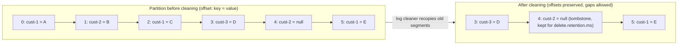

## Explanation

Log compaction is a retention mode for an append-only log in which the broker keeps *at least* the most recent record for each message key and discards older records that carry the same key. The log stays ordered and append-only, offsets never change, and nothing is reordered; what changes is that a reader starting from the beginning eventually sees the final value of every key rather than every intermediate write. Apache Kafka popularised the idea and the vocabulary for message logs, and Azure Event Hubs offers the same semantics under the same name.

The mechanics matter because they explain the guarantees. Kafka stores each partition as a sequence of segment files. The *active* segment, the one still being written, is never compacted. Background *log cleaner* threads pick the log whose head (not yet cleaned, "dirty" bytes) is largest relative to its tail, build an in-memory map of key to latest offset, then recopy the older segments while skipping any record whose key has a newer record. The rewritten segments are swapped in, reads are never blocked, and the extra disk space needed is roughly one segment. A record whose value is `null` is a *tombstone*: it deletes the key, suppresses earlier values, and is itself removed after `delete.retention.ms` (default 86400000 ms, one day). That window is how long a consumer starting from offset zero has to observe the delete; one that lags longer never learns the key existed.

The behaviour is tuned per topic. `cleanup.policy` is `delete` by default, can be `compact`, or both together so that very old segments are dropped and the rest is compacted. `min.cleanable.dirty.ratio` (default 0.5) means a log is not cleaned until more than half of it is dirty, so compaction is lazy by design. `min.compaction.lag.ms` (default 0) sets a floor on how long a record stays uncompacted, which gives slow consumers a chance to see every version; `max.compaction.lag.ms` (default the maximum long value) forces eligibility after a deadline even when the ratio has not been reached. `segment.ms` (default seven days) rolls the active segment so that its data can be cleaned at all. The design documentation states the guarantees plainly: consumers that keep up with the head see every record with sequential offsets; ordering is always maintained; the offset of a record is its permanent identifier; and a consumer reading from the start sees at least the final state of every key in the order it was written.

Why does this exist? Time- or size-based retention cannot promise a complete picture of state, because the write that established a key's current value eventually expires. Compaction turns a topic into a *changelog* whose size is bounded by the number of distinct keys, not by the write rate. That suits entity state (customer profiles, instrument reference data, configuration), restoring a service after a crash, warming caches, and [change data capture](change-data-capture.md) feeds. Kafka itself relies on it: committed consumer offsets live in the internal compacted topic `__consumer_offsets`, because the broker only needs the latest commit per partition. Event Hubs documents the same use cases (CDC, state for stream processors, event caching).

In the reader's stack the gap is instructive: Redis Streams have no compaction, only [MAXLEN trim](maxlen-trim.md), which evicts by count or ID, so current state in Redis lives in a hash keyed by entity id while the stream stays a history. The [Redis Streams vs. Kafka](../messaging/eventing/redis-streams-vs-kafka.md) article weighs that trade-off for the platform as a whole.



## How it differs

| Neighbour | Keeps | Removes | Bounded by | Typical use |
| --- | --- | --- | --- | --- |
| Log compaction | newest record per key | superseded records, expired tombstones | number of distinct keys | changelog of current state |
| [MAXLEN trim](maxlen-trim.md) | newest N entries (or IDs above a threshold) | oldest entries, whatever their key | entry count or time | bounded recent history in Redis |
| [Data retention policy](data-retention-policy.md) | everything younger than an age or under a size | oldest segments or rows | time or bytes | audit trails, replayable event history |
| [Change data capture](change-data-capture.md) | every row change as an event | nothing; it is a producer, not a store | the sink's retention | propagating database changes |
| [Materialized view](materialized-view.md) | a precomputed query result | stale rows on refresh | the query's result set | fast reads inside the database |

**Versus MAXLEN trim.** Redis trimming answers "how much history do I keep?" and ignores keys entirely: `XADD ... MAXLEN ~ 100000` keeps roughly the newest hundred thousand entries, and an entity updated an hour ago can be gone while an entity updated yesterday is still there if the stream is quiet. Compaction answers "what is the latest value of each key?" and keeps a record for years if nothing supersedes it. Choose trimming for recent-window workloads (ticks, telemetry) and compaction for state.

**Versus a data retention policy.** Retention is calendar or capacity driven, deterministic and easy to reason about: everything older than seven days disappears. Compaction is driven by supersession and a dirty ratio, so a topic can hold a three-year-old record next to one from a second ago. The two combine (`cleanup.policy=compact,delete`) when you want a changelog but also a hard cap on how long dead keys linger.

**Versus change data capture.** CDC is the act of extracting row-level changes from a database log into events; compaction is a way of storing those events. A CDC topic that is *not* compacted is a complete history that grows forever; a compacted CDC topic is a bootstrap-able snapshot where each primary key appears with its latest row image and deletes arrive as tombstones. Most CDC deployments use the compacted form for the "load the current table" case and a retained form when the full history matters.

**Versus a materialized view.** A view is computed and queried inside one database and refreshed by that database. A compacted topic is not queryable: every consumer must replay it into its own store (a hash in Redis, a table in TimescaleDB, an in-memory map) to answer questions. The topic is the integration contract; the view is a local optimisation.

## Examples

A reference-data service publishes every customer profile change keyed by customer id. New services bootstrap by reading the topic from the beginning, then follow it live.

=== "C#"

    ```csharp
    using Confluent.Kafka;
    using Confluent.Kafka.Admin;

    const string bootstrap = "kafka:9092";

    using var admin = new AdminClientBuilder(new AdminClientConfig { BootstrapServers = bootstrap }).Build();
    await admin.CreateTopicsAsync([
        new TopicSpecification
        {
            Name = "customer-profile",
            NumPartitions = 6,
            ReplicationFactor = 3,
            Configs = new Dictionary<string, string>
            {
                ["cleanup.policy"] = "compact",
                ["min.cleanable.dirty.ratio"] = "0.2",   // clean sooner than the 0.5 default
                ["delete.retention.ms"] = "86400000",    // tombstones stay visible for one day
            },
        },
    ]);

    using var producer = new ProducerBuilder<string, string?>(new ProducerConfig { BootstrapServers = bootstrap }).Build();

    // The entity id is the key, so compaction keeps the newest version per customer.
    await producer.ProduceAsync("customer-profile", new Message<string, string?> { Key = "cust-42", Value = """{"tier":"gold"}""" });
    await producer.ProduceAsync("customer-profile", new Message<string, string?> { Key = "cust-42", Value = """{"tier":"platinum"}""" });

    // A null value is a tombstone: the key is deleted once the cleaner runs and delete.retention.ms has passed.
    await producer.ProduceAsync("customer-profile", new Message<string, string?> { Key = "cust-42", Value = null });
    ```

=== "Python"

    ```python
    from confluent_kafka import Producer
    from confluent_kafka.admin import AdminClient, NewTopic

    conf = {"bootstrap.servers": "kafka:9092"}

    admin = AdminClient(conf)
    futures = admin.create_topics([
        NewTopic(
            "customer-profile",
            num_partitions=6,
            replication_factor=3,
            config={
                "cleanup.policy": "compact",
                "min.cleanable.dirty.ratio": "0.2",
                "delete.retention.ms": "86400000",
            },
        )
    ])
    for topic, fut in futures.items():
        fut.result()  # raises if the topic could not be created

    producer = Producer(conf)
    producer.produce("customer-profile", key="cust-42", value=b'{"tier":"gold"}')
    producer.produce("customer-profile", key="cust-42", value=b'{"tier":"platinum"}')
    producer.produce("customer-profile", key="cust-42", value=None)  # tombstone
    producer.flush()
    ```

=== "Azure"

    Azure Event Hubs supports log compaction per event hub (Kafka topic) on the Standard, Premium and Dedicated tiers; the Basic tier does not. The partition key you set on each event is the compaction key, and a tombstone is an event with an existing key and a `null` payload, retained for the configured tombstone retention time. The service runs the compaction job itself and does not let you trigger it, so several payloads for one key can coexist between runs. Compacted event hubs are capped at 1 GB per partition on Standard and 250 GB per partition on Premium and Dedicated. Kafka clients such as the ones above can produce to a compacted event hub through the Event Hubs Kafka endpoint once their connection settings point at the namespace (SASL over TLS), but the cleaner-tuning configs such as `min.cleanable.dirty.ratio` are Apache Kafka broker settings: Event Hubs decides when and how fast to compact, and the only knobs it documents are the cleanup policy and the tombstone retention time.

=== "AWS"

    Amazon MSK runs Apache Kafka, so `cleanup.policy=compact` and the tuning knobs above apply exactly as written. Amazon Kinesis Data Streams has no key-based compaction: records are retained by time only, 24 hours by default and up to 8760 hours (365 days), with extra charges beyond 24 hours. If a Kinesis-based design needs a rebuildable snapshot of current state, keep that state in DynamoDB or another store and treat the stream as history, or choose MSK for the changelog topics.

## Misconceptions

- **"A compacted topic contains exactly one record per key."** It contains *at least* one. The head of the log (the active segment and anything newer than the last clean) still holds every version, and the cleaner only runs once the dirty ratio or the maximum lag is exceeded. Consumers must tolerate duplicates per key by always taking the latest.
- **"Compaction makes the topic a complete event history."** The opposite: intermediate versions are removed on purpose. If an audit trail or event sourcing needs every change, keep a separately retained topic or use `compact,delete` carefully with the understanding that history is still lost within a key.
- **"Deleting a key is immediate and permanent for everyone."** The tombstone is applied when the cleaner next runs, and it is visible only for `delete.retention.ms`. A consumer that was offline longer than that never learns about the delete and may keep a stale key forever unless it rebuilds from scratch.
- **"Compaction frees disk as soon as I overwrite a key."** It is a lazy, background, ratio-triggered rewrite that costs CPU and I/O when it runs and roughly one extra segment of disk. Event Hubs goes further and does not even expose when its job runs.
- **"Redis Streams can do this with MAXLEN."** MAXLEN keeps the newest entries by position, not by key; a quiet entity's last update can be evicted while a chatty entity keeps hundreds of versions. The Redis equivalent of a compacted changelog is a hash or JSON key per entity, updated alongside the stream.

## Exam notes

No exam in this library tests Kafka internals directly, but the design decision behind compaction shows up repeatedly. AWS Certified Data Engineer – Associate (DEA-C01) and AWS Certified Solutions Architect – Associate (SAA-C03) expect you to pick between Amazon Kinesis Data Streams and Amazon MSK for streaming workloads; the trap is assuming Kinesis can act as a durable changelog, when its retention is purely time-based and tops out at a year. Designing Microsoft Azure Infrastructure Solutions (AZ-305) asks for a messaging or event-driven architecture recommendation, where Event Hubs (with or without compaction) competes with Service Bus and Event Grid; compaction is the tell that the scenario needs "latest state per key" rather than a queue. AWS Certified Developer – Associate (DVA-C03) covers streaming data handling and event-driven patterns at the code level, where the distinction between a history you replay and a snapshot you rebuild decides how a new consumer bootstraps. Across all of them, remember that compaction preserves ordering and offsets, uses null values as tombstones, and is a per-topic setting that can be combined with time-based deletion.

## Self-check

??? question "A new pricing service must start with the current reference data for 2 million instruments and then follow updates. The reference-data team publishes to a Kafka topic with the default cleanup policy and seven-day retention. Why will the bootstrap be incomplete, and what should change?"
    With `cleanup.policy=delete` the topic only holds the last seven days of updates, so any instrument not touched in that window is missing and the new consumer cannot rebuild the full set. Switching the topic to `cleanup.policy=compact` keeps the latest record for every instrument id indefinitely (bounded by the number of keys), so reading from offset zero yields a complete snapshot followed by live changes. Deletions must then be published as tombstones (null values) rather than relying on expiry.

??? question "Your consumer rebuilt its cache from a compacted topic after a two-week outage and now serves customers that were deleted ten days ago. What happened?"
    The deletes were published as tombstones, but tombstones are only retained for `delete.retention.ms` (one day by default). The cleaner removed them before the consumer came back, so the replay contained neither the old values (compacted away) nor the delete markers. Fixes include raising `delete.retention.ms` to cover realistic outages, having long-offline consumers rebuild from an authoritative store, or reconciling against a periodic full snapshot.

??? question "A team wants Redis Streams to behave like a compacted topic by trimming with MAXLEN ~ 10000. Will that work?"
    No. MAXLEN evicts the oldest entries by position regardless of key, so an entity whose last update is older than the newest ten thousand entries disappears while a frequently updated entity keeps many versions. Redis Streams have no key-based retention; keep the current state in a hash or JSON document per entity and use the stream as a bounded history, or move the changelog to Kafka or Event Hubs where compaction exists.

## Further reading

- [Redis Streams vs. Kafka](../messaging/eventing/redis-streams-vs-kafka.md) for the platform-level trade-off behind this term.
- [Delivery semantics](../messaging/eventing/delivery-semantics.md) and [the outbox pattern](../messaging/eventing/outbox-pattern.md) for how records get into the topic reliably in the first place.
- [MAXLEN trim](maxlen-trim.md), [data retention policy](data-retention-policy.md), [change data capture](change-data-capture.md) and [consumer group](consumer-group.md).
- Apache Kafka design documentation, Log Compaction: <https://kafka.apache.org/43/design/design/>
- Azure Event Hubs log compaction: <https://learn.microsoft.com/en-us/azure/event-hubs/log-compaction>
