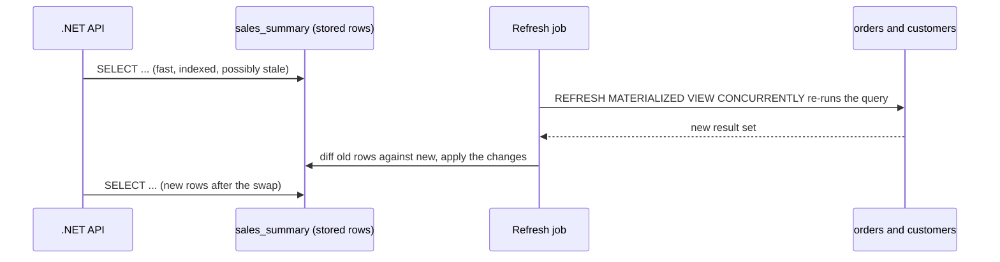

## Explanation

A materialized view is a query whose result rows are physically stored. An ordinary view is a saved query re-executed on every reference; `CREATE TABLE AS` stores rows but forgets the query. A materialized view does both: PostgreSQL keeps the defining query in the catalog and persists the rows in table-like storage, so a query against it reads stored rows and never touches the base tables. The point is to pay for an expensive join or aggregation once and serve it many times: dashboard summaries, denormalised read models, or an indexable local copy of data reached through a foreign data wrapper.

The PostgreSQL mechanics are plain. `CREATE MATERIALIZED VIEW name AS query` runs the query and stores the rows; `WITH NO DATA` creates the definition but leaves the view unscannable until its first refresh. Its rows cannot be modified directly; `REFRESH MATERIALIZED VIEW name` re-runs the query and replaces everything. The plain form is fastest when many rows change but blocks readers while it runs. `REFRESH MATERIALIZED VIEW CONCURRENTLY` builds the new result on the side, computes the difference and applies it, so readers keep seeing the old rows until the swap; it needs at least one `UNIQUE` index on plain column names (no expressions, no `WHERE` clause), the view must already be populated, and it is usually slower when most rows change. Either way only one refresh runs against a view at a time, the refresher needs the `MAINTAIN` privilege, and an `ORDER BY` in the definition is not guaranteed to survive a refresh. Because the rows are stored you can put a [B-tree](b-tree-index.md) or any other index on them; the manual's own example turns a 188 ms lookup through a file wrapper into a 0.117 ms index-only scan.

Freshness is the design decision. Between refreshes the view is stale, and nothing in PostgreSQL knows how stale; you choose the cadence (`pg_cron`, a hosted service, a pipeline step) and tell consumers what they are looking at. Other engines differ. SQL Server and Azure SQL *indexed views* are maintained synchronously: once a unique clustered index exists on a schema-bound view, every `INSERT`, `UPDATE` or `DELETE` on the base tables updates the view inside the same statement, so reads are always current and writes pay for it, hence the restricted definitions (`COUNT_BIG` with `GROUP BY`, no outer joins, no `DISTINCT`). Amazon Redshift refreshes incrementally where the SQL allows, can auto-refresh when base tables change, and rewrites queries to use a view they never mention. Azure Data Explorer and Fabric Eventhouse keep a materialized part plus a delta of unprocessed rows and combine them at query time, so the view is always fresh unless you ask for the materialized part only. TimescaleDB's [continuous aggregate](continuous-aggregate.md) refreshes only the time buckets that changed and can merge live rows on read. The `pg_ivm` extension adds immediate incremental maintenance to PostgreSQL through `AFTER` triggers, for a defined set of query shapes.

The costs are storage for a second copy, the CPU of each refresh, the write overhead of any synchronous variant, and the risk that a consumer forgets it is reading a snapshot. For a .NET 9 service the view is just another relation: map it in EF Core as a keyless entity (`HasNoKey().ToView("sales_summary")`), read it through Npgsql, and run the refresh from a `BackgroundService` on a `PeriodicTimer`, or from `pg_cron` on a managed server. [Redis Streams vs Kafka](../messaging/eventing/redis-streams-vs-kafka.md) and the [outbox pattern](../messaging/eventing/outbox-pattern.md) cover projecting state outside the database instead.



## How it differs

**[Continuous aggregate](continuous-aggregate.md).** Both store a precomputed result, but a continuous aggregate is a time-series specialisation: its definition must group by `time_bucket()` over a hypertable, an invalidation log records which buckets changed, a policy refreshes only those buckets on a schedule, and real-time aggregation can union the unmaterialised tail at query time. A PostgreSQL materialized view accepts any SQL and refreshes everything every time. Pick the continuous aggregate for rollups over growing time-series data on TimescaleDB; pick the materialized view for everything else, including engines where TimescaleDB is not available.

**[Change data capture](change-data-capture.md).** CDC reads the database's change log and streams inserts, updates and deletes to consumers. It answers the same need, a derived read model, from the outside: the projection lives in Redis, Elasticsearch or another service and is updated as events arrive, with its own consistency lag. A materialized view keeps the projection inside the same database, with transactional consistency at refresh time and no extra infrastructure, but it cannot feed another system. Many architectures use both: a materialized view for in-database reporting and CDC through an [outbox](transactional-outbox.md) for cross-service projections.

**[Log compaction](log-compaction.md).** A compacted Kafka topic deletes older records for a key and keeps the latest, so the topic itself becomes a materialised current-state table that any consumer can replay to rebuild its own view. That is state materialisation by key, with no joins or aggregates; a materialized view is materialisation by query. Compaction suits event-driven systems that need a rebuildable source of truth per entity; the view suits a relational system that needs an expensive query answered fast.

**[MVCC](mvcc.md).** Multi-version concurrency control also hands readers a snapshot, but a transient one: each transaction sees the row versions committed when it started, assembled on read and never stored. A materialized view is a snapshot made durable, taken at refresh time and served unchanged to every reader until the next refresh. The practical link is that `REFRESH ... CONCURRENTLY` relies on MVCC to let readers keep the old rows while the diff is applied, and that a long refresh, like any long transaction, holds back vacuum on the base tables while it runs.

| | Plain view | PostgreSQL materialized view | SQL Server indexed view | Continuous aggregate | Kusto materialized view |
|---|---|---|---|---|---|
| Stored rows | no | yes | yes | yes | yes, plus delta |
| Kept current by | re-running the query | `REFRESH` on demand | the writing statement | policy per bucket | background materialisation plus delta on read |
| Freshness | always | last refresh | always | last refresh or live | always |
| Write overhead | none | none | every DML on base tables | ingest unaffected | ingest unaffected |
| Definition limits | none | none | strict (`SCHEMABINDING`, `COUNT_BIG`, no outer joins) | `time_bucket` grouping, limited joins | aggregation query, set of supported functions |

## Examples

A daily sales summary that a dashboard reads thousands of times an hour:

```sql
CREATE MATERIALIZED VIEW sales_summary AS
SELECT customer_id,
       placed_at::date                  AS order_day,
       sum(total_amount)::numeric(14,2) AS sales_amt
FROM orders
WHERE placed_at < date_trunc('day', now())   -- today is incomplete; serve it from a live query
GROUP BY customer_id, placed_at::date;

-- Required for CONCURRENTLY: a UNIQUE index on plain columns, no WHERE, no expressions.
CREATE UNIQUE INDEX sales_summary_customer_day ON sales_summary (customer_id, order_day);

-- Readers keep the old rows until the diff is applied.
REFRESH MATERIALIZED VIEW CONCURRENTLY sales_summary;

-- Schedule it on a managed server with pg_cron (available on Azure flexible server and RDS).
SELECT cron.schedule('refresh-sales-summary', '*/15 * * * *',
                     $$REFRESH MATERIALIZED VIEW CONCURRENTLY sales_summary$$);

-- Free the storage but keep the definition; the view is unscannable until the next refresh.
REFRESH MATERIALIZED VIEW sales_summary WITH NO DATA;
```

=== "C#"

    ```csharp
    // EF Core 9: a materialized view is read like any relation; map it as a keyless entity.
    public sealed class SalesSummaryRow
    {
        public long CustomerId { get; init; }
        public DateOnly OrderDay { get; init; }
        public decimal SalesAmt { get; init; }
    }

    protected override void OnModelCreating(ModelBuilder modelBuilder)
        => modelBuilder.Entity<SalesSummaryRow>().HasNoKey().ToView("sales_summary");

    // Refresh on a timer from a hosted service; CONCURRENTLY keeps the dashboard readable.
    public sealed class SalesSummaryRefresher(NpgsqlDataSource dataSource, ILogger<SalesSummaryRefresher> log)
        : BackgroundService
    {
        protected override async Task ExecuteAsync(CancellationToken stoppingToken)
        {
            using var timer = new PeriodicTimer(TimeSpan.FromMinutes(15));
            while (await timer.WaitForNextTickAsync(stoppingToken))
            {
                try
                {
                    await using var cmd = dataSource.CreateCommand(
                        "REFRESH MATERIALIZED VIEW CONCURRENTLY sales_summary");
                    cmd.CommandTimeout = 600;
                    await cmd.ExecuteNonQueryAsync(stoppingToken);
                    log.LogInformation("sales_summary refreshed at {Time}", DateTimeOffset.UtcNow);
                }
                catch (PostgresException ex)
                {
                    // A refresh that overlaps a previous one waits for it; a missing unique
                    // index or an unpopulated view surfaces here as an error.
                    log.LogError(ex, "sales_summary refresh failed: {Message}", ex.MessageText);
                }
            }
        }
    }
    ```

=== "Python"

    ```python
    from datetime import date
    from decimal import Decimal
    import psycopg

    # REFRESH ... CONCURRENTLY may run inside a transaction; the context manager
    # commits on a clean exit, and readers switch to the new rows at that point.
    def refresh_sales_summary(conninfo: str) -> None:
        with psycopg.connect(conninfo) as conn:
            conn.execute("REFRESH MATERIALIZED VIEW CONCURRENTLY sales_summary")

    def top_customers(conninfo: str, day: date) -> list[tuple[int, Decimal]]:
        with psycopg.connect(conninfo) as conn:
            return conn.execute(
                """
                SELECT customer_id, sales_amt FROM sales_summary
                WHERE order_day = %s
                ORDER BY sales_amt DESC LIMIT 10
                """,
                (day,),
            ).fetchall()
    ```

=== "Azure"

    Azure Database for PostgreSQL flexible server supports materialized views as above, with `pg_cron` in its extension catalogue for scheduling the refresh and `pg_ivm` for immediate incremental maintenance of views that fit its supported query shapes.

    Azure SQL Database and Azure SQL Managed Instance use indexed views: create the view `WITH SCHEMABINDING`, add a unique clustered index, and the engine maintains it synchronously as part of every write to the base tables. Azure SQL uses the indexed view automatically even when a query does not name it; on SQL Server Standard edition you need the `NOEXPAND` hint. The restrictions (deterministic expressions, `COUNT_BIG(*)` with `GROUP BY`, no outer joins, no `DISTINCT`, no subqueries) are the price of synchronous maintenance.

    Azure Data Explorer and Fabric Eventhouse materialized views are aggregation queries kept as a materialized part plus a delta, always fresh when queried by name and faster but possibly stale through `materialized_view('Name')`; their retention policy applies to the view, not to the source table.

=== "AWS"

    Amazon RDS for PostgreSQL and Aurora PostgreSQL behave like the examples above and include `pg_cron` for scheduling.

    Amazon Redshift materialized views are the richer option: `REFRESH MATERIALIZED VIEW` applies only the changes since the last refresh where the SQL permits, `AUTO REFRESH YES` lets Redshift refresh when base tables change and resources allow, the optimizer rewrites eligible queries to use a view they never reference, views can be stacked on views, and a view can ingest straight from Kinesis Data Streams or MSK. Redshift can also store a materialized view as an Apache Iceberg table in S3 so that Athena, Spark and other engines read the same result.

## Misconceptions

- **"A materialized view updates itself."** In PostgreSQL it changes only when something runs `REFRESH`; the stored rows are a snapshot. Synchronous maintenance is a property of SQL Server indexed views and of engines such as Kusto, not of the term in general.
- **"`CONCURRENTLY` is the faster option."** It exists so that readers are not blocked. It computes a diff and applies it row by row, which is slower than the plain form when most of the result changes, and it needs a unique index and a populated view before it will run.
- **"You cannot index a materialized view."** You can, and you usually should; indexing the stored rows is one of the main reasons to materialise, especially over data reached through a foreign data wrapper that supports no indexes of its own.
- **"`WITH NO DATA` gives a lazily populated view."** It creates an unscannable object. Any query against it fails until a `REFRESH` populates it, which makes it useful for deployment scripts and useless as a cache that fills itself.
- **"It is only a cache, so staleness is harmless."** A dashboard reading yesterday's numbers is fine; a pricing or limits decision reading a fifteen-minute-old balance is not. Record the refresh time alongside the data and keep operational decisions on the base tables.

## Exam notes

DEA-C01 tests Amazon Redshift materialized views by name under data-store management: incremental refresh, automatic refresh, automatic query rewrite and streaming ingestion into a materialized view, usually contrasted with Redshift Spectrum and federated queries. DP-700 and DP-600 test Kusto materialized views in Fabric Real-Time Intelligence, contrasted with update policies, and whether to query the whole view or the materialized part. DP-300 includes indexed views as part of index strategy on Azure SQL, with the `SCHEMABINDING` and determinism requirements as the usual trick. AZ-305 asks when precomputation is the right answer to a reporting-latency requirement. The traps: assuming any materialized view is incrementally maintained (PostgreSQL's is not), forgetting the unique index requirement for a non-blocking refresh, and choosing an indexed view on a write-heavy SQL Server table without accounting for the synchronous maintenance cost on every DML statement.

## Self-check

??? question "A report query joins five tables and takes 40 seconds; the dashboard runs it every page load, and the data may be up to an hour old. What do you build, and what must you add before refreshing it without blocking readers?"
    A materialized view holding the join result, with indexes on the columns the dashboard filters by, refreshed by a scheduled job. To use `REFRESH MATERIALIZED VIEW CONCURRENTLY` so that readers never block, add a `UNIQUE` index on plain column names covering every row (no `WHERE`, no expression columns) and populate the view once with a plain refresh first.

??? question "A .NET team moves a reporting materialized view from PostgreSQL to Azure SQL as an indexed view and finds order inserts are now 30 percent slower. What happened?"
    Indexed views are maintained synchronously: the engine updates the view's clustered index inside every `INSERT`, `UPDATE` and `DELETE` that touches the base tables. The PostgreSQL view cost nothing on the write path because it was refreshed on a schedule. Either accept the trade for always-current reads, simplify the view, or move the rollup to a scheduled process such as a staging table refreshed by a job.

??? question "You need the same precomputed rollup inside the database for reports and in Redis for an API cache. Is a materialized view the right tool for both?"
    For the in-database report, yes. A materialized view cannot push its rows anywhere, so the Redis projection needs a different mechanism: change data capture or an outbox publishing events that a consumer applies to Redis, or a job that reads the view after each refresh and writes the cache. Decide which copy is authoritative and how far behind the other may be.

## Further reading

- [Relational Databases](../data/relational/relational-databases.md), engine differences that decide how a view can be maintained.
- [Redis Streams vs Kafka](../messaging/eventing/redis-streams-vs-kafka.md) and the [Outbox Pattern](../messaging/eventing/outbox-pattern.md), for projecting state outside the database.
- [Continuous Aggregate](continuous-aggregate.md), [Change Data Capture](change-data-capture.md), [Log Compaction](log-compaction.md), [Transactional Outbox](transactional-outbox.md), [B-Tree Index](b-tree-index.md).
- [Materialized views in Kusto](https://learn.microsoft.com/en-us/kusto/management/materialized-views/materialized-view-overview), the materialized-part-plus-delta model.
- [pg_ivm](https://github.com/sraoss/pg_ivm), incremental view maintenance for PostgreSQL.
