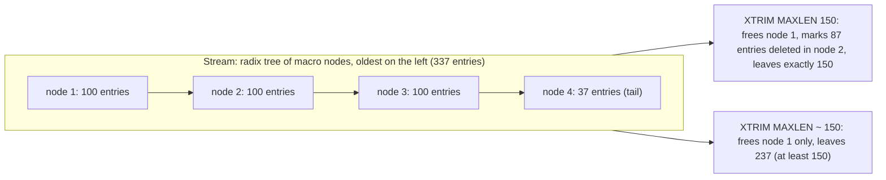

## Explanation

A Redis Stream is an append-only log held in memory, and `XADD` is an O(1) append that never removes anything on its own. Left alone, a tick feed or an event bus on Redis grows until the instance runs out of memory. *Trimming* is the mechanism that bounds it, and it comes in two strategies that you can attach to every `XADD` or run separately with `XTRIM`:

- `MAXLEN threshold` evicts entries from the oldest end for as long as the stream is longer than the threshold, so the stream keeps its newest `threshold` entries.
- `MINID threshold` (Redis 6.2 and later) evicts every entry whose ID is lower than the threshold and keeps the rest. Because stream IDs are `<milliseconds>-<sequence>`, a MINID of "now minus 24 hours" is a time-based retention policy, which Redis does not otherwise offer.

Both strategies are *exact* by default (written `=`), meaning the stream ends up with precisely the minimum of its current length and the threshold, or precisely no IDs below the threshold. Exact trimming can be expensive, and the reason is the data structure. A stream is a radix tree whose leaves are *macro nodes*, each a packed node holding up to `stream-node-max-entries` entries (default 100) or `stream-node-max-bytes` bytes (default 4096), whichever limit is reached first. Removing a whole node is one deallocation; removing part of a node means marking entries deleted inside its packed listpack, which costs work per entry and frees no memory until the whole node goes. The `~` operator asks for *approximate* trimming: Redis stops as soon as it would have to split a node, so the stream keeps *at least* the threshold and possibly a few tens of entries more; `MAXLEN ~ 1000` may leave 1000, 1010 or 1030 entries, never fewer than 1000. Approximate trimming is what you want in nearly every producer path. A second lever, `LIMIT count` (6.2 and later, only meaningful with `~`), caps how many entries one call may evict; when omitted, Redis uses 100 times the entries per macro node, and `LIMIT 0` removes the cap. `NOMKSTREAM` on `XADD` (6.2) stops an add from creating a stream that was trimmed or deleted away.

Trimming is where Redis Streams and consumer groups collide. A group's pending entries list (PEL) records which consumer was delivered which ID and awaits `XACK`; trimming does not consult it. Until Redis 8.2 the default was the only behaviour: entries vanish while their PEL references remain. Redis 8.2 added three modes on `XADD` and `XTRIM`: `KEEPREF` (the default, trims regardless of groups and keeps the dangling references), `DELREF` (trims and removes the references from every group's PEL) and `ACKED` (only trims entries that every group has read and acknowledged, still stopping at the MAXLEN limit if too many are referenced). A consumer that falls behind the trim horizon on `KEEPREF` gets no error; the entries are simply gone, which is why "my consumer skipped events" on a quiet weekend is usually a trimming story, not a delivery story. The library's [Redis Streams vs. Kafka](../messaging/eventing/redis-streams-vs-kafka.md) comparison treats this as the central operational difference from Kafka, whose retention is disk-backed and whose [log compaction](log-compaction.md) is key-aware.

In the reader's stack, the producer writes `XADD ticks:EURUSD MAXLEN ~ 100000 * ...` so memory is a known budget, a housekeeping job runs `XTRIM ... MINID ~ <cutoff>` to enforce a time window, and the MAXLEN figure is derived from peak insert rate times the longest acceptable consumer outage. With TimescaleDB as the durable history, the stream only has to cover the time it takes a consumer to restart and catch up.



## How it differs

| Neighbour | What it bounds | Loses data? | Key-aware? | Where it runs |
| --- | --- | --- | --- | --- |
| MAXLEN / MINID trim | stream length or oldest ID | yes, oldest entries | no | Redis, on write or on a schedule |
| [Log compaction](log-compaction.md) | one record per key | superseded versions only | yes | Kafka broker background cleaner |
| [Backpressure](backpressure.md) | work in progress | no | n/a | between producer and consumer |
| [Data retention policy](data-retention-policy.md) | age or size of stored data | yes, oldest data | no | platform (Kafka, TimescaleDB, Event Hubs) |
| [Consumer group](consumer-group.md) | nothing; it tracks delivery | no | n/a | Redis, per group |

**Versus log compaction.** The two are often confused because both "keep the stream from growing forever". Compaction keeps the latest value of every key and removes the rest; trimming keeps the newest entries and removes the oldest, whatever their keys. If the stream carries entity updates and you need "the current value of each entity", trimming is the wrong tool; keep that state in a hash or move the changelog to Kafka or Event Hubs.

**Versus backpressure.** Trimming is a memory budget enforced by discarding; backpressure is a flow budget enforced by waiting. A tick flood with `MAXLEN ~ 100000` never blocks the producer and never runs out of memory, but a slow consumer silently loses the oldest ticks. A bounded channel between the feed and the consumer would instead slow the feed down and lose nothing. Use trimming when the history has a natural horizon and staleness is acceptable; use backpressure when every message must be processed.

**Versus a data retention policy.** Platforms with disk-backed logs give you declarative time-based retention (`retention.ms` in Kafka, retention periods in Event Hubs and Kinesis). Redis has no per-entry TTL and the guide notes that a built-in "older than" trim was avoided because it could block for a long time after an insertion spike. MINID with a scheduled `XTRIM` is how you build the same policy, and `LIMIT` is how you keep each run short.

**Versus a consumer group.** A group remembers what each consumer has been delivered; trimming forgets entries. With the default `KEEPREF` mode the PEL can reference IDs that no longer exist, and a group that was created with `$` after a trim never sees the trimmed history. Only `ACKED` (Redis 8.2) makes trimming defer to acknowledgement, at the cost of letting a stuck consumer hold memory.

## Examples

A market-data gateway publishes ticks to a per-symbol stream, keeps roughly the newest 100,000 entries on every write, and a housekeeping job applies a 24-hour time window with MINID.

=== "C#"

    ```csharp
    using StackExchange.Redis;

    var mux = await ConnectionMultiplexer.ConnectAsync("redis:6379");
    var db = mux.GetDatabase();

    // Producer path: MAXLEN ~ 100000 on every append (cheap, whole-node eviction).
    await db.StreamAddAsync("ticks:EURUSD",
        [new NameValueEntry("bid", "1.08412"), new NameValueEntry("ask", "1.08419")],
        maxLength: 100_000,
        useApproximateMaxLength: true);

    // Housekeeping job: time-based retention via MINID; entry IDs are millisecond timestamps.
    var cutoff = DateTimeOffset.UtcNow.AddHours(-24).ToUnixTimeMilliseconds();
    long evicted = await db.StreamTrimByMinIdAsync("ticks:EURUSD", $"{cutoff}-0", useApproximateMaxLength: true);

    // Exact trimming when you really need a hard number (rare; edits a partially trimmed macro node).
    await db.StreamTrimAsync("ticks:EURUSD", maxLength: 1_000, useApproximateMaxLength: false);
    ```

=== "Python"

    ```python
    import time
    import redis

    r = redis.Redis(host="redis", port=6379, decode_responses=True)

    # redis-py defaults to approximate=True, so maxlen=100_000 is MAXLEN ~ 100000.
    r.xadd("ticks:EURUSD", {"bid": "1.08412", "ask": "1.08419"}, maxlen=100_000)

    # Pass approximate=False to get exact MAXLEN = trimming.
    r.xadd("ticks:EURUSD", {"bid": "1.08413", "ask": "1.08420"}, maxlen=100_000, approximate=False)

    # Housekeeping: 24-hour window with MINID, bounding the work per call with LIMIT (Redis 6.2+).
    cutoff_ms = int((time.time() - 24 * 3600) * 1000)
    evicted = r.xtrim("ticks:EURUSD", minid=f"{cutoff_ms}-0", approximate=True, limit=10_000)
    ```

=== "Azure"

    Azure Managed Redis runs Redis 7.4.x on Redis Enterprise, so `MAXLEN`, `MINID`, `~`, `LIMIT` and `NOMKSTREAM` all work, while the Redis 8.2 `KEEPREF`/`DELREF`/`ACKED` modes are not available there yet. Streams live in memory, so the MAXLEN budget is what keeps you inside the SKU's size (0.5 GB upward on the Balanced tier); the Flash Optimized tier moves cold data to NVMe but does not change trimming semantics. Data persistence writes the trimmed stream to disk for recovery; it is not a retention mechanism.

=== "AWS"

    Amazon ElastiCache and Amazon MemoryDB are compatible with Valkey and Redis OSS; MemoryDB adds Multi-AZ durability through a transactional log and is positioned as a primary database rather than a cache. Valkey forked from Redis 7.2.4, so the 6.2-era options (`MINID`, `LIMIT`, `NOMKSTREAM`) are present, but `XADD` and `XTRIM` do not take the Redis 8.2 `KEEPREF`/`DELREF`/`ACKED` modes. Valkey 9.2 (a release candidate in September 2026) adds those modes only on its new `XACKDEL` and `XDELEX` commands, so check the engine version before you depend on them. A durable MemoryDB stream still needs trimming: durability means a trimmed stream survives failover, not that entries are kept.

## Misconceptions

- **"`MAXLEN ~ 1000` keeps at most 1000 entries."** It keeps *at least* 1000. Approximate trimming only frees whole macro nodes, so expect a few tens of extra entries; size budgets should assume the overshoot.
- **"redis-py's `maxlen=1000` is exact."** The Python client defaults to `approximate=True`, so you get `MAXLEN ~ 1000` unless you pass `approximate=False`. Other clients differ, which is why cross-language tests on exact lengths flake.
- **"Trimming respects unread or pending entries."** By default it does not; `KEEPREF` leaves dangling PEL references and the entries are gone. Only the Redis 8.2 `ACKED` mode defers to acknowledgement, and only on servers that have it.
- **"Redis Streams have time-based retention like Kafka."** There is no per-entry TTL. MINID plus a scheduled `XTRIM` is the time-based policy, and the cutoff is computed by you from the ID timestamp.
- **"Trimming is free because XADD is O(1)."** Appending is O(1); evicting is O(N) in the number of evicted entries, kept cheap by node-level deallocation and by `LIMIT`. Exact trimming of a huge backlog in one call can stall the single-threaded server.

## Exam notes

Trimming is a Redis operational detail rather than an exam objective, but the surrounding decisions are examined. Developing AI Cloud Solutions on Azure (AI-200) covers Azure Managed Redis data operations including expiration and invalidation, where the trap is assuming a stream entry can carry a TTL the way a key can. AWS Certified Data Engineer – Associate (DEA-C01) asks about retention and throttling on streaming sources and about choosing between ElastiCache or MemoryDB and durable streams such as Kinesis or MSK; the discriminator is that Redis bounds a stream by count or ID in memory while the streaming services bound it by time on disk. AWS Certified Solutions Architect – Associate (SAA-C03) positions MemoryDB as a durable in-memory primary store versus ElastiCache as a cache, a distinction that does not change how streams are trimmed. In every case, remember that approximate trimming overshoots by design and that a trimmed entry is unrecoverable regardless of consumer group state.

## Self-check

??? question "A consumer group falls behind over a weekend and on Monday it is missing thousands of events, with no errors logged. The producer uses XADD with MAXLEN ~ 50000. What happened and what are the options?"
    The stream was trimmed past the group's position: the producer kept appending, Redis evicted the oldest entries, and the group's next-ID pointer now refers to entries that no longer exist. Options are to size MAXLEN from peak rate times the longest tolerated outage, to switch to MINID with a time window that covers weekends, to use the Redis 8.2 ACKED trim mode so unacknowledged entries are retained (accepting the memory risk), or to rehydrate the consumer from the durable history in TimescaleDB rather than from the stream.

??? question "You need the stream to hold exactly the last 10,000 entries for a compliance report. Which call do you use and what does it cost?"
    `XTRIM key MAXLEN 10000` (or `MAXLEN = 10000`), the exact form, possibly followed by exact `XADD ... MAXLEN = 10000`. Exact trimming may have to delete entries one by one inside a macro node on every call, so it is more expensive than `~`; if the report only runs hourly, trim approximately on the hot path and exactly once before the report.

??? question "A housekeeping job runs XTRIM MINID ~ cutoff once a day and the first run after a long pause stalls Redis. How do you make it safe?"
    Add `LIMIT count` to bound how many entries each call evicts and loop until the return value is zero, or run the job more often so each run has less to remove. Approximate mode is required for LIMIT to apply. Because Redis executes commands on a single thread, a single unbounded exact trim of millions of entries blocks every client.

## Further reading

- [Redis Streams vs. Kafka](../messaging/eventing/redis-streams-vs-kafka.md) and [delivery semantics](../messaging/eventing/delivery-semantics.md).
- [High-frequency indexing and partitioning](../data/time-series/high-frequency-indexing-partitioning.md) for the durable side of the same tick data.
- [Log compaction](log-compaction.md), [backpressure](backpressure.md), [consumer group](consumer-group.md) and [data retention policy](data-retention-policy.md).
- Redis `XADD`: <https://redis.io/docs/latest/commands/xadd/> and `XTRIM`: <https://redis.io/docs/latest/commands/xtrim/>
- Redis Streams guide, capped streams: <https://redis.io/docs/latest/develop/data-types/streams/>
