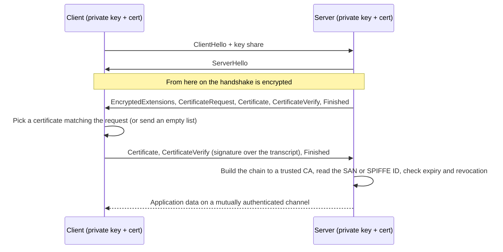

## Explanation

Transport Layer Security (TLS) normally authenticates one side only: the server presents an X.509 certificate (a public key bound to a name and signed by a certificate authority, or CA) and the client checks it against the CAs it trusts. Mutual TLS adds the mirror-image step. The server asks the client for a certificate, the client sends one and signs the handshake with the matching private key, and the server validates the chain and binds the connection to that identity. Both peers know who is on the other end before a single byte of HTTP flows.

Mechanically, in TLS 1.3 (RFC 8446) the server includes a `CertificateRequest` message after `ServerHello`. The client answers with `Certificate` and `CertificateVerify`, where `CertificateVerify` is a signature over the transcript hash of everything exchanged so far: it proves possession of the private key without ever transmitting it. A client with no suitable certificate sends an empty certificate list, and the server may continue unauthenticated or abort with a `certificate_required` alert. Because everything after `ServerHello` is encrypted in TLS 1.3, the client certificate is hidden from passive observers, which it was not in TLS 1.2. A client that offered the `post_handshake_auth` extension can also be asked for a certificate later, on demand; Kestrel's `DelayCertificate` mode exposes the same idea by requesting the certificate only when the application asks for it.



What the certificate asserts is up to the issuer. A corporate client certificate carries a subject name; a SPIFFE X.509 SVID carries the workload's SPIFFE ID (`spiffe://trust-domain/path`) as exactly one URI subject alternative name, with the `cA` constraint false and `digitalSignature` set so that a leaf can never mint further identities. The receiving side maps that name to an authorization decision; mTLS itself only answers "who is this".

mTLS exists because shared secrets travel badly. An [API key](api-key.md) or password is a bearer credential: whoever copies it can replay it. A private key stays on the client, so an eavesdropper, a proxy log or a crash dump never yields a reusable credential. That property makes mTLS the default for service-to-service traffic in a [zero-trust](zero-trust.md) network, for partner and IoT integrations, and for sender-constrained OAuth tokens: RFC 8705 binds an access token to the SHA-256 thumbprint of the client certificate (the `cnf` claim with `x5t#S256`), so a stolen token is useless without the key.

You meet it in three shapes. Terminated in the application: Kestrel negotiates the certificate (`ClientCertificateMode.RequireCertificate`) and ASP.NET Core's certificate authentication handler validates it. Terminated at the edge: Azure Application Gateway, Azure App Service, an AWS Application Load Balancer or Amazon API Gateway verifies the certificate and forwards it to your code in a header such as `X-ARR-ClientCert` or `X-Amzn-Mtls-Clientcert`, which means the header may only be trusted when it arrived from that proxy. Or automated by a [service mesh](service-mesh.md): Istio's Envoy sidecars obtain SPIFFE-style certificates from `istiod`, rotate them automatically and enforce a `PeerAuthentication` policy in `PERMISSIVE` or `STRICT` mode, so application code never touches a certificate. PostgreSQL (and therefore TimescaleDB) and Redis can also require client certificates, which is the cleanest way to secure the data tier in a Docker Compose home lab without passwords in `.env` files.

## How it differs

**Versus an [API key](api-key.md).** Both identify a calling application, but an API key is proof by possession of a string: every hop that sees it (TLS-terminating proxies, access logs, browser dev tools) could replay it, and revoking it means redistributing a new one. An mTLS client proves possession of a private key through a signature that is only valid for this handshake; the key is never on the wire. Choose mTLS for anything inside your trust boundary or for partners who can manage certificates; fall back to keys where the counterparty offers nothing else, which is common with broker and exchange APIs (see [Broker and exchange API integrations](../messaging/integration/broker-exchange-api-integrations.md)).

**Versus [workload identity](workload-identity.md).** Workload identity answers how a pod, VM or job obtains an identity it never had to store: attestation by the platform, then issuance of a short-lived SVID or token. mTLS answers how that identity is presented on a connection. SPIFFE makes the relationship explicit: SPIRE attests the workload and hands it an X.509 SVID over the Workload API, and mTLS is simply what the workload does with it. You can have mTLS without workload identity (hand-issued certificates in a vault) and workload identity without mTLS (JWT SVIDs or cloud tokens over ordinary TLS).

**Versus the [OAuth 2.0 client credentials flow](oauth-client-credentials-flow.md).** Client credentials authenticates an OAuth client once at a token endpoint and returns a bearer access token carrying scopes, audience and expiry; the resource server inspects the token, not the connection. mTLS has no notion of scope. The two compose well: RFC 8705 lets the client authenticate to the token endpoint with its certificate (`tls_client_auth`) and binds the issued token to that certificate, so the resource server checks both the token and the handshake.

**Versus [secrets rotation](secrets-rotation.md).** Certificates expire, so an mTLS estate is a rotation problem whether you like it or not. The difference is where the work lands: with SPIRE, Istio or cert-manager the renewal is continuous and invisible, while rotating a password or API key is a scheduled cut-over you must design for. The hard part of mTLS rotation is CA roll-over: both peers must trust the new root before any leaf signed by it appears.

**Versus a [service mesh](service-mesh.md).** A mesh is a delivery mechanism for mTLS (plus retries, telemetry and policy), not the protocol. It buys transparent certificate issuance and uniform enforcement at the cost of a [sidecar](sidecar-pattern.md) per pod and another control plane to run. If you only need two services to authenticate each other, Kestrel and a small internal CA are enough; if you need every pod in a cluster to, a mesh pays for itself.

| Dimension | mTLS | API key | OAuth client credentials | Workload identity |
|---|---|---|---|---|
| What is proven | Possession of a private key | Possession of a string | A client credential, once, at the token endpoint | Attested runtime identity |
| Enforced at | TLS handshake (transport) | Application or gateway | Resource server (token validation) | Issuer and consumer |
| Leaks if observed on the wire | Nothing reusable | The key itself | The token until it expires | The token until it expires |
| Carries scopes | No (name only) | Usually not | Yes | Depends on the token |
| Renewal | Certificate expiry, often automated | Manual rotation | Token expiry; credential rotation | Automatic, platform-driven |

## Examples

=== "C#"

    ```csharp
    // Program.cs (.NET 9): Kestrel demands a client certificate issued by our internal CA,
    // the certificate handler validates the chain, and the SPIFFE ID becomes a claim.
    using System.Security.Claims;
    using System.Security.Cryptography.X509Certificates;
    using Microsoft.AspNetCore.Authentication.Certificate;
    using Microsoft.AspNetCore.Server.Kestrel.Https;

    var builder = WebApplication.CreateBuilder(args);

    builder.WebHost.ConfigureKestrel(k => k.ConfigureHttpsDefaults(h =>
        h.ClientCertificateMode = ClientCertificateMode.RequireCertificate));

    var internalCa = X509CertificateLoader.LoadCertificateFromFile("/etc/pki/internal-ca.crt");

    builder.Services.AddAuthentication(CertificateAuthenticationDefaults.AuthenticationScheme)
        .AddCertificate(o =>
        {
            o.AllowedCertificateTypes = CertificateTypes.Chained;          // no self-signed leaves
            o.ChainTrustValidationMode = X509ChainTrustMode.CustomRootTrust;
            o.CustomTrustStore = new X509Certificate2Collection(internalCa);
            o.RevocationMode = X509RevocationMode.NoCheck;                 // short-lived certs: expiry does the job
            o.Events = new CertificateAuthenticationEvents
            {
                OnCertificateValidated = ctx =>
                {
                    // The URI SAN holds the SPIFFE ID; expose it for authorization policies.
                    var spiffeId = ctx.ClientCertificate.GetNameInfo(X509NameType.UrlName, forIssuer: false);
                    var identity = new ClaimsIdentity(ctx.Principal!.Identity);
                    identity.AddClaim(new Claim("spiffe_id", spiffeId));
                    ctx.Principal = new ClaimsPrincipal(identity);
                    ctx.Success();
                    return Task.CompletedTask;
                }
            };
        })
        .AddCertificateCache();      // validation result is a pure function of the certificate, so cache it

    builder.Services.AddAuthorizationBuilder()
        .AddPolicy("orders-reader", p => p.RequireClaim("spiffe_id", "spiffe://lab.local/ns/orders/sa/reporting"));

    var app = builder.Build();
    app.UseAuthentication();
    app.UseAuthorization();
    app.MapGet("/orders", (ClaimsPrincipal user) => $"hello {user.FindFirstValue("spiffe_id")}")
       .RequireAuthorization("orders-reader");
    app.Run();
    ```

    ```csharp
    // Caller: present our certificate. CreateFromPemFile pairs the cert with its private key.
    // (On Windows, SslStream needs the key re-imported as PKCS#12; on Linux containers this is enough.)
    var clientCert = X509Certificate2.CreateFromPemFile(
        "/run/secrets/reporting-client.crt", "/run/secrets/reporting-client.key");

    var handler = new SocketsHttpHandler();
    handler.SslOptions.ClientCertificates = new X509Certificate2Collection(clientCert);

    using var http = new HttpClient(handler) { BaseAddress = new Uri("https://orders.internal") };
    var body = await http.GetStringAsync("/orders");
    ```

=== "Python"

    ```python
    # Server side with FastAPI behind uvicorn: require a client certificate from our internal CA.
    #   uvicorn app:app --ssl-certfile server.crt --ssl-keyfile server.key \
    #       --ssl-ca-certs /etc/pki/internal-ca.crt --ssl-cert-reqs 2     # 2 == ssl.CERT_REQUIRED
    #
    # Pure-stdlib equivalent for asyncio.start_server / http.server:
    import ssl

    server_ctx = ssl.create_default_context(ssl.Purpose.CLIENT_AUTH, cafile="/etc/pki/internal-ca.crt")
    server_ctx.load_cert_chain("server.crt", "server.key")
    server_ctx.verify_mode = ssl.CERT_REQUIRED          # no client certificate, no connection
    # after the handshake: conn.getpeercert()["subjectAltName"] -> (("URI", "spiffe://lab.local/..."),)
    ```

    ```python
    # Client side: present our certificate and pin trust to the internal CA (httpx accepts an SSLContext).
    import ssl
    import httpx

    ctx = ssl.create_default_context(cafile="/etc/pki/internal-ca.crt")
    ctx.load_cert_chain(certfile="/run/secrets/reporting-client.crt",
                        keyfile="/run/secrets/reporting-client.key")

    with httpx.Client(verify=ctx, base_url="https://orders.internal") as client:
        print(client.get("/orders").text)
    ```

=== "Azure"

    - **App Service** terminates TLS at its front end. Set *Client certificate mode* to Required, Optional or Optional Interactive User (with optional exclusion paths), and the certificate reaches your code base64-encoded in the `X-ARR-ClientCert` header. App Service forwards it and nothing more; your app must validate it. In ASP.NET Core that is `AddCertificateForwarding(o => o.CertificateHeader = "X-ARR-ClientCert")` plus `UseCertificateForwarding()` ahead of `UseAuthentication()`, and only ever on an app that is unreachable except through App Service.
    - **Application Gateway v2** (Standard_v2 and WAF_v2) takes a trusted client CA chain in an SSL profile attached to a listener. *Strict* mode rejects a missing or invalid certificate during the handshake and can check revocation with OCSP (CRLs are not supported); *passthrough* mode leaves validation to the backend. Server variables such as `client_certificate_subject` and `client_certificate_fingerprint` can be rewritten into headers for the backend.
    - **API Management** validates a presented certificate with the `validate-client-certificate` policy, which is how you combine mTLS with subscription keys or JWT validation on the same API.
    - **AKS** offers the Istio-based service mesh add-on, so pod-to-pod mTLS with `PeerAuthentication` arrives without touching .NET code.

=== "AWS"

    - **Amazon API Gateway (REST APIs)** enables mutual TLS on a Regional custom domain name with a `TLS_1_2` security policy and a PEM truststore in S3 that holds the full chain (maximum chain length four, self-signed allowed). It checks X.509 syntax, integrity, validity period and name chaining, but not revocation, and forwards the certificate to Lambda authorizers and backend integrations. Disable the default `execute-api` endpoint so the custom domain is the only way in; private APIs are not supported.
    - **Application Load Balancer** has two modes on an HTTPS listener. *Verify* validates the client certificate against a trust store (a CA bundle in S3, optionally with revocation lists) and sets `X-Amzn-Mtls-Clientcert-Subject`, `-Issuer`, `-Serial-Number`, `-Validity` and `-Leaf` headers; *passthrough* forwards the whole chain in `X-Amzn-Mtls-Clientcert` for the target to validate. TLS session resumption is unavailable in both modes.
    - **AWS Private CA** issues the client certificates; AWS Certificate Manager supplies the server certificate for the domain. Rotate the client side with short lifetimes rather than relying on revocation, since API Gateway never consults a CRL.

## Misconceptions

- **"mTLS encrypts the traffic, plain TLS does not."** Both encrypt. mTLS only adds client authentication; the cipher suites and key exchange are identical.
- **"A valid client certificate means the caller is authorized."** It means the caller is authenticated. Which SAN or subject may call which endpoint is a separate policy; ASP.NET Core deliberately returns 403, not 401, when certificate authentication fails because the connection cannot be upgraded after the fact.
- **"The client certificate is visible to anyone sniffing the handshake."** In TLS 1.2 it was; in TLS 1.3 everything after `ServerHello` is encrypted, including the client's certificate.
- **"Terminate TLS at the load balancer and read the certificate header."** Only if the application accepts that header exclusively from the proxy. An internet-reachable app that trusts `X-ARR-ClientCert` or `X-Amzn-Mtls-Clientcert` from any source lets an attacker forge an identity with a plain HTTP header.
- **"mTLS removes the need for rotation."** Certificates expire and CAs roll over. Short-lived certificates issued by SPIRE, Istio or cert-manager make rotation continuous, but a hand-issued two-year client certificate in a vault is just a slower secret.

## Exam notes

Microsoft exams test mTLS through the services that terminate it rather than the handshake: AZ-104 covers certificates and TLS for App Service, SC-100 covers encryption in transit and where Key Vault holds the certificates, and SC-300 covers certificate-based authentication for users, which is the same mechanism pointed at people. Expect scenario questions where the right answer is Application Gateway mutual authentication or API Management client-certificate validation in front of a backend, and distractors that suggest an API key or a shared secret for a partner integration.

AWS exams test it as a feature placement problem: SAA-C03 and SOA-C03 expect you to reach for ACM for server certificates and to know that encrypting in transit is a TLS question, SCS-C03 goes deeper into AWS Private CA and certificate lifecycle across Regions, DVA-C03 names certificate management with AWS Private CA explicitly, and DOP-C02 asks about PKI concepts and combining ACM with other controls. The trap is API Gateway: mutual TLS needs a Regional custom domain and an S3 truststore, does not check revocation, and should be paired with disabling the default endpoint.

Kubernetes certifications approach it from the mesh side. CKS lists pod-to-pod encryption with Cilium or Istio, and KCSA covers the service mesh as a security component. The conceptual exams (CISSP, CCSP, Security+) frame it under digital certificates, certificate authorities, OCSP versus CRLs and mutual authentication; a classic trap is confusing a self-signed certificate with an untrusted one, and another is assuming mutual authentication implies authorization.

## Self-check

??? question "Your Angular front end calls a .NET 9 API through Azure Application Gateway, and a partner's batch job must call the same API from their data centre. The partner can manage certificates; browsers cannot be given client certificates. How do you design authentication?"
    Use two listeners. The partner traffic hits a listener with an SSL profile in strict mode that trusts the partner's CA chain, with OCSP revocation checks if their CA publishes a responder; the gateway rewrites `client_certificate_subject` into a header that the API only trusts from the gateway's private IP range. The browser traffic uses the OAuth 2.0 authorization code flow with PKCE through a backend-for-frontend, so the API sees a bearer token, not a certificate. The API applies authorization by mapping the certificate subject (partner) and the token's scopes (users) onto the same policy model, because mTLS answers who is calling and never what they may do.

??? question "A security review of your Docker Compose lab finds the TimescaleDB password and the Redis AUTH string in a .env file that is also checked into Git. What does switching the data tier to mTLS change, and what does it not change?"
    Both PostgreSQL and Redis can require client certificates, so the services authenticate with a private key mounted as a Compose secret instead of a password: a copy of the repository no longer contains a reusable credential, and a leaked connection string proves nothing without the key. It does not change the need for rotation (the certificates expire and the internal CA must be able to roll over), it does not provide authorization (database roles and Redis ACLs still decide what each identity may do), and it does not protect the private key file itself, which must be kept out of the image and the repository exactly as the password should have been.

??? question "A colleague proposes replacing OAuth access tokens between two internal services with mTLS alone, arguing that the certificate already identifies the caller. When is that right, and when is it a loss?"
    It is right when the only question is which service is calling and both run on infrastructure that can issue and rotate certificates, for example SPIRE-issued SVIDs or an Istio mesh in STRICT mode; mTLS removes a token round-trip and a bearer credential from the path. It is a loss when the call carries delegated authority (acting for a user) or needs scopes, audience restriction or short-lived, revocable permissions, because a certificate carries a name and nothing else. The composed answer is RFC 8705: authenticate the client to the token endpoint with its certificate and bind the issued token to that certificate, so the resource server checks both.

## Further reading

- [mTLS vs. API Keys / Shared Secrets](../security/iam/mtls-vs-api-keys.md) and [Workload Identity vs. Static Credentials](../security/iam/workload-identity.md) in this library.
- [Docker and containerization](../devops/docker-containerization.md) for mounting certificates as Compose secrets, and [REST vs. gRPC APIs](../messaging/apis/rest-vs-grpc-apis.md) for where channel credentials sit in gRPC.
- Terms: [Workload identity](workload-identity.md), [API key](api-key.md), [OAuth 2.0 client credentials flow](oauth-client-credentials-flow.md), [Service mesh](service-mesh.md), [Zero trust](zero-trust.md), [Secrets rotation](secrets-rotation.md).
- [RFC 8446, section 4.4](https://www.rfc-editor.org/rfc/rfc8446#section-4.4) for the authentication messages and [RFC 8705](https://www.rfc-editor.org/rfc/rfc8705) for certificate-bound access tokens.
- [SPIFFE X509-SVID standard](https://github.com/spiffe/spiffe/blob/main/standards/X509-SVID.md) and [Istio security concepts](https://istio.io/latest/docs/concepts/security/) for how identities end up in certificates automatically.
