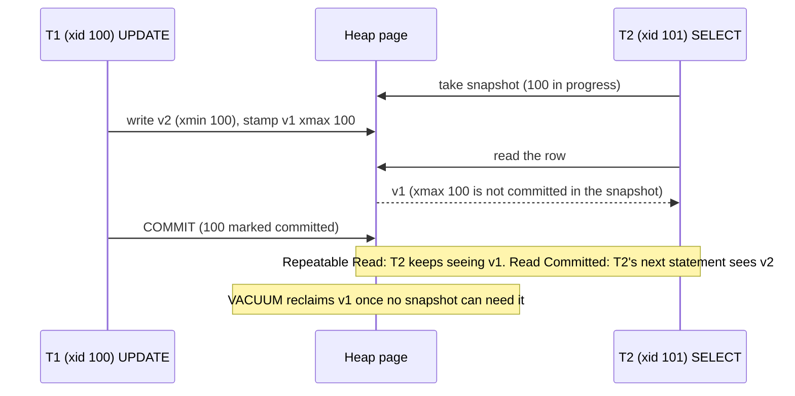

## Explanation

Multi-version concurrency control is the strategy of never overwriting a row that someone might still be reading. A writer creates a new *version* of the row; readers keep seeing the version that was current when their *snapshot* was taken; the old version becomes garbage once no snapshot can need it. PostgreSQL's documentation states the consequence plainly: reading never blocks writing and writing never blocks reading.

In PostgreSQL the versions are literal tuples in the heap, and two header fields do the bookkeeping, exposed as the system columns `xmin` (the inserting transaction's ID) and `xmax` (the deleting transaction's ID, or zero). An `UPDATE` inserts a new tuple with `xmin` set to the writer's ID and stamps `xmax` on the old one; a `ROLLBACK` leaves the stamps in place and records the transaction as aborted, so the new version is invisible and the old one remains visible. A snapshot records which transaction IDs count as committed; a tuple is visible if its `xmin` is committed and included in the snapshot, and its `xmax` is zero, aborted, or not yet visible to the snapshot.

The isolation level decides when snapshots are taken. In *Read Committed*, the default, every statement takes a fresh snapshot, and an `UPDATE` that meets a row changed by a concurrent uncommitted transaction waits, then re-evaluates its `WHERE` clause against the new version. In *Repeatable Read* the transaction takes one snapshot at its first statement, and a conflicting update fails with `could not serialize access due to concurrent update`. *Serializable* adds Serializable Snapshot Isolation (SSI): predicate locks that never block but detect dangerous read/write dependency cycles and abort one participant with SQLSTATE `40001`. PostgreSQL implements three levels internally (Read Uncommitted behaves as Read Committed), and both upper levels require retry logic in the application.

The price is garbage. Dead versions stay in the heap until `VACUUM` marks their space reusable. Autovacuum triggers when dead tuples exceed a base threshold plus a scale factor times the table size (defaults 50 and 0.2), capped since PostgreSQL 18 by `autovacuum_vacuum_max_threshold` so that huge tables are not left waiting for hundreds of millions of dead rows. Vacuum also maintains the *visibility map*, the per-page bit that lets index-only scans skip the heap, and Heap-Only Tuples (HOT) let an update that changes no indexed column avoid new index entries. Anything holding an old snapshot, a long transaction, an idle-in-transaction session or a lagging replication slot, holds back cleanup for every table; bloat is almost always a symptom of an old snapshot.

Transaction IDs are 32-bit and compared modulo 2^32, so every XID has two billion "older" and two billion "newer" neighbours. To stop ancient rows from appearing to be in the future, vacuum *freezes* old tuples, marking them visible to everyone; a table whose oldest unfrozen XID exceeds `autovacuum_freeze_max_age` (default 200 million) is vacuumed even when autovacuum is disabled, and with fewer than three million XIDs left the server refuses to begin write transactions until vacuum catches up.

The alternative is lock-based concurrency, where readers take shared locks and block writers. SQL Server does that by default; its row-versioning levels, `READ_COMMITTED_SNAPSHOT` and `SNAPSHOT`, are off by default on SQL Server and Azure SQL Managed Instance and on by default in Azure SQL Database. The theory is Bernstein and Goodman's 1983 multiversion analysis. In the reader's stack MVCC is why an EF Core read never waits for a background worker that is updating the same rows, and why "it got slow after a month" is usually a vacuum story.



## How it differs

**[Write-ahead log](write-ahead-log.md)** keeps history too, but a different kind for a different reader. The WAL is a physical, append-only record of page changes used by crash recovery, replication and logical decoding; no query reads it. MVCC versions are logical rows read by every query through a snapshot and discarded by vacuum. The two touch only in that creating a version, stamping `xmax` and vacuuming are themselves WAL-logged. Tuning the WAL is about `fsync`, checkpoints and slots; tuning MVCC is about transaction length, vacuum and fill factor.

**[Row-oriented storage](row-oriented-storage.md)** is where PostgreSQL happens to put its versions: the heap page is the version store. That is an implementation choice, not a definition. SQL Server keeps the same 8 KiB row pages, updates in place, and under row-versioning isolation copies the previous version to a separate version store; the TimescaleDB columnstore handles an update by moving the affected batch back to row form. Think of the storage layout as the *container* and MVCC as the *protocol* for which contents a transaction may see.

**[B-tree index](b-tree-index.md)** stores no visibility information at all. Every row version gets its own index entries unless HOT applies, and an index scan must visit the heap to learn whether a version is visible, unless the visibility map says the whole page is all-visible (which is what makes an index-only scan possible). Two consequences follow: update-heavy tables bloat their indexes as well as their heaps, and an `INCLUDE` covering index only avoids heap fetches on well-vacuumed tables. The index locates versions; MVCC judges them.

**[Materialized view](materialized-view.md)** and the word "snapshot" cause real confusion. A materialized view is a stored table built from a query and refreshed when you say so; until then it is stale by design. An MVCC snapshot stores nothing: it is a rule ("transactions up to here count as committed") applied to live tuples, taken afresh at each statement or transaction. A `REFRESH MATERIALIZED VIEW` runs inside a snapshot like any other query, which is the only sense in which the two meet.

**[Optimistic UI update](optimistic-ui-update.md)** shares the word "optimistic" with the concurrency-control family MVCC belongs to: both bet that conflicts are rare and check afterwards instead of locking first. The difference is where the bet is placed and how it is settled. MVCC is optimism inside the engine: the snapshot is exact, the conflict is detected by the database (an `UPDATE` that waits and re-checks, or a `40001` abort) and the retry is a server round trip. An optimistic UI update is optimism in an Angular component: the screen shows the expected result before the request completes and must reconcile with the server's answer, which is itself produced under MVCC. Use them together, with an explicit version column or `xmin`-based concurrency token in EF Core so that the server can tell the client its optimism was misplaced.

| | MVCC versions | WAL | Materialized view |
|---|---|---|---|
| What is kept | Logical row versions | Physical page changes | Query result rows |
| Who reads it | Every query, via a snapshot | Recovery, replicas, decoders | Queries that name the view |
| Removed by | VACUUM | Checkpoint and recycling | REFRESH or DROP |
| Problem when neglected | Bloat, wraparound | Full disk, slow recovery | Stale data |

## Examples

=== "SQL"

    ```sql
    CREATE TABLE accounts (id int PRIMARY KEY, balance numeric);
    INSERT INTO accounts VALUES (1, 100);

    -- Session A                                    -- Session B, at the same time
    BEGIN;                                           SELECT xmin, xmax, balance FROM accounts;
    UPDATE accounts SET balance = 90 WHERE id = 1;   --  old version: xmax = A's xid, still visible
    SELECT xmin, xmax, balance FROM accounts;        BEGIN ISOLATION LEVEL REPEATABLE READ;
    --  new version: xmin = A's xid                  SELECT balance FROM accounts;   -- 100
    COMMIT;                                          SELECT balance FROM accounts;   -- still 100
                                                     COMMIT;

    -- Bloat and HOT ratio per table.
    SELECT relname, n_live_tup, n_dead_tup, n_tup_upd, n_tup_hot_upd, last_autovacuum
    FROM pg_stat_user_tables WHERE relname = 'accounts';

    -- Who is holding back cleanup with an old snapshot?
    SELECT pid, state, age(backend_xmin) AS snapshot_age, xact_start
    FROM pg_stat_activity
    WHERE backend_xmin IS NOT NULL
    ORDER BY age(backend_xmin) DESC;

    -- Wraparound watch.
    SELECT datname, age(datfrozenxid) FROM pg_database;
    ```

=== "C#"

    ```csharp
    // .NET 9 + Npgsql: Serializable transactions must be retried on SQLSTATE 40001.
    // Npgsql's PostgresException.IsTransient already covers 40001 and 40P01 (deadlock).
    static async Task<T> RunSerializableAsync<T>(
        NpgsqlDataSource dataSource,
        Func<NpgsqlConnection, NpgsqlTransaction, Task<T>> body,
        int maxAttempts = 5)
    {
        for (var attempt = 1; ; attempt++)
        {
            await using var conn = await dataSource.OpenConnectionAsync();
            await using var tx = await conn.BeginTransactionAsync(IsolationLevel.Serializable);
            try
            {
                var result = await body(conn, tx);
                await tx.CommitAsync();           // SSI may still fail here
                return result;
            }
            catch (PostgresException ex)
                when (ex.SqlState == PostgresErrorCodes.SerializationFailure && attempt < maxAttempts)
            {
                await Task.Delay(TimeSpan.FromMilliseconds(20 * attempt));   // then retry from scratch
            }
        }
    }
    ```

=== "Python"

    ```python
    # Python 3.12 + psycopg 3: the same retry loop.
    import time
    import psycopg
    from psycopg import IsolationLevel
    from psycopg.errors import SerializationFailure

    def transfer(conninfo: str, src: int, dst: int, amount: int, attempts: int = 5) -> None:
        for attempt in range(1, attempts + 1):
            with psycopg.connect(conninfo) as conn:
                conn.isolation_level = IsolationLevel.SERIALIZABLE
                try:
                    with conn.transaction():    # commits on exit; may raise SerializationFailure
                        conn.execute("UPDATE accounts SET balance = balance - %s WHERE id = %s", (amount, src))
                        conn.execute("UPDATE accounts SET balance = balance + %s WHERE id = %s", (amount, dst))
                    return
                except SerializationFailure:
                    if attempt == attempts:
                        raise
                    time.sleep(0.02 * attempt)
    ```

=== "Azure"

    - **Azure SQL Database** has `READ_COMMITTED_SNAPSHOT` and `ALLOW_SNAPSHOT_ISOLATION` on by default, so its Read Committed is version-based like PostgreSQL's; **SQL Server and Azure SQL Managed Instance** default to lock-based Read Committed (shared locks on reads) until you switch the database options on. DP-300 scenarios about readers blocking writers are usually answered by enabling row versioning.
    - **Azure Database for PostgreSQL flexible server** is PostgreSQL MVCC unchanged; the platform exposes a *Maximum Used Transaction IDs* metric that the documentation tells you to alert on, precisely because abandoned replication slots and long transactions block freezing.

=== "AWS"

    - **Amazon RDS for PostgreSQL** adds *adaptive autovacuum* (`rds.adaptive_autovacuum`, on by default): when the `MaximumUsedTransactionIDs` CloudWatch metric reaches `autovacuum_freeze_max_age` or 500 million, whichever is greater, RDS makes autovacuum more aggressive in memory and raises an event. AWS still recommends your own alarm on that metric. The RDS documentation also notes that from PostgreSQL 17 vacuum is no longer limited to 1 GB of dead-tuple memory per pass.
    - **Aurora PostgreSQL** keeps PostgreSQL's MVCC semantics; the shared storage changes how pages are written, not which versions a transaction sees.

## Misconceptions

- **"MVCC means no locking."** Readers do not lock, but writers still take row locks: two transactions updating the same row serialise, `SELECT ... FOR UPDATE` locks explicitly, and DDL takes table locks. MVCC removes read/write conflicts, not write/write conflicts.
- **"Repeatable Read is weaker than it sounds in PostgreSQL."** It is stronger than the SQL standard requires: PostgreSQL's Repeatable Read is snapshot isolation, so phantom reads cannot occur. What it permits are serialization anomalies, which only Serializable (SSI) detects.
- **"Old versions are removed at commit."** Commit only records the outcome; the dead version stays until vacuum (or HOT pruning) reclaims it, and only once no snapshot can still see it.
- **"Bloat means autovacuum is too slow."** Often the cause is an old snapshot: an idle-in-transaction connection, a long report, or a replication slot. Vacuum cannot remove what a live snapshot might still read, so find the holder before tuning vacuum.
- **"`VACUUM` shrinks the table file."** Ordinary vacuum reuses space inside the table and returns only trailing empty pages to the operating system; `VACUUM FULL` or `pg_repack` rewrites the table to actually shrink it.

## Exam notes

DP-300 is the exam that tests this material most directly, in SQL Server vocabulary: the isolation levels and their phenomena, `READ_COMMITTED_SNAPSHOT` versus `SNAPSHOT`, why row versioning stops readers blocking writers and what it costs in `tempdb`, and that Azure SQL Database enables it by default. DP-900 and architecture exams (CPSA-F, CPSA-A) test ACID isolation at the concept level and expect you to know that "isolation" is implemented by either locking or versioning. AWS exams test MVCC only indirectly through operational RDS PostgreSQL questions, transaction ID wraparound alarms, autovacuum and why long-running transactions matter; a scenario about an RDS instance "becoming read-only" is a wraparound question. The traps: assuming higher isolation removes the need for retry logic (it adds it), and assuming Read Committed behaves identically across engines.

## Self-check

??? question "A nightly report on PostgreSQL runs for three hours inside one transaction. During that window the `orders` table, updated thousands of times per minute, grows from 2 GB to 9 GB although row counts are flat. Explain and fix."
    The report's snapshot is older than every version written since it started, so vacuum cannot remove any of those dead versions; the heap fills with them. Run the report against a read replica or in shorter transactions, or move it to a columnar copy; set `idle_in_transaction_session_timeout` and alert on `age(backend_xmin)` in `pg_stat_activity`. Afterwards, ordinary vacuum will reclaim the space for reuse, but only `VACUUM FULL` or `pg_repack` shrinks the file.

??? question "Two .NET services both run `SELECT SUM(amount) ... ; INSERT ...` under Repeatable Read and together produce a result that no serial execution could. Nobody got an error. Why, and what changes if you switch to Serializable?"
    Repeatable Read (snapshot isolation) prevents non-repeatable and phantom reads but not serialization anomalies such as write skew: each transaction read a consistent snapshot and inserted based on it, and neither updated a row the other touched, so no conflict was detected. Under Serializable, SSI tracks the read/write dependencies and aborts one transaction with SQLSTATE `40001`; the application must catch it and retry, which is the code shown in the examples.

??? question "An RDS PostgreSQL instance suddenly refuses all writes with a message about preventing transaction ID wraparound. What happened and what is the recovery?"
    The oldest unfrozen transaction ID fell within three million of the wraparound horizon, so PostgreSQL stopped assigning new XIDs; reads still work. Something prevented freezing, typically a stalled replication slot, a very long transaction or autovacuum unable to finish on a huge table. Remove the blocker and run `VACUUM` (a freeze-capable vacuum) on the affected tables; the server resumes writes as the age drops. Prevent it with alarms on `MaximumUsedTransactionIDs` and on slot lag.

??? question "Why can an index-only scan be slow right after a bulk update even though the index covers every column the query needs?"
    Index entries carry no visibility information, so the scan must check the visibility map; after a bulk update the modified pages are no longer all-visible, and every candidate row forces a heap fetch, turning the index-only scan into an ordinary index scan. Once vacuum has set the all-visible bits again, the heap fetches disappear.

## Further reading

- [Relational Databases](../data/relational/relational-databases.md) in this library
- [The Outbox Pattern](../messaging/eventing/outbox-pattern.md) in this library, where snapshot visibility decides which outbox rows a poller can see
- Term pages: [Write-Ahead Log](write-ahead-log.md), [Row-Oriented Storage](row-oriented-storage.md), [B-Tree Index](b-tree-index.md), [Materialized view](materialized-view.md), [Transactional outbox](transactional-outbox.md)
- [Concurrency Control](https://www.postgresql.org/docs/current/mvcc-intro.html), [Transaction Isolation](https://www.postgresql.org/docs/current/transaction-iso.html), [Routine Vacuuming](https://www.postgresql.org/docs/current/routine-vacuuming.html), [System Columns](https://www.postgresql.org/docs/current/ddl-system-columns.html) and [Heap-Only Tuples](https://www.postgresql.org/docs/current/storage-hot.html), PostgreSQL documentation
- [Multiversion concurrency control: theory and algorithms (ACM TODS, 1983)](https://dl.acm.org/doi/10.1145/319996.319998), Bernstein and Goodman
- [Transaction locking and row versioning guide](https://learn.microsoft.com/en-us/sql/relational-databases/sql-server-transaction-locking-and-row-versioning-guide), Microsoft Learn, for the lock-based contrast
- [Working with PostgreSQL autovacuum on Amazon RDS](https://docs.aws.amazon.com/AmazonRDS/latest/UserGuide/Appendix.PostgreSQL.CommonDBATasks.Autovacuum.html), AWS documentation
