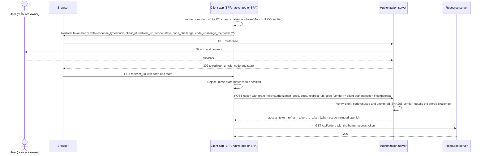

## Explanation

The authorization code grant (RFC 6749, section 4.1) is how an application obtains access to a user's resources without ever seeing the user's password. On the *front channel*, the app redirects the user's browser to the authorization server with `response_type=code`, its `client_id`, a `redirect_uri`, the `scope` it wants and a random `state`; the user authenticates there and consents; the server redirects back with a short-lived, single-use authorization code (at most ten minutes per RFC 6749, about one minute at Microsoft Entra). On the *back channel*, the app posts the code to the token endpoint with `grant_type=authorization_code` and receives an access token, usually a refresh token and optionally an ID token. The browser only ever carries the code, which is worthless without the second step.



**PKCE** (RFC 7636, Proof Key for Code Exchange) closes the gap between the two channels. The client generates a `code_verifier` of 43 to 128 unreserved characters, sends `code_challenge = BASE64URL(SHA256(verifier))` with `code_challenge_method=S256` on the front channel, and the verifier itself on the back channel; the server recomputes the hash and refuses a mismatch with `invalid_grant`. An attacker who intercepts the code (a malicious app registered for the same custom URI scheme) cannot redeem it without the verifier, which never left the client. Servers must implement S256, and OAuth 2.1 removes `plain`. RFC 9700, the OAuth security BCP, requires PKCE for public clients and recommends it for confidential ones; the OAuth 2.1 draft (revision 16, September 2026, still an Internet-Draft) requires it for every authorization code request, and ASP.NET Core's OpenID Connect handler enables `UsePkce` by default.

**Why implicit is deprecated.** The implicit grant (`response_type=token`) returned the access token in the URL fragment. That put a bearer token into browser history, referrer headers and any script on the page, offered no client authentication and no PKCE, and left the client unable to tell the token was meant for it. RFC 9700 says clients should not use it; RFC 10017 (OAuth 2.0 for Browser-Based Applications, 2026) says browser-based clients must not, and that access tokens must only come from the token endpoint; OAuth 2.1 omits it entirely, along with the password grant, and requires exact string matching of redirect URIs.

**OpenID Connect** is an identity layer on this flow, not a different protocol. Add `openid` to the scope (and optionally a `nonce`), and the token response includes an ID token: a signed JWT with `iss`, `sub`, `aud`, `exp` and `iat` that the client validates (issuer, audience, expiry, nonce) and uses to know *who signed in*; the access token remains for the resource server, and the UserInfo endpoint returns further claims for it.

**Which client are you?** A server-rendered or backend-for-frontend (BFF) app is a confidential client and authenticates at the token endpoint. An Angular SPA or a mobile app is a public client: no secret, mandatory PKCE, and refresh tokens rotated on each use or sender-constrained (DPoP). RFC 10017 ranks the browser options: a BFF keeping tokens server-side behind a cookie session first, a token-mediating backend second, a browser-only client holding tokens in JavaScript last. Native apps follow RFC 8252: system browser, PKCE, and a loopback or claimed-https redirect. The same flow now runs agents: the MCP authorization specification requires OAuth 2.1 with PKCE, a `resource` indicator (RFC 8707) binding tokens to one MCP server, and authorization server discovery from a `401` with `WWW-Authenticate`, so an agent connecting to a remote tool server runs exactly this dance in the user's browser.

## How it differs

**Versus the [client credentials flow](oauth-client-credentials-flow.md).** Client credentials has no user, no browser, no consent and no refresh token: the application authenticates as itself and acts under application permissions. Authorization code exists to let a person delegate: the resulting tokens carry delegated scopes, the user's `sub`, and an audit trail that names them. The decision rule is who the call is for. Picking client credentials for a user-facing feature because it avoids redirects erases the user from every downstream log; picking authorization code for a nightly job means storing a refresh token that impersonates whoever set it up.

**Versus an [API key](api-key.md).** A key is handed over once and presented forever, represents the application rather than any user, and is extractable from any client that holds it. Authorization code never gives the client the user's credentials at all, yields tokens that expire in about an hour, scopes them to what the user consented to, and lets the authorization server revoke them. Keys remain useful for identifying an application in front of a user flow (an API gateway subscription in front of a JWT), not instead of one.

| Dimension | Authorization code (with PKCE) | Implicit (deprecated) | Client credentials |
|---|---|---|---|
| Who is represented | A user, via the app | A user, via the app | The application |
| Token delivery | Back channel, from the token endpoint | Front channel, in the URL fragment | Back channel |
| Client authentication | Yes for confidential clients; PKCE for all | None | Yes, always |
| Refresh token | Yes (rotated or sender-constrained for public clients) | No | Should not be issued |
| Status | OAuth 2.1 default, required PKCE | Omitted from OAuth 2.1; MUST NOT in browsers (RFC 10017) | Retained in OAuth 2.1 |
| OpenID Connect sign-in | Yes, via the openid scope and ID token | Historically yes | No |

## Examples

=== "C#"

    ```csharp
    // .NET 9 backend-for-frontend: the server is the confidential OAuth client; the Angular app talks
    // to it with a same-site cookie and never sees a token (RFC 10017's first-ranked pattern).
    using Microsoft.AspNetCore.Authentication;
    using Microsoft.AspNetCore.Authentication.Cookies;
    using Microsoft.AspNetCore.Authentication.OpenIdConnect;
    using Microsoft.IdentityModel.Protocols.OpenIdConnect;
    using System.Net.Http.Headers;

    var builder = WebApplication.CreateBuilder(args);
    builder.Services.AddHttpClient();
    builder.Services.AddAuthentication(o =>
        {
            o.DefaultScheme = CookieAuthenticationDefaults.AuthenticationScheme;
            o.DefaultChallengeScheme = OpenIdConnectDefaults.AuthenticationScheme;
        })
        .AddCookie(o =>
        {
            o.Cookie.SameSite = SameSiteMode.Lax;
            o.Cookie.SecurePolicy = CookieSecurePolicy.Always;
        })
        .AddOpenIdConnect(o =>
        {
            o.Authority = "https://login.example.com";          // discovery via /.well-known/openid-configuration
            o.ClientId = "orders-web";
            o.ClientSecret = builder.Configuration["Oidc:ClientSecret"];   // or a client assertion; never in the browser
            o.ResponseType = OpenIdConnectResponseType.Code;    // never "token" or "id_token token"
            o.UsePkce = true;                                    // the default; shown for emphasis
            o.Scope.Add("offline_access");                       // ask for a refresh token
            o.Scope.Add("orders.read");
            o.SaveTokens = true;                                 // tokens live in the encrypted cookie ticket
            o.MapInboundClaims = false;                          // keep "sub" as "sub"
        });
    builder.Services.AddAuthorization();

    var app = builder.Build();
    app.UseAuthentication();
    app.UseAuthorization();

    app.MapGet("/bff/me", (HttpContext ctx) => ctx.User.FindFirst("sub")?.Value).RequireAuthorization();
    app.MapGet("/bff/orders", async (HttpContext ctx, IHttpClientFactory factory) =>
    {
        var accessToken = await ctx.GetTokenAsync("access_token");          // from the cookie ticket
        var http = factory.CreateClient();
        http.DefaultRequestHeaders.Authorization = new AuthenticationHeaderValue("Bearer", accessToken);
        return Results.Stream(await http.GetStreamAsync("https://api.example.com/orders"), "application/json");
    }).RequireAuthorization();
    app.Run();
    ```

    The Angular 20 side needs no OAuth library at all: `HttpClient` calls `/bff/orders` with `withCredentials`, a 401 triggers a navigation to `/bff/login` (a challenge endpoint), and token refresh is the handler's job.

=== "Python"

    ```python
    # Python 3.12 public client (a CLI or desktop tool): PKCE from the standard library, loopback redirect
    # per RFC 8252, and the code exchanged without any client secret.
    import base64
    import hashlib
    import secrets
    import urllib.parse
    import requests

    AUTHZ = "https://login.example.com/authorize"
    TOKEN = "https://login.example.com/token"
    CLIENT_ID, REDIRECT_URI = "orders-cli", "http://127.0.0.1:8765/callback"

    # 1. PKCE: fresh verifier per request; challenge = BASE64URL(SHA256(verifier)) without padding
    verifier = secrets.token_urlsafe(64)                       # 86 chars from A-Z a-z 0-9 - _
    challenge = base64.urlsafe_b64encode(
        hashlib.sha256(verifier.encode("ascii")).digest()).rstrip(b"=").decode()
    state = secrets.token_urlsafe(16)

    # 2. Front channel: open the system browser at the authorization endpoint
    url = AUTHZ + "?" + urllib.parse.urlencode({
        "response_type": "code", "client_id": CLIENT_ID, "redirect_uri": REDIRECT_URI,
        "scope": "openid orders.read offline_access", "state": state,
        "code_challenge": challenge, "code_challenge_method": "S256",
    })
    print("open:", url)
    code, returned_state = wait_for_callback()                  # your tiny HTTP listener on 127.0.0.1:8765
    assert secrets.compare_digest(returned_state, state)

    # 3. Back channel: redeem the single-use code with the verifier
    tokens = requests.post(TOKEN, data={
        "grant_type": "authorization_code", "code": code, "redirect_uri": REDIRECT_URI,
        "client_id": CLIENT_ID, "code_verifier": verifier,
    }, timeout=10).json()
    # tokens: access_token, refresh_token (rotated on each use for a public client), id_token (scope had openid)
    ```

=== "Azure"

    ```http
    GET https://login.microsoftonline.com/{tenant}/oauth2/v2.0/authorize
        ?client_id={application id}
        &response_type=code
        &redirect_uri=https://app.example.com/signin-oidc
        &response_mode=query
        &scope=openid offline_access https://graph.microsoft.com/mail.read
        &state={random}
        &code_challenge={BASE64URL(SHA256(verifier))}
        &code_challenge_method=S256
    ```

    Entra requires PKCE for redirect URIs registered with the `spa` type (which also enables CORS on the token endpoint) and recommends it for every client; a SPA must not send a `client_secret`, and the platform refuses secrets in any request carrying a browser `Origin`. Codes expire after about a minute. Confidential web apps redeem the code with a client secret or, better, a certificate credential, and should use `response_mode=form_post` so the code reaches the server even from `http://localhost`. Refresh tokens are only returned when `offline_access` was requested; for `spa` redirect URIs they expire after 24 hours, after which the app silently re-runs the flow in a top-level frame. The hybrid flow (`response_type=code id_token`) adds a `nonce` and needs the ID token implicit grant enabled on the registration, which is why ASP.NET Core templates default to plain code with PKCE instead.

=== "AWS"

    ```http
    GET https://auth.example.com/oauth2/authorize
        ?response_type=code
        &client_id={app client id}
        &redirect_uri=https://app.example.com/callback
        &scope=openid orders/read
        &state={random}
        &code_challenge={BASE64URL(SHA256(verifier))}
        &code_challenge_method=S256
    ```

    Amazon Cognito user pools support the authorization code grant with PKCE through managed login, and it is the only way to obtain all three tokens (ID, access and refresh) from the authorization server. The implicit grant is retained as a legacy option that exposes tokens in the callback URL; restrict each app client to the authorization code grant to prevent it. Client credentials cannot share an app client with either user grant. The code is redeemed at `/oauth2/token` with `grant_type=authorization_code`, `code`, `redirect_uri`, `client_id` and `code_verifier`, using HTTP Basic client authentication when the app client has a secret. Custom scopes such as `orders/read` come from a resource server, and an API Gateway Cognito authorizer can enforce them.

## Misconceptions

- **"PKCE is only for mobile apps and SPAs."** RFC 9700 recommends it for confidential clients as well, and OAuth 2.1 requires it for every authorization code request, because it also defeats code injection, not just interception on public clients.
- **"Implicit is fine for a SPA because it avoids a token request."** It leaks bearer tokens through the URL, offers no client authentication and no PKCE; RFC 9700 says should not, RFC 10017 says must not, and OAuth 2.1 removed it. Use authorization code with PKCE, preferably behind a BFF.
- **"The authorization code is a credential I can keep."** It is single-use and expires within minutes; reuse must be refused and may revoke the tokens already issued. The refresh token is the long-lived artefact, and even that is rotated for public clients.
- **"state, nonce and PKCE are three ways of doing the same thing."** `state` binds the callback to the client session (CSRF), the `nonce` binds the ID token to the authentication request (replay), and PKCE binds the code to the client that started the flow (interception and injection). You want all three.
- **"OpenID Connect is a different protocol from OAuth."** It is the same authorization code flow with the `openid` scope and an ID token on top. OAuth answers what the app may access; OpenID Connect answers who signed in; the access token is for the resource server, the ID token for the client.

## Exam notes

Microsoft exams test this through app registrations and sign-in design: SC-300 covers planning and creating app registrations, OAuth permission grants, consent settings and policies for OAuth apps, and SC-100 covers designing a modern authentication and authorization strategy. The traps are redirect URI exact matching, the `spa` redirect type and PKCE for single-page apps, delegated versus application permissions, and recognising that hybrid flow needs the implicit grant setting for ID tokens while plain code does not. AI-500 asks you to design authentication flows in multi-agent solutions, including user impersonation and on-behalf-of, where the user-facing leg is this flow and the agent-to-API leg is on-behalf-of or client credentials; PAA covers agent-to-tool calls with OAuth 2.0, which the MCP specification pins to OAuth 2.1 with PKCE.

On AWS, DVA-C03 covers federated access with Cognito and securing applications with bearer tokens, and SCS-C03 covers identity solutions for human and application authentication; know that only the authorization code grant yields all three Cognito tokens, that implicit is legacy, and that an app client cannot mix client credentials with user grants. Security+ and ISSAP list OAuth under SSO and authentication protocols, and the conceptual trap is calling OAuth an authentication protocol: sign-in comes from OpenID Connect layered on this grant.

## Self-check

??? question "Your Angular 20 SPA talks to a .NET 9 API. A teammate proposes MSAL in the browser with tokens in sessionStorage; another proposes a backend-for-frontend. What does RFC 10017 say, and what would you choose for an app that moves money?"
    RFC 10017 ranks the browser-based patterns in decreasing order of security: BFF first, token-mediating backend second, browser-held tokens last, and it strongly recommends the BFF for business and sensitive applications because tokens in the browser are exposed to any script that runs on the page. For an app that moves money, run the authorization code flow with PKCE from the .NET backend as a confidential client, keep tokens server-side in an encrypted cookie ticket with a Lax or Strict same-site cookie, and have Angular call the BFF. Browser-held tokens remain acceptable for low-risk apps, with PKCE and refresh-token rotation.

??? question "An authorization server logs show the same authorization code redeemed twice from two IP addresses within thirty seconds, both with a valid code_verifier. What happened and what should the server do?"
    A code is single-use, so the second redemption must be refused regardless of the verifier, and RFC 6749 says the server should revoke the tokens issued on the first redemption where possible, because the code was evidently captured (for example from a log or a shared device). A valid verifier on both attempts suggests the attacker obtained the verifier too, which points at the client being compromised rather than the redirect: rotate the client's credentials, and check that the client is a public client whose refresh tokens are rotated so the stolen refresh token is detected on reuse.

??? question "A remote MCP server returns 401 with a WWW-Authenticate header when your agent connects. Walk through what the agent must do before it can call a tool."
    Parse the header to find the protected resource metadata, fetch it to learn the authorization server, fetch that server's metadata, and register dynamically if no client ID exists. Then run the authorization code flow with PKCE: open the user's browser at the authorization endpoint with the `resource` parameter naming the MCP server's canonical URI, receive the code at a registered redirect URI (localhost or https), and redeem it with the code verifier and the same `resource` value. Send the access token as a bearer in the Authorization header on every request, never in the query string, and expect the MCP server to reject tokens whose audience is not itself.

## Further reading

- [MCP tool orchestration](../ai/protocols/mcp-tool-orchestration.md) for agents authenticating to tool servers, and [Angular fundamentals](../frontend/angular/angular-fundamentals.md) for where the BFF boundary sits in the front end.
- [SignalR and WebSockets](../messaging/realtime/signalr-websockets.md) for carrying the resulting token on a real-time connection.
- Terms: [OAuth 2.0 client credentials flow](oauth-client-credentials-flow.md), [API key](api-key.md), [Workload identity](workload-identity.md), [Capability-based authorization](capability-based-authorization.md), [Zero trust](zero-trust.md).
- [RFC 6749, section 4.1](https://www.rfc-editor.org/rfc/rfc6749#section-4.1), [RFC 7636](https://www.rfc-editor.org/rfc/rfc7636), [RFC 8252 (native apps)](https://www.rfc-editor.org/rfc/rfc8252), [RFC 9700](https://www.rfc-editor.org/rfc/rfc9700), [RFC 10017](https://www.rfc-editor.org/rfc/rfc10017) and the [OAuth 2.1 draft](https://datatracker.ietf.org/doc/draft-ietf-oauth-v2-1/).
- [Microsoft identity platform authorization code flow](https://learn.microsoft.com/en-us/entra/identity-platform/v2-oauth2-auth-code-flow), [Amazon Cognito OAuth 2.0 grants](https://docs.aws.amazon.com/cognito/latest/developerguide/federation-endpoints-oauth-grants.html) and the [MCP authorization specification](https://modelcontextprotocol.io/specification/2025-06-18/basic/authorization).
