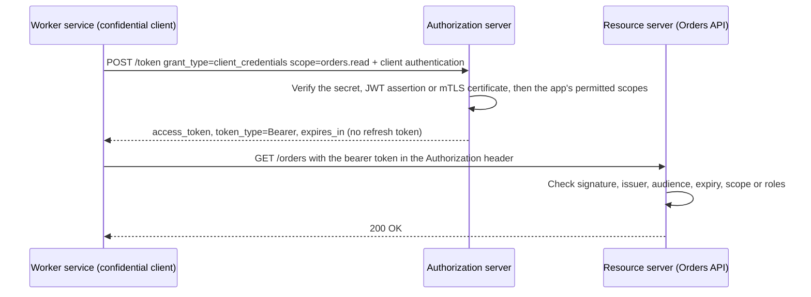

## Explanation

OAuth 2.0 (RFC 6749) separates the *client* that wants access from the *authorization server* that issues tokens and the *resource server* that accepts them. Most grants exist to let a user delegate access to a client. The client credentials grant (section 4.4) is the one grant with no user at all: the client requests a token for resources it owns or has been granted directly, by authenticating as itself. A nightly settlement job, a Redis Streams consumer calling an orders API, an MCP server calling an upstream API as its own OAuth client: these are client credentials.

Mechanically it is a single back-channel request. The client sends `POST /token` with `grant_type=client_credentials` and an optional `scope`, and authenticates per section 3.2.1. RFC 6749 obliges the server to support HTTP Basic with the client ID and secret, calls putting them in the request body "NOT RECOMMENDED" and forbids them in the URL; the OAuth 2.1 draft reverses the preference: servers MUST accept credentials in the body and MAY support HTTP Basic. The response is an access token with `token_type` and `expires_in`. A refresh token "SHOULD NOT be included", and Microsoft Entra never issues one here: when the token expires, the client simply authenticates again. The grant "MUST only be used by confidential clients": code that can keep a credential private, such as a server or daemon, never a browser or mobile app.



How the client authenticates is the real design decision. A shared **client secret** is an [API key](api-key.md) by another name, except that it is only ever sent to the token endpoint and the resulting token is short-lived. A **client assertion** per RFC 7523 is better: the client signs a JWT whose `iss` and `sub` are its client ID, whose `aud` is the token endpoint, with an `exp` a few minutes out and a `jti` so the server may reject replays, and sends it as `client_assertion` with `client_assertion_type=urn:ietf:params:oauth:client-assertion-type:jwt-bearer`. OpenID Connect calls this `private_key_jwt`. The private key never leaves the client. **Mutual TLS** per RFC 8705 goes further by authenticating the connection and binding the token to the certificate. And **workload identity federation** removes the stored credential entirely: the `client_assertion` is a token minted by Kubernetes, GitHub Actions or SPIRE (see [Workload identity](workload-identity.md)).

The token *means* something different too: there is no consent and no delegated permission; authorization is granted to the application by an administrator. In Entra you request `scope=<resource>/.default`, an admin consents to application permissions (app roles), and the token carries a `roles` claim; an API may also keep an access control list keyed on the token's `appid` and `iss`. In Amazon Cognito the app client must have a secret, must support *only* this grant, and receives custom scopes defined on a resource server.

The standard is stable but moving. OAuth 2.1 (draft-ietf-oauth-v2-1-16, September 2026) remains an Internet-Draft, with a working-group milestone to send it to the IESG in December 2026; it keeps this grant (still for confidential clients only) while dropping the implicit and password grants, requiring PKCE for authorization code, and forbidding bearer tokens in query strings. RFC 9700, the OAuth security best current practice, recommends sender-constraining access tokens with mTLS or DPoP, which matters most for long-running service clients. The MCP authorization specification builds on OAuth 2.1 too: an MCP server must validate that a token was issued for it and must never pass a client's token upstream, so when it calls another API it does so as its own client, usually with this grant.

## How it differs

**Versus the [authorization code flow](oauth-authorization-code-flow.md).** Authorization code puts a user in the loop: a browser redirect, a login, a consent screen, a one-time code and tokens that act *on behalf of* that user with delegated scopes. Client credentials has none of it. The decisive question is whether the call is made for a person. If a user asked for it, use authorization code (or on-behalf-of for a chained API); if a schedule or a queue triggered it, use client credentials. Using client credentials to "simplify" a user-facing app silently turns every action into the application's own, erasing the audit trail.

**Versus an [API key](api-key.md).** A key is presented raw on every call for its whole life, so every log and proxy sees a replayable credential. Client credentials sends the secret to one endpoint only and the API sees a token that expires in about an hour, carries an audience and scopes, and can be validated offline from the issuer's signing keys. With a JWT assertion or mTLS, no reusable secret crosses the wire at all. Keys remain the right tool for metering a partner's usage or when the provider offers nothing else.

**Versus [workload identity](workload-identity.md).** They are layers, not rivals. Client credentials is the exchange; workload identity decides what the client proves with. The migration path is literally changing `client_secret` to a `client_assertion` that the platform produced, and the request is otherwise identical. If your code runs where the platform can attest it, the stored secret or certificate is unnecessary.

**Versus [mutual TLS](mtls.md).** mTLS authenticates the channel and carries a name; client credentials issues a token with scopes, audience and lifetime that the resource server can evaluate without a shared trust store. RFC 8705 combines them so that the token is useless on any connection not presenting the same certificate.

**Versus [secrets rotation](secrets-rotation.md).** The grant does not rotate anything; its access tokens expire and are replaced by re-authenticating. What rotates is the credential behind the grant, the secret or certificate, and a JWT assertion with a five-minute `exp` plus a rotated signing key is the healthy shape.

| Dimension | Client credentials | Authorization code | API key |
|---|---|---|---|
| Who is represented | The application | A user, via the application | The application or subscription |
| User interaction | None | Login and consent in a browser | None |
| Credential sent per call | Short-lived access token | Short-lived access token | The key itself |
| Refresh token | Should not be issued | Usually issued | Not applicable |
| Permissions model | Application permissions, app roles, ACL | Delegated scopes, consent | Whatever the key's account allows |
| Allowed client types | Confidential only | Public and confidential | Any, unfortunately |

## Examples

=== "C#"

    ```csharp
    // .NET 9 worker authenticating with a signed client assertion (RFC 7523 / OIDC private_key_jwt),
    // then calling the API as a bearer. No user, no redirect, no refresh token: re-run when it expires.
    using System.Net.Http.Headers;
    using System.Net.Http.Json;
    using System.Security.Cryptography.X509Certificates;
    using System.Text.Json.Serialization;
    using Microsoft.IdentityModel.JsonWebTokens;
    using Microsoft.IdentityModel.Tokens;

    const string TokenEndpoint = "https://auth.example.com/oauth2/token";
    const string ClientId = "orders-worker";

    var cert = X509Certificate2.CreateFromPemFile("/run/secrets/orders-worker.crt", "/run/secrets/orders-worker.key");
    var now = DateTime.UtcNow;
    var assertion = new JsonWebTokenHandler().CreateToken(new SecurityTokenDescriptor
    {
        Issuer = ClientId,
        Audience = TokenEndpoint,                                   // aud = the token endpoint, nothing else
        Claims = new Dictionary<string, object> { ["sub"] = ClientId, ["jti"] = Guid.NewGuid().ToString() },
        IssuedAt = now,
        NotBefore = now,
        Expires = now.AddMinutes(5),                                // short: the assertion is single-purpose
        SigningCredentials = new X509SigningCredentials(cert, SecurityAlgorithms.RsaSsaPssSha256),
    });

    using var http = new HttpClient();
    var response = await http.PostAsync(TokenEndpoint, new FormUrlEncodedContent(new Dictionary<string, string>
    {
        ["grant_type"] = "client_credentials",
        ["scope"] = "orders.read",
        ["client_assertion_type"] = "urn:ietf:params:oauth:client-assertion-type:jwt-bearer",
        ["client_assertion"] = assertion,
    }));
    response.EnsureSuccessStatusCode();
    var token = await response.Content.ReadFromJsonAsync<TokenResponse>();

    http.DefaultRequestHeaders.Authorization = new AuthenticationHeaderValue("Bearer", token!.AccessToken);
    var orders = await http.GetStringAsync("https://orders.example.com/orders");
    // Cache the token until shortly before ExpiresIn elapses; a new token request per call is the classic mistake.

    record TokenResponse(
        [property: JsonPropertyName("access_token")] string AccessToken,
        [property: JsonPropertyName("token_type")] string TokenType,
        [property: JsonPropertyName("expires_in")] int ExpiresIn);
    ```

    For Entra, MSAL does the assertion for you: `var app = ConfidentialClientApplicationBuilder.Create(clientId).WithCertificate(cert).WithAuthority(AzureCloudInstance.AzurePublic, tenantId).Build()` and then `await app.AcquireTokenForClient(["https://graph.microsoft.com/.default"]).ExecuteAsync()`, which also caches the token in memory.

=== "Python"

    ```python
    # Python 3.12: same flow with PyJWT (cryptography extra) and requests.
    import time
    import uuid
    from pathlib import Path

    import jwt
    import requests

    TOKEN_ENDPOINT = "https://auth.example.com/oauth2/token"
    CLIENT_ID = "orders-worker"
    private_key = Path("/run/secrets/orders-worker.key").read_text()

    now = int(time.time())
    assertion = jwt.encode(
        {"iss": CLIENT_ID, "sub": CLIENT_ID, "aud": TOKEN_ENDPOINT,
         "jti": str(uuid.uuid4()), "iat": now, "nbf": now, "exp": now + 300},
        private_key, algorithm="PS256", headers={"kid": "orders-worker-2026-10"},
    )

    resp = requests.post(TOKEN_ENDPOINT, data={
        "grant_type": "client_credentials",
        "scope": "orders.read",
        "client_assertion_type": "urn:ietf:params:oauth:client-assertion-type:jwt-bearer",
        "client_assertion": assertion,
    }, timeout=10)
    resp.raise_for_status()
    token = resp.json()          # {"access_token": "...", "token_type": "Bearer", "expires_in": 3599}

    orders = requests.get("https://orders.example.com/orders",
                          headers={"Authorization": f"Bearer {token['access_token']}"}, timeout=10)
    ```

    For Entra, `msal.ConfidentialClientApplication(client_id, authority=..., client_credential={"private_key": private_key, "thumbprint": sha1_hex})` followed by `acquire_token_for_client(scopes=["https://graph.microsoft.com/.default"])` builds and caches the same thing.

=== "Azure"

    ```http
    POST https://login.microsoftonline.com/{tenant}/oauth2/v2.0/token
    Content-Type: application/x-www-form-urlencoded

    client_id={application id}
    &scope=https://graph.microsoft.com/.default
    &grant_type=client_credentials
    &client_assertion_type=urn:ietf:params:oauth:client-assertion-type:jwt-bearer
    &client_assertion={JWT signed with the registered certificate, or a federated token from AKS or GitHub}
    ```

    Three credential cases share this request: a `client_secret` instead of the assertion, a certificate credential (assertion header `alg: PS256` and `x5t#S256`, `aud` set to the token endpoint, `exp` five to ten minutes out), or a federated identity credential where another issuer signed the JWT. The scope is always one resource suffixed with `/.default`; mixing resources is an error. Permissions are application permissions (app roles) exposed by the API and granted through the admin consent endpoint, after which the token carries a `roles` claim. Entra never returns a refresh token here, `expires_in` is about 3599 seconds, and it blocks secrets in any request carrying a browser `Origin` header. Where the code runs on Azure, skip all of this and use a managed identity, optionally as the federated credential of an app registration.

=== "AWS"

    ```bash
    # Cognito user pool: a resource server defines custom scopes; the app client must have a secret
    # and must support only the client credentials grant (it cannot share an app client with user grants).
    aws cognito-idp create-resource-server --user-pool-id "$POOL" \
      --identifier orders --name "Orders API" \
      --scopes ScopeName=read,ScopeDescription="Read orders"

    # Token request: HTTP Basic with client id and secret, scopes namespaced by the resource server
    curl -u "$CLIENT_ID:$CLIENT_SECRET" \
      -d "grant_type=client_credentials&scope=orders/read" \
      https://auth.example.com/oauth2/token          # returns an access token only
    ```

    The access token carries the custom scopes as claims that your API (or an API Gateway Cognito authorizer) checks. Client credentials requests go straight to the token endpoint, bypass the authorize endpoint and managed login entirely, and are billed separately as machine-to-machine usage. For service-to-service calls *within* AWS, do not reach for Cognito at all: IAM roles with SigV4 signing are the native equivalent of a workload identity.

## Misconceptions

- **"It is fine in a mobile or single-page app if I obfuscate the secret."** RFC 6749 restricts the grant to confidential clients; anything shipped to a device or browser is public and its secret is extractable. Entra enforces this by rejecting secrets when an `Origin` header is present.
- **"I should store the refresh token for later."** None should be issued (and Entra issues none). Re-authenticating is the refresh.
- **"The access token identifies the user who configured the integration."** There is no user. The token represents the application, and APIs must authorize it by app roles, scopes or an application allow-list, never by a `sub` that looks like a person.
- **"A client secret is as bad as an API key, so nothing is gained."** The secret crosses the wire to one endpoint and the API only ever sees an expiring, audience-bound token. The remaining risk is removed by a JWT assertion, mTLS or federation, which an API key cannot offer.
- **"OAuth 2.1 deprecates client credentials along with implicit."** It drops the implicit and resource owner password grants and keeps client credentials unchanged.

## Exam notes

SC-300 is the exam that tests this most directly: its workload identities domain covers app registrations, application permissions and policies for OAuth apps, and SC-100 asks you to design workload authentication and API security. AZ-400 and AZ-401 frame it as service principal versus managed identity, where the trap is choosing a service principal with a client secret when a managed identity or federation would do. AI-500 asks you to design authentication flows across agents including on-behalf-of, API keys and OAuth 2.0, and PAA covers agent-to-tool calls with OAuth 2.0; the discriminator is user impersonation (authorization code or on-behalf-of) versus the agent acting as itself (client credentials).

On AWS, DVA-C03 and SCS-C03 test Cognito grant selection and bearer-token security. Remember that a Cognito app client configured for client credentials needs a secret, uses resource-server scopes and cannot also serve browser users, and that IAM roles, not Cognito, are the answer for AWS-to-AWS service calls. Security+ and ISSAP list OAuth among authentication protocols and SSO technologies; the exam-grade distinction is that OAuth is an authorization framework, and that sign-in comes from OpenID Connect layered on the authorization code flow, never from client credentials.

## Self-check

??? question "A Redis Streams consumer written in .NET 9 must call a partner's orders API every few seconds. The partner supports OAuth 2.0 with client credentials and also offers API keys. Which do you choose, and what do you do about token lifetime?"
    Client credentials, authenticated with a JWT assertion or a certificate if the partner supports it, otherwise a client secret kept in a vault and rotated. Acquire a token once, cache it in memory until shortly before `expires_in`, and share it across the consumer's loop; re-authenticate on a 401 with `invalid_token`. The API key would be presented on every request for as long as it lives, which is exactly what a bearer token with a one-hour lifetime avoids.

??? question "An ASP.NET Core API receives a token from a background service that has no roles claim and a scope claim that looks like a user's delegated permission. What went wrong, and how should the API respond?"
    The caller used a user flow (probably authorization code with a stored refresh token) to impersonate a person for an unattended job, or the API was registered without application permissions and Entra issued a role-less app-only token. Either way the API must not treat it as a service call: reject tokens that lack the expected `roles` (or an allow-listed `appid` with a trusted `iss`), and enable assignment requirements on the API so role-less app-only tokens cannot be issued. The background service should move to client credentials with application permissions consented by an admin.

??? question "Your MCP server runs over HTTP, receives OAuth tokens from agent clients and needs to call a downstream invoicing API. A developer suggests forwarding the client's token to the invoicing API to avoid another login. Why is that wrong, and what is the right pattern?"
    The MCP authorization specification requires the server to validate that incoming tokens were issued for it (audience binding via the `resource` parameter) and forbids passing them through, because the downstream API would then trust a token that was never meant for it, the classic confused deputy. The MCP server should act as its own OAuth client to the invoicing API: client credentials with its own credential (ideally a federated or certificate credential) when the call is the server's own, or an on-behalf-of exchange if the downstream call must carry the user's identity.

## Further reading

- [MCP tool orchestration](../ai/protocols/mcp-tool-orchestration.md) for how agents authenticate to tool servers, and [Workload Identity vs. Static Credentials](../security/iam/workload-identity.md) for replacing the client secret.
- [Capability-based AuthZ vs. RBAC](../security/iam/capability-based-authz.md) for what a scoped token should and should not grant.
- Terms: [OAuth 2.0 authorization code flow](oauth-authorization-code-flow.md), [Workload identity](workload-identity.md), [Mutual TLS](mtls.md), [API key](api-key.md), [Secrets rotation](secrets-rotation.md), [Capability-based authorization](capability-based-authorization.md).
- [RFC 6749, section 4.4](https://www.rfc-editor.org/rfc/rfc6749#section-4.4), [RFC 7523](https://www.rfc-editor.org/rfc/rfc7523), [RFC 8705](https://www.rfc-editor.org/rfc/rfc8705) and [RFC 9700](https://www.rfc-editor.org/rfc/rfc9700).
- [Microsoft identity platform certificate credentials](https://learn.microsoft.com/en-us/entra/identity-platform/certificate-credentials) for the exact assertion format, and the [MCP authorization specification](https://modelcontextprotocol.io/specification/2026-07-28/basic/authorization).
