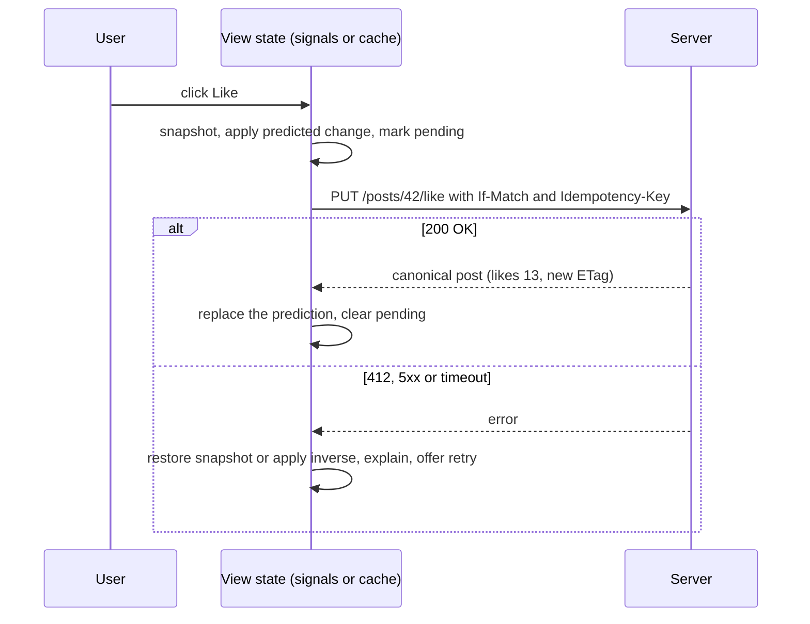

## Explanation

An optimistic UI update applies the expected result of a user action to the interface immediately, sends the request to the server in the background, and then either confirms the change with the server's answer or reverses it when the server says no. The bet is that most mutations succeed, so the user should not wait for a round trip whose outcome is almost always yes. The alternative, a *pessimistic* update, disables the control until the response arrives. Meteor popularised it as *latency compensation*: a method runs a client-side simulation against local data, the server runs the real method, and the client rolls the simulation back and applies the server's result.

Mechanically there are five steps. Snapshot the current state, or record an inverse operation. Apply the predicted change locally, usually with a marker (`pending: true`, a temporary id). Send the mutation with whatever the server needs to detect a conflict and to be retried safely: an entity tag in `If-Match` and an [idempotency key](idempotency-key.md). On success, replace the prediction with the server's response (real ids, timestamps, derived fields) and clear the marker. On failure, restore the snapshot or apply the inverse, explain why, and offer a retry. Frameworks package this. React's `useOptimistic(value, reducer?)` renders an optimistic value only while an Action is pending (its setter must be called inside an Action or `startTransition`) and converges on the real value in the same render as the Action settles, so a failed action reverts without extra code. TanStack Query offers two shapes: render the mutation's `variables` while `isPending`, or update the cache in `onMutate` (after `cancelQueries`, so an in-flight refetch cannot overwrite the prediction), roll back from the snapshot in `onError` and `invalidateQueries` in `onSettled`. Apollo Client's `optimisticResponse` writes a separate optimistic layer into the normalised cache, keyed by `__typename` and `id`, which the real response replaces or a GraphQL error discards. Angular has no dedicated primitive, but [signals](angular-signals.md) make the pattern short: snapshot a signal, `update` it, await the request, `set` the result or the snapshot; a `resource` has a `local` status for exactly this and `reload()` reconciles with the server.

The hard parts are not the happy path. *Identity*: a created item needs a client-generated or temporary id, and every reference to it must be rewritten when the real id arrives (Meteor seeds the client's id generator for this). *Ordering*: two overlapping optimistic mutations on the same entity need per-mutation inverses rather than one snapshot, or the second rollback resurrects the first prediction. *Push*: if the server also broadcasts changes over SignalR or [server-sent events](server-sent-events.md), the broadcast may arrive before the HTTP response and must be recognised as confirmation of the pending change rather than as a new one. *Retries*: a timed-out request that actually succeeded will be re-sent under [at-least-once delivery](at-least-once-delivery.md), so the mutation must be idempotent. *Conflicts*: the server must refuse a stale write rather than silently overwrite; HTTP's `If-Match` with the `ETag` the client rendered from makes the request conditional, and 412 Precondition Failed is the refusal (RFC 9110 sections 13.1.1 and 15.5.13). EF Core's concurrency tokens (`[Timestamp]` or `IsRowVersion()` on SQL Server, an application-managed token elsewhere) surface the same race as `DbUpdateConcurrencyException`.

Use it where failures are rare, reversible and user-owned: likes, reordering, toggles, drafts, chat messages, renaming. Avoid it where the server's decision is the point: payments, order submission to an exchange, anything with quotas or authorisation that often says no, and multi-step workflows where a rollback would cascade. The compromise is the *pending* style: show the change immediately but visibly provisional until it is confirmed.



## How it differs

**[MVCC](mvcc.md).** Multi-version concurrency control is the database engine's way of letting readers and writers proceed without blocking each other: each transaction sees a consistent snapshot, and a write that conflicts with a committed change is detected at commit time. It is optimism *inside the store*. An optimistic UI update is optimism *at the edge*: the browser shows a result that no transaction has committed yet. The two meet when the server uses optimistic concurrency (an `ETag`, a row version, a conditional write) to detect that the client's prediction was based on stale data; the 412 that comes back is the UI's cue to roll back and refresh. The naming collision causes real confusion in design reviews: "we use optimistic concurrency" says nothing about what the user sees, and "we have an optimistic UI" says nothing about whether lost updates are prevented.

**[Idempotency Key](idempotency-key.md).** The key is a client-generated identifier that lets the server recognise a retried request and return the original result instead of applying the change twice. It is the companion, not the alternative, of an optimistic update: because the UI has already shown success, the client is obliged to deliver the mutation eventually, which means retrying after a timeout, which means the server may see it twice. Without the key, a retried "add to cart" becomes two items while the screen shows one. The key handles *duplicates*; the entity tag handles *staleness*; the snapshot handles *failure*. All three are part of a complete optimistic mutation.

| Concern | Optimistic UI update | Pessimistic update | Optimistic concurrency (ETag, row version) | MVCC | Idempotency key |
|---|---|---|---|---|---|
| Layer | Presentation | Presentation | API and data access | Storage engine | API |
| Question | What does the user see before the reply? | Block until the reply? | Is the client's base version still current? | How do transactions isolate? | Was this request already applied? |
| Failure signal | Rollback and message | None needed | 412 or `DbUpdateConcurrencyException` | Serialisation failure at commit | Cached original response |

## Examples

=== "TypeScript"

    ```typescript
    // Angular with signals: snapshot, predict, send, reconcile or roll back.
    import { Injectable, inject, signal } from '@angular/core';
    import { HttpClient } from '@angular/common/http';
    import { firstValueFrom } from 'rxjs';

    type Post = { id: string; likes: number; likedByMe: boolean; etag: string };

    @Injectable({ providedIn: 'root' })
    export class Posts {
      private readonly http = inject(HttpClient);
      readonly posts = signal<Post[]>([]);

      async toggleLike(id: string): Promise<void> {
        const before = this.posts();                               // snapshot for rollback
        const post = before.find(p => p.id === id);
        if (!post) return;

        const liked = !post.likedByMe;
        this.posts.update(list => list.map(p => p.id === id         // predicted result, shown now
          ? { ...p, likedByMe: liked, likes: p.likes + (liked ? 1 : -1) }
          : p));

        const key = crypto.randomUUID();                           // reuse the same key on a retry
        try {
          const res = await firstValueFrom(this.http.put<Post>(`/api/posts/${id}/like`, { liked }, {
            headers: { 'If-Match': post.etag, 'Idempotency-Key': key },
            observe: 'response',
          }));
          const saved: Post = { ...res.body!, etag: res.headers.get('ETag') ?? post.etag };
          this.posts.update(list => list.map(p => (p.id === id ? saved : p)));   // server truth wins
        } catch (err) {
          // Snapshot rollback is simple but discards other optimistic changes made since;
          // apply the inverse of this one mutation instead when several can overlap.
          this.posts.update(list => list.map(p => (p.id === id ? post : p)));
          throw err;                                                // let the component explain and offer retry
        }
      }
    }
    ```

    ```typescript
    // React: useOptimistic renders the optimistic value only while the Action is pending
    // and converges on the real `post` when it settles, including on failure.
    import { startTransition, useOptimistic } from 'react';

    function LikeButton({ post, like }: { post: Post; like: (id: string, liked: boolean) => Promise<void> }) {
      const [shown, setShown] = useOptimistic(post, (current, liked: boolean) =>
        ({ ...current, likedByMe: liked, likes: current.likes + (liked ? 1 : -1) }));

      return (
        <button onClick={() => startTransition(async () => {
          setShown(!post.likedByMe);              // shown immediately
          try {
            await like(post.id, !post.likedByMe); // when the parent updates `post`, both agree
          } catch {
            // `shown` reverts to `post` by itself when the Action ends; only explain here.
          }
        })}>
          {shown.likedByMe ? 'Unlike' : 'Like'} ({shown.likes})
        </button>
      );
    }
    ```

=== "C#"

    ```csharp
    // ASP.NET Core minimal API: the server half. A stale If-Match means someone else changed
    // the row; refuse with 412 instead of overwriting (RFC 9110 §13.1.1), and let EF Core's
    // row version catch the race between the check and the write. An Idempotency-Key store
    // (not shown) must answer a replay with the original 200: otherwise a retried request that
    // had in fact succeeded fails If-Match with 412, and the client rolls back a real change.
    using System.ComponentModel.DataAnnotations;
    using Microsoft.EntityFrameworkCore;

    app.MapPut("/api/posts/{id}/like", async (string id, LikeRequest body, HttpContext http, AppDb db) =>
    {
        var req = http.Request;
        var post = await db.Posts.FindAsync(id);
        if (post is null) return Results.NotFound();

        var currentTag = $"\"{Convert.ToBase64String(post.Version)}\"";
        if (req.Headers.IfMatch.Count > 0 && req.Headers.IfMatch.ToString() != currentTag)
            return Results.StatusCode(StatusCodes.Status412PreconditionFailed);

        post.Likes += body.Liked ? 1 : -1;
        try
        {
            await db.SaveChangesAsync();               // UPDATE ... WHERE Id = @id AND Version = @version
        }
        catch (DbUpdateConcurrencyException)           // zero rows matched: lost the race
        {
            return Results.StatusCode(StatusCodes.Status412PreconditionFailed);
        }
        http.Response.Headers.ETag = $"\"{Convert.ToBase64String(post.Version)}\"";   // the client's next If-Match
        return Results.Ok(post);
    });

    public sealed class Post
    {
        public string Id { get; set; } = default!;
        public int Likes { get; set; }
        [Timestamp] public byte[] Version { get; set; } = default!;   // SQL Server rowversion concurrency token
    }

    public sealed record LikeRequest(bool Liked);
    ```

## Misconceptions

- **"It is just hiding latency; the data is the same."** For the duration of the request the client shows state that no server has accepted. The pattern is only honest if every prediction is reconciled with the server's answer, including ids, counters and derived fields the client guessed.
- **"Rollback means restoring the snapshot."** A snapshot restores everything to the moment before *this* mutation, including other optimistic changes made since, which then vanish although their requests may succeed. Overlapping mutations need per-mutation inverses or a layered cache, which is what Apollo's optimistic layer and TanStack's `onMutate` context provide.
- **"The server validates, so optimism is safe."** The server's validation is exactly what the UI has pre-empted. Where rejections are common (authorisation, quotas, exchange order checks), an optimistic UI trains users to distrust what they see; use the pending style or a pessimistic update there.
- **"Optimistic UI requires optimistic concurrency."** They live in different layers. An optimistic UI can call a last-writer-wins endpoint, and optimistic concurrency can protect a pessimistic form. They combine well because the 412 from a conditional request is the cleanest signal that a prediction was based on stale data.
- **"If it fails, just show a toast."** A failed optimistic update should also say what was reverted and offer a retry that reuses the same idempotency key, because from the user's point of view the action already happened.

## Exam notes

The UI half of this pattern is interview material, not exam material. The server half is examined: the AWS Developer Associate (DVA-C02, which gives way to DVA-C03 at the end of November 2026) tests conditional writes and optimistic locking with a version attribute in DynamoDB, and on Azure DP-420 tests optimistic concurrency on Cosmos DB items with the `_etag` property and an `If-Match` request option (AZ-204, which also covered Blob Storage conditional requests, retired on 31 July 2026); architecture exams test idempotent retries in message-driven designs. In interviews, the discriminating points are the three separate mechanisms (snapshot for failure, entity tag for staleness, idempotency key for duplicates), the rollback problem with overlapping mutations, reconciling a pushed broadcast with a pending prediction, and knowing which actions must stay pessimistic. The trap is treating "optimistic concurrency" and "optimistic UI" as the same feature.

## Self-check

??? question "A chat client appends a message optimistically, then the server broadcasts the message over SignalR to all clients, including the sender, before the HTTP response arrives. Users see their own message twice for a moment. How do you fix it without giving up the optimistic append?"
    The broadcast and the response are two confirmations of one prediction, and the client must be able to recognise both. Give each message a client-generated id (or the idempotency key) that the server stores and echoes in both the HTTP response and the broadcast; when a broadcast arrives whose id matches a pending local message, treat it as confirmation (clear the pending marker, adopt server fields such as the timestamp) instead of appending. Then the HTTP response, arriving later, finds the message already confirmed and is a no-op. This also makes the retry path correct: a re-sent request with the same id cannot create a second message.

??? question "A kanban board lets users drag cards between columns with an optimistic move. Two quick moves of the same card are in flight when the first request fails with 412. The naive rollback restores the snapshot taken before the first move, which also undoes the second move whose request later succeeds. Design the rollback."
    Keep a per-mutation record of the inverse operation (card, from-column, to-column, position) rather than a whole-board snapshot, and keep the pending mutations in a queue per card. When the first move fails, apply its inverse only to the parts of the state that later mutations have not superseded: if the second move already relocated the card, the first move's failure means the card's base version was stale, so the correct action is to refresh the card from the server (the 412 tells you the server state changed) and re-base or cancel the second move rather than replay inverses blindly. The general rule is that overlapping mutations on one entity must be serialised client-side, or the entity must be re-fetched on the first conflict.

??? question "A product manager wants the 'Submit order' button on a trading screen to behave optimistically because the like button feels so fast. What do you recommend?"
    Decline the full optimistic treatment and offer the pending style. An order submission is the case where the server's decision is the point: risk checks, balance checks and the exchange's acknowledgement frequently say no, and a rollback of a filled order cannot be shown truthfully. Show the order immediately in a visibly provisional state ("submitting", greyed, no fills), send it with an idempotency key so a timeout can be retried without duplicating the order, and move it to confirmed or rejected only on the server's answer or the pushed execution report. The like button is reversible, user-owned and rarely rejected; the order is none of those, which is the test for choosing optimism.

## Further reading

- [Delivery semantics](../messaging/eventing/delivery-semantics.md) and [the outbox pattern](../messaging/eventing/outbox-pattern.md) for the retry and duplicate side of mutations
- [SignalR and WebSockets](../messaging/realtime/signalr-websockets.md) for reconciling pushed confirmations, and [Real-time UI streaming](../frontend/realtime/real-time-ui-streaming.md)
- [Idempotency Key](idempotency-key.md), [MVCC](mvcc.md), [At-Least-Once Delivery](at-least-once-delivery.md) and [Angular Signals](angular-signals.md)
- [useOptimistic](https://react.dev/reference/react/useOptimistic) (React), [Optimistic updates](https://tanstack.com/query/latest/docs/framework/react/guides/optimistic-updates) (TanStack Query), [Optimistic mutation results](https://www.apollographql.com/docs/react/performance/optimistic-ui) (Apollo) and [RFC 9110](https://www.rfc-editor.org/rfc/rfc9110) sections 13.1.1 and 15.5.13
