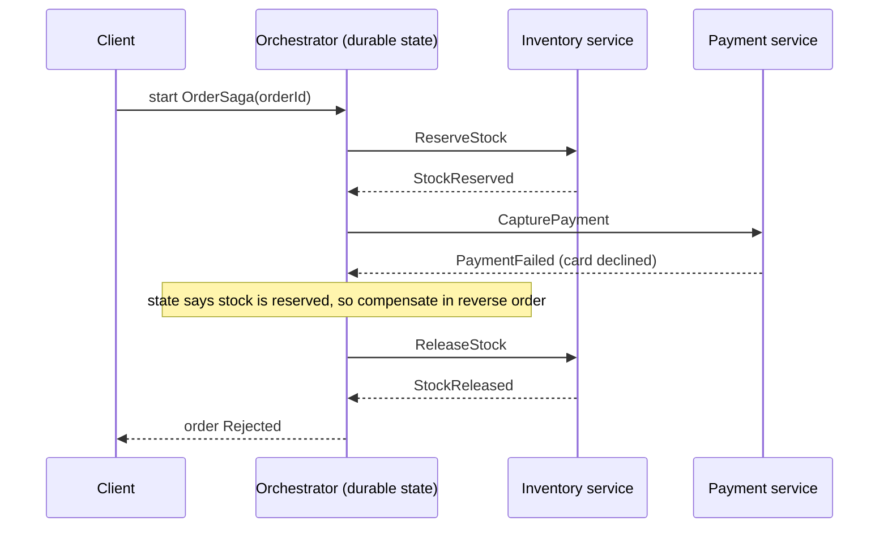

## Explanation

Orchestration is the coordination style in which a dedicated component owns a multi-step workflow. The *orchestrator* sends a command to each participant (`ReserveStock`, `CapturePayment`, `ConfirmOrder`), waits for the reply, records where the workflow is, decides what comes next, and when a step fails it runs the *compensating transactions* for the steps that already succeeded. The participants stay simple: they execute one local transaction and report back, without knowing the flow. The saga literature calls this an orchestration-based saga: the orchestrator issues the saga's requests, stores and interprets each task's state, and recovers from failure through compensation.

The hard part is that an orchestrator holds state across long periods and failures, so "a class with a switch statement" is not enough: the process can crash between steps, a reply can arrive hours later, and a human approval can take days. This is why orchestration is almost always built on a *durable execution* engine. The engines differ in surface but share one model. Azure Durable Functions lets you write orchestrator, activity and entity functions in code; the runtime checkpoints progress to a storage provider and reconstructs an orchestrator's position by *replaying* its history, which is why orchestrator code must be deterministic (no wall-clock reads, random numbers or I/O outside activities). Temporal has the same shape: a Workflow Definition in Go, Java, TypeScript or Python emits commands and consumes events that are recorded in an Event History; on recovery the code is re-run from the start against that history, so it must make the same decisions, and anything touching the outside world lives in Activities whose results are recorded once and reused on replay. Dapr Workflow persists the result of each completed step so a workflow resumes after a crash, with SDKs for .NET, Python, JavaScript, Java and Go. AWS Step Functions takes a declarative route: a state machine written in Amazon States Language with `Task`, `Choice`, `Parallel` and `Map` states, `Retry` and `Catch` for error handling, and two execution modes. Standard workflows run for up to a year with exactly-once execution of each step and are priced per state transition; Express workflows run for up to five minutes with at-least-once execution and are priced by executions and duration.

Why pay for all this? Because the orchestrator makes the flow explicit and testable, keeps compensation ordered, avoids cyclic dependencies between participants and keeps their logic clean, which the saga guidance lists as the benefits for complex or growing workflows. The costs are listed too: extra coordination logic, and a component whose failure stalls every flow, which durable engines mitigate but do not remove. A saga of either style still lacks isolation: concurrent sagas can read each other's intermediate state, so countermeasures such as semantic locks, commutative updates and version checks remain the designer's job. Participants must also be idempotent, because every engine retries.

The word *orchestration* is overloaded, and the disambiguation matters for exams. Container orchestration (Kubernetes scheduling pods) is about placing workloads, not coordinating business transactions. Agent orchestration (a coordinator model delegating to sub-agents, or tool orchestration over the [Model Context Protocol](../ai/protocols/mcp-tool-orchestration.md)) borrows the idea of a central planner but runs inside an inference loop. This page is about the service-coordination sense, the alternative to [choreography](choreography.md). In the reader's stack, an orchestrated order flow is a Durable Functions or Temporal workflow whose activities call the .NET services, with Redis Streams or Service Bus carrying commands and replies when calls should not be synchronous.



## How it differs

| Aspect | Orchestration | [Choreography](choreography.md) |
| --- | --- | --- |
| Where the flow lives | in the orchestrator | spread across subscribers |
| Participant knowledge | none of the flow | its own reactions only |
| Adding a step | edit the orchestrator | add or change subscriptions |
| Compensation | ordered, central | per participant, event-triggered |
| Failure of the coordinator | stalls flows until the engine resumes | no coordinator to fail |
| Testing | orchestrator can be unit-tested with faked activities | every participant must run |

**Versus choreography.** Pick orchestration when steps are sequential, compensations must run in a known order, the number of services is growing, or the business wants to read the flow in one place. Pick choreography for independent, parallel, fire-and-forget operations across bounded contexts. The Azure choreography guidance even suggests using an orchestrator inside a single bounded context and choreography between contexts, which is a reasonable default for a platform with a few domains.

**Versus exactly-once delivery.** Step Functions Standard documents exactly-once execution of workflow steps, and Durable Functions and Temporal checkpoint activity results so an orchestrator never re-runs a completed activity on replay. That is a property of the engine's own state machine. The activity's side effect, an HTTP call to a payment provider, a row written to TimescaleDB, can still happen twice when the activity times out and is retried, and Express workflows are explicitly at least once. [Exactly-once delivery](exactly-once-delivery.md) in messaging is a different, equally narrow guarantee; neither replaces idempotent participants.

**Versus an idempotency key.** The key is the mechanism; the orchestrator is the policy. An orchestrator decides that `CapturePayment` may be retried three times with backoff and then compensated; the idempotency key (the order id passed to the payment API) is what makes attempt two harmless if attempt one actually succeeded but the reply was lost. Orchestration without idempotent activities turns every retry into a potential double charge.

## Examples

The same order saga in two durable engines. The orchestrator holds no business logic beyond ordering, retries and compensation; the activities are the participants.

=== "C#"

    ```csharp
    // Azure Durable Functions, .NET isolated worker (Microsoft.Azure.Functions.Worker.Extensions.DurableTask).
    using Microsoft.Azure.Functions.Worker;
    using Microsoft.DurableTask;

    public static class OrderSaga
    {
        [Function(nameof(OrderSaga))]
        public static async Task<string> Run([OrchestrationTrigger] TaskOrchestrationContext context, OrderRequest order)
        {
            // Orchestrator code is replayed: no DateTime.Now, Random or I/O here; only activities, timers and events.
            var retry = TaskOptions.FromRetryPolicy(new RetryPolicy(maxNumberOfAttempts: 3, firstRetryInterval: TimeSpan.FromSeconds(2)));

            await context.CallActivityAsync(nameof(ReserveStock), order, retry);
            try
            {
                await context.CallActivityAsync(nameof(CapturePayment), order, retry);
            }
            catch (TaskFailedException)
            {
                await context.CallActivityAsync(nameof(ReleaseStock), order, retry);   // compensate the completed step
                return "Rejected";
            }
            await context.CallActivityAsync(nameof(ConfirmOrder), order, retry);
            return "Confirmed";
        }

        [Function(nameof(ReserveStock))]
        public static Task ReserveStock([ActivityTrigger] OrderRequest order) => Task.CompletedTask;   // idempotent on order.Id

        [Function(nameof(CapturePayment))]
        public static Task CapturePayment([ActivityTrigger] OrderRequest order) => Task.CompletedTask;

        [Function(nameof(ReleaseStock))]
        public static Task ReleaseStock([ActivityTrigger] OrderRequest order) => Task.CompletedTask;

        [Function(nameof(ConfirmOrder))]
        public static Task ConfirmOrder([ActivityTrigger] OrderRequest order) => Task.CompletedTask;
    }

    public record OrderRequest(string Id, string Sku, int Quantity, decimal Amount);
    ```

=== "Python"

    ```python
    # Temporal Python SDK: the workflow is replayed from its event history, activities run once and are recorded.
    from dataclasses import dataclass
    from datetime import timedelta

    from temporalio import activity, workflow
    from temporalio.common import RetryPolicy
    from temporalio.exceptions import ActivityError


    @dataclass
    class Order:
        id: str
        sku: str
        quantity: int
        amount: float


    @activity.defn
    async def reserve_stock(order: Order) -> None: ...      # idempotent on order.id

    @activity.defn
    async def capture_payment(order: Order) -> None: ...

    @activity.defn
    async def release_stock(order: Order) -> None: ...

    @activity.defn
    async def confirm_order(order: Order) -> None: ...


    @workflow.defn
    class OrderSaga:
        @workflow.run
        async def run(self, order: Order) -> str:
            opts = dict(
                start_to_close_timeout=timedelta(seconds=30),
                retry_policy=RetryPolicy(maximum_attempts=3, non_retryable_error_types=["CardDeclined"]),
            )
            await workflow.execute_activity(reserve_stock, order, **opts)
            try:
                await workflow.execute_activity(capture_payment, order, **opts)
            except ActivityError:
                await workflow.execute_activity(release_stock, order, **opts)   # compensation
                return "Rejected"
            await workflow.execute_activity(confirm_order, order, **opts)
            return "Confirmed"


    # Worker: Worker(client, task_queue="orders", workflows=[OrderSaga], activities=[...]).run()
    # Starter: await client.execute_workflow(OrderSaga.run, order, id=f"order-{order.id}", task_queue="orders")
    ```

=== "Azure"

    Durable Functions is the code-first orchestrator for Azure Functions in C#, JavaScript, TypeScript, Python, PowerShell and Java, with orchestrator, activity and entity function types and the Durable Task Scheduler as the recommended backend; the same Durable Task SDKs can run outside Functions when you want to host the workers yourself. Azure Logic Apps is the designer-first alternative for integration flows with connectors and built-in retry policies. When the participants are queue-based, Service Bus carries the commands and replies while the orchestration state stays in the task hub.

=== "AWS"

    AWS Step Functions expresses the saga as a state machine: `Task` states call Lambda functions or any of the SDK integrations, `Retry` handles transient errors and `Catch` routes failures to compensation states. Standard workflows (exactly-once steps, up to one year, priced per transition) suit order sagas and human approvals via the callback task-token pattern; Express workflows (at-least-once, up to five minutes) suit high-rate event processing. A minimal definition with compensation:

    ```json
    {
      "StartAt": "ReserveStock",
      "States": {
        "ReserveStock": { "Type": "Task", "Resource": "arn:aws:lambda:eu-west-1:111122223333:function:reserve-stock", "Next": "CapturePayment" },
        "CapturePayment": {
          "Type": "Task", "Resource": "arn:aws:lambda:eu-west-1:111122223333:function:capture-payment",
          "Retry": [ { "ErrorEquals": ["States.TaskFailed"], "MaxAttempts": 3, "IntervalSeconds": 2, "BackoffRate": 2.0 } ],
          "Catch": [ { "ErrorEquals": ["States.ALL"], "Next": "ReleaseStock" } ],
          "Next": "ConfirmOrder"
        },
        "ReleaseStock": { "Type": "Task", "Resource": "arn:aws:lambda:eu-west-1:111122223333:function:release-stock", "Next": "Rejected" },
        "Rejected": { "Type": "Fail", "Error": "OrderRejected" },
        "ConfirmOrder": { "Type": "Task", "Resource": "arn:aws:lambda:eu-west-1:111122223333:function:confirm-order", "End": true }
      }
    }
    ```

## Misconceptions

- **"The orchestrator is a single point of failure, so choreography is safer."** A durable engine persists every step and resumes after a crash; what remains is a dependency, not data loss. The real cost of orchestration is coupling participants to a coordinator's commands and operating the engine, which is a design trade-off rather than a reliability verdict.
- **"Orchestration means synchronous REST calls in a loop."** Commands and replies can travel over queues or streams; Durable Functions, Temporal and Step Functions all wait for asynchronous completions and callbacks for hours or days.
- **"An orchestrated saga is a distributed transaction."** It is a sequence of committed local transactions with compensations. There is no rollback and no isolation: another saga can read intermediate state, and a compensation can itself fail, which is why pivot and retryable steps are designed explicitly.
- **"Exactly-once steps mean my activities never run twice."** The engine will not re-execute a *completed* step on replay, but a step that times out before reporting is retried under your policy, and Express-style modes are at least once. Activities must be idempotent regardless of engine.
- **"Orchestrator code is ordinary code."** It is replayed to rebuild state, so it must be deterministic: time comes from the context, randomness and I/O belong in activities, and changing the orchestrator's logic while instances are in flight needs versioning.

## Exam notes

AWS Certified Developer – Associate (DVA-C03) lists choreography and orchestration by name among the patterns to describe, and AWS Certified Solutions Architect – Associate (SAA-C03) has an explicit workflow-orchestration item centred on Step Functions; the recurring trap is Standard versus Express (duration, execution semantics and pricing) and recognising that a sequence with compensations or a human approval step is Step Functions rather than EventBridge or SQS. AWS Certified Solutions Architect – Professional (SAP-C03), DevOps Engineer – Professional (DOP-C02) and Data Engineer – Associate (DEA-C01) use Step Functions as the orchestration answer for integration, event-processing and ETL workflows respectively, with Amazon MWAA appearing for data pipelines. On the Azure side, Designing Microsoft Azure Infrastructure Solutions (AZ-305) asks for messaging and event-driven architecture recommendations where Durable Functions or Logic Apps is the orchestrator answer and Service Bus or Event Grid the choreography answer. The agentic AI exams (Developing AI Apps and Agents on Azure, AI-103, and AWS Certified Generative AI Developer – Professional, AIP-C01) use the word for multi-agent coordination and Step Functions agent patterns; read the scenario to see which sense is meant. Container orchestration questions (Kubernetes, ECS) are about scheduling, not sagas.

## Self-check

??? question "A payment provider sometimes acknowledges a charge after the activity has already timed out. Under an orchestrator with a retry policy, how do you prevent a double charge?"
    Make the activity idempotent by passing a stable idempotency key (the order id) to the provider so the retried call returns the original result, and keep the retry policy for transient failures only (declined cards are non-retryable). The engine's exactly-once or checkpointing guarantees cover completed steps, not steps whose reply was lost, so the key is what makes retry safe.

??? question "An orchestrator function reads DateTime.UtcNow to decide whether a discount still applies, and instances started yesterday behave differently after a restart. Why, and what is the fix?"
    Orchestrator code is replayed from history to rebuild state, so a non-deterministic read returns a different value on replay and the control flow diverges. Use the context's replay-safe current time (or Temporal's workflow.now()) and move anything else that touches the outside world into an activity whose result is recorded once.

??? question "You must process 50,000 IoT events per second through a three-step validation flow that completes in under a minute. Which Step Functions type, and what changes in your participant design?"
    Express workflows: they are built for high event rates and short durations, up to five minutes, and are priced by executions and duration. They execute at least once, so each step must be idempotent and the flow must tolerate reruns; Standard would be the choice if the flow needed exactly-once steps, callbacks or a long wait.

## Further reading

- [Event-driven vs. request-response](../messaging/eventing/event-driven-vs-request-response.md) and [the outbox pattern](../messaging/eventing/outbox-pattern.md).
- [MCP tool orchestration](../ai/protocols/mcp-tool-orchestration.md) for the agentic sense of the word.
- [Choreography](choreography.md), [exactly-once delivery](exactly-once-delivery.md), [idempotency key](idempotency-key.md), [transactional outbox](transactional-outbox.md) and [dead-letter queue](dead-letter-queue.md).
- Saga pattern (Azure Architecture Center): <https://learn.microsoft.com/en-us/azure/architecture/patterns/saga>
- Temporal Workflows: <https://docs.temporal.io/workflows> and AWS Step Functions: <https://docs.aws.amazon.com/step-functions/latest/dg/welcome.html>
