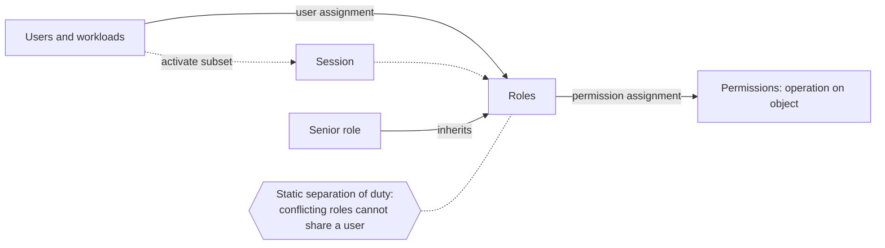

## Explanation

Role-based access control inserts one level of indirection between people and permissions. Instead of writing "Alice may read the ledger" for every Alice and every ledger, an administrator defines a role such as *Trader* with the permissions that job needs, and assigns users to the role. Ferraiolo and Kuhn formalised the model at NIST in 1992 as a *non-discretionary* alternative to discretionary access control (where resource owners hand out rights individually) for commercial and civilian-government systems; Sandhu and colleagues published the family of reference models in 1996; NIST unified the two in 2000, and the result became the ANSI/INCITS 359-2004 standard, revised in 2012. A 2010 study commissioned by NIST estimated the work had saved industry about 1.1 billion dollars in provisioning and administration.

The standard model has four parts. **Core RBAC**, the only mandatory one, defines users, roles, permissions (an operation on an object), the user-assignment and permission-assignment relations, and *sessions*: a user activates a subset of their roles for a session, which is how a person who is both *Trader* and *Auditor* can act as just one of them. **Hierarchical RBAC** lets a senior role inherit a junior role's permissions along a partial order, so *Desk Head* contains *Trader* without re-listing its permissions. **Static separation of duty** forbids assigning conflicting roles to the same user (nobody is both *Approver* and *Payee*); **dynamic separation of duty** allows the assignment but forbids activating both roles in one session. Sandhu's paper draws the line that matters most in practice: a *group* is a set of users, while a *role* binds a set of users to a set of permissions, which is why group membership alone is not RBAC until something maps the group to permissions.

Mechanically the check is a request-time lookup: identify the principal, resolve its active roles (a token's `roles` claim, a directory, a binding object), resolve their permissions and compare with the requested operation. Because the decision depends on *who* is asking, a service acting on behalf of many callers uses its own role, which is the root of the confused-deputy problem that [capability-based authorization](capability-based-authorization.md) was invented to avoid.

Where the reader meets it: ASP.NET Core's `[Authorize(Roles = "Trader")]` and `RequireRole` policies read the `ClaimTypes.Role` claim; Microsoft Entra app roles are declared on an app registration and arrive in tokens as a `roles` claim; Kubernetes RBAC uses `Role`, `ClusterRole`, `RoleBinding` and `ClusterRoleBinding` objects with purely additive rules and no deny; PostgreSQL grants privileges to roles; Redis ACLs give users command and key patterns. Azure RBAC is the same model with a scope axis: a role assignment is a security principal plus a role definition plus a scope (management group, subscription, resource group or resource), assignments are additive, deny assignments can override, and a subscription holds at most 5,000 assignments. AWS IAM uses the term differently: an *IAM role* is an assumable identity with temporary credentials, not an RBAC role; AWS implements RBAC by attaching job-function policies (such as `DatabaseAdministrator` or `SecurityAudit`) to users, groups or IAM roles.

RBAC's known weakness is **role explosion**: as distinct (resource, context) combinations multiply, so do roles, until each has one member. The standard escape is attribute-based access control, which NIST SP 800-162 defines as authorizing by evaluating attributes of the subject, object, requested operation and environment against policy at request time. Both clouds add ABAC to RBAC rather than replacing it: Azure role assignment conditions filter a role's permissions by blob tags, container names, principal attributes or time, and AWS policies compare `aws:PrincipalTag` with `aws:ResourceTag` so new resources inherit access by tag without a policy edit.



## How it differs

| Neighbour | What it is | The decisive difference | How to choose |
| --- | --- | --- | --- |
| [Capability-based authorization](capability-based-authorization.md) | Possession of a scoped, unforgeable token is the permission | RBAC decides from identity at check time; a capability decides from what the request carries | Capabilities for delegation, multi-tenancy, agents and partner access; RBAC for administering people |
| [Least privilege](least-privilege.md) | Grant only task-sufficient access | A principle to judge roles by, not a competing mechanism | Always; design roles and scopes to satisfy it |
| [Workload identity](workload-identity.md) | Platform-issued identity for a running process | Authentication of the subject; RBAC is the authorization that follows | Both; a managed identity with a role assignment is the pairing |
| [API key](api-key.md) | A bearer secret identifying a client | Usually one key maps to one fixed entitlement; RBAC makes the entitlement a named, reusable, auditable role | Keys for simple machine clients; RBAC when the same permissions recur across principals |

**Versus capability-based authorization.** RBAC answers "what may this principal do?" by consulting assignments; a capability answers "what does this request prove it may do?" by verifying a token. RBAC is easier to administer and review (who holds *Approver*?), and easier to retrofit; capabilities resist the confused deputy and make per-request narrowing cheap, but need to be designed in. Most cloud estates run both: Azure RBAC decides who may *mint* a shared access signature; the signature is the capability.

**Versus least privilege.** Sandhu's models note that RBAC *supports* least privilege because a role can be configured with only the permissions its tasks need, but cannot *enforce* it. The common failures are scope (Contributor at subscription scope when a resource group would do), rights (a built-in role richer than the task) and time (permanent instead of eligible assignments).

**Versus workload identity and API keys.** Authentication tells you the subject; RBAC maps the subject to permissions. An API key compresses the two into one secret with a fixed entitlement, which is fine for a single integration and unmanageable at fifty; replace it with a workload identity plus a role assignment, and the permissions become a reviewable object instead of a line in a config file.

**Versus ABAC.** Choose RBAC when permissions follow organisational structure and change slowly; choose attribute conditions when access depends on data about the resource or request (project tags, classification, time, network). Azure's and AWS's guidance is the same: start with roles, add conditions where roles would otherwise multiply.

## Examples

=== "C#"

    ```csharp
    // ASP.NET Core (.NET 9) with Microsoft Entra app roles. Entra emits a "roles" claim;
    // tell the JWT handler to treat it as the role claim so IsInRole and [Authorize(Roles)] work.
    var builder = WebApplication.CreateBuilder(args);

    builder.Services.AddAuthentication("Bearer").AddJwtBearer("Bearer", o =>
    {
        o.Authority = builder.Configuration["Auth:Authority"];
        o.Audience  = builder.Configuration["Auth:Audience"];
        o.TokenValidationParameters.RoleClaimType = "roles";
    });

    builder.Services.AddAuthorizationBuilder()
        .AddPolicy("CanBookTrade", p => p.RequireRole("Trader", "DeskHead"))   // any of these roles
        .AddPolicy("CanCloseBooks", p => p.RequireRole("Accountant").RequireRole("Approver")); // both roles

    var app = builder.Build();
    app.UseAuthentication();
    app.UseAuthorization();

    app.MapPost("/trades", (TradeRequest t) => Results.Accepted())
       .RequireAuthorization("CanBookTrade");

    app.MapPost("/ledger/close", () => Results.Accepted())
       .RequireAuthorization("CanCloseBooks");

    app.Run();

    record TradeRequest(string Symbol, int Quantity);
    ```

    Role names are compared as .NET strings, so `Trader` and `trader` are different roles; policy names are looked up case-insensitively.

=== "Python"

    ```python
    # FastAPI dependency that enforces a role claim with the same any-of / all-of semantics.
    import jwt
    from fastapi import Depends, FastAPI, HTTPException, Request

    app = FastAPI()

    def claims(request: Request) -> dict:
        token = request.headers.get("authorization", "").removeprefix("Bearer ").strip()
        try:
            return jwt.decode(token, options={"verify_signature": False})  # verify against the IdP JWKS in production
        except jwt.PyJWTError:
            raise HTTPException(401)

    def require_any_role(*allowed: str):
        def dep(c: dict = Depends(claims)) -> dict:
            if not set(c.get("roles", [])) & set(allowed):
                raise HTTPException(403, f"one of {allowed} required")
            return c
        return dep

    def require_all_roles(*needed: str):
        def dep(c: dict = Depends(claims)) -> dict:
            if not set(needed) <= set(c.get("roles", [])):
                raise HTTPException(403, f"all of {needed} required")
            return c
        return dep

    @app.post("/trades")
    def book(_: dict = Depends(require_any_role("Trader", "DeskHead"))):
        return {"accepted": True}

    @app.post("/ledger/close")
    def close(_: dict = Depends(require_all_roles("Accountant", "Approver"))):
        return {"accepted": True}
    ```

=== "Kubernetes"

    ```yaml
    # Namespaced Role plus RoleBinding: rules are additive and there is no deny.
    apiVersion: rbac.authorization.k8s.io/v1
    kind: Role
    metadata: { namespace: trading, name: stream-consumer }
    rules:
    - apiGroups: [""]
      resources: ["configmaps"]
      verbs: ["get", "list", "watch"]
    ---
    apiVersion: rbac.authorization.k8s.io/v1
    kind: RoleBinding
    metadata: { namespace: trading, name: ingest-reads-config }
    subjects:
    - kind: ServiceAccount
      name: ingest
      namespace: trading
    roleRef:
      kind: Role
      name: stream-consumer
      apiGroup: rbac.authorization.k8s.io
    ```

    The built-in user-facing ClusterRoles are `cluster-admin`, `admin`, `edit` and `view`; bind `admin`, `edit` or `view` with a *RoleBinding* to confine them to one namespace. The API server refuses to let a principal create a role or binding that grants permissions it does not itself hold, unless it has the `escalate` or `bind` verbs.

=== "Azure"

    ```bash
    # Role assignment = principal + role definition + scope (additive across assignments)
    az role assignment create \
      --assignee-object-id "$INGEST_MI_OBJECT_ID" --assignee-principal-type ServicePrincipal \
      --role "Storage Blob Data Contributor" \
      --scope "/subscriptions/$SUB/resourceGroups/rg-market/providers/Microsoft.Storage/storageAccounts/stmarket" \
      --condition "((!(ActionMatches{'Microsoft.Storage/storageAccounts/blobServices/containers/blobs/write'})) OR (@Resource[Microsoft.Storage/storageAccounts/blobServices/containers:name] StringEquals 'ticks'))" \
      --condition-version "2.0"
    ```

    Azure Resource Manager evaluates deny assignments first, then collects the principal's (transitive) group memberships and role assignments at or above the scope, computes `Actions - NotActions` and `DataActions - NotDataActions`, and finally evaluates any condition. The five fundamental roles are Owner, Contributor, Reader, Role Based Access Control Administrator and User Access Administrator; Azure roles govern Azure resources, while Microsoft Entra roles (Global Administrator, User Administrator) govern the directory, and the two do not overlap unless a Global Administrator explicitly elevates access.

=== "AWS"

    ```bash
    # RBAC the AWS way: a job-function managed policy attached to a group of humans...
    aws iam attach-group-policy --group-name dba \
      --policy-arn arn:aws:iam::aws:policy/job-function/DatabaseAdministrator

    # ...and an IAM *role* (an assumable identity, not an RBAC role) for the workload
    aws iam attach-role-policy --role-name ingest-task \
      --policy-arn arn:aws:iam::111122223333:policy/IngestWritesTicks
    ```

    When roles would multiply per project, switch the policy to tag matching so it never needs editing when resources are added:

    ```json
    {
      "Effect": "Allow",
      "Action": ["ec2:StartInstances", "ec2:StopInstances"],
      "Resource": "*",
      "Condition": { "StringEquals": { "aws:ResourceTag/access-project": "${aws:PrincipalTag/access-project}" } }
    }
    ```

    Evaluation is deny by default: an explicit `Deny` anywhere wins; within one account, identity-based and resource-based allows are a union; permissions boundaries, service control policies, resource control policies and session policies each intersect with that result.

## Misconceptions

- **"An AWS IAM role is an RBAC role."** It is an identity with temporary credentials that principals assume; AWS's own documentation says a job-function role in the RBAC sense is distinct from an IAM role. The RBAC role lives in the policies attached to it.
- **"Groups are roles."** A group is a set of users; a role also binds permissions. Entra illustrates the difference with two claims: `groups` (tenant-wide membership, portable nowhere) and `roles` (app roles defined on the application, portable to every tenant that installs it).
- **"RBAC enforces least privilege."** It supports it; it cannot enforce it. Azure RBAC and Kubernetes RBAC are additive, so the broadest assignment anywhere above the resource is the effective permission.
- **"Azure RBAC and Microsoft Entra roles are the same system."** Azure roles are enforced by Azure Resource Manager over resources at four scope levels; Entra roles manage the directory at tenant, administrative-unit or object scope. Global Administrator has no Azure resource access until elevated.
- **"RBAC scales to any granularity."** Beyond a few hundred combinations you get role explosion; Azure caps assignments at 5,000 per subscription and 500 per management group, which is why both clouds push conditions and tags for the fine-grained tail.
- **"Role checks in code are enough."** A role check tells you the user *may* perform the operation class, not that they may touch *this* record; resource-level checks (owner, tenant) still belong in the handler or in attribute conditions.

## Exam notes

SC-300 and SC-900 test Entra roles versus Azure roles, app roles versus groups, and least-privilege administrator roles; AZ-104, AZ-305 and AZ-500 test role assignments (principal, definition, scope), scope inheritance, custom roles with `Actions`, `NotActions` and `DataActions`, deny assignments, the 5,000-assignment subscription limit as a reason to use groups, and conditions as the fine-grained answer. SC-100 asks you to pick RBAC, ABAC or PIM-eligible assignments for a governance scenario. On AWS, SAA-C03, DVA-C03 and SCS-C03 test the vocabulary trap directly: an IAM role is for assuming temporary credentials, job-function managed policies implement RBAC, and `aws:PrincipalTag` and `aws:ResourceTag` conditions implement ABAC; they also test the evaluation order (explicit deny, then allows, intersected with boundaries and SCPs). CKA, CKAD, CKS and KCSA test Role versus ClusterRole, RoleBinding versus ClusterRoleBinding, the additive no-deny model, the user-facing default roles and the escalation safeguards. CISSP and Security+ frame RBAC against DAC, MAC and ABAC and expect "non-discretionary" and "role hierarchy" as distinguishing terms; CCSP adds the cloud control plane angle.

## Self-check

??? question "A Marketing group has Contributor at subscription scope and one of its members also has Reader on a resource group. What can that member do in the resource group, and why?"
    Everything Contributor allows. Azure RBAC is additive: effective permissions are the union of all assignments that apply at or above the resource, so the subscription-scope Contributor assignment already covers the resource group and the Reader assignment adds nothing. To restrict the member you would need a deny assignment, a narrower assignment that replaces the broad one, or an attribute condition on the data actions involved; a lower-scope lesser role never subtracts.

??? question "Your finance app has grown to sixty roles such as Invoice-Reader-EMEA-Q3. What is happening, and what are the two standard remedies?"
    Role explosion: the role set is encoding resource and context attributes (region, period) that RBAC has no axis for, so each combination needs its own role and the administrative benefit disappears. The remedies are a role hierarchy to collapse roles that only differ by inheritance, and attribute-based conditions for the dimensions that vary per resource: keep Invoice-Reader as the role and let a condition (Azure role assignment condition on a tag, or an AWS `aws:ResourceTag` condition) decide which invoices it applies to.

??? question "A support engineer needs to run a privileged database operation about once a month. Why is a permanent Database Administrator role assignment the wrong RBAC answer, and what is right?"
    The role is appropriate but the time dimension is wrong: a permanent assignment leaves a standing privileged credential that an attacker or a mistake can use at any moment. Make the assignment eligible rather than active (Microsoft Entra PIM for Azure resource roles or Entra roles), so the engineer activates it for a bounded window with MFA and a justification, and review the eligibility periodically; on AWS, let the engineer assume a dedicated role with a short session duration instead of attaching the policy to their everyday identity.

## Further reading

- [Capability-Based AuthZ vs. RBAC](../security/iam/capability-based-authz.md): when a role lookup is the wrong shape for the problem.
- [Workload Identity](../security/iam/workload-identity.md) and [mTLS vs. API Keys](../security/iam/mtls-vs-api-keys.md): the authentication half of the pairing.
- Term pages: [Principle of Least Privilege](least-privilege.md), [Zero Trust Architecture](zero-trust.md), [Capability-Based Authorization](capability-based-authorization.md), [API Key](api-key.md).
- Primary sources: Kubernetes RBAC authorization (<https://kubernetes.io/docs/reference/access-authn-authz/rbac/>), Azure role assignment conditions (<https://learn.microsoft.com/en-us/azure/role-based-access-control/conditions-overview>), Azure roles versus Entra roles (<https://learn.microsoft.com/en-us/azure/role-based-access-control/rbac-and-directory-admin-roles>), AWS policy evaluation logic (<https://docs.aws.amazon.com/IAM/latest/UserGuide/reference_policies_evaluation-logic.html>) and ASP.NET Core role-based authorization (<https://learn.microsoft.com/en-us/aspnet/core/security/authorization/roles>).
