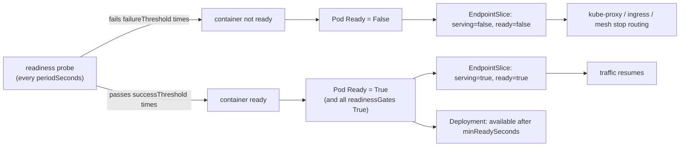

## Explanation

A readiness probe answers one question on behalf of a container: should requests be sent here right now? It uses the same diagnostics as every other Kubernetes probe (`exec` exit code, `httpGet` status 200-399, `tcpSocket` connect, `grpc` `SERVING`) and the same fields (`periodSeconds` default 10, `timeoutSeconds` 1, `failureThreshold` 3, `successThreshold` 1, which for readiness may be raised to demand several consecutive passes). What distinguishes it is the consequence. A failing readiness probe never kills anything; it flips the container's ready state, which flips the Pod's `ContainersReady` and `Ready` conditions, which the EndpointSlice controller translates into `serving: false` and `ready: false` on the Pod's endpoint, at which point kube-proxy, ingress controllers and mesh proxies stop sending it traffic. When the probe passes again the chain reverses. Before `initialDelaySeconds` the readiness result is `Failure`, so a Pod with a readiness probe starts out of rotation; a container with no readiness probe is treated as ready as soon as it is running.

Readiness runs for the container's entire life, which is the source of its three uses. At **startup** it holds traffic until caches are warm, the Redis Streams consumer group exists, TimescaleDB migrations have been verified, or the Angular SSR server bundle has loaded. During **operation** it withdraws a replica when a strict backend is unavailable, when the instance is overloaded, or when an operator wants it out for maintenance, and returns it without a restart. During a **rollout** it is the gate: a Deployment counts a new Pod as available only once it is Ready, and only after staying Ready for `minReadySeconds` (default 0) without a container crash; `maxUnavailable` and `maxSurge` (both 25% by default) bound how many Pods may be unready or extra at once; a Pod whose readiness never passes stalls the rollout, and after `progressDeadlineSeconds` (default 600) the Deployment reports `ProgressDeadlineExceeded` and keeps the old replicas serving.



Two subtleties around the edges. **Termination does not need readiness.** When a Pod is deleted, the control plane immediately marks its endpoint `terminating` with `ready: false`, so load balancers drain it while the containers receive the termination signal; a readiness probe adds nothing here, although a short `preStop` sleep still helps proxies that update asynchronously. **Readiness is composable.** A native [sidecar](sidecar-pattern.md) with a readiness probe contributes to Pod readiness, and `readinessGates` let an external controller (a cloud load-balancer controller registering the Pod as a target, for example) add conditions that must also be `True` before the Pod is Ready. Services with `publishNotReadyAddresses: true`, used for StatefulSet peer discovery, publish endpoints as ready regardless of the probe.

The main design risk is a readiness check that is too eager. If every replica's readiness depends on one database, a database blip empties the Service, and unlike an Application Load Balancer (which fails open when all targets are unhealthy) Kubernetes simply has no endpoints to send to. Check a dependency in readiness only when the service cannot do anything useful without it, keep the check cheap and bounded, and prefer the application degrading gracefully over the Service disappearing.

Azure Container Apps implements readiness with the same semantics over HTTP or TCP: a replica failing readiness is excluded, a revision is reported unhealthy if any replica fails, and in multiple-revision mode traffic shifts to a new revision only after its readiness probes pass. Amazon ECS has no readiness probe; the load balancer's target health plays that role, with `healthCheckGracePeriodSeconds` on the service protecting slow-starting tasks.

## How it differs

**[Liveness probe](liveness-probe.md).** The two probes are independent and should be configured differently even when they hit the same endpoint. Readiness may fail often and cheaply: dependencies, warm-up, overload. Liveness must fail only for a stuck process, because its consequence is a restart. A Pod can be alive and not ready for an hour and that is a normal, healthy state.

**[Health check](health-check.md).** Readiness is one asker of the general health check. ECS, ALB and App Service each have their own version of "may this instance take traffic", with their own thresholds and with ALB's fail-open behaviour that Kubernetes lacks.

**[Rolling deployment](rolling-deployment.md).** The deployment strategy consumes readiness; it does not define it. If readiness always passes, a broken image rolls out to 100% at the speed of `maxSurge`; if readiness is honest, the rollout stops at the first unready Pod and the old ReplicaSet keeps serving until someone rolls back.

**[Sidecar pattern](sidecar-pattern.md).** Each container has its own readiness, and the Pod is ready only when all of them are. A native sidecar's readiness probe is part of that calculation, so probe the sidecar for what it actually must provide (a listening port) rather than for its upstream's health.

| | Readiness | Liveness | ALB target health |
| --- | --- | --- | --- |
| Failure consequence | removed from endpoints | container killed | target out of service |
| Reversible | yes, on next pass | no, new process | yes |
| All instances failing | Service has no endpoints | fleet restarts | fail open: traffic to all |
| Dependency checks | allowed, with care | never | allowed |
| Used by rollouts | yes (available replicas) | indirectly | yes (ECS/ASG deployments) |

## Examples

=== "C#"

    ```csharp
    using Microsoft.AspNetCore.Diagnostics.HealthChecks;
    using Microsoft.Extensions.Diagnostics.HealthChecks;

    var builder = WebApplication.CreateBuilder(args);
    builder.Services.AddSingleton<WarmupState>();
    builder.Services.AddHostedService<Warmup>();
    builder.Services.AddHealthChecks()
        .AddApplicationLifecycleHealthCheck("ready")   // Unhealthy before ApplicationStarted and once stopping begins
        .AddCheck<WarmupDone>("warmup", tags: ["ready"]);

    var app = builder.Build();
    app.MapHealthChecks("/healthz/ready", new HealthCheckOptions { Predicate = r => r.Tags.Contains("ready") });
    app.MapHealthChecks("/healthz/live", new HealthCheckOptions { Predicate = _ => false });
    app.Run();

    sealed class WarmupState { public volatile bool Done; }

    sealed class Warmup(WarmupState state) : BackgroundService
    {
        protected override async Task ExecuteAsync(CancellationToken stoppingToken)
        {
            // create the Redis Streams consumer group, prime the quote cache, verify TimescaleDB migrations ...
            await Task.Delay(TimeSpan.FromSeconds(5), stoppingToken);
            state.Done = true;             // readiness flips to Healthy; the Pod joins the Service
        }
    }

    sealed class WarmupDone(WarmupState state) : IHealthCheck
    {
        public Task<HealthCheckResult> CheckHealthAsync(HealthCheckContext context, CancellationToken ct = default)
            => Task.FromResult(state.Done ? HealthCheckResult.Healthy() : HealthCheckResult.Unhealthy("warming up"));
    }
    ```

=== "Python"

    ```python
    import asyncio
    from contextlib import asynccontextmanager
    from fastapi import FastAPI, Response

    ready = asyncio.Event()

    async def warm_up() -> None:
        # create the consumer group, prime caches, verify migrations ...
        await asyncio.sleep(5)
        ready.set()                        # readiness returns 200; the Pod joins the Service

    @asynccontextmanager
    async def lifespan(app: FastAPI):
        app.state.warmup = asyncio.create_task(warm_up())
        yield
        ready.clear()                      # fail readiness while shutting down

    app = FastAPI(lifespan=lifespan)

    @app.get("/healthz/ready")
    async def readiness(response: Response) -> dict:
        if not ready.is_set():
            response.status_code = 503     # outside 200-399: the kubelet counts a failure
            return {"status": "Unhealthy"}
        return {"status": "Healthy"}
    ```

=== "Kubernetes"

    ```yaml
    apiVersion: apps/v1
    kind: Deployment
    metadata: { name: market-api }
    spec:
      replicas: 4
      minReadySeconds: 10                    # Ready for 10s without a crash before it counts as available
      progressDeadlineSeconds: 300           # report a stalled rollout after 5 minutes
      strategy:
        type: RollingUpdate
        rollingUpdate: { maxSurge: 1, maxUnavailable: 0 }   # never drop below 4 ready replicas
      selector: { matchLabels: { app: market-api } }
      template:
        metadata: { labels: { app: market-api } }
        spec:
          terminationGracePeriodSeconds: 30
          containers:
            - name: api
              image: ghcr.io/example/market-api:2.3.0
              ports: [{ containerPort: 8080, name: http }]
              readinessProbe:
                httpGet: { path: /healthz/ready, port: http }
                periodSeconds: 5
                failureThreshold: 3            # ~15s of failures withdraws the Pod
                successThreshold: 2            # two passes before it returns (not allowed for liveness)
              livenessProbe:
                httpGet: { path: /healthz/live, port: http }
                periodSeconds: 10
                failureThreshold: 6
              lifecycle:
                preStop:
                  exec: { command: ["sleep", "5"] }   # let proxies observe the terminating endpoint first
    ```

    ```bash
    kubectl get endpointslices -l kubernetes.io/service-name=market-api -o wide   # who is serving right now
    kubectl rollout status deployment/market-api                                  # waits on readiness
    ```

=== "Azure"

    ```yaml
    # Azure Container Apps: a replica failing readiness is excluded; the revision shows unhealthy
    # if any replica fails; with multiple revisions, traffic moves only after readiness passes.
    probes:
      - type: Readiness
        httpGet:
          path: /healthz/ready
          port: 8080
        initialDelaySeconds: 3
        periodSeconds: 5
        timeoutSeconds: 3
        failureThreshold: 3
        successThreshold: 1
    ```

    Without explicit probes and with ingress enabled, Container Apps adds a TCP readiness probe on the ingress port (every 5 seconds, `failureThreshold` 48), so an app that opens its port before it is actually able to serve needs its own HTTP readiness probe.

=== "AWS"

    ```bash
    # ECS has no readiness probe: the target group decides who receives traffic.
    aws elbv2 modify-target-group --target-group-arn "$TG_ARN" \
      --health-check-path /healthz/ready --health-check-interval-seconds 10 \
      --healthy-threshold-count 2 --unhealthy-threshold-count 2 --matcher HttpCode=200

    # Drain in-flight requests for 30s after deregistration instead of the 300s default
    aws elbv2 modify-target-group-attributes --target-group-arn "$TG_ARN" \
      --attributes Key=deregistration_delay.timeout_seconds,Value=30

    # Give new tasks 60s before load balancer health checks can stop them
    aws ecs update-service --cluster trading --service market-api --health-check-grace-period-seconds 60
    ```

    Note the fail-open rule: if every target in the group is unhealthy, the ALB routes to all of them anyway, which Kubernetes does not do.

## Misconceptions

- **"A failing readiness probe restarts the container."** It never does. Only liveness and startup probes kill containers; readiness only changes where traffic goes.
- **"I need a readiness probe for graceful shutdown."** Deleting a Pod marks its endpoint `terminating` with `ready: false` immediately; the drain happens without any probe. A `preStop` delay helps slow proxies, a readiness probe does not.
- **"Readiness only matters at startup."** It runs for the container's whole life and is the right tool for taking an instance out of rotation during a dependency outage, overload or maintenance.
- **"Checking every dependency in readiness makes the system safer."** It makes the Service disappear when a shared dependency blips, with no fail-open. Check only dependencies the service cannot function without, and prefer degraded responses over an empty endpoint list.
- **"Not Ready means unreachable."** Only Service traffic stops. The Pod's IP still works directly, headless Services with `publishNotReadyAddresses` still publish it, and endpoints that are both serving and terminating may still receive traffic when nothing else is available.

## Exam notes

CKAD treats readiness as a core skill: write the probe, know the defaults, explain why a Service shows no endpoints (`kubectl get endpointslices`), and recognise that `successThreshold` may exceed 1 only for readiness. CKA adds the rollout angle: `kubectl rollout status` waits on readiness, `minReadySeconds` and `progressDeadlineSeconds` shape it, and a stalled Deployment keeps the old ReplicaSet serving. CKS occasionally probes the interaction with a mesh: the kubelet's HTTP probe arrives through the sidecar proxy, so `STRICT` mTLS needs the mesh's probe rewriting (Istio does this by default) or the probe fails.

AZ-204 covers Container Apps readiness, revision health and traffic splitting between revisions, which waits for readiness in multiple-revision mode. AZ-305 pairs readiness with deployment strategies (blue-green, canary, rolling) and expects you to know that App Service's Health check removes an instance after repeated failures but needs two or more instances to reroute.

DVA-C02 and SAA-C03 ask the equivalent ALB questions: healthy and unhealthy thresholds, the matcher, deregistration delay, the ECS service health check grace period, and the fail-open behaviour when every target is unhealthy. SAP-C03 scenarios combine a slow-starting container, an aggressive ALB health check and ECS replacing tasks before they are ready; the fix is the grace period or a longer start period, not a looser matcher.

## Self-check

??? question "A rolling update of your order API ships a build with a broken Redis connection string. The readiness probe checks Redis. What does the cluster do, and is that the outcome you want?"
    The first new Pod never becomes Ready, so with `maxUnavailable: 0` the Deployment cannot scale down an old Pod and the rollout stalls at one new, unready replica; after `progressDeadlineSeconds` the Deployment reports `ProgressDeadlineExceeded`, while the old ReplicaSet keeps serving all traffic. That is exactly the outcome you want: an honest readiness probe turned a bad release into a paused rollout and a rollback decision instead of an outage. Had the probe not checked Redis, the broken build would have replaced every healthy replica.

??? question "Your TimescaleDB primary fails over and is unreachable for 40 seconds. Every API replica's readiness probe checks it, and your dashboard shows the Service had zero endpoints for a minute. What should change?"
    Decide whether the API can do anything useful without the database. If some endpoints can serve cached quotes or accept writes into the outbox, keep readiness independent of the database and let those requests degrade gracefully; the Service then stays populated and only database-backed requests fail. If nothing works without it, the empty Service is honest, but raise `failureThreshold` or `periodSeconds` so a 40-second blip does not withdraw every replica at once, and remember Kubernetes will not fail open the way an ALB does.

??? question "An OpenTelemetry Collector sidecar in your Pods has a readiness probe that checks the upstream telemetry backend. The backend is down for maintenance and your API disappears from the Service. Why, and how do you fix it?"
    With native sidecars, the sidecar's readiness probe is part of the Pod's Ready condition, so the Collector's failing probe marks the whole Pod not Ready and the API's endpoint is withdrawn even though the API is fine. Probe the sidecar for what the application needs from it (its OTLP port is listening) rather than for its upstream's health, or drop the readiness probe on the sidecar and let it buffer and retry exports.

## Further reading

- [Docker & Containerization Trade-offs](../devops/docker-containerization.md), [CI/CD Pipeline Design Trade-offs](../devops/ci-cd-pipelines.md) and [Redis Streams vs. Kafka](../messaging/eventing/redis-streams-vs-kafka.md) in this library.
- Term pages: [Liveness Probe](liveness-probe.md), [Health Check](health-check.md), [Rolling Deployment](rolling-deployment.md), [Sidecar Pattern](sidecar-pattern.md), [Backpressure](backpressure.md).
- [Liveness, Readiness, and Startup Probes](https://kubernetes.io/docs/concepts/configuration/liveness-readiness-startup-probes/), [EndpointSlices](https://kubernetes.io/docs/concepts/services-networking/endpoint-slices/), [Deployments](https://kubernetes.io/docs/concepts/workloads/controllers/deployment/) and [Pod Lifecycle](https://kubernetes.io/docs/concepts/workloads/pods/pod-lifecycle/) (Kubernetes).
- [Health probes in Azure Container Apps](https://learn.microsoft.com/en-us/azure/container-apps/health-probes) and [ALB target group health checks](https://docs.aws.amazon.com/elasticloadbalancing/latest/application/target-group-health-checks.html).
