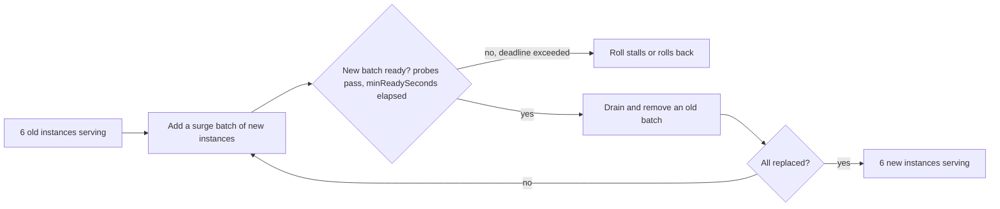

## Explanation

A rolling deployment upgrades a fleet the way you would repaint a bridge without closing it: a few lanes at a time, never all of them. The orchestrator takes a batch of instances out of service, replaces them with instances running the new version, waits until they report ready, and moves on. At every moment a defined share of capacity is serving traffic, and for the duration of the roll two versions are live behind the same endpoint. It is the default strategy of almost every orchestrator because it needs no second environment and no router trick, only a load balancer that stops routing to instances that are not ready.



Two knobs shape every rolling implementation: the **surge**, how many extra instances may exist above the desired count while a batch is added, and the **unavailable** allowance, how many may be missing below it. Kubernetes exposes them as `maxSurge` and `maxUnavailable`, both defaulting to 25 percent (surge rounds up, unavailable rounds down, and they cannot both be zero), so a Deployment is guaranteed at least 75 percent and at most 125 percent of its replicas during a roll. Virtual Machine Scale Sets express the same idea as a batch size (20 percent by default), a maximum unhealthy percentage before the roll stops, and an optional MaxSurge mode that creates new VMs before deleting old ones. Amazon ECS uses `minimumHealthyPercent` and `maximumPercent`, defaulting to 100 and 200 for replica services, so it starts a full set of new tasks before stopping any old ones. Docker Swarm uses `update_config.parallelism`, `delay` and `order` (`stop-first` by default, `start-first` for surge). Elastic Beanstalk distinguishes plain Rolling, which reduces capacity by one batch, from Rolling with additional batch, which launches a batch first. CodeDeploy's in-place EC2 deployments are rolling too (`OneAtATime` by default, `HalfAtATime` or `AllAtOnce`), and an Auto Scaling group instance refresh rolls a new launch template across the group while keeping 90 percent healthy by default, optionally pausing at checkpoints.

The signal that advances the roll is readiness. Kubernetes counts a pod as available only once its readiness probe passes and `minReadySeconds` has elapsed, and declares the rollout failed after `progressDeadlineSeconds` (600 by default) without progress. A VMSS rolling upgrade requires the Application Health extension (Flexible orchestration) or either that extension or a load balancer health probe (Uniform orchestration), and stops when too many instances are unhealthy. ECS can stop a deployment through its deployment circuit breaker when tasks repeatedly fail to start, or through CloudWatch alarms, and roll back to the previous service revision. The dual of readiness is graceful shutdown: an instance leaving the fleet should finish in-flight work. Kubernetes marks a terminating pod's endpoints not ready, runs the `preStop` hook, sends SIGTERM, and sends SIGKILL after `terminationGracePeriodSeconds` (30 seconds by default); a .NET host answers SIGTERM by raising `ApplicationStopping`, refusing new connections and draining existing requests within `HostOptions.ShutdownTimeout`, also 30 seconds by default.

The price of rolling is coexistence. For minutes or hours, version N and N+1 both read the database, consume the same Redis Stream and serve the same Angular users, so every contract between them (API shapes, message fields, cache entry formats, schema) must work for both: the expand-contract discipline of parallel change. Static assets are a classic trap: a browser that loaded version N's `index.html` may request a chunk file only version N's instances have, so hashed assets are best served from storage or a CDN that keeps both builds. Docker Compose, finally, does not roll at all: `docker compose up` stops and recreates a changed service's containers, and `deploy.update_config` is honoured by Swarm, not Compose.

## How it differs

**[Blue-green deployment](blue-green-deployment.md)** avoids coexistence by keeping versions in separate environments and switching all traffic at once; rollback is a second switch and takes seconds. Rolling tolerates coexistence to avoid paying for a second environment; rollback is another roll (`kubectl rollout undo`, an ECS rollback to the previous service revision, an instance refresh rollback) and takes as long as the deployment did. Choose rolling when capacity is constrained and versions are compatible, blue-green when instant reversal and a clean verification window are worth the duplicate capacity.

**[Canary release](canary-release.md)** holds the new version at a deliberate percentage and advances on evidence from metrics compared against a control. A rolling update's percentage is whatever the batch size happens to be, it never pauses to analyse unless you pause it by hand, and it has no concept of a control group. Argo Rollouts, CodeDeploy's canary configurations and the Azure Pipelines canary strategy exist to add those missing steps on top of a rolling mechanism.

**[Immutable infrastructure](immutable-infrastructure.md)** is orthogonal: it determines what a "replacement" is. A Kubernetes rolling update creates new pods from a new image and is immutable; a CodeDeploy in-place deployment stops the application on the same instance, installs the new revision and restarts it, which is rolling but mutable. The rollback story reveals which one you have.

**[Readiness probe](readiness-probe.md)** is the gate, rolling is the process. A probe that returns 200 as soon as the process listens will let the orchestrator remove healthy old instances while new ones are still warming caches or waiting on a database, converting a safe roll into a rolling outage. A probe that checks real dependencies, plus `minReadySeconds` as a soak, is what makes the batch logic safe.

**[Health check](health-check.md)** is the general form of the same gate outside Kubernetes: an Elastic Load Balancing target health check, the VMSS Application Health extension or load balancer probe, Elastic Beanstalk's enhanced health reporting. A rolling deployment waits for each batch to pass them, and most rolling failures trace back to a check that answers 200 before the instance can really serve, or to a health model that watches the process rather than its dependencies.

| | Rolling | Blue-green | Canary |
| --- | --- | --- | --- |
| Extra capacity | One surge batch (or none, with a capacity dip) | A full environment | A small slice |
| Versions coexisting | Yes, for the whole roll | No | Yes, deliberately |
| What advances the release | Readiness of each batch | A verification decision | Metric comparison |
| Rollback | Roll again in reverse | Switch back | Route the slice back |
| Typical implementations | Kubernetes Deployment, VMSS rolling upgrade, ECS rolling update, Swarm, Beanstalk Rolling, instance refresh | Slots, CodeDeploy EC2 blue/green, Container Apps labels | Weighted aliases, slot routing, revision weights, Argo Rollouts |

## Examples

**A Deployment that rolls safely.** Surge instead of dipping below capacity, a readiness probe that means it, a soak time, a `preStop` pause so endpoint removal propagates before SIGTERM, and a grace period longer than the application's own shutdown timeout.

=== "Kubernetes"

    ```yaml
    apiVersion: apps/v1
    kind: Deployment
    metadata:
      name: orders-api
    spec:
      replicas: 6
      revisionHistoryLimit: 5
      progressDeadlineSeconds: 600
      minReadySeconds: 10
      strategy:
        type: RollingUpdate
        rollingUpdate:
          maxSurge: 25%          # 25% of 6 rounds up to 2 extra pods
          maxUnavailable: 0      # never fewer than 6 ready pods
      selector:
        matchLabels: { app: orders-api }
      template:
        metadata:
          labels: { app: orders-api }
        spec:
          terminationGracePeriodSeconds: 40
          containers:
            - name: api
              image: myregistry.azurecr.io/orders-api@sha256:<digest>
              ports: [{ containerPort: 8080 }]
              readinessProbe:
                httpGet: { path: /ready, port: 8080 }
                periodSeconds: 5
              livenessProbe:
                httpGet: { path: /healthz, port: 8080 }
                periodSeconds: 10
              lifecycle:
                preStop:
                  sleep: { seconds: 5 }   # kubelet-run sleep action (stable since 1.34); no shell needed in the image
    ```

    ```bash
    kubectl rollout status deployment/orders-api      # waits for the roll to complete or fail
    kubectl rollout history deployment/orders-api
    kubectl rollout undo deployment/orders-api        # a rollback is itself a rolling update
    ```

=== "C#"

    ```csharp
    // Program.cs (.NET 9). Two things a rolling deployment needs from the application:
    // readiness that reflects real dependencies, and a graceful exit when SIGTERM arrives.
    using Microsoft.AspNetCore.Diagnostics.HealthChecks;     // HealthCheckOptions
    using Microsoft.Extensions.Diagnostics.HealthChecks;     // IHealthCheck, HealthCheckResult

    var builder = WebApplication.CreateBuilder(args);
    builder.Services.Configure<HostOptions>(o => o.ShutdownTimeout = TimeSpan.FromSeconds(25)); // below the pod's 40 s grace
    builder.Services.AddSingleton<DrainState>();
    builder.Services.AddHealthChecks()
        .AddNpgSql(builder.Configuration["ConnectionStrings:Orders"]!, tags: ["ready"])   // package AspNetCore.HealthChecks.NpgSql
        .AddCheck<DrainCheck>("draining", tags: ["ready"]);

    var app = builder.Build();
    var drain = app.Services.GetRequiredService<DrainState>();
    app.Lifetime.ApplicationStopping.Register(() => drain.Draining = true);   // SIGTERM: fail readiness first, then drain

    app.MapHealthChecks("/healthz");                                              // liveness: the process is up
    app.MapHealthChecks("/ready", new HealthCheckOptions { Predicate = r => r.Tags.Contains("ready") });
    app.MapGet("/orders/{id:guid}", (Guid id) => Results.Ok(new { id }));
    app.Run();

    public sealed class DrainState { public volatile bool Draining; }

    public sealed class DrainCheck(DrainState drain) : IHealthCheck
    {
        public Task<HealthCheckResult> CheckHealthAsync(HealthCheckContext context, CancellationToken ct = default)
            => Task.FromResult(drain.Draining
                ? HealthCheckResult.Unhealthy("instance is draining")
                : HealthCheckResult.Healthy());
    }
    ```

=== "Python"

    ```python
    # worker.py (Python 3.12, redis-py). A Redis Streams consumer that survives being rolled:
    # it finishes the batch in hand on SIGTERM and acknowledges only after the work is durable,
    # so a replacement consumer can reclaim anything it did not finish.
    import os
    import signal

    import redis

    STREAM, GROUP = "ticks", "pricers"
    CONSUMER = os.environ.get("HOSTNAME", "pricer")   # one consumer name per replica


    class Lifecycle:
        stopping = False


    def price(fields: dict[bytes, bytes]) -> None:
        ...   # the real work; must be idempotent, because an unacknowledged entry is redelivered


    signal.signal(signal.SIGTERM, lambda *_: setattr(Lifecycle, "stopping", True))
    r = redis.Redis.from_url(os.environ["REDIS_URL"])

    while not Lifecycle.stopping:
        batches = r.xreadgroup(GROUP, CONSUMER, {STREAM: ">"}, count=50, block=2000) or []
        for _, entries in batches:
            for entry_id, fields in entries:
                price(fields)
                r.xack(STREAM, GROUP, entry_id)    # ack after, never before
    # Exit cleanly inside the grace period; unacknowledged entries stay pending for XAUTOCLAIM by survivors.
    ```

=== "Azure"

    ```bash
    # Virtual Machine Scale Set: rolling upgrade policy with surge, health gating and a pause between batches.
    # Flexible orchestration requires the Application Health extension; Uniform accepts it or a load balancer probe.
    az vmss update --resource-group rg-platform --name vmss-orders \
      --set upgradePolicy.mode=Rolling \
      --max-batch-instance-percent 20 --max-unhealthy-instance-percent 20 \
      --max-unhealthy-upgraded-instance-percent 20 --pause-time-between-batches PT30S \
      --prioritize-unhealthy-instances true --max-surge true

    # Change the model (for example a new image version) and the scale set rolls it out.
    az vmss update --resource-group rg-platform --name vmss-orders \
      --set virtualMachineProfile.storageProfile.imageReference.id="/subscriptions/<sub>/resourceGroups/rg-platform/providers/Microsoft.Compute/galleries/platformGallery/images/orders/versions/1.4.2"
    az vmss rolling-upgrade get-latest --resource-group rg-platform --name vmss-orders
    ```

    ```yaml
    # Azure Pipelines: the rolling strategy for a VM environment, five machines at a time.
    jobs:
      - deployment: rollout
        environment:
          name: prod
          resourceType: VirtualMachine
        strategy:
          rolling:
            maxParallel: 5
            deploy:
              steps:
                - script: ./deploy-orders-api.sh
            routeTraffic:
              steps:
                - script: ./probe-health.sh --wait-for 200
    ```

=== "AWS"

    ```bash
    # ECS rolling update: surge to 150 percent, never below 100 percent, stop and roll back on repeated failures.
    aws ecs update-service --cluster prod --service orders-api --task-definition orders-api:43 \
      --deployment-configuration "maximumPercent=150,minimumHealthyPercent=100,deploymentCircuitBreaker={enable=true,rollback=true}"

    # Auto Scaling group instance refresh: roll a new launch template version, keep 90 percent healthy,
    # pause for verification after the first quarter, and roll back automatically on failure.
    aws autoscaling start-instance-refresh --auto-scaling-group-name asg-orders \
      --preferences '{"MinHealthyPercentage":90,"InstanceWarmup":120,"CheckpointPercentages":[25,100],"CheckpointDelay":600,"AutoRollback":true}'

    # CodeDeploy in-place deployment to EC2: rolling, but each instance is upgraded in place.
    aws deploy create-deployment --application-name orders-api --deployment-group-name orders-api-inplace \
      --deployment-config-name CodeDeployDefault.HalfAtATime \
      --s3-location bucket=releases,key=orders-api-1.4.2.zip,bundleType=zip
    ```

    ```bash
    # Docker Swarm (not plain Compose): one task at a time, start the new one first, roll back on failure.
    docker service update --image myregistry.azurecr.io/orders-api:1.4.2 \
      --update-parallelism 1 --update-delay 10s --update-order start-first --update-failure-action rollback orders-api
    ```

## Misconceptions

- **"`docker compose up` does a rolling update."** It stops and recreates the containers whose image or configuration changed, so a single-replica service is down for the restart. Rolling semantics (`update_config`) belong to Swarm services or to an orchestrator.
- **"Rolling deployments are zero-downtime by default."** They are zero-downtime only when readiness means something, shutdown is graceful, and the surge and unavailable settings keep enough capacity. With `maxUnavailable` at 25 percent and no surge, you run a quarter short during the roll; with Elastic Beanstalk's plain Rolling policy, each batch is out of service while it deploys.
- **"A rollback is instant, like blue-green."** A rollback is another rolling deployment in the opposite direction and takes about as long as the deployment did. Kubernetes keeps old ReplicaSets (`revisionHistoryLimit`, 10 by default) so that `rollout undo` can reuse them, but the pods are still replaced batch by batch.
- **"Only the API contract needs to be compatible across versions."** The database schema, cache entry formats, messages on queues and streams, and hashed static assets all cross the version boundary during the roll.
- **"Setting `maxUnavailable: 0` guarantees capacity."** It guarantees that old instances are not removed before new ones are ready, which requires surge capacity to exist; if the cluster cannot schedule the surge batch, the roll stalls rather than proceeding.

## Exam notes

The Kubernetes exams (CKA, CKAD) test rolling updates directly: the `RollingUpdate` and `Recreate` strategies, `maxSurge` and `maxUnavailable` and their defaults, `kubectl rollout status`, `history`, `undo`, `pause` and `resume`, `revisionHistoryLimit`, `progressDeadlineSeconds`, and how a failing readiness probe stalls a rollout; KCNA asks the conceptual version. AZ-104 and AZ-305 cover VMSS upgrade policy modes (Automatic, Manual, Rolling) and the health probe or Application Health extension requirement; AZ-400 and its successor AZ-401 list rolling deployments under minimising downtime and cover the rolling strategy in Azure Pipelines deployment jobs. On AWS, DVA-C02/C03 test Elastic Beanstalk's policies (All at once, Rolling, Rolling with additional batch, Immutable, Traffic splitting) and the CodeDeploy in-place configurations; DOP-C02 adds instance refresh with checkpoints and rollback, ECS deployment configuration and circuit breaker; SOA-C03 and SAA-C03 touch Auto Scaling group updates.

Traps worth memorising: Beanstalk Rolling reduces capacity during the roll while Rolling with additional batch does not, and Immutable launches a separate Auto Scaling group; CodeDeploy's default EC2 configuration is `OneAtATime`, and `AllAtOnce` counts as success if even one instance deploys; a VMSS in Automatic mode may take down all instances at once; Kubernetes `Recreate` terminates every old pod before creating new ones; and `maxSurge` and `maxUnavailable` cannot both be zero.

## Self-check

??? question "A six-replica Deployment uses the defaults. During a rollout, p99 latency triples even though no pod ever reports unhealthy. What is the most likely cause and the fix?"
    With the defaults, `maxUnavailable` of 25 percent rounds down to one and `maxSurge` rounds up to two, so the Deployment can run with as few as five ready pods while the remaining traffic is concentrated on them; if the service is sized tightly, a one-pod dip is enough to blow the latency budget. Set `maxUnavailable: 0` so old pods are only removed after replacements are ready, keep or raise `maxSurge`, and add `minReadySeconds` so a pod that passes its probe but is still warming caches is not counted as available immediately.

??? question "After a rolling release, a small fraction of users see a blank Angular page and the browser console shows a 404 for a JavaScript chunk. Nothing is wrong with the API. Why does this happen only during and shortly after the roll?"
    Users who loaded the previous version's `index.html` request chunk files whose hashed names exist only in the previous build. During the roll some instances serve the new build, which does not contain those files, so the request fails. Serve hashed assets from storage or a CDN that retains previous builds, or keep the previous build's assets inside the new image for a release or two, so that mixed versions behind one endpoint remain consistent for in-flight clients.

??? question "Your worker service consumes a Redis Stream through a consumer group. During rolling restarts some entries are processed twice. Is the rolling deployment at fault?"
    No, the rolling deployment is exposing an at-least-once property that was always there. A consumer that is killed after processing but before acknowledging leaves the entry pending, and a surviving consumer later claims it with `XAUTOCLAIM`, so it runs again. Make the handler idempotent (for example with an idempotency key), keep the handler's shutdown within the grace period so in-flight batches finish and acknowledge, and treat duplicates as expected rather than as a deployment bug.

## Further reading

- [CI/CD pipelines](../devops/ci-cd-pipelines.md) for the pipeline stages that trigger and observe a roll, and [Docker and containerization](../devops/docker-containerization.md) for why Compose and Swarm behave differently.
- [Delivery semantics](../messaging/eventing/delivery-semantics.md) and [Redis Streams vs Kafka](../messaging/eventing/redis-streams-vs-kafka.md) for the consumer-side consequences of restarting workers.
- [Async and threading in .NET](../messaging/runtime/async-threading.md) for cancellation tokens and graceful shutdown.
- Neighbouring terms: [Blue-Green Deployment](blue-green-deployment.md), [Canary Release](canary-release.md), [Immutable Infrastructure](immutable-infrastructure.md), [Readiness Probe](readiness-probe.md), [Health Check](health-check.md), [Horizontal Scaling](horizontal-scaling.md).
- [Kubernetes Deployments](https://kubernetes.io/docs/concepts/workloads/controllers/deployment/) and [Pod lifecycle](https://kubernetes.io/docs/concepts/workloads/pods/pod-lifecycle/) for surge, unavailability and termination semantics.
- [VMSS rolling upgrades](https://learn.microsoft.com/en-us/azure/virtual-machine-scale-sets/virtual-machine-scale-sets-configure-rolling-upgrades), [ECS rolling update deployments](https://docs.aws.amazon.com/AmazonECS/latest/developerguide/deployment-type-ecs.html), [Auto Scaling instance refresh defaults](https://docs.aws.amazon.com/autoscaling/ec2/userguide/understand-instance-refresh-default-values.html) and [.NET Generic Host shutdown timeout](https://learn.microsoft.com/en-us/aspnet/core/fundamentals/host/generic-host): the platform and runtime defaults quoted above.
