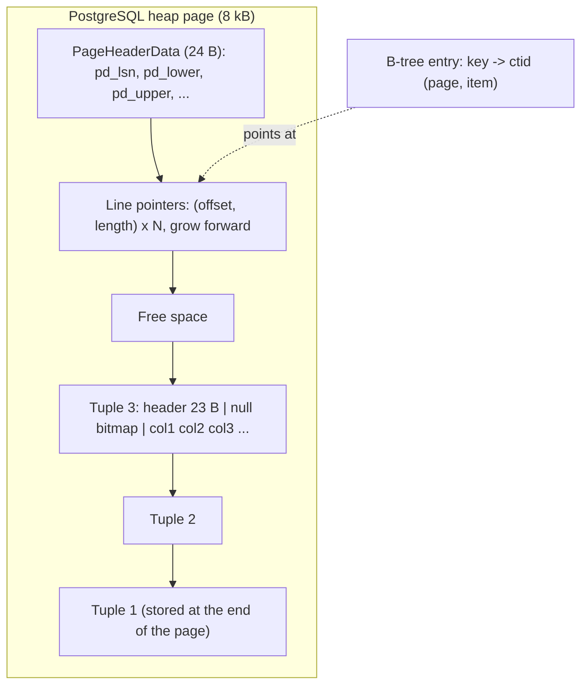

## Explanation

Row-oriented storage keeps all the columns of one record next to each other on disk, and keeps records one after another inside fixed-size pages. It is the layout almost every transactional database uses by default (PostgreSQL, SQL Server, MySQL's InnoDB, Oracle), and the baseline against which [columnar storage](columnar-storage.md) is defined. The name *row-major* comes from how a two-dimensional array is flattened into memory, one row after another.

The page is the unit of everything. PostgreSQL stores tables and indexes as arrays of pages, usually 8 kB; SQL Server's are 8 KiB, grouped into 64 KiB extents. I/O happens a page at a time, so "how many pages must I touch?" is the real cost model of a row store. A PostgreSQL heap page has five parts: a 24-byte header (including `pd_lsn`, the position of the last [write-ahead log](write-ahead-log.md) record that changed the page, and the free-space pointers), an array of 4-byte *line pointers* growing from the front, free space, the tuples packed backwards from the end, and a special area that ordinary tables leave empty. A tuple is a 23-byte header on most platforms (transaction stamps `t_xmin` and `t_xmax`, flags, the data offset), an optional null bitmap, then the column values in declared order. The pair *(page number, line pointer index)* is the tuple's `ctid`, the physical address an index entry points at. SQL Server's data page is the same idea: a 96-byte header, rows stored forward, and a slot array of 2-byte row offsets growing backwards from the end.

Tuples cannot span pages. PostgreSQL handles oversized values with TOAST (The Oversized-Attribute Storage Technique): when a row would exceed `TOAST_TUPLE_THRESHOLD`, normally 2 kB, wide values are compressed and, if still too large, moved out of line into a TOAST table and replaced by a pointer. SQL Server caps in-row data at 8,060 bytes and moves variable-length columns to row-overflow pages or large-object types to text/LOB pages.

Within a page the heap is unordered. PostgreSQL inserts a row wherever free space exists, and only an index, or a one-off `CLUSTER`, imposes order. SQL Server distinguishes a *heap* from a table with a *clustered index*, whose rows are kept in key order inside a B-tree; both are row stores, differing only in whether storage order is maintained.

Why rows? Transactional access touches whole records. One page read returns everything about the entity, one page write persists all of its columns, and a [B-tree index](b-tree-index.md) turns a key into a `ctid` in a few hops. C-Store's authors put it precisely: in a row store one disk write pushes every field of a record out to disk, which is why they called such systems write-optimised. The same property is a liability for analytics: summing one column of a billion rows drags every other column through the buffer cache, and mixed-type values packed together compress poorly. [MVCC](mvcc.md) also lives in these pages: an `UPDATE` writes a new tuple version and stamps the old one's `t_xmax`, so a row store silently accumulates dead versions until `VACUUM` frees their line pointers.

In the reader's stack every PostgreSQL table, including the rowstore chunks of a TimescaleDB [hypertable](hypertable.md), is this layout, and EF Core's entity-per-row model is its application-side mirror. The row store is the right default; the architect's question is when a subset of the data, usually the historical part, should move to a columnar layout.



## How it differs

**[Columnar storage](columnar-storage.md)** is the opposite layout: one column of many records together. The decisive difference is which query shape pays. A row store answers entity-at-a-time questions with one page; a column store answers column-at-a-time questions by reading only the segments involved and compressing them several times better. Choose rows when the workload is reads by key and single-row writes (OLTP, online transaction processing), columns when it is scans and aggregates over many rows (OLAP, online analytical processing), and a hybrid such as TimescaleDB hypercore or a SQL Server nonclustered columnstore index when it is both.

**[B-tree index](b-tree-index.md)** is frequently mistaken for a storage layout because SQL Server's clustered index really does dictate row order. The index is still a separate sorted structure whose leaf entries lead to rows; the rows themselves remain row-oriented. In PostgreSQL the distinction is sharper: the heap is never ordered by an index, every index is secondary, and an index-only scan is possible only when the visibility map says the heap page needs no visit. Think of the layout as *where bytes live* and the index as *how to find them*.

**[MVCC](mvcc.md)** is a concurrency protocol that happens to be implemented inside heap tuples in PostgreSQL (`t_xmin`, `t_xmax`), which makes people say "the heap is MVCC". Other engines implement MVCC elsewhere (SQL Server keeps row versions in a version store when row-versioning isolation is on) while using the same row-oriented pages. The storage layout determines I/O cost; MVCC determines visibility and bloat. You tune the first with page size, fill factor and TOAST strategy, the second with vacuum and transaction length.

**[Table partitioning](table-partitioning.md)** divides a table into child tables by key ranges, lists or hashes. Each partition is a complete row store with its own pages, indexes and bloat; partitioning changes which file a row lands in, not how the row is laid out inside the page. People reach for partitioning when a row store "gets slow", but if the slowness is a wide scan, partitioning only helps when the filter prunes partitions; a columnar layout addresses the scan itself.

| Question | Row store | Columnar | Partitioned row store |
|---|---|---|---|
| Fetch one row by key | One index lookup, one page | Many segments | One index lookup in one partition |
| Insert one row | One page write (plus index entries) | Buffered, later columnised | Routed to one partition |
| Scan two of fifty columns | Reads all fifty | Reads two | Reads all fifty in surviving partitions |
| Compression | Modest, per page | High, per column | Same as row store |

## Examples

=== "SQL"

    ```sql
    -- Look inside a heap page with the pageinspect extension (superuser).
    CREATE EXTENSION IF NOT EXISTS pageinspect;

    CREATE TABLE orders (id bigint PRIMARY KEY, status text, total numeric);
    INSERT INTO orders VALUES (1, 'new', 10.00), (2, 'new', 25.50);
    UPDATE orders SET status = 'paid' WHERE id = 1;

    -- ctid is the physical address (page, line pointer); xmin/xmax are MVCC stamps.
    SELECT ctid, xmin, xmax, * FROM orders;

    -- Page 0 header: lower/upper are the free-space boundaries.
    SELECT lower, upper, special, pagesize FROM page_header(get_raw_page('orders', 0));

    -- All line pointers on page 0, including the dead version left by the UPDATE.
    SELECT lp, lp_off, lp_len, t_xmin, t_xmax, t_ctid
    FROM heap_page_items(get_raw_page('orders', 0));

    -- Leave room on each page for in-place (HOT) updates of this hot table.
    ALTER TABLE orders SET (fillfactor = 80);
    ```

=== "C#"

    ```csharp
    // .NET 9 + Npgsql: entity-at-a-time access is what a row store is built for.
    // Loading one order by primary key touches one index path and one heap page.
    await using var conn = await dataSource.OpenConnectionAsync();

    await using var cmd = new NpgsqlCommand(
        "SELECT id, status, total FROM orders WHERE id = $1", conn);
    cmd.Parameters.Add(new NpgsqlParameter { Value = 42L });

    await using var reader = await cmd.ExecuteReaderAsync();
    if (await reader.ReadAsync())
    {
        var order = new Order(
            reader.GetInt64(0),
            reader.GetString(1),
            reader.GetDecimal(2));
    }

    // Ask the planner what it will touch; a row store answers in pages (buffers).
    await using var explain = new NpgsqlCommand(
        "EXPLAIN (ANALYZE, BUFFERS) SELECT * FROM orders WHERE id = 42", conn);
    await using var plan = await explain.ExecuteReaderAsync();
    while (await plan.ReadAsync())
        Console.WriteLine(plan.GetString(0));
    ```

=== "Python"

    ```python
    # Python 3.12 + psycopg 3: show how rows are addressed physically.
    import psycopg

    with psycopg.connect(conninfo) as conn:
        for ctid, xmin, xmax, oid in conn.execute(
            "SELECT ctid::text, xmin::text, xmax::text, id FROM orders ORDER BY ctid"
        ):
            # ctid prints as '(page,item)': the physical address of this row version
            print(f"order {oid}: at {ctid}, inserted by xid {xmin}, deleted by xid {xmax}")

        # Buffer counts are the honest cost of a row-store query.
        for (line,) in conn.execute(
            "EXPLAIN (ANALYZE, BUFFERS) SELECT status FROM orders"
        ):
            print(line)
    ```

=== "Azure"

    - **Azure SQL Database and Azure SQL Managed Instance** store rowstore tables as heaps or clustered-index B-trees on 8 KiB pages; "rowstore" is Microsoft's own term for the layout, used in contrast with columnstore indexes.
    - **Azure Database for PostgreSQL flexible server** is unmodified PostgreSQL storage: 8 kB heap pages, TOAST, `fillfactor`, `pageinspect` available as an extension.
    - **Azure Cosmos DB for NoSQL** is a document store rather than a page-oriented row store; the analytical store it can project into is columnar, which is the same row-versus-column split at service level.

=== "AWS"

    - **Amazon RDS for PostgreSQL** is stock PostgreSQL heap storage on EBS volumes; everything above applies, including `pageinspect`.
    - **Amazon Aurora PostgreSQL** keeps the PostgreSQL page format at the engine, but the engine ships only log records to the storage layer, which coalesces them into data pages across six copies in three Availability Zones; the row layout is unchanged, the way pages are materialised is not.
    - **Amazon Redshift** is the counter-example: its documentation walks through why row-wise blocks suit OLTP and then explains why Redshift stores blocks by column instead.

## Misconceptions

- **"Rows are stored in primary-key order."** In PostgreSQL the heap is unordered; a row lands wherever a page has room and moves only on update or `VACUUM FULL`. Only SQL Server-style clustered indexes (and InnoDB's clustered primary key) keep rows in key order.
- **"A wide table with a hundred columns costs nothing if I only select two."** In a row store every page read carries all hundred columns through memory. Column selectivity is exactly what columnar storage adds; in a row store it is a free lunch only when an index-only scan can answer from the index.
- **"The `ctid` is a stable row identifier."** It is a physical address that changes whenever the row is updated (a new version is written) or the table is rewritten. Use the primary key for identity; use `ctid` only for diagnostics or self-join deduplication within one statement.
- **"Updates happen in place."** PostgreSQL never overwrites a visible tuple; an `UPDATE` writes a new version and leaves the old one for `VACUUM`. SQL Server does update in place but, under row-versioning isolation, copies the old version elsewhere first. Either way, update-heavy row stores need space management.
- **"Page size does not matter to the application."** It fixes the I/O granularity, the row-size ceiling (TOAST or row-overflow beyond it) and the amount of data a single lock or a single full-page WAL image covers. Wide rows that straddle the limit are a design smell in a row store.

## Exam notes

DP-900 and DP-300 use "rowstore" explicitly: expect questions that contrast rowstore tables (heaps, clustered indexes) with columnstore indexes and ask which to use for OLTP versus analytics. DP-300 also tests fill factor, page splits and why in-row versus off-row storage affects performance. AWS exams (SAA-C03, DEA-C01) test the same split at service level, RDS or Aurora for transactional row access versus Redshift for columnar analytics, and may describe Aurora's log-only storage path; the trap is assuming Aurora changed the table layout. iSAQB and architecture exams (CPSA-F) expect you to justify a storage choice from the access pattern rather than from the product name. A common trap in all of them is treating "add an index" as the fix for a scan-shaped query on a row store.

## Self-check

??? question "A .NET service loads a trade by id, mutates three fields and saves it, ten thousand times a minute. A colleague wants to move the table to a columnar layout because 'the reports are slow'. What do you recommend?"
    Keep the row store for the operational table: each load is one index lookup and one page, and each save is one page write plus index maintenance, which is exactly what a row-oriented heap is built for. Serve the reports from a columnar copy, such as a nonclustered columnstore index in SQL Server, a TimescaleDB columnstore for aged chunks, or an export to Parquet, so the OLTP path is untouched.

??? question "`SELECT symbol, avg(price) FROM ticks GROUP BY symbol` reads 40 GB of buffers although `symbol` and `price` are 16 bytes per row. Why, and what are the options?"
    The row store must read every page, and every page carries all columns of every row, so the scan cost is the whole table regardless of how few columns the query names. Options: a covering B-tree with `INCLUDE (price)` that allows an index-only scan when the visibility map is mostly set; a columnar layout for the historical chunks so only two segments are read; or a continuous aggregate that answers the question without a scan at all.

??? question "After bulk updates, a PostgreSQL table's `ctid` values change and a reporting script that cached them breaks. What went wrong?"
    `ctid` is the physical address of a row version, not an identity. Every update writes a new version at a new address, and `VACUUM FULL` or `CLUSTER` moves rows wholesale. The script should key on the primary key; `ctid` is for diagnostics.

## Further reading

- [Row-Oriented vs. Columnar Storage](../data/time-series/row-vs-columnar-storage.md) in this library
- [Relational Databases](../data/relational/relational-databases.md) in this library
- Term pages: [Columnar Storage](columnar-storage.md), [B-Tree Index](b-tree-index.md), [MVCC](mvcc.md), [Table Partitioning](table-partitioning.md), [Write-Ahead Log](write-ahead-log.md)
- [Database Page Layout](https://www.postgresql.org/docs/current/storage-page-layout.html), [TOAST](https://www.postgresql.org/docs/current/storage-toast.html) and [Heap-Only Tuples](https://www.postgresql.org/docs/current/storage-hot.html), PostgreSQL documentation
- [pageinspect](https://www.postgresql.org/docs/current/pageinspect.html), the extension used in the SQL example
- [Page and extent architecture guide](https://learn.microsoft.com/en-us/sql/relational-databases/pages-and-extents-architecture-guide), Microsoft Learn
- [C-Store: A Column-oriented DBMS (VLDB 2005)](https://www.vldb.org/archives/website/2005/program/paper/thu/p553-stonebraker.pdf), whose introduction is the classic statement of why row stores are write-optimised
