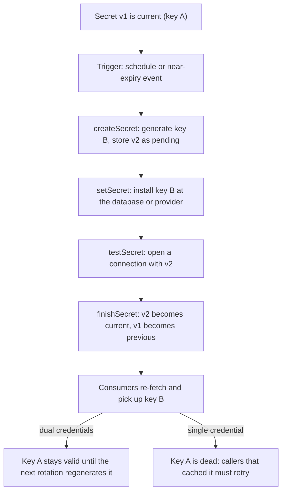

## Explanation

A secret is any value whose possession grants access: a database password, an [API key](api-key.md), a client secret, a signing key, a certificate's private key. Rotation is the controlled replacement of that value with a fresh one and the retirement of the old one. NIST SP 800-57 calls the time a key is authorised for use its *cryptoperiod* and lists what bounding it buys: it limits the material available for cryptanalysis, the exposure if one key is compromised, the time an attacker has to penetrate the controls around it, and how long an inadvertent disclosure stays useful. A secret that leaked last month and was rotated last week is worthless today.

Rotation is a small state machine, which AWS Secrets Manager makes explicit. A rotation function runs four steps: `createSecret` generates the new value and stores it as a new version labelled `AWSPENDING`; `setSecret` changes the credential in the database or service to match; `testSecret` proves the pending version works; `finishSecret` moves the `AWSCURRENT` label to the new version, and the previous version automatically becomes `AWSPREVIOUS`, the last known good value. Consumers read whatever `AWSCURRENT` points at.



Whether consumers notice depends on the strategy. With a **single credential** (Secrets Manager's *single user* strategy) there is a short window between the provider accepting the new value and the store publishing it in which a caller using the old value is refused, so applications need a retry that re-fetches the secret. With **dual credentials** (the *alternating users* strategy, a user and a `user_clone` with identical permissions swapped on every rotation, or Key Vault's dual-key pattern alternating a storage account's two access keys) one value is always valid, at the cost of a second principal and, for databases, a superuser secret that can clone users. Key Vault triggers rotation with an Event Grid `SecretNearExpiry` event thirty days before expiry that calls a function to regenerate the *alternate* key; AWS triggers it from a `rate()` or `cron()` schedule, as often as every four hours, inside a rotation window.

Consumers must cooperate: fetch the secret by its versionless name so the latest enabled version is returned, keep the cache short, and treat an authentication failure as "it may have rotated" before giving up. Signing keys work the same way: Key Vault's rotation policy creates a new key version at a chosen interval (minimum seven days) for services that reference the key without a version.

When to rotate is where policy meets evidence. NIST SP 800-63B-4 (July 2025) says verifiers "SHALL NOT require subscribers to change passwords periodically" but "SHALL force a change if there is evidence that the authenticator has been compromised". Machine secrets are different because nobody notices when they leak, so OWASP's secrets cheat sheet says to rotate them regularly and automatically and prefers dynamic, short-lived secrets. Public TLS certificates are heading the same way: CA/Browser Forum ballot SC-081 cuts maximum validity in stages from 398 days to 47 days by March 2029, which makes automation mandatory. Rotation is also not revocation: on a leak you revoke first, rotate second and delete every exposed copy, including the one in the log.

In the reader's stack, the TimescaleDB password, the Redis `AUTH` string, broker API keys and the JWT signing key each need an owner, a schedule, a dual-credential cut-over where downtime is unacceptable, and a vault read at run time rather than a `.env` file in a Compose stack. [Workload identity](workload-identity.md) is where the road ends: when the platform issues the credential, rotation stops being a process you run.

## How it differs

**Versus [workload identity](workload-identity.md).** Rotation improves a secret you still store; workload identity removes the stored secret. The kubelet rewriting a projected token at 80 percent of its lifetime, or a managed identity whose credential you can never read, is rotation performed by the platform with no cut-over to design. Choose rotation for the secrets that remain after you have exhausted workload identity: database passwords on engines that cannot federate, partner API keys, bootstrap credentials.

**Versus an [API key](api-key.md).** The key is an object; rotation is its lifecycle. A well-designed key scheme makes rotation cheap by issuing keys in pairs, hashing them server-side so the old one can be invalidated instantly, and carrying an expiry. A key without a rotation story is a permanent credential waiting to be found in a repository.

**Versus the [OAuth 2.0 client credentials flow](oauth-client-credentials-flow.md).** Access tokens are not rotated; they expire and the client re-authenticates. What rotates is the client secret or certificate. A signed client assertion with a five-minute expiry and a signing key on a rotation policy is the healthy shape; a client secret pasted into a pipeline variable two years ago is the unhealthy one.

**Versus [mutual TLS](mtls.md).** Certificates carry their own expiry, and issuers such as SPIRE, Istio and cert-manager renew them continuously, so certificate rotation is usually automated out of sight. What secrets rotation adds for mTLS is the slow part: CA roll-over, where every peer must trust the new root before leaves signed by it appear, and the renewal of whatever credential the issuer itself uses.

| Dimension | Scheduled rotation | Dual-credential rotation | Short-lived credentials |
|---|---|---|---|
| Downtime risk | Brief refusal window; needs retries | None, one value is always valid | None, renewal precedes expiry |
| Extra moving parts | A rotation job | A second principal or key, often a superuser secret | An issuer (SPIRE, platform, vault) |
| Where it fits | Passwords and keys with one slot | Databases, storage keys, API keys | Tokens, SVIDs, platform identities |
| Leak exposure | Until the next rotation | Until the next rotation | Minutes to hours |

## Examples

=== "C#"

    ```csharp
    // A consumer that survives rotation: read the versionless secret at use time, and treat an
    // authentication failure as "it may have rotated" before failing. .NET 9, Azure.Identity, Npgsql.
    using Azure.Identity;
    using Azure.Security.KeyVault.Secrets;
    using Npgsql;

    var secrets = new SecretClient(new Uri("https://orders-kv.vault.azure.net/"), new DefaultAzureCredential());

    async Task<NpgsqlConnection> OpenTimescaleAsync(CancellationToken ct)
    {
        for (var attempt = 1; ; attempt++)
        {
            KeyVaultSecret pw = await secrets.GetSecretAsync("timescale-password", cancellationToken: ct);
            var conn = new NpgsqlConnection(
                $"Host=timescale;Database=market;Username=orders;Password={pw.Value};SSL Mode=VerifyFull");
            try
            {
                await conn.OpenAsync(ct);
                return conn;
            }
            catch (PostgresException ex) when (ex.SqlState == "28P01" && attempt < 3)   // invalid_password
            {
                await conn.DisposeAsync();
                await Task.Delay(TimeSpan.FromSeconds(attempt), ct);   // let the new version propagate, then re-fetch
            }
        }
    }
    ```

    The connection string is built per attempt from the latest version, so a rotation that completed between two calls is picked up on the retry. Keep the retry narrow (only the password error code) so a real outage still fails fast.

=== "Python"

    ```python
    # AWS Secrets Manager rotation function (Lambda, Python 3.12). Secrets Manager invokes it four
    # times with the same ClientRequestToken, once per step, so every step must be idempotent.
    import json
    import boto3

    sm = boto3.client("secretsmanager")

    def lambda_handler(event, context):
        arn, token, step = event["SecretId"], event["ClientRequestToken"], event["Step"]
        {"createSecret": create_secret, "setSecret": set_secret,
         "testSecret": test_secret, "finishSecret": finish_secret}[step](arn, token)

    def create_secret(arn, token):
        current = json.loads(sm.get_secret_value(SecretId=arn, VersionStage="AWSCURRENT")["SecretString"])
        try:
            sm.get_secret_value(SecretId=arn, VersionId=token, VersionStage="AWSPENDING")  # already created
        except sm.exceptions.ResourceNotFoundException:
            current["password"] = sm.get_random_password(ExcludeCharacters="/@\"'\\")["RandomPassword"]
            sm.put_secret_value(SecretId=arn, ClientRequestToken=token,
                                SecretString=json.dumps(current), VersionStages=["AWSPENDING"])

    def set_secret(arn, token):
        # ALTER USER ... PASSWORD with the AWSPENDING value, through a parameterised statement.
        # Guard against a confused deputy: AWSCURRENT must be valid, and host and username must match.
        ...

    def test_secret(arn, token):
        # Open a read-only connection with the AWSPENDING credentials; raise if it fails.
        ...

    def finish_secret(arn, token):
        meta = sm.describe_secret(SecretId=arn)
        current = next(v for v, stages in meta["VersionIdsToStages"].items() if "AWSCURRENT" in stages)
        if current != token:
            sm.update_secret_version_stage(SecretId=arn, VersionStage="AWSCURRENT",
                                           MoveToVersionId=token, RemoveFromVersionId=current)
            # Secrets Manager attaches AWSPREVIOUS to the old version automatically.
    ```

=== "Azure"

    ```json
    {
      "lifetimeActions": [
        { "trigger": { "timeAfterCreate": "P18M" }, "action": { "type": "Rotate" } },
        { "trigger": { "timeBeforeExpiry": "P30D" }, "action": { "type": "Notify" } }
      ],
      "attributes": { "expiryTime": "P2Y" }
    }
    ```

    ```bash
    az keyvault key rotation-policy update --vault-name orders-kv --name signing-key --value ./policy.json
    az keyvault key rotate --vault-name orders-kv --name signing-key      # on demand
    ```

    Key Vault rotates *keys* natively: the policy above creates a new version eighteen months after creation, sets a two-year expiry on each version and raises a `KeyNearExpiry` Event Grid event thirty days out. The minimum rotation interval is seven days, the Key Vault Crypto Officer role manages it, and consumers must use the versionless key URI. *Secrets* have no built-in rotation: the dual-credential tutorial stores each storage account key as a version of one secret with `CredentialId`, `ProviderAddress` and `ValidityPeriodDays` tags, subscribes a function to `SecretNearExpiry`, regenerates the alternate key and writes it as the next version. Where possible, skip the problem: use a managed identity and disable shared-key authorization on the storage account.

=== "AWS"

    ```bash
    # Lambda-based rotation every 30 days in a two-hour window, starting immediately
    aws secretsmanager rotate-secret --secret-id orders/timescale \
      --rotation-lambda-arn arn:aws:lambda:eu-west-1:111122223333:function:SecretsManagerTimescaleRotation \
      --rotation-rules '{"ScheduleExpression": "rate(30 days)", "Duration": "2h"}' \
      --rotate-immediately
    ```

    Pick the strategy first. *Single user* changes one user's password in place; it is the simplest and appropriate for most cases, with a short window in which a stale caller is refused and should retry. *Alternating users* clones the user on the first rotation and thereafter alternates passwords between `user` and `user_clone`, so both sets of credentials are valid after every rotation; it needs a separate superuser secret, and Amazon RDS Proxy does not support it. For Amazon RDS, Aurora, Redshift and DocumentDB there is *managed rotation* with no Lambda at all. Schedules use `rate()` or `cron()` expressions in UTC, never more often than every four hours, inside a window of at least one hour, and `AWSPENDING`, `AWSCURRENT` and `AWSPREVIOUS` labels track the versions.

## Misconceptions

- **"Rotating every 90 days is the point."** The calendar is a proxy. NIST 800-57 bounds a cryptoperiod by exposure and attack time; NIST 800-63B-4 explicitly forbids forcing periodic password changes on people while requiring a change on evidence of compromise. For machine secrets the sound reasoning is "nobody will notice a leak, so bound its usefulness and automate the replacement".
- **"Rotation is the same as revocation."** Rotation issues a new value; revocation invalidates the old one. A dual-credential scheme deliberately keeps the previous value alive for one cycle, so a leaked key stays usable until the next rotation unless you revoke it explicitly. On a leak: revoke, rotate, delete the exposed copies.
- **"Rotation always causes an outage."** Only single-slot rotation has a refusal window, and a retry that re-fetches the secret closes it. Alternating users, dual keys and versionless key references exist precisely so that rotation is invisible.
- **"Once the secret is in a vault, the job is done."** Consumers that cache the first value for the life of the process, CI variables copied from the vault, and log lines that echo connection strings all defeat rotation. The vault's own bootstrap credential is a secret too.
- **"Short-lived tokens mean I never rotate anything."** The access token expires, but the client secret, certificate or signing key that mints it still rotates. Workload identity is the only arrangement where that credential is the platform's problem rather than yours.

## Exam notes

This is a recurring design-question topic rather than a trivia one. On Azure, AZ-305 and SC-100 ask you to recommend a solution to manage secrets, keys and certificates, where the expected answer is Key Vault with rotation, Event Grid near-expiry notifications and, above all, managed identities so that fewer secrets exist; AZ-400 covers Key Vault in pipelines plus secret scanning; SC-900 only needs you to describe Key Vault. On AWS, SCS-C03 tests designing the management and rotation of credentials and secrets and managing imported key material, DOP-C02 tests automating credential rotation for machine identities, SAA-C03 and SAP-C03 test choosing Secrets Manager (rotation) over Parameter Store (none built in) and rotating keys and certificates, DVA-C03 asks about enabling and disabling key rotation, and SOA-C03 about storing secrets securely. The classic trap is a question that wants automatic rotation and offers Parameter Store as a distractor; the second is forgetting that RDS Proxy rules out the alternating-users strategy.

CISSP (key management practices), CCSP (keys, secrets and certificate management) and Security+ (hardcoded secrets, secrets scanning in repositories) treat it conceptually. Know the cryptoperiod rationale, the difference between rotation and revocation, and that for human passwords the modern NIST guidance is "change on compromise, not on a schedule". Kubernetes exams (CKA, CKAD, CKS, KCSA) stay at Secrets objects and their handling; the rotation story there is the projected service account token and external secret operators, not a built-in rotation feature.

## Self-check

??? question "Your .NET 9 order service and a Python reporting job both connect to TimescaleDB with the same password stored in Secrets Manager. Rotation must not drop either, and the database runs behind RDS Proxy. Which strategy and what client changes?"
    RDS Proxy rules out alternating users, so use the single-user strategy with a rotation window outside market hours and make the clients tolerant: fetch the secret by name at connection time rather than at startup, cache it briefly, and on an invalid-password error re-fetch and retry a couple of times before failing. Open connections are not dropped by the rotation; only new connections made with a stale cached password are refused during the short propagation window. If the proxy were not there, alternating users would remove even that window at the cost of a second database user and a superuser secret.

??? question "A developer accidentally pushed the Redis AUTH string and a partner API key to a public repository, then force-pushed to remove them an hour later. The next scheduled rotation is in three weeks. What is the correct sequence?"
    Treat both as compromised regardless of the force-push, because clones and caches exist. Revoke first: regenerate the partner key (or ask the partner to) and change the Redis password now, not in three weeks. Rotate second: write the new values to the vault as new versions so consumers pick them up. Then delete the exposed copies everywhere they landed, including CI logs and local checkouts, and check the partner's usage logs for the window. Finally fix the cause: secrets in files that reach Git, which is a secrets-scanning and workload-identity problem, not a rotation problem.

??? question "Security asks you to rotate the JWT signing key for your API every month. Yesterday's tokens must keep validating until they expire. How do you avoid a cut-over outage?"
    Publish both keys. Keep the key in Key Vault with a rotation policy and reference it versionlessly for signing, so new tokens use the new version, while token validation accepts any key currently in your JWKS, which you populate from the enabled versions of the key. Tokens carry a `kid` header so validators pick the right key. Retire the old version only after the longest token lifetime has elapsed. This is the same dual-credential idea as alternating database users, applied to asymmetric keys.

## Further reading

- [Workload Identity vs. Static Credentials](../security/iam/workload-identity.md) for making the secret disappear, and [mTLS vs. API Keys / Shared Secrets](../security/iam/mtls-vs-api-keys.md) for the leaked-secret blast radius.
- [CI/CD pipelines](../devops/ci-cd-pipelines.md) for secrets in pipelines and OIDC federation, and [Docker and containerization](../devops/docker-containerization.md) for Compose secrets instead of `.env`.
- Terms: [Workload identity](workload-identity.md), [API key](api-key.md), [OAuth 2.0 client credentials flow](oauth-client-credentials-flow.md), [Mutual TLS](mtls.md), [Least privilege](least-privilege.md).
- [NIST SP 800-57 Part 1 Rev. 5](https://nvlpubs.nist.gov/nistpubs/SpecialPublications/NIST.SP.800-57pt1r5.pdf), section 5.3, for cryptoperiods, and [NIST SP 800-63B-4](https://pages.nist.gov/800-63-4/sp800-63b.html) for the password-change rule.
- [Lambda function rotation strategies](https://docs.aws.amazon.com/secretsmanager/latest/userguide/rotation-strategy.html), [Rotation schedules](https://docs.aws.amazon.com/secretsmanager/latest/userguide/rotate-secrets_schedule.html) and [Configure key auto-rotation in Azure Key Vault](https://learn.microsoft.com/en-us/azure/key-vault/keys/how-to-configure-key-rotation).
