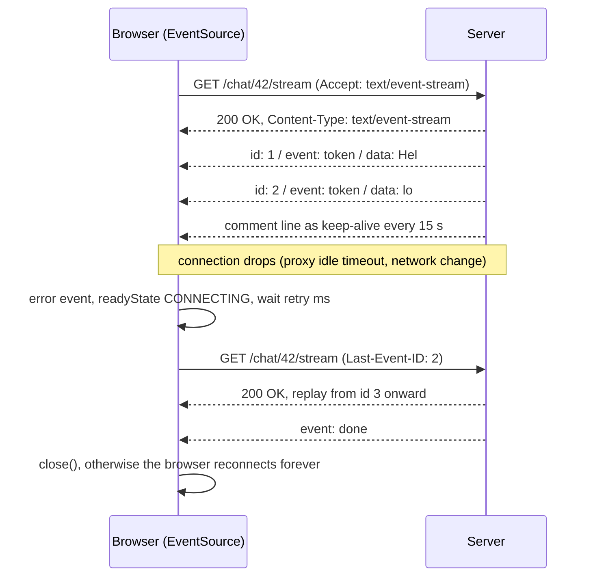

## Explanation

Server-Sent Events is the simplest way for an HTTP server to push to a browser. The client sends an ordinary GET, the server answers `200 OK` with `Content-Type: text/event-stream` and never finishes the body; it keeps appending small text blocks, and the browser's `EventSource` object turns each block into a DOM event. It is standardised in the WHATWG HTML Living Standard; in RFC 6202's vocabulary it is *HTTP streaming* (the server keeps one request open indefinitely) rather than *long polling* (the server holds each request until it has news and the client asks again). What SSE adds to raw streaming is a framing format and a client with reconnection built in.

The wire format is UTF-8 text, one `field: value` per line, with a blank line dispatching the event. `data` carries the payload, and several `data` lines are joined with a line feed; `event` names the type (default `message`) so the client can route with `addEventListener`; `id` sets the *last event ID*, remembered until another `id` replaces it; `retry` sets the reconnection delay in milliseconds. A line beginning with a colon is a comment, which the specification suggests sending about every fifteen seconds so legacy proxies do not drop an idle connection. Unknown fields are ignored and a partial event at end of stream is discarded.

Reconnection is what makes SSE more than `fetch()` with a long body. When the body ends or the network fails, the browser fires `error`, moves `readyState` to `CONNECTING`, waits the reconnection time and reconnects, adding a `Last-Event-ID` header if the last event ID is non-empty so the server can resume. It only *stops* when told to: a `204 No Content`, any other non-200 status or a wrong content type fails the connection permanently (`CLOSED`), as does `close()` on the client. Monotonic ids (a sequence number, or a Redis Stream entry ID so the server resumes with `XRANGE`) give at-least-once delivery across reconnects; no ids means a fresh stream each time.

The constraints follow from being a plain HTTP response. It is one-way: client-to-server traffic goes over separate requests, which is how SignalR's SSE transport works when WebSockets are unavailable. It is text only, so binary is base64. `EventSource` cannot set request headers, so authentication is a cookie (`withCredentials: true`), a short-lived token in the URL, or a hand-rolled `fetch()` client with a parser. On HTTP/1.1 each stream occupies one of the browser's six connections per host (shared across every tab open on that site), a limit HTTP/2 multiplexing removes. And anything that buffers responses (a gateway in buffered mode, a reverse proxy, a body-logging policy) silently turns a stream into a delayed download.

SSE has become the default transport for model output. The Claude Messages API streams with `"stream": true` as named events in a fixed order: `message_start`, then per content block `content_block_start`, one or more `content_block_delta` events (delta types include `text_delta`, `input_json_delta`, `thinking_delta` and `signature_delta`) and `content_block_stop`, then one or more `message_delta` events and a final `message_stop`, with `ping` and `error` events possible in between; the SDKs' `messages.stream()` helpers consume that. The Model Context Protocol's Streamable HTTP transport uses SSE too, and its current revision (2026-07-28) narrows it: every request is a POST answered with either one JSON object or a `text/event-stream` scoped to that request, long-lived change notifications arrive on the response stream of a `subscriptions/listen` request, and servers should send `X-Accel-Buffering: no`. The standalone GET stream, sessions and `Last-Event-ID` resumption that revisions 2025-03-26 to 2025-11-25 defined were removed, so an MCP client recovers from a dropped stream by retrying the request, not by resuming it. An agent UI therefore has SSE at two hops, model to backend and backend to browser. In .NET, `System.Net.ServerSentEvents` arrived in .NET 9 with `SseParser` for consuming streams; .NET 10 added `SseFormatter` and ASP.NET Core's `TypedResults.ServerSentEvents` for producing them, so on .NET 9 you write the frames yourself.



## How it differs

| Aspect | SSE | [WebSocket](websocket.md) | Long polling |
| --- | --- | --- | --- |
| Direction | server to client | both | server to client per request |
| Protocol | HTTP response, any version | Upgrade to a framed TCP protocol | ordinary HTTP requests |
| Payload | UTF-8 text | text or binary frames | anything |
| Reconnect and resume | built into the browser, Last-Event-ID | yours (or a library's) | implicit, every request |
| Headers and auth | cookies or URL token only | handshake headers, cookies, subprotocols | full control |
| Proxy friendliness | needs unbuffered proxies | needs Upgrade or CONNECT support | works everywhere |

**Versus WebSocket.** Choose SSE when the client only listens and the payload is text: dashboards, notifications, progress, token streams. It survives corporate proxies that block Upgrade, it reconnects without code, and it is cheap to host behind HTTP infrastructure. Choose a WebSocket when the client must send frequently (chat, collaborative editing, order entry), when binary framing matters, or when sub-second bidirectional latency is the product. SignalR hides the choice by falling back from WebSockets to SSE to long polling.

**Versus backpressure.** An `EventSource` cannot ask the server to slow down; the only brake is the TCP window, which stalls the server's write but not the work that feeds it. If a slow client must not slow the model stream, the server needs a bounded per-connection buffer with a documented drop or wait policy; if every token must arrive, the server must await each write and stop pulling from the source when the write blocks. See [backpressure](backpressure.md) for the patterns.

**Versus a hot observable.** In Angular code an SSE stream is wrapped as an observable or a signal and behaves like a hot source: subscribing late misses what was already sent, and two subscribers share one connection only if you share the `EventSource`. The transport, though, has properties Rx does not: ids, resume semantics and a reconnect loop that must be stopped with `close()`. Model the transport once in a service and expose a [hot observable](hot-observable.md) or signal to components.

## Examples

A chat backend streams model tokens to an Angular client, with ids so a dropped connection resumes instead of restarting.

=== "C#"

    ```csharp
    // .NET 9 minimal API: write the text/event-stream frames by hand.
    var app = WebApplication.CreateBuilder(args).Build();

    app.MapGet("/chat/{id}/stream", async (string id, HttpContext ctx, ITokenSource llm, CancellationToken ct) =>
    {
        ctx.Response.ContentType = "text/event-stream";
        ctx.Response.Headers.CacheControl = "no-cache";
        ctx.Response.Headers["X-Accel-Buffering"] = "no";                 // ask nginx-style proxies not to buffer

        string? lastId = ctx.Request.Headers["Last-Event-ID"];            // present only when a browser reconnects
        await ctx.Response.WriteAsync("retry: 2000\n\n", ct);              // reconnection delay hint, milliseconds

        await foreach (var (seq, token) in llm.TokensAsync(id, resumeAfter: lastId, ct))
        {
            // One event: id for resume, event for routing, data split into one line per newline.
            await ctx.Response.WriteAsync($"id: {seq}\nevent: token\ndata: {token.Replace("\n", "\ndata: ")}\n\n", ct);
            await ctx.Response.Body.FlushAsync(ct);                        // push now; do not wait for a full buffer
        }
        await ctx.Response.WriteAsync("event: done\ndata: end\n\n", ct);  // the client closes; otherwise it reconnects
    });

    // ASP.NET Core 10 formats the frames for you (IAsyncEnumerable<string> plus an event name, or SseItem<T>):
    // app.MapGet("/chat/{id}/stream", (string id, ITokenSource llm, CancellationToken ct) =>
    //     TypedResults.ServerSentEvents(llm.TextAsync(id, ct), eventType: "token"));

    app.Run();

    public interface ITokenSource
    {
        IAsyncEnumerable<(long Seq, string Token)> TokensAsync(string chatId, string? resumeAfter, CancellationToken ct);
        IAsyncEnumerable<string> TextAsync(string chatId, CancellationToken ct);
    }
    ```

=== "Python"

    ```python
    import anthropic
    from fastapi import FastAPI, Request
    from fastapi.responses import StreamingResponse

    app = FastAPI()
    client = anthropic.AsyncAnthropic()      # credentials from the environment

    async def token_events(request: Request, prompt: str):
        yield "retry: 2000\n\n"
        seq = 0
        # The SDK consumes the API's own SSE stream (message_start, content_block_delta, ...) and yields text.
        async with client.messages.stream(
            model="claude-opus-5-5",
            max_tokens=64000,
            messages=[{"role": "user", "content": prompt}],
        ) as stream:
            async for text in stream.text_stream:
                if await request.is_disconnected():
                    break                                       # stop pulling from the model when the browser is gone
                seq += 1
                yield f"id: {seq}\nevent: token\ndata: {text.replace('\n', '\ndata: ')}\n\n"
        yield "event: done\ndata: end\n\n"

    @app.get("/chat/stream")
    async def chat_stream(request: Request, q: str):
        return StreamingResponse(
            token_events(request, q),
            media_type="text/event-stream",
            headers={"Cache-Control": "no-cache", "X-Accel-Buffering": "no"},
        )
    ```

=== "TypeScript"

    ```typescript
    import { Injectable, signal } from '@angular/core';

    @Injectable({ providedIn: 'root' })
    export class ChatStream {
      readonly text = signal('');
      readonly state = signal<'connecting' | 'open' | 'closed'>('closed');
      private source?: EventSource;

      start(chatId: string): void {
        this.stop();
        this.text.set('');
        // EventSource cannot set request headers: authenticate with a cookie (withCredentials) or a short-lived URL token.
        const es = new EventSource(`/chat/${chatId}/stream`, { withCredentials: true });
        this.state.set('connecting');
        es.onopen = () => this.state.set('open');
        es.addEventListener('token', (e: MessageEvent<string>) => this.text.update(t => t + e.data));
        es.addEventListener('done', () => this.stop());   // close explicitly, or the browser reconnects and replays
        es.onerror = () => {
          // CONNECTING means a retry is scheduled (Last-Event-ID will be sent); CLOSED means a permanent failure.
          this.state.set(es.readyState === EventSource.CLOSED ? 'closed' : 'connecting');
        };
        this.source = es;
      }

      stop(): void {
        this.source?.close();
        this.source = undefined;
        this.state.set('closed');
      }
    }
    ```

=== "Azure"

    Azure API Management passes SSE through on the classic and v2 tiers but not on Consumption, which lacks long-running connections. Its guidance is to set `buffer-response="false"` on `forward-request`, avoid policies that buffer (such as `validate-content`), disable response caching and request/response body logging for those APIs, and keep the connection alive at least every four minutes because the Azure Load Balancer underneath enforces a four-minute idle timeout. For fan-out of the same token stream to many clients, Azure Web PubSub is the managed alternative; it advertises streaming AI-generated tokens as a primary use case.

=== "AWS"

    Amazon API Gateway REST APIs can stream a proxy integration's response when the integration's response transfer mode is `STREAM` (the default is `BUFFERED`): the documentation lists server-sent events and lower time-to-first-byte for generative AI as the use cases, supports only `HTTP_PROXY` and `AWS_PROXY` integrations, streams for up to 15 minutes with idle timeouts of 5 minutes (Regional or private) or 30 seconds (edge-optimised), caps bandwidth at 2 MB/s after the first 10 MB, and disables caching, VTL transformation and content encoding. AWS Lambda streams natively through function URLs or the `InvokeWithResponseStream` API, with Node.js managed runtimes supporting it directly and other languages via a custom runtime or the Lambda Web Adapter; responses can reach 200 MB, the first 6 MB are uncapped and the rest is limited to 2 MBps, and the function keeps running (and billing) if the client disconnects.

## Misconceptions

- **"SSE is a legacy HTTP/1.1 technique."** It works over HTTP/2 and HTTP/3, where multiplexing removes the per-host connection limit, it is the transport of current LLM APIs and the MCP Streamable HTTP transport, and ASP.NET Core 10 ships a first-class result type for it.
- **"Reconnection is automatic, so resume is solved."** The browser only sends `Last-Event-ID` if you sent ids, and only the server can replay from that id. Without both halves a reconnect silently starts a new stream and the user loses the tokens in between.
- **"I can put a bearer token in a header."** `EventSource` takes a URL and `withCredentials` and nothing else. Use a cookie, a short-lived token in the query string, or a `fetch()`-based client with a parser when headers are mandatory.
- **"Any HTTP path will stream."** Buffering intermediaries (API Management policies that read the body, API Gateway in buffered mode, reverse proxies with proxy buffering on) hold the response until it ends. Streaming has to be enabled hop by hop.
- **"The stream ends when the server stops writing."** When the server closes the body the browser treats it as a transient failure and reconnects. End a conversation with a final event the client reacts to by calling `close()`, or answer the reconnect with `204`.

## Exam notes

Server-Sent Events are named in the AWS Certified Generative AI Developer – Professional (AIP-C01) outline, which asks you to build real-time interaction with streaming model APIs over WebSockets or SSE with chunked transfer encoding, to put API Gateway streaming in front of model calls, and to weigh latency against cost; the trap is proposing a buffered API Gateway integration or a Lambda without response streaming for a token stream. AWS Certified Developer – Associate (DVA-C03) and Solutions Architect – Associate (SAA-C03) test the surrounding choices between REST, WebSocket APIs and polling, where SSE is the answer for one-way text push through plain HTTP. The Azure AI exams (Developing AI Apps and Agents on Azure, AI-103, and Developing AI Cloud Solutions on Azure, AI-200) assume streamed completions in their SDK and agent objectives without naming the transport; know that API Management needs explicit configuration and that Azure Web PubSub exists for fan-out. In every case, be ready to say why SSE rather than WebSocket (one-way, text, proxy-friendly, reconnects itself) and what breaks it (buffering, idle timeouts, header-based auth).

## Self-check

??? question "Users of an agent UI see the response restart from the beginning after a brief network blip, duplicating what they already read. Which part of SSE is being misused?"
    The server is not assigning ids (or ignores Last-Event-ID), so on reconnect the browser cannot say where it was and the server streams from the start. Send a monotonic id with every token (a sequence number or the Redis Stream entry ID of the buffered token), and on a request carrying Last-Event-ID resume from the next id. The client must also close the EventSource on the final done event rather than letting the browser reconnect after completion.

??? question "A token stream works from a developer laptop but appears all at once, after a long delay, when deployed behind an API gateway. What is wrong?"
    An intermediary is buffering the response until it completes. Enable streaming per hop: response transfer mode STREAM on an API Gateway REST API, buffer-response false and no body-reading policies in API Management, proxy buffering off on a reverse proxy, and an explicit flush after each event in the application. Also check idle timeouts, since a stream that pauses for longer than the gateway's idle limit is cut.

??? question "The product owner asks for typing indicators and message sending in the same channel as the token stream, using SSE. Is that possible?"
    Only half of it. SSE is server to client; the client's typing indicators and messages must go over separate HTTP requests, which is fine for occasional messages. If the client must send frequently with low latency, or binary payloads are needed, switch the channel to a WebSocket (or SignalR, which falls back to SSE where WebSockets are blocked) and keep SSE for simple one-way streams.

## Further reading

- [SignalR and WebSockets](../messaging/realtime/signalr-websockets.md), [real-time UI streaming](../frontend/realtime/real-time-ui-streaming.md) and [RxJS state management](../frontend/angular/rxjs-state-management.md).
- [MCP tool orchestration](../ai/protocols/mcp-tool-orchestration.md) for where SSE sits in the agent stack.
- [WebSocket](websocket.md), [backpressure](backpressure.md), [hot observable](hot-observable.md) and [cold observable](cold-observable.md).
- WHATWG HTML Living Standard, server-sent events: <https://html.spec.whatwg.org/multipage/server-sent-events.html>
- Azure API Management SSE guidance: <https://learn.microsoft.com/en-us/azure/api-management/how-to-server-sent-events> and API Gateway response streaming: <https://docs.aws.amazon.com/apigateway/latest/developerguide/response-transfer-mode.html>
