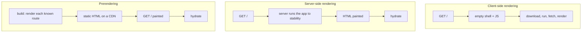

## Explanation

Server-side rendering produces the HTML of a page on the server, per request, by executing the application's component tree there and serialising the result. The browser receives markup it can paint at once, before or while the JavaScript bundle downloads. It sits on a spectrum with two other strategies. **Client-side rendering (CSR)** sends a near-empty shell and does routing, data fetching and rendering in the browser. **Prerendering**, also called static site generation (SSG), produces the HTML once at build time for every known URL and serves it from a CDN; it is to SSR what a [materialized view](materialized-view.md) is to a query, cheap to read and stale until rebuilt. *Hybrid rendering* mixes all three in one application, route by route.

Measured in web.dev's vocabulary (Time to First Byte, First Contentful Paint, Interaction to Next Paint), SSR improves first paint and gives crawlers and link previews real content at the price of a server, per-request compute and a longer TTFB; prerendering is fastest and cheapest to serve but cannot contain user-specific data; CSR is the simplest to host. SSR'd HTML is inert until [hydration](hydration.md) attaches the application to it, so SSR is always paired with a hydration strategy.

In Angular, `ng new --ssr` or `ng add @angular/ssr` installs the `@angular/ssr` package (successor to the Angular Universal packages). `server.ts` hosts an `AngularNodeAppEngine` behind Express (other runtimes use `AngularAppEngine` with Web `Request` and `Response`). `app.config.server.ts` registers `provideServerRendering(withRoutes(serverRoutes))`, and `app.routes.server.ts` assigns each route a `RenderMode`: `Server` (render per request), `Client` (CSR) or `Prerender` (build time), with `getPrerenderParams` to enumerate parameterised routes, `fallback: PrerenderFallback.Server | Client | None` for unknown parameters, and per-route `headers` and `status`. The generated configuration prerenders everything (`**`); setting `outputMode` to `static` in `angular.json` produces a fully static site with no server at all.

Rendering a request means bootstrapping the application in a Node process, running [change detection](angular-change-detection.md) until the application is *stable* (no pending `HttpClient` requests, no open `PendingTasks`), and serialising the DOM. The `HttpClient` transfer cache embeds `GET` and `HEAD` responses in the HTML and the browser replays them instead of refetching until it becomes stable. Excluded by default: requests carrying `Authorization`, `Proxy-Authorization` or `Cookie` headers, credentialed requests (`withCredentials` or a credentialed Fetch mode), responses whose `Cache-Control` says `no-store`, `no-cache` or `private`, and responses that set a cookie. Server-side response bodies above 1 MB fail with NG02825 unless `maxResponseBodySize` is raised. `HTTP_TRANSFER_CACHE_ORIGIN_MAP` maps the internal server-side origin (an API's Compose service name) to the public one.

The server has no `window`, `document`, `navigator` or `location`. Browser-only work belongs in `afterNextRender()` or `afterEveryRender()`, and `isPlatformBrowser` in a template condition produces different output on the two sides and breaks hydration. Request data comes from the `REQUEST`, `RESPONSE_INIT` and `REQUEST_CONTEXT` tokens, which are `null` in the browser, during prerendering and at build time. Angular bootstraps a fresh application, with a fresh root injector, for every request, but anything evaluated when the server bundle loads is shared: a top-level `useValue` provider keeps its value across requests, as do module-level variables, so per-request values need `useFactory`, whose factory runs for every request; and URLs fetched during a server render are a server-side request forgery surface, which the guide's security section on allowed hosts addresses.

For a .NET engineer the same spectrum exists in Blazor with its own names: *static SSR* (no interactivity), *interactive SSR* (a Blazor Server circuit over SignalR), *CSR* (WebAssembly) and *Auto*, with prerendering on by default for the interactive modes and `prerender: false` to switch it off per component. Angular's "SSR plus hydration" corresponds to Blazor's "prerendering plus an interactive render mode". Operationally, SSR adds a Node service beside the ASP.NET Core API, with its own health check and scaling; a prerendered or CSR app is just files.



## How it differs

**[Hydration](hydration.md).** SSR is the server half and hydration the client half of the same user experience; they are configured separately and fail separately. SSR problems show up as slow TTFB, render timeouts (an application that never becomes stable), leaked per-request state and server-only crashes on `window`; hydration problems show up as mismatches, flicker and dead buttons. You can have SSR without hydration (the client re-renders, which is what Angular did before v16) and prerendering with hydration (the HTML was produced at build time, the client adopts it identically). When someone says "SSR is slow", ask which half they mean: the render on the server or the hydration in the browser.

**[Angular Change Detection](angular-change-detection.md).** The server runs change detection exactly as the browser does, but once and to a fixed point: bootstrap, let `HttpClient` calls and `PendingTasks` finish, run the tree until nothing is dirty, serialise, dispose. Nothing event-driven happens. Code written for the browser's repeated ticks can therefore misbehave on the server, whether by never finishing (under Zone.js a polling timer registered in a constructor keeps the application unstable, and there is no server-side timeout; zoneless, a `PendingTasks` entry that is never removed does the same) or by doing nothing (an `effect` that waits for a browser event). The guide's answer is to keep browser-only work in `afterNextRender()` and to express pending work with `PendingTasks` so the server knows when the render is complete.

| Strategy | HTML produced | Personalised content | Hosting | Typical choice |
|---|---|---|---|---|
| CSR (`RenderMode.Client`) | In the browser | Yes | Static files | Authenticated app screens, dashboards |
| SSR (`RenderMode.Server`) | Per request on a server | Yes | Node process (container, App Service, ECS, Lambda) | Public, dynamic, SEO-relevant pages |
| Prerender (`RenderMode.Prerender`) | Once at build | No (or via client fetch after hydration) | Static files on a CDN | Marketing, docs, catalogue pages with known URLs |
| Hybrid | Per route | Per route | Node process plus static assets | Most real applications |

## Examples

=== "TypeScript"

    ```typescript
    // app.routes.server.ts — a render mode per route (hybrid rendering).
    import { inject } from '@angular/core';
    import { PrerenderFallback, RenderMode, ServerRoute } from '@angular/ssr';
    import { SymbolsApi } from './symbols-api';

    export const serverRoutes: ServerRoute[] = [
      { path: '', renderMode: RenderMode.Prerender },                         // landing page: build time
      {
        path: 'markets/:symbol',
        renderMode: RenderMode.Prerender,                                     // top symbols at build time,
        fallback: PrerenderFallback.Server,                                   // the long tail on demand
        async getPrerenderParams() {
          const api = inject(SymbolsApi);                                     // inject() works here
          return (await api.top()).map(symbol => ({ symbol }));
        },
      },
      { path: 'portfolio/**', renderMode: RenderMode.Client },               // personal data: browser only
      { path: '**', renderMode: RenderMode.Server, headers: { 'Cache-Control': 'no-store' } },
    ];
    ```

    ```typescript
    // app.config.server.ts — server providers merged onto the browser config.
    import { ApplicationConfig, mergeApplicationConfig } from '@angular/core';
    import { provideServerRendering, withRoutes } from '@angular/ssr';
    import { appConfig } from './app.config';
    import { serverRoutes } from './app.routes.server';

    const serverConfig: ApplicationConfig = {
      providers: [
        provideServerRendering({ maxResponseBodySize: 4 * 1024 * 1024 }, withRoutes(serverRoutes)),
      ],
    };

    export const config = mergeApplicationConfig(appConfig, serverConfig);
    ```

    ```typescript
    // server.ts — the Node host generated by the CLI, trimmed to its essentials.
    import { AngularNodeAppEngine, createNodeRequestHandler, isMainModule, writeResponseToNodeResponse } from '@angular/ssr/node';
    import express from 'express';
    import { join } from 'node:path';

    const app = express();
    const angularApp = new AngularNodeAppEngine();

    app.get('/healthz', (_req, res) => { res.send('ok'); });             // for the container health check
    app.use(express.static(join(import.meta.dirname, '../browser'), { maxAge: '1y', index: false, redirect: false }));
    app.use((req, res, next) => {
      angularApp.handle(req)
        .then(response => (response ? writeResponseToNodeResponse(response, res) : next()))
        .catch(next);
    });

    if (isMainModule(import.meta.url)) {
      const port = process.env['PORT'] || 4000;
      app.listen(port, () => console.log(`SSR server listening on http://localhost:${port}`));
    }

    export const reqHandler = createNodeRequestHandler(app);
    ```

    ```typescript
    // A component that reads the request on the server and touches the DOM only in the browser.
    import { Component, REQUEST, afterNextRender, inject, signal } from '@angular/core';

    @Component({ selector: 'app-greeting', template: `<p>{{ locale }} · {{ width() }}px</p>` })
    export class Greeting {
      private readonly request = inject(REQUEST, { optional: true });   // null in the browser and at build time
      readonly locale = this.request?.headers.get('accept-language')?.split(',')[0] ?? 'en';
      readonly width = signal(0);

      constructor() {
        afterNextRender(() => this.width.set(window.innerWidth));       // never in the constructor
      }
    }
    ```

=== "C#"

    ```csharp
    // Program.cs — a Blazor Web App: static SSR is the baseline; interactivity is opt-in.
    builder.Services.AddRazorComponents()
        .AddInteractiveServerComponents()
        .AddInteractiveWebAssemblyComponents();

    app.MapRazorComponents<App>()
        .AddInteractiveServerRenderMode()
        .AddInteractiveWebAssemblyRenderMode();
    ```

    ```html
    @* Markets.razor — static SSR: rendered on the server, no circuit, no WebAssembly, no event handlers. *@
    @page "/markets"
    <MarketTable Rows="rows" />

    @* Interactive SSR with prerendering (the default): HTML first, then a SignalR circuit takes over. *@
    <Blotter @rendermode="InteractiveServer" />

    @* CSR via WebAssembly, prerendering off because the server has nothing useful to render. *@
    <Portfolio @rendermode="@(new InteractiveWebAssemblyRenderMode(prerender: false))" />
    ```

=== "Docker Compose"

    ```yaml
    # The SSR server is a real service beside the API; its server-side fetches use the
    # internal name, which HTTP_TRANSFER_CACHE_ORIGIN_MAP maps to the public origin.
    services:
      api:
        build: ./src/Api                      # ASP.NET Core 9 Web API
        environment:
          ConnectionStrings__Ticks: Host=timescale;Database=ticks;Username=app;Password=app
      web-ssr:
        build: ./src/Web                      # node dist/web/server/server.mjs
        environment:
          PORT: "4000"
          API_BASE_URL: http://api:8080       # server-side origin (never seen by the browser)
        ports: ["4000:4000"]
        healthcheck:
          test: ["CMD", "wget", "-qO-", "http://localhost:4000/healthz"]
          interval: 30s
      timescale:
        image: timescale/timescaledb:latest-pg17
        environment:
          POSTGRES_USER: app
          POSTGRES_PASSWORD: app
          POSTGRES_DB: ticks
    ```

## Misconceptions

- **"SSR makes the app faster."** It makes the first paint earlier and the first byte later, and it moves rendering cost onto a server you must run and scale. Interactivity still waits for the bundle and [hydration](hydration.md); a heavy app can feel slower if the user clicks before it is live.
- **"SSR is for SEO only."** Crawlers are one audience; link previews, slow devices, slow networks and perceived performance are the others. Conversely, an authenticated dashboard behind a login gains little from SSR and often belongs on `RenderMode.Client`.
- **"Prerendering is SSR at build time, so personalisation just works."** A prerendered page is the same bytes for everyone. User-specific content has to be fetched after hydration or served through a route rendered on the server.
- **"Every provider is per request on the server."** Angular creates a new application and root injector per request, so `providedIn: 'root'` services are per request, but a top-level `useValue` object, a module-level variable or a static field is evaluated once when the server bundle loads and is shared by every concurrent request; a user's data cached there leaks to the next user. Use `useFactory` or the request-scoped tokens.
- **"Any component works on the server."** Anything touching `window`, `document`, `localStorage` or layout measurement throws or renders wrongly. Move it to `afterNextRender()`, and never branch a template on `isPlatformBrowser`.

## Exam notes

Cloud exams test SSR only as a hosting and architecture decision, never as framework mechanics. AZ-305 frames it as static hosting (Azure Static Web Apps, or a storage static website behind Front Door) versus a compute service for a Node render server (App Service, Container Apps), and AI-200, the developer exam that replaced AZ-204 when it retired on 31 July 2026, tests deploying such a container to App Service or Container Apps; the AWS Solutions Architect Associate and Professional exams frame it as S3 plus CloudFront versus Amplify Hosting, Lambda or ECS (App Runner, the former container shortcut, closed to new customers on 30 April 2026). The trap is choosing compute for a site that is entirely prerenderable, or static hosting for a page whose HTML must vary per request. In front-end interviews the discriminators are the stability model (what keeps a render pending), the per-request state leak and the transfer cache's exclusion of credentialed requests.

## Self-check

??? question "A trading news site has thousands of article pages that change rarely, a live markets page that must show current prices in the HTML for crawlers, and a portfolio page behind a login. Assign render modes and justify them."
    Articles: `RenderMode.Prerender` with `getPrerenderParams` enumerating the known slugs and `fallback: PrerenderFallback.Server` so a new article published after the build still renders on demand; they are the same for every reader and benefit most from CDN delivery. Markets: `RenderMode.Server`, because the HTML must contain fresh prices on each request and the audience includes crawlers and link previews; add `Cache-Control` headers with a short max-age in the route's `headers` to absorb bursts. Portfolio: `RenderMode.Client`, because the content is user-specific, the user is authenticated (so credentialed requests are excluded from the transfer cache anyway) and nothing about it should be rendered or cached on a shared server.

??? question "After enabling SSR, the first user who logs in each morning sees another user's watchlist for a second. No one can reproduce it locally. What is the likely cause?"
    A per-user value is being kept in state that outlives the request. Angular bootstraps a new application (and new root services) for each request, but a top-level `useValue` object, a module-level cache or a static field is created once when the Node process loads the bundle, so a watchlist stored there during one user's render is still in memory when the next request is rendered, and the initial render and transfer cache embed it into the second user's HTML until the browser refetches. Locally there is one user, so the leak is invisible. Move per-request values to a `useFactory` provider or derive them from the `REQUEST` token, keep user data out of module-level state, and make sure the watchlist request carries credentials or an `Authorization` header so the transfer cache excludes it by default.

??? question "Requests for the server-rendered markets page hang until the load balancer gives up with a 504, although the API answers in 40 ms. Other routes render normally. What is holding the render?"
    The server serialises the page only when the application becomes stable, and Angular applies no server-side timeout, so a piece of work that never reports completion holds the response open indefinitely. In a Zone.js application the usual culprit is a polling `setInterval` or a WebSocket subscription started in a constructor or `ngOnInit`: the zone never drains, so the application never becomes stable. In a zoneless application timers do not affect stability, and the culprit is a `PendingTasks.add()` whose returned cleanup function is never called (or a `PendingTasks.run()` whose promise never settles). Move browser-only work into `afterNextRender()`, which does not run on the server, make long-lived subscriptions conditional on the platform, and add `provideStabilityDebugging()` temporarily to log the stack of each task that keeps the application from stabilising.

## Further reading

- [Angular: architectural trade-offs](../frontend/angular/angular-fundamentals.md), [Docker and containerisation](../devops/docker-containerization.md) and [CI/CD pipelines](../devops/ci-cd-pipelines.md) in this library
- [Hydration](hydration.md), [Angular Change Detection](angular-change-detection.md) and [Materialized View](materialized-view.md)
- [Server-side and hybrid rendering](https://angular.dev/guide/ssr) on angular.dev and [Rendering on the web](https://web.dev/articles/rendering-on-the-web) on web.dev
- [ASP.NET Core Blazor render modes](https://learn.microsoft.com/en-us/aspnet/core/blazor/components/render-modes) on Microsoft Learn
