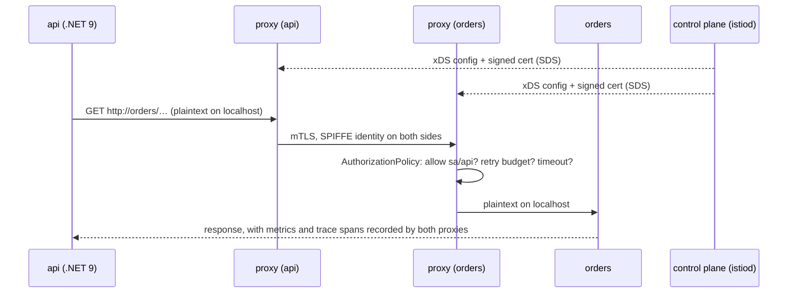

## Explanation

A service mesh moves the networking concerns that every service would otherwise implement itself (encryption, authentication, retries, timeouts, traffic splitting, metrics and traces) out of application code and into infrastructure that intercepts the traffic. It has two halves. The **control plane** (Istio's `istiod`; Linkerd's `destination`, `identity` and `proxy-injector`) holds the desired configuration, discovers endpoints and acts as a certificate authority. The **data plane** is the set of proxies that actually carry the packets and enforce what the control plane pushes to them; Envoy receives that configuration over its xDS discovery APIs, Linkerd's Rust micro-proxy over the destination gRPC API.

In the classic sidecar model a mutating admission webhook injects a proxy into every Pod of a labelled namespace (`istio-injection=enabled` or `istio.io/rev=<revision>` for Istio, the `linkerd.io/inject: enabled` annotation for Linkerd). An init container (`istio-init`, `linkerd-init`) rewrites the Pod's iptables so all TCP traffic passes through the proxy; because that needs the `NET_ADMIN` and `NET_RAW` capabilities, both projects offer a privileged per-node CNI agent that does the rewriting instead, leaving workloads unprivileged. The proxy then speaks plain HTTP or TCP to the application over `localhost` and [mTLS](mtls.md) to the peer's proxy. By default since Istio 1.27 (on Kubernetes 1.29 or later) and Linkerd 2.20, the proxy is injected as a Kubernetes native [sidecar](sidecar-pattern.md), so it is up before the application and stops after it.

Identity is what makes a mesh more than an encrypting tunnel. On Kubernetes each workload's identity is its service account. The Istio agent beside each proxy generates a key and certificate signing request, `istiod` validates the Pod's credentials and signs it, the certificate reaches Envoy through its SDS API and is rotated before expiry; Linkerd's `identity` component does the same and its certificates expire after 24 hours. Policy then names principals rather than IP addresses: an Istio `AuthorizationPolicy` allows `cluster.local/ns/trading/sa/api` to call `orders` and nothing else, and `PeerAuthentication` chooses `STRICT` (only mTLS), `PERMISSIVE` (mTLS and plaintext, the default for mesh-wide policies, meant for migration) or `DISABLE`. Istio applies the narrowest matching policy: workload, then namespace, then mesh.



Istio's **ambient mode**, generally available since Istio 1.24 (November 2024), removes the sidecar. A per-node proxy called `ztunnel`, written in Rust and limited to layer 4, gives every Pod on the node mTLS, L4 authorization and L4 telemetry by tunnelling traffic over HBONE, an HTTP CONNECT tunnel inside mTLS with HTTP/2 multiplexing on port 15008; the CNI node agent, which is mandatory in ambient mode, redirects traffic from inside each Pod's network namespace. Layer-7 features (HTTP routing, retries, request-level authorization, JWT validation) come from optional **waypoint** proxies, Envoy deployments that run outside the application Pods and are enrolled per namespace or per service with the `istio.io/use-waypoint` label. Adoption is incremental: no mesh, then the L4 overlay, then L7 where a namespace needs it, and sidecar and ambient Pods can coexist in one mesh.

For the reader's stack: the .NET service keeps `HttpClient` pointed at `http://orders` and never touches certificates; gRPC works because Envoy speaks HTTP/2 natively; Redis Streams and TimescaleDB connections are raw TCP, so the mesh encrypts and authorizes them at L4 but cannot retry or route them at L7. Resist stacking `Microsoft.Extensions.Http.Resilience` retries on top of mesh retries: both layers retrying a 503 multiplies load. Observability arrives for free at the proxy, but a trace is only joined end to end if the application propagates the W3C `traceparent` header, which ASP.NET Core and `HttpClient` do by default.

## How it differs

**[Sidecar pattern](sidecar-pattern.md).** The sidecar is the shape, the mesh is the system. A mesh needs a control plane, a certificate authority, injection and policy objects; a sidecar needs none of that, and ambient mode proves a mesh needs no sidecar. Ask "do I need traffic policy between services?" (mesh) separately from "does this helper need to share the Pod?" (sidecar).

**[mTLS](mtls.md).** A mesh is the cheapest way to get mTLS everywhere, with certificate issuance, rotation and enforcement handled for you, but mTLS is a protocol feature you can run without one: Kestrel can require client certificates, SPIRE can issue SVIDs to plain processes, and ECS Service Connect does mesh-style TLS with AWS Private CA. The trap in the other direction is assuming "we have a mesh" means "all traffic is mTLS": in `PERMISSIVE` mode plaintext is still accepted, unmeshed Pods and skipped ports bypass the proxy, and Linkerd accepts plaintext from non-meshed sources by default until an authorization policy forbids it.

**[Workload identity](workload-identity.md).** The mesh does not define who a workload is; the platform does (Kubernetes service account, SPIFFE ID, cloud identity). The mesh consumes that identity to mint certificates and evaluate principals. If you later call Azure or AWS APIs you still need the cloud's workload identity federation; the mesh certificate is not accepted there.

**[Zero trust](zero-trust.md).** Zero trust says never trust by network location, always verify identity and authorize each request. A mesh is one enforcement point for that principle on east-west traffic. It does nothing for user authentication, data-at-rest, the cluster control plane, or a compromised Pod that is allowed to call the service it then abuses, so it is a component of a zero-trust design, not the design.

| Mesh | Data plane | Proxy | mTLS by default | L7 features | Notes |
| --- | --- | --- | --- | --- | --- |
| Istio, sidecar mode | per-Pod Envoy (native sidecar since 1.27) | Envoy | PERMISSIVE until `STRICT` is set | full | largest feature set; AKS add-on supports this mode |
| Istio, ambient mode | per-node `ztunnel` (L4) + optional waypoints (L7) | Rust ztunnel, Envoy waypoints | yes at L4 | via waypoint | GA since 1.24; no Pod restarts to enrol |
| Linkerd | per-Pod `linkerd2-proxy` (native sidecar since 2.20) | Rust micro-proxy | yes | retries, timeouts, routing | stable releases come from vendors since Feb 2024; edge releases from the project |
| Cilium | eBPF (L3/L4) + per-node Envoy (L7) | Envoy; ztunnel for encryption | no; ztunnel encryption is beta | Gateway API, L7 policy | also the CNI; legacy mutual auth deprecated in 1.20 |
| ECS Service Connect | managed proxy container per task | Envoy-based | optional TLS via AWS Private CA | discovery, metrics | ECS only; App Mesh's successor |

Cilium takes a similar sidecarless route with eBPF for L3/L4 and a per-node Envoy for L7, but it is not yet a full mTLS mesh: its original SPIFFE-based mutual authentication was deprecated in Cilium 1.20, and the suggested replacement, ztunnel transparent encryption (added in 1.19), is still beta. Across all of them, the Kubernetes Gateway API's GAMMA work standardises mesh routing (an `HTTPRoute` whose `parentRef` is a `Service`, with producer routes in the Service's namespace and consumer routes in the caller's) and has been GA since Gateway API v1.1, which makes it the portable way to express routing rules that outlive a mesh choice (the AKS Istio add-on does not support it yet).

## Examples

=== "Istio (sidecar)"

    ```yaml
    # 1. Enrol the namespace in a revision; new Pods get istio-init + istio-proxy injected
    apiVersion: v1
    kind: Namespace
    metadata:
      name: trading
      labels: { istio.io/rev: "1-27" }
    ---
    # 2. Only mTLS is accepted by workloads in this namespace
    apiVersion: security.istio.io/v1
    kind: PeerAuthentication
    metadata: { name: default, namespace: trading }
    spec:
      mtls: { mode: STRICT }
    ---
    # 3. orders accepts calls only from the api service account, and only GET/POST on /orders
    apiVersion: security.istio.io/v1
    kind: AuthorizationPolicy
    metadata: { name: orders-allow-api, namespace: trading }
    spec:
      selector: { matchLabels: { app: orders } }
      action: ALLOW
      rules:
        - from:
            - source: { principals: ["cluster.local/ns/trading/sa/api"] }
          to:
            - operation: { methods: ["GET", "POST"], paths: ["/orders*"] }
    ```

=== "Istio (ambient)"

    ```yaml
    # Enrol the namespace in the L4 overlay: no injection, no Pod restarts
    apiVersion: v1
    kind: Namespace
    metadata:
      name: trading
      labels:
        istio.io/dataplane-mode: ambient
    ---
    # Opt the orders Service into L7 processing through a waypoint
    # (create one with: istioctl waypoint apply -n trading --name waypoint)
    apiVersion: v1
    kind: Service
    metadata:
      name: orders
      namespace: trading
      labels:
        istio.io/use-waypoint: waypoint
    spec:
      selector: { app: orders }
      ports: [{ port: 80, targetPort: 8080 }]
    ```

    The same `AuthorizationPolicy` as in sidecar mode applies; L4 rules (principals, namespaces) are enforced by ztunnel, HTTP-level rules need the waypoint.

=== "Linkerd"

    ```yaml
    # Inject the proxy into every Pod created in the namespace; mTLS between meshed Pods is automatic
    apiVersion: v1
    kind: Namespace
    metadata:
      name: trading
      annotations:
        linkerd.io/inject: enabled
    ```

    ```bash
    linkerd check --proxy -n trading          # proxies healthy, certificates issued
    linkerd viz edges deployment -n trading   # which edges are mTLS and under which identity
    ```

=== "Azure"

    ```bash
    # Managed Istio control plane on AKS (sidecar mode; ambient is not yet supported by the add-on)
    az aks mesh enable --resource-group rg-trading --name aks-trading
    az aks show --resource-group rg-trading --name aks-trading \
      --query "serviceMeshProfile.istio.revisions" -o tsv     # e.g. asm-1-29
    kubectl label namespace trading istio.io/rev=asm-1-29
    ```

    Microsoft runs and scales `istiod`, tests each revision against supported AKS versions, and upgrades the mesh when you trigger it (not on cluster auto-upgrade, so an old revision can block the next Kubernetes upgrade). Some customisations are blocked (`ProxyConfig`, `WorkloadEntry`, `WasmPlugin`, `IstioOperator`), `EnvoyFilter` is allowed but unsupported, and native sidecars are the default from AKS 1.33 with `asm-1-29`.

=== "AWS"

    AWS App Mesh reached end of support on 30 September 2026; its console and resources are no longer accessible, and AWS points ECS users to Service Connect. Service Connect is configured on the ECS service rather than in the task definition: ECS adds its Envoy-based proxy container to every task, publishes endpoints into an AWS Cloud Map namespace, emits traffic metrics to CloudWatch, and can encrypt service-to-service traffic with certificates from AWS Private CA that it rotates every five days.

    ```json
    {
      "serviceName": "orders",
      "serviceConnectConfiguration": {
        "enabled": true,
        "namespace": "trading",
        "services": [
          {
            "portName": "http",
            "clientAliases": [{ "port": 80, "dnsName": "orders" }]
          }
        ]
      }
    }
    ```

    For EKS there is no managed mesh from AWS: teams run Istio, Linkerd or Cilium themselves. Across VPCs and accounts, Amazon VPC Lattice gives a managed service network with IAM auth policies and per-request logs without any proxy in your tasks or Pods, which covers the discovery and authorization slice of a mesh but not sidecar-level retries or mTLS between your own processes.

## Misconceptions

- **"Installing a mesh encrypts everything."** Not until `PeerAuthentication` is `STRICT`: Istio's mesh-wide default is `PERMISSIVE`, and traffic to unmeshed Pods or on skipped ports bypasses the proxy entirely. Verify with `istioctl x describe pod` or `linkerd viz edges`, not with the install log.
- **"A mesh fixes a chatty architecture."** It adds a proxy hop (two in sidecar mode) to every call and a certificate handshake to every new connection. Retries, timeouts and circuit breaking in the mesh make failures more graceful; they do not reduce the number of calls.
- **"Ambient mode is sidecar mode with less memory."** It changes the security and feature model: ztunnel is L4 only and shared by all Pods on a node, so request-level authorization and HTTP routing exist only where a waypoint is deployed, and the node agent is mandatory.
- **"A mesh replaces application authorization."** It authorizes a *workload* to reach a *workload*. Whether this user may cancel that order is still the application's decision, as is anything that needs business data.
- **"AWS App Mesh is the AWS mesh."** AWS discontinued it on 30 September 2026. Current AWS guidance is ECS Service Connect for ECS, VPC Lattice for cross-VPC application networking, and self-managed meshes on EKS.

## Exam notes

CKS is where the mesh appears most concretely: pod-to-pod encryption with mTLS, the difference between `PERMISSIVE` and `STRICT`, and why `istio-init` needs `NET_ADMIN`/`NET_RAW` while the CNI node agent does not. CKA and CKAD stay at the level of Services, Ingress and Gateway API; they do not require a mesh, although knowing that a mesh proxy sits between the kubelet's HTTP probe and your app explains some odd probe failures.

AZ-305 design scenarios typically frame the choice as "AKS Istio add-on versus application-level resilience and Dapr": the add-on is the answer when the requirement is uniform mTLS, retries and telemetry across many services with no code changes; Dapr is the answer when the requirement is building blocks (pub/sub, state) for the application. Remember the add-on's limits (no ambient mode, no multi-cluster, no Windows Server containers, no GAMMA mesh routing) when a scenario includes them.

SAP-C03 and SAA-C03 study material still carries App Mesh vocabulary (virtual services, virtual nodes, virtual routers, the Envoy sidecar); on the current exam the better answers are Service Connect for ECS service discovery and metrics, VPC Lattice for connecting services across VPCs and accounts with IAM-based auth policies, and Istio or Linkerd on EKS when questions ask for open-source mesh features. SC-100 and CISSP treat the mesh as a zero-trust and segmentation control for east-west traffic: it mitigates lateral movement, not credential theft at the edge.

## Self-check

??? question "A security review demands that every service-to-service call in your AKS cluster is encrypted and that only the api service may call orders. The team has 40 .NET services and no bandwidth for code changes. What do you propose, and what two things could still leave traffic unencrypted?"
    Enable the AKS Istio add-on, label the namespaces with the revision so proxies are injected, set a mesh-wide (or per-namespace) `PeerAuthentication` with `mode: STRICT`, and add an `AuthorizationPolicy` on `orders` that allows only the principal `cluster.local/ns/<ns>/sa/api`. Nothing in the services changes; they keep calling `http://orders`. Two gaps remain: any Pod that is not injected (a namespace without the label, or a Pod with injection disabled) and any port excluded from redirection bypass the proxy, and `PERMISSIVE` anywhere in the policy hierarchy would re-admit plaintext, because the narrowest policy wins.

??? question "Your Redis Streams consumer and TimescaleDB connections now go through Istio. Which mesh features apply to them and which do not?"
    Both are raw TCP, so the mesh gives them mTLS, L4 authorization by workload identity and byte-level telemetry. It cannot retry a failed `XREADGROUP`, route a percentage of SQL to a canary, or apply HTTP rules, because Envoy is not parsing those protocols as HTTP. Retries and timeouts stay in the client libraries, and the [idempotency](idempotency-key.md) story stays in your code.

??? question "A platform team proposes Istio ambient mode to avoid restarting 2,000 Pods and to cut proxy memory. A product team needs per-route timeouts and JWT validation on three services. Does ambient mode satisfy both?"
    Yes, if the three services get waypoints. Ambient enrols namespaces by label with no Pod restarts and provides mTLS plus L4 policy from the shared `ztunnel`; HTTP-level timeouts and `RequestAuthentication` for JWTs require a waypoint proxy, which is an Envoy deployment enrolled per namespace or per service with `istio.io/use-waypoint`. The platform team pays the waypoint cost only where L7 is needed, and the rest of the mesh stays L4-only.

## Further reading

- [mTLS vs. API Keys](../security/iam/mtls-vs-api-keys.md), [Workload Identity vs. Static Credentials](../security/iam/workload-identity.md) and [REST vs. gRPC APIs](../messaging/apis/rest-vs-grpc-apis.md) in this library.
- Term pages: [Sidecar Pattern](sidecar-pattern.md), [mTLS](mtls.md), [Workload Identity](workload-identity.md), [Zero Trust](zero-trust.md), [Container Isolation](container-isolation.md).
- [Istio ambient mode overview](https://istio.io/latest/docs/ambient/overview/), [HBONE](https://istio.io/latest/docs/ambient/architecture/hbone/), [Istio security](https://istio.io/latest/docs/concepts/security/) and [Istio CNI node agent](https://istio.io/latest/docs/setup/additional-setup/cni/).
- [Linkerd architecture](https://linkerd.io/2-edge/reference/architecture/), [Automatic mTLS](https://linkerd.io/2-edge/features/automatic-mtls/) and [Linkerd releases and versions](https://linkerd.io/releases/).
- [Gateway API for service mesh (GAMMA)](https://gateway-api.sigs.k8s.io/concepts/gamma/) and [Envoy xDS protocol](https://www.envoyproxy.io/docs/envoy/latest/api-docs/xds_protocol).
- [AKS Istio add-on](https://learn.microsoft.com/en-us/azure/aks/istio-about), [Amazon ECS Service Connect](https://docs.aws.amazon.com/AmazonECS/latest/developerguide/service-connect.html) and [What is Amazon VPC Lattice?](https://docs.aws.amazon.com/vpc-lattice/latest/ug/what-is-vpc-lattice.html).
