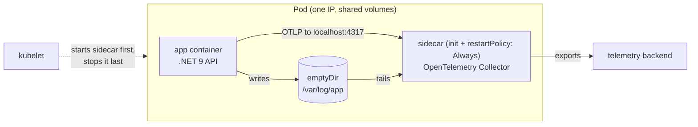

## Explanation

A sidecar is a second container that runs beside your application container inside the same scheduling unit (a Kubernetes Pod, an Amazon ECS task or an Azure Container Apps replica) and shares its fate. Kubernetes gives every container in a Pod the same network namespace, so they have one IP address, one port space and reach each other over `localhost`, and it lets them mount the same volumes; each container still has its own image, root filesystem and process tree. That combination is what makes the pattern work: the sidecar can see the application's traffic and files without being compiled into it. ECS tasks in `awsvpc` network mode and Container Apps replicas offer the same shared network and storage.

The pattern exists because a cross-cutting concern such as log shipping, metrics export, TLS termination, retries or secret retrieval has two unattractive homes. Built into the process it is fast but must be written in the application's language and can take the application down with it; run as a separate service it is language-neutral but a network hop away and deployed on its own schedule. Microsoft's Architecture Center positions the sidecar between those two: language independence, access to the same host resources, loopback latency, independent updates, and a lifecycle tied to the application instance.

Typical sidecars are an OpenTelemetry Collector receiving OTLP on `localhost:4317`, a Fluent Bit log router tailing a shared volume, a [service mesh](service-mesh.md) proxy terminating [mTLS](mtls.md), the Dapr runtime `daprd` exposing its building blocks over local HTTP or gRPC, a connection pooler in front of TimescaleDB, or an MCP server packaged next to an agent so its tools are reachable only over the loopback interface.

The Kubernetes mechanics matter because they changed. For years a sidecar was simply a second entry in `containers`, which had three defects that Istio documented: the application could start before the proxy was ready and lose its first connections, the proxy could exit before the application during shutdown, and a Job never completed because the sidecar kept running after the main container finished. Native sidecar containers fix all three. A sidecar is declared as an entry in `initContainers` with `restartPolicy: Always`. The feature appeared in v1.28, has been on by default since v1.29 and is stable (and locked on) since v1.33. The kubelet starts it in order with the other init containers and moves to the next one as soon as the sidecar's `started` state is true, which means a process is running when no startup probe is defined, or the startup probe succeeded. The sidecar then runs for the Pod's lifetime and restarts regardless of the Pod's `restartPolicy`; a readiness probe on it feeds the Pod's `Ready` condition; at termination the kubelet waits until the main containers have fully stopped and then stops sidecars in reverse declaration order; and a Job completes when its main container completes. Istio injects its proxy this way by default since Istio 1.27, and Linkerd since 2.20.



Elsewhere the same shape has different knobs. ECS orders containers with `dependsOn` conditions `START`, `COMPLETE`, `SUCCESS` and `HEALTHY`; `HEALTHY` requires a container [health check](health-check.md) on the dependency and is evaluated only at task startup, and shutdown reverses every dependency. FireLens, the ECS log-router sidecar, gets that ordering added automatically. Container Apps lists sidecars in the `containers` array and init containers in `initContainers`, and adds no default probes to sidecars. Docker Compose attaches a container to another service's network stack with `network_mode: "service:api"`.

## How it differs

**[Service mesh](service-mesh.md).** People say "sidecar" when they mean "Istio", but the two are separable in both directions. A mesh is a system (control plane plus data plane) whose per-pod proxy happens to be delivered as a sidecar, and Istio's ambient mode delivers the same mesh with no sidecar at all. Conversely most sidecars have nothing to do with a mesh: log routers, telemetry agents, secret fetchers, Dapr. Choose the pattern whenever a concern must share the application's network or files; choose a mesh only when the concern is service-to-service traffic policy.

**[Container isolation](container-isolation.md).** Isolation is the set of kernel mechanisms that keep containers apart; a sidecar is a deliberate hole in that separation. Containers in a Pod share the network and IPC namespaces and can share volumes, but not the PID namespace unless `shareProcessNamespace: true` is set, and never the root filesystem. A sidecar that needs `NET_ADMIN` to rewrite iptables (the classic `istio-init`) is therefore a security-review item, which is why meshes moved that work into a privileged node agent.

**[Readiness probe](readiness-probe.md).** Each container has its own probes; the application's readiness says nothing about the sidecar's. With native sidecars the sidecar's startup probe decides when the next init container may start, and its readiness probe is part of Pod readiness, so a telemetry sidecar with a broken readiness check will keep a perfectly healthy API out of the Service.

| Question | Sidecar pattern | Service mesh | Separate service | Library in-process |
| --- | --- | --- | --- | --- |
| Lives in the app's Pod/task | yes | often (sidecar mode) or no (ambient) | no | yes, in-process |
| Language of the concern | any | any | any | the app's |
| Added latency | loopback | loopback or node hop | network hop | none |
| Scales with | each app instance | each instance or each node | independently | the app |
| Changes app code | no | no | usually a client | yes |

The Architecture Center's own list of when not to use a sidecar is the practical tie-breaker: very small applications, components that must scale independently of the app, chatty interprocess communication, and platforms or sidecarless meshes that already provide the capability. The scheduler also charges for every sidecar: the effective Pod request is the larger of the sum of all app and sidecar containers and the highest single init container, plus Pod overhead.

## Examples

=== "Kubernetes"

    ```yaml
    apiVersion: apps/v1
    kind: Deployment
    metadata: { name: market-api }
    spec:
      replicas: 3
      selector: { matchLabels: { app: market-api } }
      template:
        metadata: { labels: { app: market-api } }
        spec:
          volumes:
            - { name: otel-config, configMap: { name: otel-sidecar } }
          initContainers:
            - name: otel-collector               # a native sidecar: init container that never "completes"
              image: otel/opentelemetry-collector-contrib:0.118.0
              restartPolicy: Always              # this one field makes it a sidecar
              args: ["--config=/etc/otel/config.yaml"]
              ports: [{ containerPort: 4317, name: otlp-grpc }]
              volumeMounts: [{ name: otel-config, mountPath: /etc/otel }]
              startupProbe:                      # gates the start of the app container
                tcpSocket: { port: 4317 }
                periodSeconds: 2
                failureThreshold: 15
              resources:
                requests: { cpu: 50m, memory: 64Mi }
                limits: { memory: 128Mi }
          containers:
            - name: api
              image: ghcr.io/example/market-api:2.3.0
              env:
                - { name: OTEL_EXPORTER_OTLP_ENDPOINT, value: "http://localhost:4317" }
              ports: [{ containerPort: 8080 }]
    ```

=== "C#"

    ```csharp
    // The application does not know a sidecar exists. It emits OTLP to the
    // default endpoint (http://localhost:4317), which the Collector sidecar owns.
    using OpenTelemetry;

    var builder = WebApplication.CreateBuilder(args);

    builder.Services.AddOpenTelemetry()
        .ConfigureResource(r => r.AddService("market-api"))
        .WithTracing(t => t.AddAspNetCoreInstrumentation().AddHttpClientInstrumentation())
        .WithMetrics(m => m.AddAspNetCoreInstrumentation().AddRuntimeInstrumentation())
        .UseOtlpExporter();   // honours OTEL_EXPORTER_OTLP_ENDPOINT; falls back to localhost:4317

    var app = builder.Build();
    app.MapGet("/quotes/{symbol}", (string symbol) => Results.Ok(new { symbol, bid = 101.2m, ask = 101.4m }));
    app.Run();
    ```

=== "Python"

    ```python
    # Same idea: the app speaks OTLP to localhost; the sidecar forwards it.
    from fastapi import FastAPI
    from opentelemetry import trace
    from opentelemetry.exporter.otlp.proto.grpc.trace_exporter import OTLPSpanExporter
    from opentelemetry.sdk.resources import Resource
    from opentelemetry.sdk.trace import TracerProvider
    from opentelemetry.sdk.trace.export import BatchSpanProcessor

    provider = TracerProvider(resource=Resource.create({"service.name": "market-api"}))
    provider.add_span_processor(BatchSpanProcessor(OTLPSpanExporter()))  # endpoint from env, default localhost:4317
    trace.set_tracer_provider(provider)

    app = FastAPI()

    @app.get("/quotes/{symbol}")
    async def quote(symbol: str) -> dict:
        with trace.get_tracer(__name__).start_as_current_span("lookup-quote"):
            return {"symbol": symbol, "bid": 101.2, "ask": 101.4}
    ```

=== "Docker Compose"

    ```yaml
    # Local stand-in for a Pod: the collector joins the api service's network namespace,
    # so the api still reaches it at localhost:4317.
    services:
      api:
        build: .
        environment:
          OTEL_EXPORTER_OTLP_ENDPOINT: http://localhost:4317
        ports: ["8080:8080"]
      otel-collector:
        image: otel/opentelemetry-collector-contrib:0.118.0
        network_mode: "service:api"      # share api's network stack; no ports/networks allowed here
        volumes: ["./otel.yaml:/etc/otelcol-contrib/config.yaml:ro"]
      redis:
        image: redis:7
    ```

=== "Azure"

    Azure Container Apps runs sidecars as additional entries in the `containers` array of the app template; they share disk, network and lifecycle with the main container, and the portal adds default probes only to the main container, never to sidecars. On AKS the Istio-based service mesh add-on injects `istio-proxy` as a native sidecar by default on clusters at Kubernetes 1.33 with revision `asm-1-29` or later; `kubectl get pods -o custom-columns=INIT:.spec.initContainers[*].name` shows `istio-init,istio-proxy` under INIT when it is active.

    ```yaml
    # Container Apps template excerpt: main container plus a log-shipping sidecar on a shared volume
    template:
      containers:
        - name: market-api
          image: ghcr.io/example/market-api:2.3.0
          resources: { cpu: 0.5, memory: 1Gi }
          volumeMounts: [{ volumeName: logs, mountPath: /var/log/app }]
        - name: log-shipper
          image: fluent/fluent-bit:3.2
          resources: { cpu: 0.25, memory: 0.5Gi }
          volumeMounts: [{ volumeName: logs, mountPath: /var/log/app }]
      volumes:
        - { name: logs, storageType: EmptyDir }
    ```

=== "AWS"

    ```json
    {
      "family": "market-api",
      "networkMode": "awsvpc",
      "requiresCompatibilities": ["FARGATE"],
      "cpu": "512", "memory": "1024",
      "containerDefinitions": [
        {
          "name": "api",
          "image": "123456789012.dkr.ecr.eu-west-1.amazonaws.com/market-api:2.3.0",
          "essential": true,
          "portMappings": [{ "containerPort": 8080, "protocol": "tcp" }],
          "logConfiguration": { "logDriver": "awsfirelens" },
          "dependsOn": [{ "containerName": "log_router", "condition": "HEALTHY" }]
        },
        {
          "name": "log_router",
          "image": "public.ecr.aws/aws-observability/aws-for-fluent-bit:stable",
          "essential": true,
          "firelensConfiguration": { "type": "fluentbit" },
          "healthCheck": {
            "command": ["CMD-SHELL", "curl -sf http://localhost:2020/api/v1/health || exit 1"],
            "interval": 5, "timeout": 2, "retries": 3, "startPeriod": 10
          }
        }
      ]
    }
    ```

    The `HEALTHY` condition is only honoured at task startup and requires the dependency to define a health check; at shutdown ECS stops containers in the reverse dependency order. For service-to-service traffic ECS Service Connect adds its own managed Envoy-based proxy container to each task.

## Misconceptions

- **"A sidecar is a service mesh."** A mesh may use sidecars, and the sidecar pattern may carry a mesh proxy, but most sidecars are log routers, telemetry agents, identity agents or Dapr. Istio's ambient mode is a mesh without sidecars.
- **"Kubernetes starts the sidecar before the app."** Only a native sidecar (an init container with `restartPolicy: Always`) has that guarantee. A second entry in `containers` has no ordering, which is exactly the bug class native sidecars were created to remove.
- **"A sidecar in a Job keeps the Job running forever."** That was true for legacy sidecars; a native sidecar lets the Job complete when the main container exits.
- **"Sidecars are free because they are small."** Every replica pays the sidecar's CPU and memory, the scheduler reserves it, and a 50 MiB proxy across 400 Pods is 20 GiB. The Architecture Center lists small apps and independently scaling components as cases where the cost outweighs the isolation.
- **"A sidecar can see everything the app does."** It sees the shared network and any shared volume. It does not see the app's processes (unless `shareProcessNamespace` is set), environment variables or root filesystem.

## Exam notes

CKAD and CKA test the mechanics directly: multi-container Pods, `kubectl logs <pod> -c <container>`, init containers versus sidecars, and since the native sidecar feature went stable, the `initContainers` plus `restartPolicy: Always` syntax. Expect a scenario where a Job never finishes or an app fails on startup because its proxy is not ready; the fix is to make the helper a native sidecar. CKS approaches the same Pod from the other side: a sidecar that needs `NET_ADMIN` and `NET_RAW` violates the restricted Pod Security Standard, which is why Istio offers a CNI node agent instead of `istio-init`.

AZ-305 and AZ-204 draw on the Architecture Center's cloud design patterns, where the trap is distinguishing sidecar from the ambassador and gateway patterns: an ambassador is a sidecar that proxies outbound calls on the app's behalf, a gateway sits in front of many services. Container Apps questions ask which containers share a replica's lifecycle and which get default probes.

AWS DVA-C02 and SAA-C03 cover ECS task definitions: `essential`, `dependsOn` conditions (and that `COMPLETE`/`SUCCESS` cannot apply to essential containers), FireLens as the log-router sidecar, and the fact that Fargate containers in one task share the network namespace and can talk over `localhost`. SAP-C03 adds ECS Service Connect, whose proxy is a managed sidecar.

## Self-check

??? question "Your .NET 9 API starts, immediately fails to reach Redis Streams through the Istio proxy, crashes, and only works on the second restart. What is happening and what is the clean fix?"
    The application container and the legacy `istio-proxy` container start with no ordering guarantee, so the app's first connections are made before the proxy's iptables redirection and listener are ready. The clean fix is native sidecars: run a Kubernetes version where `SidecarContainers` is on (1.29 or later, stable since 1.33) and let Istio inject the proxy as an init container with `restartPolicy: Always` (its default since Istio 1.27). The kubelet then waits for the proxy's startup probe before starting the app. Retry loops in the app or a `sleep` in the entrypoint are workarounds, not fixes.

??? question "A nightly Kubernetes Job runs a TimescaleDB compaction script with a Fluent Bit log-shipper container beside it. The script finishes in ten minutes but the Job is still Running the next morning. Why?"
    The log shipper is declared as a regular container, so the Pod stays Running as long as it runs, and a Job only completes when the Pod's containers terminate. Declare the shipper in `initContainers` with `restartPolicy: Always`: a native sidecar does not prevent Job completion, and the kubelet stops it after the main container exits, so the last log lines are still flushed.

??? question "Your team wants a shared metrics agent for 300 small Pods on each node and proposes a sidecar. What question should an architect ask first?"
    Whether the concern needs to share each application's network namespace or volumes. If it only needs node-level data (host metrics, container logs from the runtime), a DaemonSet or a per-node agent serves all 300 Pods for the cost of one process, which is the "scales independently" case the Architecture Center flags against sidecars. A sidecar is justified when the agent must receive the application's own traffic (OTLP over loopback, request-level metrics) or read files that only that Pod can see.

## Further reading

- [Docker & Containerization Trade-offs](../devops/docker-containerization.md), [Microservices vs. Modular Monoliths](../messaging/integration/microservices-vs-modular-monoliths.md) and [mTLS vs. API Keys](../security/iam/mtls-vs-api-keys.md) in this library.
- [MCP Tool Orchestration](../ai/protocols/mcp-tool-orchestration.md) for packaging tool servers beside an agent.
- Term pages: [Service Mesh](service-mesh.md), [Container Isolation](container-isolation.md), [Readiness Probe](readiness-probe.md), [Liveness Probe](liveness-probe.md), [Health Check](health-check.md).
- [Sidecar Containers](https://kubernetes.io/docs/concepts/workloads/pods/sidecar-containers/) and [Init Containers](https://kubernetes.io/docs/concepts/workloads/pods/init-containers/) (Kubernetes).
- [Sidecar pattern](https://learn.microsoft.com/en-us/azure/architecture/patterns/sidecar) (Azure Architecture Center) and [Native sidecar mode for the AKS Istio add-on](https://learn.microsoft.com/en-us/azure/aks/istio-native-sidecar).
- [Kubernetes Native Sidecars in Istio](https://istio.io/latest/blog/2023/native-sidecars/) and [Dapr sidecar overview](https://docs.dapr.io/concepts/dapr-services/sidecar/).
- [Using FireLens for Amazon ECS](https://docs.aws.amazon.com/AmazonECS/latest/developerguide/using_firelens.html) and [Fargate security considerations](https://docs.aws.amazon.com/AmazonECS/latest/developerguide/fargate-security-considerations.html) (AWS).
