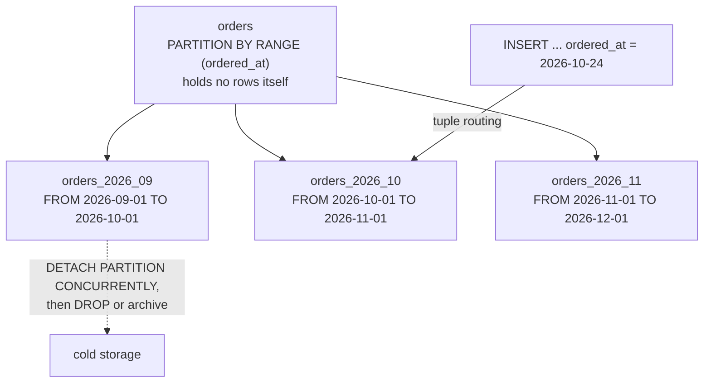

## Explanation

Table partitioning splits one logical table into several physical child tables, the *partitions*, by the value of a *partition key*. The parent, a *partitioned table*, stores no rows itself; it holds the key definition and the list of partitions with their bounds. Every row inserted through the parent is routed to the one partition whose bounds accept it (*tuple routing*), and a query against the parent is planned as a scan over the partitions that survive [partition pruning](partition-pruning.md).

PostgreSQL's built-in form is *declarative partitioning*, with three strategies. **Range** partitions own a contiguous interval, `FOR VALUES FROM ('2026-10-01') TO ('2026-11-01')`; the lower bound is inclusive and the upper exclusive, so `2026-11-01` belongs to the next partition, and `MINVALUE` and `MAXVALUE` express open ends. **List** partitions own an explicit set of values, `FOR VALUES IN ('EUR', 'GBP')`, and one list partition may accept `NULL`. **Hash** partitions take a modulus and remainder, `FOR VALUES WITH (MODULUS 4, REMAINDER 0)`; every modulus in use must divide the next larger one, which lets you grow from 8 to 16 partitions without moving all data at once. A `DEFAULT` partition (not for hash) catches rows that fit nowhere; without one such an insert fails. Partitions may themselves be partitioned, for example by month and then by region.

Indexes declared on the parent are *partitioned indexes*: a virtual definition with a real child index on every partition. There are no global indexes, which is why a unique or primary-key constraint must include every partition-key column: uniqueness is checked inside one partition only. `BEFORE ROW` insert triggers cannot redirect a row to another partition, and partitions cannot carry columns the parent lacks.

The documentation lists the reasons to bother: queries that touch one or a few partitions can run dramatically faster; bulk loads and deletes become `ATTACH PARTITION` and `DETACH PARTITION` or `DROP TABLE`, metadata operations instead of row-by-row work that bloats the heap and the [write-ahead log](write-ahead-log.md); and cold partitions can sit on cheaper tablespaces. Its rule of thumb for *when* is blunt: partition once the table would otherwise exceed physical memory. The rule for *how many* is to prune most of them: the planner copes with a few thousand partitions when typical queries exclude all but a handful, but each partition a session touches loads metadata into that session, and too many tiny partitions cost more than they save. Attaching a partition normally scans it to validate the bounds; a matching `CHECK` constraint added beforehand avoids the scan, and `DETACH PARTITION ... CONCURRENTLY` holds only a `SHARE UPDATE EXCLUSIVE` lock on the parent.

Before declarative partitioning, PostgreSQL used table inheritance plus `CHECK` constraints, trigger-based routing and the `constraint_exclusion` setting (default `partition`); it still works, but routes through slower triggers and nothing verifies that the constraints are disjoint. Nobody hand-creates monthly partitions for long: `pg_partman`, available on Azure Database for PostgreSQL and on Amazon RDS and Aurora, pre-creates partitions on a schedule and detaches or drops old ones, which is what a TimescaleDB [hypertable](hypertable.md) does natively (its chunks are extension-managed child tables, not declarative partitions). `VACUUM` and `ANALYZE` on a partitioned table recurse into its partitions; PostgreSQL 18 added an `ONLY` option to process just the parent, which matters because autovacuum never analyzes the partitioned parent itself, only its leaves.

In the reader's stack the candidates are the append-only, time-keyed tables that are not hypertables: audit logs, the [transactional outbox](transactional-outbox.md), event archives. Partition by month, index per partition, and let retention become `DETACH` followed by `DROP`.



## How it differs

**[Hypertable](hypertable.md)** is partitioning with the chores removed. A hypertable creates a chunk the moment a row needs one, sizes every chunk from a single interval setting, keeps chunk metadata in the extension's catalog, and attaches lifecycle policies (retention, columnstore conversion, reordering) to chunks. Declarative partitioning gives you the same shape but requires every partition to exist before its first row arrives; `pg_partman` closes most of the gap. Choose native partitioning for portability, list or hash as the primary scheme, or managed services without the extension; choose the hypertable for append-heavy time series where chunk management would otherwise be a job.

**[Partition pruning](partition-pruning.md)** is the reason partitioning is worth anything for reads, and it only fires when the query constrains the partition key in a form the planner can compare with the bounds. A partitioned table queried without such a predicate is a slower table: more relations to plan, more metadata to load, more child scans to append. Keep the two ideas separate when designing: pick the key from the predicates your queries actually use, then verify with `EXPLAIN` that pruning happens.

**[Row-oriented storage](row-oriented-storage.md)** is unchanged by partitioning. Each partition is a complete heap with its own pages, indexes and bloat; rows are routed between files, not re-laid-out within them. If the problem is a wide scan over few columns, partitioning only helps when the filter prunes; a columnar layout addresses the scan itself. Many systems combine both: partition by time, then convert old partitions to a columnar form.

**[Horizontal scaling](horizontal-scaling.md)** (sharding) divides data across *servers*; partitioning divides it across *files on one server*. They are often confused because distributed databases call their shards "partitions" (Azure Cosmos DB partition keys, DynamoDB partitions, Citus distributed tables). The test is simple: does a query for one key ever leave the machine? Partitioning never adds compute or memory; sharding does, at the cost of cross-shard joins and transactions.

**[Data retention policy](data-retention-policy.md)** is the business rule; partitioning is the mechanism that makes enforcing it cheap. Deleting a month of rows rewrites every tuple header, generates WAL per row and leaves dead tuples for vacuum; detaching and dropping the month's partition is instantaneous and leaves no bloat. A retention policy without partitioning is possible but expensive; partitioning without a retention policy just accumulates partitions.

| | Declarative partitioning | Hypertable | Sharding |
|---|---|---|---|
| Unit | Child table on one server | Chunk on one server | Database on another server |
| Creation | Declared in advance (or pg_partman) | Automatic on insert | Cluster configuration |
| Strategies | Range, list, hash, nested | Time range, optional hash dimension | Hash or range of a shard key |
| Adds capacity | No | No | Yes |
| Cross-unit query | Append of child scans | ChunkAppend | Network round trips |

## Examples

=== "SQL"

    ```sql
    -- Range partitioning by month; the primary key must include the partition key.
    CREATE TABLE orders (
        id         bigserial,
        ordered_at timestamptz NOT NULL,
        customer   text        NOT NULL,
        total      numeric(12,2),
        PRIMARY KEY (id, ordered_at)
    ) PARTITION BY RANGE (ordered_at);

    CREATE TABLE orders_2026_10 PARTITION OF orders
        FOR VALUES FROM ('2026-10-01') TO ('2026-11-01');
    CREATE TABLE orders_2026_11 PARTITION OF orders
        FOR VALUES FROM ('2026-11-01') TO ('2026-12-01');

    -- One definition, one physical index per partition.
    CREATE INDEX orders_customer_idx ON orders (customer, ordered_at);

    -- Bulk-load a month into a standalone table, then attach it without the
    -- validation scan: the matching CHECK constraint proves the bounds already.
    CREATE TABLE orders_2026_09 (LIKE orders INCLUDING DEFAULTS);
    -- ... COPY orders_2026_09 FROM ... ;
    ALTER TABLE orders_2026_09 ADD CONSTRAINT bounds
        CHECK (ordered_at >= '2026-09-01' AND ordered_at < '2026-10-01');
    ALTER TABLE orders ATTACH PARTITION orders_2026_09
        FOR VALUES FROM ('2026-09-01') TO ('2026-10-01');
    ALTER TABLE orders_2026_09 DROP CONSTRAINT bounds;   -- now redundant

    -- Retention as metadata: detach without blocking, then drop or archive.
    -- CONCURRENTLY cannot run inside a transaction block.
    ALTER TABLE orders DETACH PARTITION orders_2026_09 CONCURRENTLY;
    DROP TABLE orders_2026_09;

    -- List and hash strategies.
    CREATE TABLE invoices (id bigint, currency text, PRIMARY KEY (id, currency))
        PARTITION BY LIST (currency);
    CREATE TABLE invoices_eur PARTITION OF invoices FOR VALUES IN ('EUR');
    CREATE TABLE invoices_other PARTITION OF invoices DEFAULT;

    CREATE TABLE sessions (user_id bigint, started_at timestamptz, PRIMARY KEY (user_id, started_at))
        PARTITION BY HASH (user_id);
    CREATE TABLE sessions_0 PARTITION OF sessions FOR VALUES WITH (MODULUS 4, REMAINDER 0);
    CREATE TABLE sessions_1 PARTITION OF sessions FOR VALUES WITH (MODULUS 4, REMAINDER 1);
    CREATE TABLE sessions_2 PARTITION OF sessions FOR VALUES WITH (MODULUS 4, REMAINDER 2);
    CREATE TABLE sessions_3 PARTITION OF sessions FOR VALUES WITH (MODULUS 4, REMAINDER 3);
    ```

=== "C#"

    ```csharp
    // .NET 9 + Npgsql. EF Core maps Order to the parent table; partitioning is
    // invisible to the ORM. A hosted service pre-creates next month's partition
    // so inserts never arrive before their partition exists.
    public sealed class PartitionMaintenance(NpgsqlDataSource dataSource) : BackgroundService
    {
        protected override async Task ExecuteAsync(CancellationToken ct)
        {
            while (!ct.IsCancellationRequested)
            {
                var today = DateOnly.FromDateTime(DateTime.UtcNow);
                var first = new DateOnly(today.Year, today.Month, 1).AddMonths(1);
                var next  = first.AddMonths(1);

                // Partition bounds cannot be bind parameters; these values are generated, not user input.
                var ddl = $"""
                    CREATE TABLE IF NOT EXISTS orders_{first:yyyy_MM} PARTITION OF orders
                        FOR VALUES FROM ('{first:yyyy-MM-dd}') TO ('{next:yyyy-MM-dd}')
                    """;
                await using var cmd = dataSource.CreateCommand(ddl);
                await cmd.ExecuteNonQueryAsync(ct);

                await Task.Delay(TimeSpan.FromDays(1), ct);
            }
        }
    }
    ```

=== "Python"

    ```python
    # Python 3.12 + psycopg 3: compose the DDL safely with psycopg.sql.
    import datetime as dt
    import psycopg
    from psycopg import sql

    def ensure_month_partition(conn: psycopg.Connection, first: dt.date) -> None:
        nxt = (first.replace(day=28) + dt.timedelta(days=4)).replace(day=1)
        conn.execute(
            sql.SQL(
                "CREATE TABLE IF NOT EXISTS {part} PARTITION OF orders "
                "FOR VALUES FROM ({lo}) TO ({hi})"
            ).format(
                part=sql.Identifier(f"orders_{first:%Y_%m}"),
                lo=sql.Literal(first.isoformat()),
                hi=sql.Literal(nxt.isoformat()),
            )
        )

    with psycopg.connect(conninfo, autocommit=True) as conn:
        ensure_month_partition(conn, dt.date(2026, 12, 1))
    ```

=== "Azure"

    - **Azure Database for PostgreSQL flexible server**: native declarative partitioning plus the `pg_partman` extension (5.4.3 on PostgreSQL 16 to 18 at the time of writing) and its `pg_partman_bgw` background worker (or `pg_cron`) to run `run_maintenance()`; no superuser is needed, and the documentation recommends a dedicated role that owns the partition sets and the schemas where new partitions are created.
    - **Azure SQL Database, Managed Instance and SQL Server** partition tables and indexes through a *partition function* (the boundary values) and a *partition scheme* (which filegroups receive them); loading and ageing data uses partition switching, the SQL Server counterpart of `ATTACH` and `DETACH`.
    - **Azure Cosmos DB** "partition keys" are a different sense of the word: they decide which physical partition (shard) stores an item, so that is [horizontal scaling](horizontal-scaling.md), not table partitioning.

=== "AWS"

    - **Amazon RDS for PostgreSQL and Aurora PostgreSQL**: native partitioning and `pg_partman` (5.4.3 on the current PostgreSQL 18 releases); the same uniqueness and pruning rules apply, and partitioned tables are the standard RDS answer for time-series ingestion without an extension.
    - **Aurora PostgreSQL Limitless Database** distributes a table's rows across shards by a shard key; that is sharding across compute, the scale-out complement to in-database partitioning.
    - **Amazon Athena and AWS Glue** partition S3 data sets by key-value prefixes such as `dt=2026-10-24/`; queries that filter on the partition column read only those prefixes, and partition projection derives the partition list from a pattern instead of the catalog.
    - **Amazon DynamoDB** partitions are storage shards chosen by hashing the partition key; again a scaling mechanism, not a table layout you manage.

## Misconceptions

- **"Partitioning makes every query faster."** Only queries whose predicates let the planner prune benefit. An unfiltered or wrongly filtered query against a partitioned table plans more relations and appends more scans than the same query on one table.
- **"A unique index on the parent enforces global uniqueness."** There are no global indexes; a unique constraint must include the partition key and is checked within each partition. A globally unique `order_id` across monthly partitions needs the key to include `ordered_at` or an application-level guarantee.
- **"More partitions are always better."** Each partition adds planning time and per-session metadata; the documentation's advice is that neither "more" nor "fewer" is automatically right, and that a few thousand is manageable only when queries prune almost all of them.
- **"Range bounds are inclusive on both ends."** The upper bound is exclusive. Monthly partitions therefore run `FROM ('2026-10-01') TO ('2026-11-01')`, and a row stamped exactly at midnight on 1 November goes to November.
- **"Partitioning is sharding."** Partitions live on one server and add no capacity; sharding spreads data across servers. Cosmos DB, DynamoDB and Citus use "partition" for shards, which keeps the confusion alive.

## Exam notes

DP-300 is the exam that tests table partitioning most directly, in SQL Server terms: partition functions and schemes, aligned indexes, partition switching for sliding-window archiving, and why a partition-aligned clustered index matters. DP-900 asks only for the concept of splitting large tables. On AWS, DEA-C01 tests partitioning of S3 data for Athena and Glue (partition keys, partition projection, avoiding too many small partitions) and the distinction between Redshift distribution and sort keys, which are not partitions; SAA-C03 and SAP-C03 test partitioning mostly through DynamoDB partition-key design, a sharding sense of the word. AZ-305 and DP-420 test Cosmos DB partition-key choice, again sharding. The recurring trap across all of them is to answer a "slow large table" question with "partition it" when the real problem is a missing index or a scan-shaped query; and in PostgreSQL-flavoured questions, the requirement that unique keys include the partition column.

## Self-check

??? question "An audit table receives two million rows a day and a nightly job deletes rows older than 90 days, which now takes hours and leaves the table bloated. What do you change?"
    Partition the table by day or week on the timestamp column and replace the `DELETE` with `DETACH PARTITION ... CONCURRENTLY` followed by `DROP TABLE` (or archive) for partitions older than 90 days. The delete becomes a metadata operation that generates almost no WAL and leaves no dead tuples; use pg_partman or a scheduled job to pre-create future partitions.

??? question "You partition `orders` by month on `ordered_at` and try to keep the existing `PRIMARY KEY (id)`. PostgreSQL refuses. Why, and what are the options?"
    Partitioned tables have no global index, so a unique constraint must include every partition-key column; `PRIMARY KEY (id, ordered_at)` is the direct fix. If `id` must be globally unique on its own, generate it from a sequence or UUID so collisions are impossible by construction, or enforce uniqueness in the application, accepting that the database no longer guarantees it across partitions.

??? question "A colleague proposes hash-partitioning a customers table into 64 partitions 'so lookups by customer id are 64 times faster'. Evaluate."
    A lookup by primary key already goes through a B-tree whose depth barely changes with table size; splitting into 64 partitions saves at most a level or two while adding planning overhead to every query, and any query that does not filter on `customer_id` now appends 64 scans. Hash partitioning earns its keep for spreading writes or enabling partitionwise joins, not for point lookups.

## Further reading

- [High-Frequency Indexing & Partitioning](../data/time-series/high-frequency-indexing-partitioning.md) in this library
- [Relational Databases](../data/relational/relational-databases.md) in this library
- [The Outbox Pattern](../messaging/eventing/outbox-pattern.md) in this library, a natural candidate for time-based partitioning
- Term pages: [Hypertable (TimescaleDB)](hypertable.md), [Partition Pruning](partition-pruning.md), [Row-Oriented Storage](row-oriented-storage.md), [Horizontal scaling](horizontal-scaling.md), [Data retention policy](data-retention-policy.md)
- [Table Partitioning](https://www.postgresql.org/docs/current/ddl-partitioning.html) and [CREATE TABLE](https://www.postgresql.org/docs/current/sql-createtable.html), PostgreSQL documentation
- [constraint_exclusion and enable_partition_pruning](https://www.postgresql.org/docs/current/runtime-config-query.html), PostgreSQL documentation
- [Hypertables](https://www.tigerdata.com/docs/use-timescale/latest/hypertables), Tiger Data documentation, for the automated alternative
