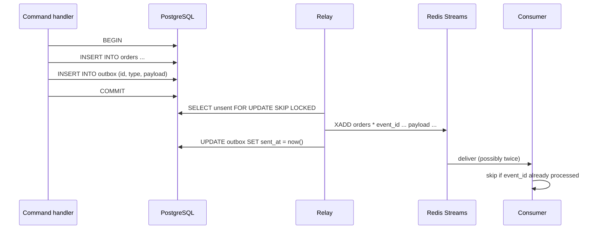

## Explanation

A service that changes its database and then announces the change to a message broker has a **dual-write problem**. Write to the database first and the process can die before the publish, leaving a change nobody hears about. Publish first and the transaction can roll back, leaving an announcement about something that never happened. Wrapping both in one distributed transaction (two-phase commit) is rarely available for brokers and couples the service to both resources. There is no ordering of the two writes that is safe.

The transactional outbox removes the second resource from the transaction. The handler writes the business change **and** a row describing the event into an `outbox` table, in the same local database transaction. Either both commit or neither does. A separate **message relay** then reads committed outbox rows and publishes them to the broker. The guarantee this buys is precise: *a message is published if and only if the transaction that produced it committed*, and messages are published in the order the application wrote them.

The relay comes in two shapes:

- **Polling publisher.** A background worker selects unsent rows (`SELECT ... FOR UPDATE SKIP LOCKED` lets several relay instances share the work), publishes them, then marks them sent or deletes them. It works with any SQL database; the costs are polling latency, extra read load, and care to preserve order.
- **Transaction log tailing.** A [change data capture](change-data-capture.md) tool such as Debezium watches the database's transaction log for inserts into the outbox table and publishes each one. There is no polling and latency is near real time. Because the connector reads the log rather than the table, the application can `INSERT` and immediately `DELETE` the outbox row in the same transaction; the insert still appears in the log and the table never grows. Debezium's outbox event router expects columns `id`, `aggregatetype`, `aggregateid`, `type` and `payload` by default (each name is configurable), routes by `aggregatetype`, copies `id` into an `id` header and keys messages by `aggregateid` so a Kafka partition keeps one aggregate's events in order.



What the outbox does **not** give you is exactly-once publishing. The relay can crash after publishing and before marking the row, so it publishes again; brokers can redeliver anyway. Delivery is therefore [at-least-once](at-least-once-delivery.md), and every consumer must be idempotent, most simply by recording processed event ids (the outbox `id`, carried as a header or field) and ignoring repeats. This is why the pattern is almost always paired with an [idempotency key](idempotency-key.md). NServiceBus packages both halves as its Outbox feature, storing outgoing messages with the business data and de-duplicating incoming messages by id; MassTransit's consumer outbox is likewise an inbox plus an outbox.

In this stack the pattern sits on the write path: a .NET 9 handler writes a trade into TimescaleDB and an outbox row in one Npgsql transaction; a hosted relay (or Debezium Server) pushes the event into a Redis Stream; downstream [consumer groups](consumer-group.md) react. Two housekeeping decisions matter from day one: how outbox rows are removed (delete after send, or a retention sweep, or the delete-in-same-transaction trick with log tailing), and what ordering column the relay uses (a sequence or a time-ordered id, not wall-clock timestamps alone). For document databases without multi-table transactions, the outbox becomes a property of the business document itself, so the relay reads events embedded in the records it tails.

## How it differs

**[Change data capture](change-data-capture.md).** Both avoid dual writes, but they publish different things. CDC emits the database's view (rows of `orders` with `before` and `after`), which leaks the schema to every consumer and forces them to reconstruct meaning. The outbox emits the application's view (`OrderPlaced` with a deliberate payload) and keeps the schema private. The two compose: tailing the log of the outbox table is the best relay. Pick plain CDC when you need every change of existing tables and cannot touch the code; pick the outbox when you are designing an event contract.

**[Exactly-once delivery](exactly-once-delivery.md).** The outbox solves atomicity between *state* and *intent to publish*. It says nothing about how many times the broker delivers. If you need the effect of each event to happen exactly once, you combine the outbox (no lost or phantom events) with idempotent consumers or a transactional consumer.

**[Idempotency key](idempotency-key.md).** The key lives on the other side of the broker: it is how a consumer (or an HTTP endpoint) neutralises duplicates. The outbox `id` is the natural idempotency key for everything downstream, which is why Debezium's router copies it into a message header.

**[Choreography](choreography.md).** A choreographed process is a chain of services reacting to one another's events with no coordinator. That style only works if every event that should exist does exist, which is exactly the outbox's job. The outbox is a mechanism inside one service; choreography is the system-level style that consumes its output. A missing outbox shows up as a flow that stops halfway with nobody to notice.

**[Write-ahead log](write-ahead-log.md).** The engine's log records physical changes for crash recovery; the outbox is an ordinary table you design. Log tailing joins them: a CDC connector reads the WAL to find outbox inserts. If you are willing to publish table-shaped events you can skip the outbox table and tail the business tables directly; the outbox earns its place when the event contract should not be your schema.

| Concern | Dual write | Transactional outbox | Outbox + CDC relay |
|---|---|---|---|
| Lost event after commit | Possible | No | No |
| Phantom event after rollback | Possible | No | No |
| Publish latency | Immediate | Poll interval | Near real time |
| Extra infrastructure | None | Relay worker | Debezium or equivalent |
| Duplicate publishes | Possible | Possible (relay retry) | Possible (offset replay) |
| Consumer must be idempotent | Yes | Yes | Yes |

## Examples

**Order placement.** The handler saves the order and an `OrderPlaced` outbox row in one transaction. A hosted service relays unsent rows into the `orders` Redis Stream every 200 ms, batching 100 at a time; the billing consumer group de-duplicates on `event_id`.

=== "SQL"

    ```sql
    CREATE TABLE outbox (
        seq            bigserial PRIMARY KEY,          -- relay order
        id             uuid        NOT NULL UNIQUE,    -- idempotency key downstream
        aggregate_type text        NOT NULL,
        aggregate_id   text        NOT NULL,
        type           text        NOT NULL,
        payload        jsonb       NOT NULL,
        occurred_at    timestamptz NOT NULL DEFAULT now(),
        sent_at        timestamptz NULL
    );
    CREATE INDEX outbox_unsent ON outbox (seq) WHERE sent_at IS NULL;
    ```

=== "C#"

    ```csharp
    // 1. Write state and event atomically (EF Core, Npgsql).
    public async Task PlaceAsync(PlaceOrder cmd, CancellationToken ct)
    {
        var order = Order.Place(cmd);
        db.Orders.Add(order);
        db.Outbox.Add(new OutboxMessage
        {
            Id = Guid.CreateVersion7(),           // time-ordered, .NET 9
            AggregateType = "order",
            AggregateId = order.Id.ToString(),
            Type = "OrderPlaced",
            Payload = JsonSerializer.Serialize(new OrderPlaced(order.Id, order.Total)),
        });
        await db.SaveChangesAsync(ct);            // one transaction, one commit
    }

    // 2. Relay: a BackgroundService that polls and publishes to Redis Streams.
    protected override async Task ExecuteAsync(CancellationToken ct)
    {
        while (!ct.IsCancellationRequested)
        {
            await using var scope = scopes.CreateAsyncScope();
            var db = scope.ServiceProvider.GetRequiredService<AppDb>();
            await using var tx = await db.Database.BeginTransactionAsync(ct);

            var batch = await db.Outbox
                .FromSql($"SELECT * FROM outbox WHERE sent_at IS NULL ORDER BY seq LIMIT 100 FOR UPDATE SKIP LOCKED")
                .ToListAsync(ct);

            foreach (var m in batch)
            {
                await redis.StreamAddAsync("orders", [
                    new NameValueEntry("event_id", m.Id.ToString()),
                    new NameValueEntry("type", m.Type),
                    new NameValueEntry("aggregate_id", m.AggregateId),
                    new NameValueEntry("payload", m.Payload)
                ], maxLength: 1_000_000, useApproximateMaxLength: true);
                m.SentAt = DateTime.UtcNow;       // crash here => published twice
            }
            await db.SaveChangesAsync(ct);
            await tx.CommitAsync(ct);
            if (batch.Count == 0) await Task.Delay(200, ct);
        }
    }
    ```

=== "Python"

    ```python
    # psycopg 3 + redis-py relay; the handler inserts into orders and outbox in one transaction.
    import json, time, psycopg, redis

    r = redis.Redis()

    def relay_once(conn: psycopg.Connection) -> int:
        with conn.transaction(), conn.cursor() as cur:
            cur.execute("""
                SELECT seq, id, type, aggregate_id, payload FROM outbox
                WHERE sent_at IS NULL ORDER BY seq LIMIT 100 FOR UPDATE SKIP LOCKED""")
            rows = cur.fetchall()
            for seq, event_id, type_, aggregate_id, payload in rows:
                r.xadd("orders", {"event_id": str(event_id), "type": type_,
                                  "aggregate_id": aggregate_id, "payload": json.dumps(payload)},
                       maxlen=1_000_000, approximate=True)
            if rows:
                cur.execute("UPDATE outbox SET sent_at = now() WHERE seq = ANY(%s)",
                            ([row[0] for row in rows],))
            return len(rows)

    with psycopg.connect(DSN) as conn:
        while True:
            if relay_once(conn) == 0:
                time.sleep(0.2)
    ```

=== "Azure"

    - With **Azure SQL** or **Azure Database for PostgreSQL**, run the relay as a hosted service in the API, or tail the log: Azure SQL CDC change tables, or Debezium against PostgreSQL logical decoding, feeding Service Bus or Event Hubs.
    - With **Azure Cosmos DB**, store the outbox entries inside the business document (same partition, one transactional write) and use the change feed, read by the change feed processor or an Azure Functions trigger, as the relay. The processor gives at-least-once semantics, so consumers still de-duplicate.
    - On the broker side, set the Service Bus `MessageId` to the outbox id and enable duplicate detection on the queue or topic; Service Bus then drops a relay retry inside the detection window (default 10 minutes, between 20 seconds and 7 days).

=== "AWS"

    - With **DynamoDB**, write the outbox item in the same `TransactWriteItems` call as the business item, enable DynamoDB Streams and let a Lambda event source mapping relay to EventBridge, SNS or SQS. Streams records each change once, in order per item, for 24 hours.
    - With **Aurora or RDS PostgreSQL**, either poll from a Fargate or Lambda relay, or run Debezium on Amazon MSK Connect against the outbox table.
    - When the target is an **SQS FIFO** queue, pass the outbox id as `MessageDeduplicationId`; SQS discards a relay retry within the five-minute deduplication interval, and `MessageGroupId = aggregate id` preserves per-aggregate order.

## Misconceptions

- **"The outbox makes publishing exactly-once."** It makes publishing *atomic with the commit*. The relay can still publish a row twice (crash between publish and mark), so consumers must de-duplicate on the event id.
- **"Publishing after `SaveChanges` is good enough if I retry."** A retry loop cannot help when the process dies between commit and publish; the event is simply gone. The outbox is the only local-transaction fix for that gap.
- **"The outbox table has to be polled."** Log tailing with Debezium reads the transaction log, lets you delete the row in the same transaction you inserted it, and publishes within milliseconds.
- **"Message ordering comes for free."** The relay must order by a sequence or time-ordered id, batch per aggregate, and key the broker message by aggregate id; a naive multi-instance relay can publish events of one aggregate out of order.
- **"Document databases cannot use it."** They can, by embedding the pending events in the document written atomically, then tailing the change feed; the relay just reads events from documents instead of a table.

## Exam notes

The outbox shows up in architecture exams as the answer to "how do I update my database and publish an event without losing either": AZ-305 and SAP-C03 phrase it around messaging reliability and avoiding distributed transactions, and iSAQB CPSA-A treats it as a standard integration tactic. DVA-C02 and DVA-C03 approach it from the AWS side through DynamoDB Streams or a FIFO queue's deduplication id as the relay and de-duplication tools, and DP-420 through the Cosmos DB change feed as a relay. The traps are reading "outbox" as exactly-once delivery, proposing two-phase commit to a broker that does not support it, and forgetting that the relay itself introduces duplicates that consumers must handle.

## Self-check

??? question "A handler saves an order, then publishes OrderPlaced to Redis Streams, and the team adds retries around the publish. Last week an order existed with no downstream fulfilment. Which failure mode slipped through, and what is the fix?"
    The process (or pod) died after the commit and before the publish; no number of retries runs after a crash. Store the event in an outbox row inside the same transaction as the order and let a relay publish it afterwards. Fulfilment must de-duplicate on the event id, because the relay is at-least-once.

??? question "Your relay runs as three replicas and events for the same order sometimes arrive reversed. What went wrong and how do you fix it without going back to one replica?"
    The replicas select overlapping or interleaved rows and publish independently, so per-aggregate order is not preserved. Order by a sequence column, use `FOR UPDATE SKIP LOCKED` so each replica owns distinct rows, and key the stream or partition by aggregate id so one aggregate's events are serialised; alternatively let a single Debezium connector tail the log, which preserves commit order.

??? question "You adopt Debezium for the outbox table and worry it will grow forever. What is the cheapest cleanup?"
    Delete the row in the same transaction that inserted it. The connector reads the transaction log, where the insert is still recorded, so the event is still published while the table stays empty.

## Further reading

- [Outbox Pattern vs. Dual-Write](../messaging/eventing/outbox-pattern.md) is the deep dive on this trade-off, including polling versus CDC relays.
- [Delivery Semantics](../messaging/eventing/delivery-semantics.md) explains why consumers stay idempotent even with an outbox.
- [Redis Streams vs. Kafka](../messaging/eventing/redis-streams-vs-kafka.md) for choosing the relay target.
- Terms: [Change data capture](change-data-capture.md), [Idempotency key](idempotency-key.md), [At-least-once delivery](at-least-once-delivery.md), [Dead-letter queue](dead-letter-queue.md).
- [Pattern: Polling publisher](https://microservices.io/patterns/data/polling-publisher.html) and [Pattern: Idempotent consumer](https://microservices.io/patterns/communication-style/idempotent-consumer.html).
