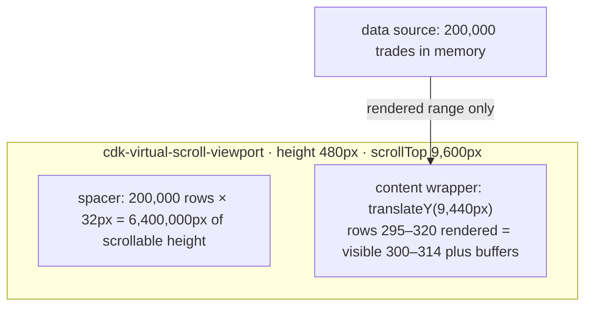

## Explanation

Virtual scrolling, also called windowing, renders only the slice of a list that can currently be seen, plus a buffer above and below it, while giving the scroll container the *geometry* of the full list so that the scrollbar, the scroll position and keyboard navigation behave as if every row existed. Three parts make it work: a viewport element of fixed size that scrolls; a spacer that sets the total scrollable size (item count multiplied by item size when rows are uniform); and a content wrapper holding the rendered rows, shifted into place with a CSS `transform` so the visible rows line up with the scroll offset. As the user scrolls, a strategy recomputes the *rendered range*, creates the rows entering the window and recycles the rows leaving it. The DOM holds a few dozen elements whether the data has 500 or 5 million rows.

The Angular implementation is `@angular/cdk/scrolling` (`ScrollingModule`, or its standalone directives). `<cdk-virtual-scroll-viewport>` wraps the list and `*cdkVirtualFor` replaces `@for` inside it. Setting `itemSize` in pixels selects `FixedSizeVirtualScrollStrategy`, which never measures rows and is therefore the fast path. `minBufferPx` (default 100) is the buffer the viewport must keep rendered beyond the visible area; when it drops below that, rows are rendered up to `maxBufferPx` (default 200). `*cdkVirtualFor` accepts an array, an `Observable<T[]>` or a `DataSource` whose `connect` and `disconnect` are the places to subscribe and clean up; it supports `trackBy`, exposes `index`, `count`, `first`, `last`, `even` and `odd` relative to the data rather than to the rendered window, and caches detached row templates for reuse (`cdkVirtualForTemplateCacheSize`, default 20; `0` disables caching for memory-heavy rows). `orientation`, `appendOnly` (keep rendered rows once created), `scrollToIndex()`, the `scrolledIndexChange` output, and `scrollWindow` or `cdkVirtualScrollingElement` for scrolling the window or an ancestor complete the API. Rows of unknown or varying height need a strategy that estimates and corrects: the CDK's `autosize` strategy lives in `@angular/cdk-experimental/scrolling`, is documented as not ready for production and supports neither `scrollToIndex` nor `scrolledIndexChange`. Implement `VirtualScrollStrategy` and provide it as `VIRTUAL_SCROLL_STRATEGY` on the hosting component to write your own.

Why it exists: DOM size is the ceiling. Style recalculation, layout, paint and hit testing scale with node count, and so does [change detection](angular-change-detection.md): an OnPush row is cheap to skip but not free, and a 100,000-row `@for` costs 100,000 views to create and destroy. Virtualisation makes cost proportional to the viewport, which is what a trade blotter, an order book or a log tail needs when Redis Streams or SignalR deliver updates hundreds of times a second (see [real-time UI streaming](../frontend/realtime/real-time-ui-streaming.md)). It is distinct from *infinite scroll*, which loads more data as the user nears the end but keeps rendering everything, and from *pagination*, which bounds the data rather than the DOM; the three combine well.

The browser now offers a lighter alternative for mostly static content. CSS `content-visibility: auto` (CSS Containment Level 2; Baseline, that is available in all three engines, since Safari 18 shipped it in September 2024) lets the engine skip layout and paint for off-screen subtrees while keeping them in the DOM and the accessibility tree, with `contain-intrinsic-size` providing a placeholder size so the scrollbar stays stable. It removes rendering cost, not node cost, so it suits long documents more than million-row grids.

The costs: rows need predictable sizes or a measuring strategy; find-in-page, select-all and screen readers only see the rendered rows; `index` arithmetic confuses people who expect the rendered position; and a row component keeps per-row state across recycling only if `trackBy` keeps identities stable.



## How it differs

**[Angular Change Detection](angular-change-detection.md).** Change detection decides how often the views that exist are re-checked; virtual scrolling decides how many exist. They are orthogonal and both matter for a live list. OnPush rows with immutable updates (or signals) stop a message storm from re-checking every row, but if 50,000 rows are in the DOM the browser still lays them out and the few ticks that do run still visit them. Virtualising the list caps the DOM at the viewport, but if the rows are `Eager` and the state lives in plain fields, every tick still re-checks every rendered row, and under Zone.js every message is a tick. The order of fixes is usually: `trackBy` first (so recycling and diffing work), then OnPush or signals (so ticks are cheap), then virtualisation (so the DOM is small), and only then measure again.

**[Backpressure](backpressure.md).** Backpressure acts on the producer side: it throttles, samples, buffers or drops messages so the consumer is not flooded. Virtual scrolling acts on the render side and assumes the consumer already holds the whole data set in memory; it says nothing about the rate at which that set changes. A blotter receiving 2,000 trades a second needs both: `bufferTime` or `auditTime` upstream so the array is replaced a few times a second, and a virtual viewport so each replacement renders a window rather than the history. Virtualisation without backpressure still re-renders the visible window on every message; backpressure without virtualisation still grows the DOM without bound.

| Technique | Bounds | Data in memory | Keeps DOM for off-screen rows | Best for |
|---|---|---|---|---|
| Pagination | Data per page | One page | n/a | Search results, admin tables |
| Infinite scroll | Nothing (grows) | Everything loaded so far | Yes | Feeds where users rarely scroll far |
| Virtual scrolling | DOM to the viewport | Everything, or a paging `DataSource` | No (recycled) | Grids, blotters, logs, long selects |
| `content-visibility: auto` | Layout and paint work | Everything | Yes (skipped, still in DOM) | Long static documents |
| Backpressure | Update rate | Depends | n/a | Any push feed |

## Examples

=== "TypeScript"

    ```typescript
    // A trade blotter: 200,000 rows in a signal, about 20 rows in the DOM.
    import { ChangeDetectionStrategy, Component, inject, signal } from '@angular/core';
    import { takeUntilDestroyed } from '@angular/core/rxjs-interop';
    import { CdkFixedSizeVirtualScroll, CdkVirtualForOf, CdkVirtualScrollViewport } from '@angular/cdk/scrolling';
    import { TradeFeed } from './trade-feed';

    export type Trade = { id: number; price: number; qty: number; at: number };

    @Component({
      selector: 'app-blotter',
      changeDetection: ChangeDetectionStrategy.OnPush,
      imports: [CdkVirtualScrollViewport, CdkFixedSizeVirtualScroll, CdkVirtualForOf],
      styles: `.viewport { height: 480px; } .row { height: 32px; display: flex; gap: 1rem; }`,
      template: `
        <cdk-virtual-scroll-viewport class="viewport" [itemSize]="32" [minBufferPx]="160" [maxBufferPx]="480">
          <div class="row" *cdkVirtualFor="let t of trades(); trackBy: byId; let i = index">
            <span>{{ i }}</span><span>{{ t.price }}</span><span>{{ t.qty }}</span>
          </div>
        </cdk-virtual-scroll-viewport>
      `,
    })
    export class Blotter {
      readonly trades = signal<Trade[]>([]);
      readonly byId = (_: number, t: Trade) => t.id;   // keeps row identity across recycling

      constructor() {
        // Batches arrive a few times a second (backpressure applied upstream);
        // each batch replaces the array, which is one notification and one window render.
        inject(TradeFeed).batches$
          .pipe(takeUntilDestroyed())                       // unsubscribe when the blotter is destroyed
          .subscribe(batch => this.trades.update(list => list.concat(batch)));
      }
    }
    ```

    ```typescript
    // A DataSource over a hot stream: *cdkVirtualFor calls connect(), and disconnect()
    // runs when the viewport is destroyed, which is where subscriptions are released.
    import { CollectionViewer, DataSource } from '@angular/cdk/collections';
    import { Observable, bufferTime, filter, scan, shareReplay } from 'rxjs';
    import type { Trade } from './blotter';

    export class TradeSource extends DataSource<Trade> {
      private readonly rows$: Observable<Trade[]>;

      constructor(trades$: Observable<Trade>) {
        super();
        this.rows$ = trades$.pipe(
          bufferTime(50),                                          // thin the hot stream: one array per 50 ms
          filter(batch => batch.length > 0),
          scan((rows, batch) => rows.concat(batch), [] as Trade[]),
          shareReplay({ bufferSize: 1, refCount: true }),          // late viewers get the current list
        );
      }

      connect(_viewer: CollectionViewer): Observable<Trade[]> { return this.rows$; }
      disconnect(): void { /* refCount: true tears the shared subscription down */ }
    }
    ```

=== "CSS"

    ```css
    /* A long, mostly static page (a daily report with hundreds of sections): keep every
       node in the DOM but let the browser skip layout and paint for off-screen sections. */
    .report-section {
      content-visibility: auto;
      contain-intrinsic-block-size: auto 640px;   /* placeholder height; `auto` remembers the real one */
    }
    ```

## Misconceptions

- **"Virtual scrolling reduces the data you load."** It reduces the DOM, not the data; the full array is still in memory unless the `DataSource` pages the backend. Pagination and infinite scroll bound the data; virtualisation bounds the elements.
- **"Every list should be virtualised."** Below a few hundred simple rows the viewport, the fixed height and the lost native behaviours (find-in-page, select-all, screen-reader row counts) cost more than they save. Measure first; virtualise the lists that are large *and* live.
- **"Infinite scroll is virtual scrolling."** Infinite scroll appends to a list that keeps growing in the DOM; it solves "load more", not "render less". A long session on an infinite feed is exactly the case that needs virtualisation.
- **"`content-visibility: auto` makes virtual scrolling obsolete."** It skips rendering work for off-screen content but leaves every node in the DOM, so memory, initial parse and script-driven updates still scale with the list. It is the right tool for long documents, not for a million-row grid.
- **"`index` inside `*cdkVirtualFor` is the rendered row number."** It is the index in the data source, as are `first`, `last`, `even` and `odd`; the rendered range is an implementation detail exposed through `getRenderedRange()`.

## Exam notes

Virtual scrolling is not on any certification syllabus; it belongs to front-end performance interviews and to the design reviews of real-time screens. The questions that separate answers are the order of remedies for a slow live grid (`trackBy`, OnPush or signals, then virtualisation, with [backpressure](backpressure.md) upstream), why fixed row heights are worth fighting for (no measurement, `scrollToIndex` works), and what breaks for users (accessibility, find-in-page, selection) so that the choice is justified rather than reflexive. A common trap is to present `content-visibility` as a drop-in replacement; it is an alternative with a different cost model.

## Self-check

??? question "A trade blotter renders 30,000 rows with `@for` and OnPush rows, and still drops to ten frames per second during the market open. The team wants to switch to signals first. Is that the right next step?"
    No. The rows are already OnPush, so change detection is not visiting them unnecessarily; the cost is the DOM itself: 30,000 row elements to lay out, paint and hit-test on every scroll and every array replacement, plus the views Angular creates and destroys as trades arrive. Switching the array to a signal changes how the update is scheduled, not how many rows exist. Wrap the list in `cdk-virtual-scroll-viewport` with a fixed `itemSize`, keep `trackBy` on the id so recycled rows keep their identity, and batch the feed upstream with `bufferTime` so the array is replaced a few times a second. Signals can come with that change (the viewport reads an array signal happily), but they are not the fix.

??? question "Rows in a virtualised order history have variable heights because some contain a multi-line note. The product owner wants `scrollToIndex` to jump to a given order. What are the options?"
    Variable heights are the one thing the fixed-size strategy cannot do, and the CDK's `autosize` strategy, which estimates and corrects sizes, is experimental and explicitly does not support `scrollToIndex`. The options are: make the rows uniform (truncate the note to one line with an expand action, which is the cheapest and usually the best user experience); render a fixed-height row that shows the note in an overlay; or write a custom `VirtualScrollStrategy` that measures rendered rows, keeps a prefix sum of known heights and estimates the rest, which is real work but gives you `scrollToIndex`. Picking autosize and promising `scrollToIndex` is the mistake to avoid.

??? question "An accessibility audit reports that the screen reader announces 'list with 25 items' for a virtualised list of 12,000 entries and that find-in-page cannot locate rows below the fold. Is this fixable?"
    Partly. The rendered DOM really does contain about 25 rows, so native find-in-page cannot search what is not there; offer an in-app search or filter instead. For assistive technology, expose the true size with ARIA: `aria-rowcount` or `aria-setsize` on the container and `aria-rowindex` or `aria-posinset` on each rendered row, using the data `index` and `count` that `*cdkVirtualFor` provides, so the reader announces the real position and total. If the list is mostly static and only moderately long, `content-visibility: auto` is the alternative that keeps every row in the DOM and the accessibility tree, at the cost of memory rather than discoverability.

## Further reading

- [Real-time UI streaming](../frontend/realtime/real-time-ui-streaming.md) and [Angular: architectural trade-offs](../frontend/angular/angular-fundamentals.md) in this library
- [Angular Change Detection](angular-change-detection.md), [Backpressure](backpressure.md), [Angular Signals](angular-signals.md) and [Hot Observable](hot-observable.md)
- [Angular CDK scrolling](https://material.angular.dev/cdk/scrolling/overview) documentation
- [CSS Containment Module Level 2](https://www.w3.org/TR/css-contain-2/) (W3C) and [content-visibility](https://web.dev/articles/content-visibility) on web.dev
